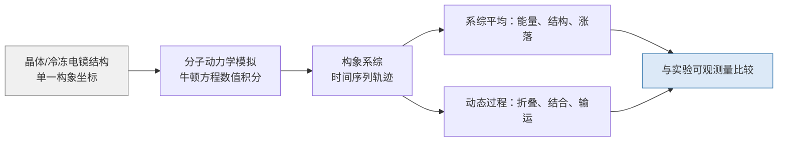
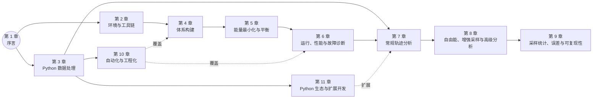
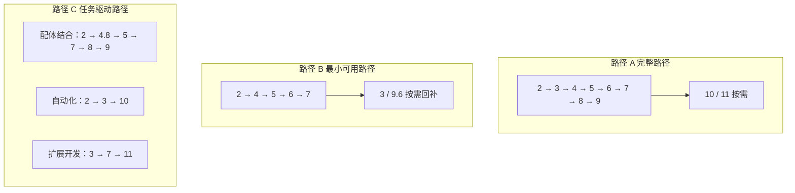

# 第 1 章 序言

分子动力学（molecular dynamics，MD）通过数值积分牛顿运动方程，在计算机上重现体系的原子的运动轨迹，再以统计力学为依据从轨迹中提取热力学与动力学性质[1]。这一方法自 1950 年代末提出以来，已从液体的物理研究工具成长为覆盖蛋白质、核酸、脂膜、材料与纳米体系的标准计算手段；GROMACS 作为其中使用最广泛的开放源代码软件之一，其并行性能与功能完整性使其同时适用于入门教学与大规模生产计算[1-2]。然而，模拟结果的可信度并不由软件本身保证：力场与算法的近似边界、采样是否充分、参数设置是否自洽、结果是否可复现，这些环节的失误都会让一段看似正常的轨迹产生误导性结论[3]。本书旨在把这些环节逐一讲清：既给出可照做的操作流程，也给出判断操作是否正确的判据。

本书的章节安排遵循「先搭环境、再造体系、再跑模拟、再分析、再进阶」的递进关系。第 2 章建立 GROMACS 2026.x（当前 2026.4）与 Python 3.12 及以上的可复现运行环境；第 3 章补齐 Python 数据处理与作图的最小集；第 4 至 6 章完成从结构文件到平衡轨迹的构建、运行与诊断；第 7 至 9 章处理轨迹分析、自由能与增强采样、统计误差与可复现性；第 10 至 11 章把流程自动化并扩展到 Python 生态与机器学习势。第 1 章作为全书入口，不涉及具体操作，而是回答四个前置问题：分子动力学能算什么、本书解决什么问题、读者需要哪些知识、全书按什么路线阅读。凡涉及软件行为与默认值，本章均以 GROMACS 2026.4 官方文档为依据并在正文标明[2]；未经本机实测的推断一律注明，读者可在自己的目标机器上复现核验。

## 学习目标

- 能说明分子动力学与静态结构方法在认识论上的差异，并用自己的话区分「可计算的量」与「可解释的量」。
- 能列举经典力场方法的四项核心近似及其各自的失效场景，判断给定研究问题是否落在经典方法适用边界内。
- 能按照本书的贯穿案例，复述鸡卵清溶菌酶体系的选择理由，并说明该案例在第 4 至 8 章中的推进线索。
- 能陈述 GROMACS 2026.4 版本基线、平台矩阵与三种安装路线的取舍依据，并为给定硬件组合选出初始方案。
- 能依据第 1 章给出的三条阅读路径，为自己规划一条与实际任务匹配的阅读顺序。
- 能复述本书的单位约定、命令书写规范与引用体例，按 GB/T 7714-2015 格式著录一条 GROMACS 文献。

## 前置知识

- 本科水平的化学、物理或生物学基础：能理解原子、分子、分子间作用力与温度、压力的概念（不支持者的知识缺口由 1.3 节自测清单定位）。
- 基础统计力学概念：系综、配分函数、系综平均与热力学量的统计定义；不熟悉者可在阅读第 2、5、9 章时按需回顾。
- 线性代数与微积分基础：能理解坐标、力、梯度与数值积分的含义；第 7 至 9 章涉及矩阵与统计估计时以此为前提。
- 后续章节对本章的依赖：第 2 章沿用的版本基线、平台矩阵与安装路线取舍直接沿用本章（1.5 节）约定；第 3 至 11 章的单位、符号与引用体例均以 1.7 节为准。

## 1.1 分子动力学的学科位置

### 1.1.1 从静态结构到构象系综

结构生物学长期以「一张照片」的方式描述生物大分子：X 射线晶体学与冷冻电镜给出体系在特定条件下占据率最高的构象，其成果是结构数据库（Protein Data Bank，PDB）中的坐标文件。1965 年 Blake 等人发表的鸡蛋清溶菌酶 2 Å 分辨率晶体结构，是这一范式的早期里程碑，它把酶的活性位点与底物结合机制落实到原子坐标上[4]。静态结构承载的信息是几何的：哪些残基彼此邻近、哪个口袋容纳底物、哪些氢键稳定二级结构。但蛋白质在生理条件下并非静止：侧链旋转、环区开合、整体折叠与去折叠、配体结合与解离，这些过程在时间上跨越皮秒到毫秒，在空间上涉及局部涨落到整体重排。一个问题由此产生：静态坐标能否承载对这些过程的理解？

热力学与统计力学给出的答案是否定的。宏观可观测量的理论对应物是系综平均而非单一构型的几何量：温度对应于动能系综平均，压力对应于维里式的时间平均，自由能则经由配分函数的对数给出。单一晶体构象至多提供势能面的一个抽样点，无法给出布居、涨落与熵的信息。分子动力学填补的正是这一空缺：它对 N 个粒子的牛顿运动方程作数值积分，产生一条时间序列坐标轨迹，在遍历性假设下用轨迹的时间平均逼近系综平均。1967 年 Verlet 对 Lennard-Jones 流体的分子动力学计算奠定了这一方法的算法骨架：中心差分积分（其蛙跳式与速度 Verlet 等价变体）、周期性边界、截断势与热力学性质估计，此后六十年间方法组件不断扩展，但「由轨迹估计统计性质」的核心逻辑未变[5]。图 1-1 给出从静态结构到构象系综的认识论路径。



图 1-1　从静态结构到构象系综的认识论路径（示意图）

### 1.1.2 可计算量与可解释量的区分

把「模拟算出了什么」与「结果意味着什么」分开，是使用分子动力学的第一项方法学纪律。从轨迹可以直接计算的量包括：各能量项的时间序列、径向分布函数、均方位移、回转半径、二级结构占比，以及通过专门流程估计的自由能差。这些量的共同特征是「在给定力场与算法参数下可精确复现」，属于可计算量。可解释量则是可计算量与实验观测之间的对应关系：例如模拟温度下的水密度是否落在实验值附近、计算结合自由能能否重现实验测得的解离常数、模拟结构与晶体结构的主链均方根偏差是否稳定。可解释量成立的前提是模型误差与统计误差都被控制：力场描述的是真实体系的近似，轨迹长度决定统计精度，两者任一失控，可计算量与可解释量即脱节。

对同行而言，把模拟结论的误差来源分解为三类，比笼统的「误差」更有操作性：**模型误差**（力场形式与参数、水模型、近似层次对真实体系的偏离）、**算法误差**（积分器步长、截断与长程近似、约束算法引入的离散化偏差）与**采样误差**（轨迹长度、自相关、遍历性不足导致的统计不确定度）。三者对应不同的归责与修复路径：模型误差靠更换或校准势能模型，算法误差靠调整数值参数并做收敛测试，采样误差靠延长轨迹或增强采样。进一步的验证分工也遵循同一框架：verification（验证）回答「数值求解是否正确」——算法与采样层面的误差是否被控制；validation（确认）回答「模型是否与实验吻合」——模型误差是否可接受。本书第 4 章处理模型选择（力场与水模型）、第 5 章处理算法参数（步长、截断、约束）、第 9 章处理采样误差，各章的参数四问正是把误差分解落到具体决策上的执行方式。报告任何一个模拟量时，应至少并列以下条件：力场及其版本、水模型、截断与 PME 设置、体系组成与盒尺寸、总时长与有效样本数、误差估计方法——这份清单在本节确立，第 9 章 9.6 节系统化为记录规范。

Frenkel 在《模拟的暗面》一文中系统归纳了误用统计方法的典型陷阱，其中一类正与本节的区分对应：把可由系综平均得到的量（如势能）与无法由单点取样得到的量（如熵、自由能）混为一谈，或把「算出了数值」直接等同于「解释了现象」[6]。Allen 与 Tildesley 的著作把这一纪律落实为教科书级表述：任何由模拟得到的量都必须说明其定义、统计估计方式与近似层次，才能进入与实验的比较[7]。本书第 5、8、9 章分别处理能量项解读、自由能与增强采样、统计误差与可复现性，其共同前提都是本小节确立的区分：先回答「算的是什么」，再回答「意味着什么」。

### 1.1.3 经典力场方法的适用边界

经典分子动力学建立在四项核心近似之上，每一项都给出方法能力的边界。其一，Born-Oppenheimer 近似被隐式采用：电子自由度不出现在运动方程中，其效应被折叠进势能函数，故经典 MD 不能描述电子转移、激发态与断键成键的化学反应。其二，相互作用以固定的函数形式与参数描述：成键项（键伸缩、键角、二面角）与范德华项（Lennard-Jones）、静电项（点电荷 Coulomb）构成力场（force field），各类力场针对不同分子类别设计，参数不可跨力场混用[8-10]。其三，运动方程以经典力学积分：核的量子效应（隧穿、零点能）被忽略，氢转移等过程须借助路径积分或混合量子力学/分子力学（QM/MM）方法处理。其四，有限采样代替无穷系综：轨迹长度决定了时间平均对系综平均的逼近程度，这一近似由第 9 章的统计方法管理。

在上述近似内部，经典 MD 的标准算法组件已相当成熟，且各自带有适用条件。时间积分以蛙跳或 velocity-Verlet 形式进行[5]；为允许 2 fs 量级的时间步长，键长约束由 SHAKE 或 LINCS 算法维持[11-12]；恒温控制从 Berendsen 弱耦合发展到 Nosé-Hoover 与 v-rescale，前者以修正系综分布为代价换取快速松弛，后两者生成正确的正则系综[13-16]；恒压控制以 Parrinello-Rahman 为代表的扩展系综方法实现[17]；长程静电由 particle mesh Ewald（PME）方法以近似 O(N log N) 的计算量处理[18]。每个组件的选择都影响结果的正确性与效率，第 5 章将对温控与压控的适用场合逐一讨论，第 11 章给出积分器、约束与 PME 的原理回顾。表 1-1 归纳经典方法的主要适用场景与典型失效场景。

表 1-1　经典力场方法的适用边界与典型失效场景

| 近似层次 | 适用场景 | 典型失效场景 | 处置方向 |
| --- | --- | --- | --- |
| Born-Oppenheimer 折叠 | 构象平衡、非共价结合、输运 | 化学反应、激发态、电荷转移 | QM/MM 或反应力场（见第 11 章） |
| 固定力场函数形式 | 标准氨基酸/核酸/脂质/水 | 新型小分子、金属配位、多极效应 | 配体参数化（第 4 章 4.8 节）、更高保真势（极化力场/机器学习势，第 11 章）或粗粒化 |
| 截断与长程近似 | 常规库仑/范德华处理（PME 等） | 强长程效应（带电体系、界面）、偶极矩敏感体系 | PME 参数调优（第 4 章 4.6 节）或改用显式极化势 |
| 经典核运动 | 大多数室温过程 | 氢转移、隧穿主导的同位素效应 | 路径积分或量子动力学 |
| 有限采样 | 皮秒至微秒级过程 | 毫秒级折叠、稀有事件 | 增强采样（第 8 章）与统计检验（第 9 章） |

力场的适用范围同样构成边界的一部分。全原子力场如 CHARMM36m 面向折叠与无序蛋白质[10]，AMBER 家族的侧链扭转参数自 ff99SB 起历经多轮改进，2026 版 GROMACS 移植的 ff14SB 与 ff19SB 均属该谱系（ff14SB 见 Maier 等 2015[19]，ff19SB 见 Tian 等 2020[20]；移植细节见 1.5.1 节，力场选择见第 4 章 4.4.2 节）[8]；粗粒化力场 Martini 以损失原子细节为代价把时间与空间尺度各推高一个数量级，适合膜与自组装体系[9]。力场与水模型的搭配约束、选择判据在第 4 章 4.4 与 4.5 节展开。读者应把本章的边界讨论当作判断标准：当研究问题触及上表任一失效场景时，经典 MD 的输出需要降级为「半定量参考」或改用更合适的方法，而不是直接写入结论。

### 1.1.4 时间尺度与空间尺度的可达范围

经典分子动力学的可达范围由计算成本与算法共同决定，明确这一范围有助于读者判断「该不该用 MD」。空间尺度上，全原子模拟的典型体系为 10^3 至 10^6 原子，第 4 章的溶菌酶体系（约 2 万原子）处于入门量级，第 2 章的资源估算方法给出按原子数和轨迹长度推算算力的流程；时间尺度上，以 2 fs 时间步长积分，普通工作站数天内可覆盖数百纳秒，集群或 GPU 环境可达微秒量级，粗粒化力场（如 Martini，见 1.1.3 节[9]）进一步把可达时间提高一至两个数量级（该数值范围系按公开基准与文献典型性能推断，未经本书实测，见第 2 章 2.7 节）。与此相对，蛋白折叠、配体慢结合解离等过程的特征时间常达毫秒级，超出直接模拟的可达范围。

尺度边界同时带来两类方法学后果。其一是有限尺寸效应：周期性盒子把宏观体系压缩为有限重复单元，盒子小于截断半径要求或分子尺寸的量级时，长程关联与有限尺寸伪影会污染结果，这是 Frenkel 在《模拟的暗面》中列举的经典陷阱之一[6]；盒尺寸的设定标准在第 4 章 4.6 节。其二是采样不足：轨迹长度有限，慢过程无法在单条轨迹内完成遍历，此时需要增强采样方法跨越势垒（第 8 章），并以统计收敛判据确认结果不再随采样量系统变化（第 9 章）。因此「分子动力学能算什么」的完整回答是：在经典近似与尺度可达范围内估计系综性质与动力学过程，超出范围时选择增强采样、粗粒化或其他方法，而不是直接外推。

## 1.2 本书的问题域

### 1.2.1 现有教程的三类缺口：正确性、可复现性、可扩展性

面向 GROMACS 的中文与英文教程数量庞大，但大多以「跑通一条命令链」为终点：给出结构文件到轨迹的固定操作序列，截图为证，读者照做得到输出即告完成。这类材料在三个环节存在系统性缺口，本书依次补齐。

第一，正确性缺口。教程中的参数往往只给取值、不给语义，而 GROMACS 的 mdp 选项与默认值随版本变化，用旧版本截图指导新版操作会产生错误推论。例如库仑截断、时间步长与键约束三者必须满足的数值一致性条件，仅从「会跑」的输出无法判断；能量最小化「收敛」与体系「平衡」在教程语境中常被混写。更隐蔽的问题是二手教程的错误在转抄中传播：来源等级为 D 级（博客、问答站、个人网页）的材料不承担方法学结论，只有官方文档（A 级）能就参数语义与默认值给出权威依据。第二，可复现性缺口。多数教程不记录软件版本、力场与水模型、随机种子、硬件类型与编译选项，而这些都影响数值结果；Nature 在 2016 年对 1576 名研究者的调查显示，超过七成受访者曾无法重现他人的实验结果[21]。模拟工作流的可复现性风险并不低于湿实验，涉及的因素清单与记录规范在第 9 章 9.6 节系统处理。第三，可扩展性缺口。固定命令序列一经换体系、换算法、换硬件即失效：换一个含配体或金属的体系，需要参数化与拓扑处理；做自由能或增强采样，需要多窗口、多副本与统计后处理；批量跑几十个体系，需要脚本与工作流引擎。教程若只覆盖单条命令链，读者在第一个新需求面前就回到原点。

### 1.2.2 本书的三条主线

针对上述三类缺口，本书确立三条贯穿主线。正确性主线：所有参数语义、默认值与版本差异以对应版本的官方文档为准，每章设「常见错误」节，参数按「是什么、为何需要、推荐取值与依据、取值不当的后果」四问展开，不确定的推断在正文标明依据类型。可复现性主线：从第 1 章的目录约定与数据校验、第 2 章的环境复现、到第 9 章的随机种子与记录规范、第 10 章的模板化与版本控制，形成闭环。可扩展性主线：第 3 章建立数据处理能力，第 7 章以 Python 批量分析轨迹，第 10 章把流程做成可复用工作流，第 11 章进入插件、gmxapi 与机器学习势的扩展开发。

三条主线不是三套并列内容，而是同一批操作的三个评价维度：一个 mdp 参数的选择是否由正确性主线担保（语义），该选择是否被记录以便他人复现（可复现性），该流程是否被抽象为可替换的模块以应对新体系（可扩展性）。BioExcel 的 GROMACS 最佳实践指南从工程角度为日常使用提供权威建议[22]，本书与之互补：最佳实践指南回答「怎么做更稳妥」，本书进一步回答「为什么必须这样做」以及「怎样判断自己是否做对了」。工具层面，本书统一使用 GROMACS 2026.x：其异构并行架构允许短程力、PME 与成键项在 CPU 与 GPU 间异步分工[23]；据该综述报道的吞吐量推断，单张消费级 GPU 足以承担本书教学体系规模的生产运行，这一推断未经本书实测，读者应以第 2 章 2.7 节的自检与基准测试核准本机性能。

## 1.3 读者画像与前置知识

### 1.3.1 目标读者

本书面向具有本科化学、物理或生物学基础，需要在研究中使用分子动力学，但缺乏系统训练的研究生与青年研究者。典型画像有三类：从事生物物理或结构生物学、需要以模拟补充静态实验证据的读者；从事材料或药物设计、需要把 MD 纳入工作流的读者；教学中讲授计算化学、需要一套可核查讲义的读者。对第一类读者，第 4 至 9 章是主体；对第二类读者，第 2、10、11 章与配体参数化（4.8 节）优先；对第三类读者，全部章节连同「常见错误」与「习题」均可直接转化为教学内容。

本书的叙述立场是「参考书」而非「速成手册」：每个结论给出来源与适用条件，每条命令注明版本与平台，不承诺任何未经实测的性能数字。读者若能照抄命令快速出结果，是效率收益；读者若能在换体系、换版本、换硬件时独立判断参数是否仍然成立，才是本书的真正目标。

### 1.3.2 前置知识清单与自测方法

表 1-2 列出读者应具备的知识域、本书中的对应章节，以及一条可操作的自测判据。自测不必一次全部通过；判据指向的章节可以按需回补，第 2 章与第 3 章即为 Linux 命令行与 Python 的零基础可读章节。

表 1-2　前置知识清单与自测判据

| 知识域 | 本书对应位置 | 自测判据 |
| --- | --- | --- |
| 化学基础：键、极性、氢键、官能团 | 第 4 章力场与拓扑 | 能解释蛋白质主链氢键的供体与受体 |
| 物理基础：温度、压力、能量、牛顿力学 | 第 5 章平衡、第 9 章统计 | 能说明 NVT 与 NpT 系综中守恒量分别是什么 |
| 数学：微积分、线性代数、初等概率 | 第 7 至 9 章 | 能写出协方差矩阵的定义并解释其含义 |
| Python 编程基础 | 第 3、7、10、11 章 | 能写出读取文本文件并逐行打印的脚本 |
| Linux 命令行基本操作 | 第 2 章 | 能用一条管道命令统计文件行数 |
| 实验方法学常识 | 第 9 章与实验比较 | 能说明误差棒与置信区间的区别 |

以数学列为例子以说明判据用法：若读者写不出协方差矩阵的定义，第 8 章 8.5.1 节的主成分分析段落将难以理解，应在阅读该节前回补线性代数中矩阵与特征值的概念；若读者无法解释 NVT 与 NpT 的差别，第 5 章的平衡判据与第 9 章的系综平均将失去直觉基础，应回补统计力学的系综概念。这类回补是正常的阅读成本，本书在每章「前置知识」中显式列出依赖，读者按图索骥即可。

### 1.3.3 本书不要求的知识

与前置知识相对，以下内容不构成阅读本书的前提，即使缺失也可从零开始：量子化学与电子结构理论（第 11 章涉及 QM/MM 与机器学习势时以概念介绍为主）；并行编程与高性能计算原理（第 2、6 章从用户视角叙述，不要求 MPI/OpenMP 编程经验）；集群管理与调度系统运维（第 2 章只给出使用 Slurm 的最小集）；C 或 C++ 程序设计（第 11 章的插件开发从模板出发，且提供 Python 侧替代路径）；繁复的统计分析（第 9 章从自相关与块平均的定义开始构建）。明确「不要求」的意义在于降低准入门槛：读者不需要先补一门并行编程课才能开始第一次模拟，所需技能随章节推进按需引入。同时，第 11 章会把其中部分内容升级为可选进阶：例如对插件开发感兴趣者需要 C++，对机器学习势感兴趣者需要神经网络的直观认识，这些在第 11 章相应小节均给出入门路径。

## 1.4 贯穿案例

### 1.4.1 体系的科学背景与选择理由

本书在操作类章节统一使用一个可复现的案例体系：鸡蛋清溶菌酶（hen egg-white lysozyme，HEWL）的晶体结构 PDB 条目 1AKI，即正交晶型、1.5 Å 分辨率、129 残基、蛋白重原子约 1 000（1AKI 沉积原子合计 1 079，含 78 个水氧）[24]。溶菌酶是分子生物学史上首批获得原子级结构的酶之一，1965 年 Blake 等人发表其 2 Å 晶体结构，直接奠定了「酶活性由特定几何排列的残基实现」的结构解释范式[4]；该蛋白由 129 个残基组成，含四个二硫键，无辅因子、无金属中心、无翻译后修饰，属于结构最简单、文献积累最完整的糖苷水解酶之一。

选择该体系作为贯穿案例，依据以下六项教学判据。第一，规模适中：129 残基蛋白在约 6 nm 边长的周期盒中溶剂化后约 2 万原子，按典型硬件性能推断，单张主流 GPU 或数核 CPU 可在分钟量级完成平衡（性能数字随硬件变化，见第 2 章 2.7 节），迭代调试的墙钟成本可接受。第二，无配体与金属：第 4 章的体系构建可以聚焦力场、质子化态与拓扑本身，不引入配体参数化的额外变量；需要配体参数的读者在第 4 章 4.8 节获得独立流程。第三，结构与实验数据公开：1AKI 的坐标、结构因子与几何参数均可从 RCSB PDB 直接下载[24]，第 9 章与实验量的比较有据可依。第四，有语义明确的稳定可观测量：回转半径、二级结构占比、温度因子对应的柔性分布均可作为平衡判据与分析目标。第五，与官方教程套件衔接：GROMACS 官方教程提供入门分子动力学的 notebook 形式教学材料[25]，读者可以交叉验证本书流程与官方流程的输出一致性。第六，规模可缩放：对原子数进行 2 至 4 倍的缩放、或替换盒子形状与溶剂电极性，可生成第 6 章性能测试与第 10 章工作流测试所需的不同规模任务。

除主案例外，本书在涉及增强采样、统计收敛与构象聚类的章节（第 8、9、11 章）辅以一个更小的次级案例：泛素（ubiquitin，76 残基）。泛素的精修结构由 Vijay-Kumar 等人于 1987 年测定[26]，其紧凑的 β-grasp 折叠、在变性条件下近似两态展开的行为与广泛的折叠研究积累，使其成为测试元动力学、马尔可夫状态模型与多副本统计的理想载体。两个案例的原子数差一个数量级（约 2 万对约 5 千），恰好覆盖第 2 章资源估算与第 6 章性能诊断所需的两种典型规模。

### 1.4.2 案例在各章的推进方式

贯穿案例不是每章重复同一段命令，而是随章节主题改变操作对象与关注量，形成一条逐层深入的案例线索。第 2 章搭建的环境与目录约定即按下文第 1.8 节的布局建立，后续所有案例文件存放于同一布局中，安装自检与基准测试使用官方基准输入。第 4 章对 1AKI 结构做预处理：去除结晶水与杂原子、核对残基完整性、选择质子化态，并以 CHARMM36m 或 AMBER 力场生成拓扑、完成溶剂化与离子中和，产出的平衡前体系是后续各章的公共起点。第 5 章对该体系实施能量最小化与 NVT、NpT 两级平衡，以密度、体积与压力涨落判据确认平衡。第 6 章以平衡后的溶菌酶轨迹练习日志解读、性能报告与 LINCS 警告诊断，并借用次级案例的不同规模演示扩展性。第 7 章对轨迹计算 RMSD、RMSF、回转半径、溶剂可及表面积、氢键与径向分布函数，可视化以 VMD 完成[27]，批量分析以 MDAnalysis 与 MDTraj 实现[28-29]，并与 GROMACS 内建工具的结果做一致性校验。

第 8 章起案例进入进阶层：泛素体系用于演示降维、聚类与 PLUMED 增强采样（元动力学、OPES）的集成[30]，配体结合自由能作为炼金术方法的工作流示例（第 4 章 4.8 节参数化的配体在此复用）。第 9 章回到溶菌酶轨迹，用块平均与多副本比较说明统计误差与收敛判据，并把「延长轨迹是否改善结论」落实到可操作检验。第 10 章把从结构到分析的全流程抽象为模板化工作流，以溶菌酶体系作为 Makefile 与 Snakemake 的回归测试对象。第 11 章以轨迹分析为例演示 MDAnalysis 对象模型与 gmxapi 集成，并讨论机器学习势在该等规模体系上的接口边界。表 1-3 汇总案例在各章的推进方式；读者在阅读第 4 章之前，至少应完成第 2 章的环境搭建，以保证所有命令可原样复现。

表 1-3　贯穿案例在各章的推进方式（规划性路线图，随各章验收同步对齐）

| 章节 | 案例操作对象 | 关注量或产物 |
| --- | --- | --- |
| 第 2 章 环境与工具链 | 目录布局、基准输入 | 可复现环境与性能基线 |
| 第 4 章 体系构建 | 1AKI 结构预处理、拓扑 | 平衡前体系与拓扑文件 |
| 第 5 章 能量最小化与平衡 | 溶菌酶水溶液 | 平衡轨迹与平衡判据 |
| 第 6 章 运行、性能与故障诊断 | 溶菌酶（2 万原子）与泛素（5 千原子） | 性能报告、日志诊断 |
| 第 7 章 常规轨迹分析 | 溶菌酶平衡轨迹 | RMSD、RDF、氢键等指标 |
| 第 8 章 自由能与增强采样 | 泛素、配体-蛋白复合物 | PMF、结合自由能、构象聚类 |
| 第 9 章 采样统计与可复现性 | 同一条溶菌酶轨迹 | 误差估计与收敛判据 |
| 第 10 章 自动化与工程化 | 全流程模板化 | 可复用的工作流 |
| 第 11 章 Python 生态与扩展 | 轨迹分析、gmxapi 集成 | 批处理脚本与扩展示例 |

## 1.5 版本基线、平台矩阵与安装路线

### 1.5.1 GROMACS 版本演进与基线选择

GROMACS 由荷兰格罗宁根大学的 van der Spoel 与 Berendsen 团队于 1990 年代开发，1995 年 Berendsen 等人发表的首篇方法学文献确立了其消息传递式并行框架[31]；2008 年发布的 4.0 版本以 C++ 重写核心、引入基于域分解的并行与新的分析工具架构[32]；2013 年的 4.5 版本把并行能力扩展到大规模集群场景[33]；Abraham 等人 2015 年的论文描述了现代 GROMACS 的多级并行架构（MPI、OpenMP 线程与 GPU 卸载），成为使用 GROMACS 时的标准引用条目[1]。2016 年起 GROMACS 改为年度版本命名，每年发布若干补丁版本，行为修正与功能新增均随补丁滚动。

2026 系列于 2026 年 1 月 19 日发布，其主要亮点包括：将 AMBER 力场谱系的 ff14SB 与 ff19SB 移植为 GROMACS 内置力场 AMBER14SB 与 AMBER19SB，并同步纳入 OPC 与 OPC3 水模型（OPC 模型见 Izadi 等[34]）；对 AMD GPU 的 HIP 后端提供完整的卸载支持；以 H5MD 格式输出轨迹的实验性支持；以及神经网络势（NNP）模块在链接原子处理、pairlist 输入与静电嵌入方面的扩展[35]。本书写作时，2026.4 是当前补丁版本，官方文档站点的 current 链接即指向该版本。第 2、6 等章凡引用安装指南、用户指南与命令行参考，均以 GROMACS 2026.4 文档为对象；涉及行为差异之处，正文会显式标注适用区间，例如「GROMACS 2024 及以后」「需 GROMACS 2025 起支持」。

版本基线选择遵循参数四问。是什么：基线指全书命令、默认值与文档引用所对应的软件版本（GROMACS 2026.x，当前 2026.4）。为何需要：MD 软件的行为随版本演进，教程若不对应明确版本，参数语义与默认值无法核查，命令输出可能与文档不符。推荐取值：2026.4，配套文档以 manual.gromacs.org 的 current 链接为准。取值不当的后果：例如在 2023 版文档中查询 2026 版才引入的选项会得到「unknown option」错误，或按旧版默认值运行得到与新版不一致的数值结果；补丁版本之间的行为修正同样会影响可复现性，读者在记录实验时应同时记录大版本与补丁号。

### 1.5.2 平台差异与可移植性

GROMACS 官方安装指南在安装章节给出受支持平台与编译器要求的完整表格（本章不重复罗列，编译与后端选型见第 2 章 2.6 节）：GCC 11 及以上、clang 14 及以上或 MSVC 2019 及以上，CMake 版本不低于 3.28[2]。操作系统与架构的宽泛支持并不等于全部性能特性可用：SIMD 指令集、GPU 后端与 MPI 的支持程度随平台变化，表 1-4 给出本书采用的后端矩阵。

表 1-4　平台与 GPU 后端支持矩阵（依据 GROMACS 2026.4 安装指南[2]）

| 平台/设备 | 推荐后端 | 说明 |
| --- | --- | --- |
| NVIDIA GPU | CUDA | 官方推荐；CUDA 工具包 12.1 及以上，计算能力 5.0 及以上 |
| AMD GPU | SYCL（AdaptiveCpp）或 HIP | HIP 自 GROMACS 2026 起完整支持卸载[35] |
| Intel GPU | SYCL（oneAPI DPC++） | 官方推荐路径 |
| Apple M 系列 GPU | OpenCL | OpenCL 已标记弃用且 2027 版存在移除计划（届时 SYCL/CPU 路径兜底，见安装指南弃用政策[2]），但仍是 M 系列唯一可用后端 |
| 无 GPU 或 CPU-only | 无（CPU 路径） | thread-MPI 单节点并行，无需外部 MPI |

表 1-4 的第二层含义是「同一输入、多种平台」的可移植性问题：GROMACS 在混合精度下默认以单精度存储坐标、速度与力，关键变量以双精度累积（精度设置与单位制的细节见 1.7.1 节）；受浮点运算顺序与并行调度影响，不同平台或不同进程数产生的轨迹在大时间尺度上可能发散（第 9 章 9.6 节处理这一不确定性），因此「可移植」指的是统计性质可复现而非轨迹逐位相同。性能则强烈依赖后端与硬件映射，第 6 章 6.4 节在异构并行框架下讨论短程力、PME 与成键项的 GPU 卸载及性能调优[23][36]，第 2 章给出安装自检与基准测试的完整流程。本书正文中的命令均注明适用平台：示例默认面向 Linux/bash 环境，Windows 用户通过 WSL 或第 2 章 2.2 节给出的 Windows 命令变体执行。

### 1.5.3 安装路线的取舍

GROMACS 的安装可以归纳为三条路线：官方二进制发行版、conda-forge 软件包与源码编译。官方二进制从 GROMACS 下载页获取[37]，按目标平台预编译并启用常用 SIMD 级别，安装后即可运行，适合首次使用与教学场景；其局限在于 GPU 后端、MPI 与特殊 SIMD 组合不能自行定制。conda-forge 软件包由社区构建并随生态一起管理，可与 Python 环境（第 3 章 3.9 节）在同一个 conda 环境中安装，隔离性好；但包是否包含 CUDA 或 SYCL 后端取决于上游构建配置，需要以 `gmx --version` 复核[38]。源码编译提供对 `-DGMX_GPU`、`-DGMX_MPI`、`-DGMX_SIMD`、`-DGMX_FFT_LIBRARY` 与混合/双精度等选项的完整控制，是生产环境与性能敏感任务的常规选择，代价是编译时间与后续维护[2]。

三条路线的取舍按参数四问展开：各路线是什么、为何存在，已在上一段给出；推荐取值依据任务类型而定——教学与快速验证选 conda-forge 或官方二进制，性能基准、集群部署与自定义后端选源码编译；取值不当的后果是性能劣化或功能缺失（例如在未启用 CUDA 的包上请求 GPU 卸载，mdrun 会报错或退回 CPU 路径）。表 1-5 汇总三条路线的差异。无论选择哪条路线，安装完成后都应执行第 2 章 2.7 节的安装自检：核对构建信息、运行回归测试、以官方基准输入测量基线性能，并把构建命令与环境信息记入实验记录。

表 1-5　GROMACS 安装路线取舍

| 维度 | 官方二进制 | conda-forge | 源码编译 |
| --- | --- | --- | --- |
| 安装速度 | 快（解压即用） | 快（依赖自动解析） | 慢（编译时间取决于核心数） |
| 后端定制 | 有限 | 取决于上游构建 | 完整（GPU、MPI、SIMD、FFT） |
| 与 Python 生态集成 | 需手动配置环境 | 同一 conda 环境内 | 需手动配置或自行包装 |
| 适用场景 | 教学、快速验证 | 教学、与 Python 依赖共处 | 生产基准、集群、特殊硬件 |
| 主要风险 | 与目标硬件 SIMD 不匹配 | 后端缺失、更新滞后 | 编译器与库版本兼容问题 |

### 1.5.4 Python 与第三方库的版本基线

本书的 Python 基线为 3.12 及以上版本，核心科学计算栈包括 NumPy、pandas、matplotlib 与 SciPy。NumPy 提供了全书数组计算的语言基础，其 2020 年发表于 Nature 的综述描述了阵列编程范式的设计原则与生态地位[39]；pandas 支撑第 3 章的表格数据处理；matplotlib 承担第 3 章与第 7 章的出版级作图。轨迹级分析依赖 MDAnalysis 与 MDTraj 两个库[28-29]，其 API 与对象模型在第 7 章 7.7 节与第 11 章 11.5 节分别展开。本书不维护一份固定的「测试通过软件栈」清单，原因在于平台差异（第 2 章）与生态演进（第 11 章）都会改变依赖的兼容区间；取而代之的是两套机制：第 3 章 3.9 节给出环境创建与版本锁定的方法，第 10 章 10.7 节把锁定文件纳入版本控制与归档流程。读者在执行具体章节的命令前，应按照该章「前置知识」所指的依赖关系创建环境，并在记录中写明库版本。

## 1.6 全书结构地图

### 1.6.1 章节依赖关系

全书 11 章正文加 4 个附录，构成两条业务链与两个支撑面。构建-运行链由第 2、4、5、6 章组成：环境先行，随后是结构到拓扑、能量最小化与平衡、生产运行与故障诊断；分析-解释链由第 7、8、9 章组成：常规轨迹分析、自由能与增强采样、统计误差与可复现性。第 3 章（Python 数据处理）与第 1 章（序言）构成支撑面：前者为批量分析、统计估计、自动化与扩展开发提供语言基础，后者提供全书的版本、单位与引用约定。第 10 章把构建-运行链抽象为可复用工作流，第 11 章把分析能力延伸到 Python 生态与扩展开发，两章分别位于工程化与生态化两个出口。图 1-2 给出依赖关系；各章开头另有「前置知识」节，列出进入该章所需的显式前置内容，与图 1-2 相互印证。



图 1-2　全书章节依赖关系图（实线为强依赖，虚线为覆盖或扩展关系）

图 1-2 中实线箭头表示「前一章的内容是进入后一章的前提」：例如第 8 章的自由能计算以第 4 章构建、第 5 章平衡、第 7 章分析能力为操作前提，第 9 章的统计方法则同时服务第 7 章的误差表述与第 8 章的自由能估计。虚线表示覆盖与扩展关系：第 10 章的模板化工作流覆盖第 4 至 6 章的操作链，第 11 章的分析对象即第 7 章产生的轨迹。读者不应把依赖关系理解为必须逐章通读：1.6.2 节给出按任务裁剪的阅读路径。

### 1.6.2 三条阅读路径

本书为三类常见需求预设三条阅读路径。路径 A（完整路径）按章节顺序通读第 2 至 9 章，再视需要进入第 10、11 章，适合把分子动力学作为长期研究工具、需要完整方法学框架的读者，这也是全书写作所假定的主线。路径 B（最小可用路径）只读第 2、4、5、6、7 章：以最短时间建立「从结构文件到轨迹分析」的完整闭环，第 3 章在第 7 章需要批量分析时按需回补，第 9 章的 9.6 节（记录规范）建议提前阅读。路径 C（任务驱动路径）按具体任务裁剪，例如：涉及配体结合则走 2 → 4.8 → 5→7→8→9；需要流程自动化则走 2→3→10；需要扩展开发或机器学习势则走 3→7→11，必要时回到 6.4 节与 11.1 节补齐并行与算法概念。图 1-3 以模块组合示意三条路径。



图 1-3　三条阅读路径的模块组合（示意图）

三条路径共享同一套版本基线、单位与引用约定（1.5 与 1.7 节），因此路径间的切换不会产生惯例冲突：读者从路径 B 转入第 8 章时，只需补齐 7.7 节以外的分析基础，而无须重新学习术语与单位。第 1 章之后的各章均标明其所属路径的推荐阅读顺序，读者可以依据图 1-3 自行拼接。

### 1.6.3 各章一句话定位

表 1-6 给出全书 11 章的一句话定位与主要依赖，供读者在浏览目录时快速判断各章与本任务的关联。括号中的章节号为该章「前置知识」节所列主要依赖的简化表达，完整列表以各章正文为准。

表 1-6　全书各章定位一览（* 表示第 9 章统计概念在第 8 章先行复用，属服务关系而非严格前置）

| 章节 | 一句话定位 | 主要依赖 |
| --- | --- | --- |
| 第 1 章 序言 | 学科位置、问题域、案例、版本与阅读路线 | — |
| 第 2 章 环境与工具链 | Linux 命令、远程会话、conda 与容器、Slurm、GROMACS 安装与基准测试 | 1 |
| 第 3 章 Python 数据处理 | 语言最小集、数组与表格、出版级作图、调用外部程序、依赖管理 | 2 |
| 第 4 章 体系构建 | 结构文件、pdb2gmx、力场与水模型、模拟盒、溶剂化、配体参数化 | 1、2 |
| 第 5 章 能量最小化与平衡 | 最小化算法、NVT/NpT 平衡、平衡判据、mdp 体系 | 2、3、4 |
| 第 6 章 运行、性能与故障诊断 | grompp 与 mdrun、日志解读、并行配置、性能诊断、数值不稳定排查 | 1、2、5 |
| 第 7 章 常规轨迹分析 | 周期性边界修正、索引与选择、RMSD/RMSF、氢键、RDF、VMD/PyMOL、Python 批量分析 | 2、3、4、6 |
| 第 8 章 自由能、增强采样与高级分析 | 炼金术自由能、伞形采样、MM-PBSA、降维聚类、PLUMED 增强采样 | 1、4、5、6、7、9* |
| 第 9 章 采样统计、误差与可复现性 | 自相关、块平均与自助法、收敛判据、与实验比较、记录与归档规范 | 1、3、6、7 |
| 第 10 章 自动化与工程化 | mdp 模板、Makefile 与 Snakemake、调度集成、结果汇总、版本控制与归档 | 2、3、5、6、9 |
| 第 11 章 Python 生态与扩展开发 | 数值方法回顾、并行架构、gmxapi、插件、生态工具、机器学习势 | 2、3、5、6、7、8、10 |

## 1.7 本书约定

### 1.7.1 单位与符号

GROMACS 在输入输出中使用一套自成体系的内部单位，官方手册称之为 MD 单位：以纳米（nm）为长度、皮秒（ps）为时间、统一原子质量单位（u）为质量、元电荷（e）为电荷、开尔文（K）为温度的基础单位，能量导出为 kJ·mol⁻¹，力为 kJ·mol⁻¹·nm⁻¹，压力为 bar，速度为 nm·ps⁻¹[40]。这套单位制的取值来自 CODATA 2010 国际推荐常数，体系中 Boltzmann 常数与气体常数取同一数值（0.0083144621 kJ·mol⁻¹·K⁻¹）[40]。手册同时警告单位不一致的后果：若在长度单位使用 Å 而其余不变，时间单位将变为 0.1 ps；若能量改用 kcal·mol⁻¹，时间单位将变为约 0.489 ps，且所有静电能量仍按 kJ·mol⁻¹ 与 nm 计算而失真[40]。因此本书规定：所有输入数值均按 GROMACS MD 单位书写，读者在把文献或实验数据换算进输入文件时，必须先完成单位换算并复核量纲。

符号方面，本书遵循物理约定：位置矢量 r、速度 v、力 F、动能 E_k、温度 T、压力 p、势能函数 U、气体常数 R 与 Boltzmann 常数 k_B。公式中出现的量纲与单位以附录 D（单位与符号表）为准，全书使用一致的符号集；同一符号在个别上下文（如索引组 i、j）出现时，以首次定义处为准。数值书写遵循第 9 章 9.7 节的规范：均值给出有效数字，误差给出估计方法，温度、压力、力场、版本与硬件等条件必须随数值一并给出。

### 1.7.2 命令书写规范

全书命令按以下规范书写，读者可据此判断命令的版本与平台适用范围。命令以 shell 提示符 `$` 开头表示在 bash 交互环境中执行，例如：

```bash
$ gmx --version
```

命令块中的反斜杠续行表示长命令的换行，复制到终端时应合并为一行或保留续行符。输出示例一律标注「示意，数值随硬件与版本变化」，不作为性能或精度的断言。命令涉及的软件版本在首次出现时注明，例如「以下命令在 GROMACS 2026.4、Linux x86-64 平台验证」；Windows 用户通过 WSL 执行 Linux 命令，或使用第 2 章 2.2 节给出的对应 PowerShell 变体。mpi 与线程参数、GPU 后端与硬件相关选项均在第 2 章 2.6 节与第 6 章 6.4 节给出完整说明，正文只给出与论点直接相关的命令片段。凡命令输出受随机种子、硬件或版本影响的量（如性能报告、能量数值），正文均注明其条件，避免读者把示例数值当作基准。

### 1.7.3 引用体例

全书采用 GB/T 7714-2015 顺序编码制著录参考文献[41]：正文中以方括号上标数字按首次出现顺序编号，编号置于句末标点之前；章末参考文献列表按编号顺序排列，期刊条目包含作者、题名、刊名、年、卷（期）、页码与 DOI，在线文档标注检索日期。每章的参考文献清单同步存放于 `refs/` 目录（如 `refs/01-refs.md`），供全书合并与复核；正文中引用他章内容一律使用「见第 X 章」的章级指代，不依赖章内小节编号。引用 GROMACS 时，必须同时引用主文献与所使用版本文档：主文献为 Abraham 等人 2015 年发表于 SoftwareX 的论文[1]，版本文档为对应的官方安装指南、用户指南或参考手册页面[2]；这一做法保证了软件行为陈述可回溯到确切版本。资料分级遵循本书约定：A 级为官方文档与核心开发者声明，承担软件行为与参数语义的论断；B 级为同行评议文献，承担方法原理与验证结论；C 级为官方教程与领域权威专著，仅辅助教学性表述；D 级材料不进入引用列表。

### 1.7.4 术语、缩写与符号登记

书中术语首次出现时给出中文名称、英文原词与缩写，例如分子动力学（molecular dynamics，MD）、蛋白质数据库（Protein Data Bank，PDB）、粒子网格 Ewald（particle mesh Ewald，PME）。全书缩写统一登记于附录 D，正文不再重复展开；同一缩写首次出现于不同章节时，该章「前置知识」或首次出现处仍会给出全称提示。符号的登记遵循 1.7.1 节的约定，跨章节符号冲突以附录 D 为准。读者在阅读第 4 章之前的快速参照习惯可以是：遇到不熟悉的缩写先查附录 D，再回到正文的首次定义处；电子版文档中，正文与附录的交叉引用可提供跳转。

## 1.8 可复现性与配套材料

### 1.8.1 目录约定

本书全部操作类章节共用一套目录布局，使不同章节产出的文件可以按约定位置互相衔接。项目根目录下设 `data`（原始结构文件与参照数据）、`topol`（力场、拓扑与结构输入）、`mdp`（参数模板）、`runs`（各次模拟的运行目录）、`analysis`（分析脚本与产出图）、`scripts`（可复用脚本）与 `logs`（命令日志与版本记录）七个子目录；`runs` 内每个运行目录按「体系-任务-序号」命名，例如 `lysozyme-em-001`，与该次运行对应的 mdp、拓扑、tpr 与检查点全部留在同一目录内。表 1-7 给出布局与命名规则，第 10 章 10.3 节在此基础上加入元数据文件与自动校验，第 9 章 9.6 节给出记录规范，三者共同构成可复现性的文件层约定。

表 1-7　本书目录约定

| 目录 | 存放内容 | 命名示例 |
| --- | --- | --- |
| data/ | 原始结构、下载参照、实验对照数据 | data/1aki.pdb |
| topol/ | 拓扑、力场增补、结构输入 | topol/topol_1aki.top |
| mdp/ | mdp 模板与参数表 | mdp/em_steep_v.mdp |
| runs/ | 每次模拟的完整运行目录 | runs/lysozyme-em-001/ |
| analysis/ | 分析脚本、输出图与数据表 | analysis/rmsd_plot.py |
| scripts/ | 跨运行复用的脚本 | scripts/prep_system.sh |
| logs/ | 命令历史、环境与版本记录 | logs/2026-10-30_env.txt |

命名约定统一为小写字母、数字与下划线，杜绝空格与非 ASCII 文件名，原因在于集群文件系统、作业脚本与 Python 路径处理对大写与空格敏感；日期以 ISO 格式 `YYYY-MM-DD` 书写，避免不同地区习惯引发的歧义。读者可以调整根目录名称与层级，但应在项目开始前固定布局并在记录中说明，因为第 2 章的环境配置、第 10 章的工作流引擎与第 11 章的脚本都假定路径可预测。

### 1.8.2 数据获取与校验

本书配套材料以公开数据与脚本两种形态提供。结构数据来自 RCSB PDB：贯穿案例使用的 1AKI 条目可从 RCSB 官网按登录号直接下载[24]；次级案例泛素的精修结构以第 8 章各节给出的登录号为准[26]。所有下载的结构文件应在使用前完成三类校验。第一，文件完整性校验：对下载的 PDB 文件计算 SHA-256 或 MD5 校验值，与官方页面公布的校验值比对，防止传输损坏：

```bash
$ sha256sum 1aki.pdb
$ md5sum 1aki.pdb
```

第二，内容完整性校验：核对序列长度、残基编号连续性与原子数是否与 RCSB 页面元数据一致，缺失原子与异常几何在第 4 章 4.2 与 4.3 节用 `gmx pdb2gmx` 与结构质量检查工具复核。第三，参数化后的一致性校验：原子数、总电荷与拓扑参数缺口按第 4 章 4.10 节核对。脚本与示例输出以配套仓库形式随书提供，仓库固定到与本章相同的版本基线；读者在引用配套材料时应记录仓库提交号，与第 10 章 10.7 节的版本控制实践衔接。

### 1.8.3 配套材料清单、许可与更新策略

配套材料分为三类：运行输入（mdp 模板、拓扑样例与结构文件清单）、分析脚本（第 7、9、10 章的 Python 脚本与工作流文件）与示例输出（供比对的结果文件与校验值）。三类材料与正文一一对应：正文给出命令与判据，仓库给出可直接执行的输入与预期输出，读者以第 1.8.2 节的校验方法核对下载文件与示例输出的一致性。材料以 CC-BY-4.0 类开放许可发布，允许署名使用与教学改编；其中第三方数据（如 RCSB PDB 的结构文件[24]）遵循各自的数据库使用条款，脚本的输出示例不构成对任何性能数字的声明。配套仓库随版本基线更新：与 GROMACS 2026.4 对应的材料版本以提交号固定，后续修订在保留旧提交的前提下以新提交发布，读者在某章节看到的版本信息（章节标题下不再重复，见第 9 章 9.6 节记录规范）应能在仓库中找回同一份输入。发现材料与所标注版本不符时，读者应按第 10 章 10.7 节的流程提出修订并归档，使配套材料本身也处于可复现的版本管理中。

## 常见错误

本节集中列出第 1 章读者最容易出现的七类判断错误，均为后续章节反复出现的错误模式，格式为「现象 → 成因 → 排查步骤 → 处置」。

**错误一：把能量最小化「收敛」当作体系「平衡」完成。**
现象：`gmx grompp` 与 `gmx mdrun` 的 em 任务正常终止，随即直接开始生产运行，轨迹在数皮秒内出现能量漂移。成因：最小化只把体系移动到势能面局部极小附近，消除初始结构的原子重叠与应力；温度、密度与压力等热力学量尚未达到其平衡分布，二者在方法学上属于不同阶段。排查步骤：检查 md.log 中最大力是否低于 `emtol`；查看温度与势能时间序列是否存在平台期。处置：按第 5 章的流程依次完成 NVT 与 NpT 平衡，并用 5.7 节的密度、体积与压力判据确认平衡后再进入生产阶段。

**错误二：模拟盒尺寸不满足最小镜像准则。**
现象：蛋白质在模拟盒中「看到自己的镜像」，结构分析出现非物理的长程关联；或 grompp 对截断半径与盒边长的关系发出警告。成因：盒边长小于两倍截断半径与分子直径之和，最小镜像约定无法成立；溶剂化时未按分子尺寸预留缓冲层。排查步骤：用第 4 章 4.6 节的方法以蛋白回转半径估算体系直径，检查 `editconf -d` 的缓冲层设置与 `rvdw`/`rcoulomb` 截断值。处置：重新以足够边长构建盒子，通常以溶质最大直径加 1.0 nm 以上缓冲为准，并复核截断与盒长的数值关系。

**错误三：教程与软件版本错配。**
现象：照抄网络上某教程的 mdp 或命令，在 GROMACS 2026.4 上执行报「unknown option」或行为与教程不符。成因：mdp 选项名、默认值与工具行为随版本演进，二手教程常针对旧版本写作且未标注适用区间。排查步骤：用 `gmx grompp -h` 与官方用户指南的 mdp 选项页核对选项是否存在、默认值为何。处置：以对应版本的官方文档（A 级来源）为准，弃用与版本不符的教程参数；凡版本差异（如「GROMACS 2024 及以后」）在正文均明确标注。

**错误四：单位混用导致的数值失真。**
现象：把文献中的 kcal·mol⁻¹ 能量值直接写入 mdp 或自定义势函数，结果能量项量级异常。成因：GROMACS 内部采用 kJ·mol⁻¹ 与 nm 的 MD 单位制，混用 Å 或 kcal·mol⁻¹ 会使时间、温度等导出量系统性失真[40]。排查步骤：检查输入数值的来源单位与单位换算因子，复核附录 D 的单位表。处置：统一按 1.7.1 节约定换算（1 kcal = 4.184 kJ），换算后复核关键能量量级是否合理。

**错误五：不记录随机种子、初始结构与版本信息。**
现象：数月后复现同一模拟，RMSD 曲线形态相近但数值不同，无法判断差异来自随机性还是环境变化。成因：第 5 章的 `gen-vel` 随机种子、初始结构与构建命令未进入实验记录，复现缺少必要信息。排查步骤：检查运行目录中是否留存日志、命令历史与版本记录。处置：按第 9 章 9.6 节的记录规范补齐「版本、力场、水模型、随机种子、硬件、命令哈希」六项要素，并把记录纳入第 10 章的归档流程。

**错误六：GPU 后端与硬件不匹配。**
现象：mdrun 启动时报 GPU 相关错误，或 GPU 完全未被使用（日志性能显示 CPU-only）。成因：安装的构建未包含对应后端（如 AMD GPU 上只有 CUDA 构建），或驱动与后端版本不满足要求[2]。排查步骤：运行 `gmx --version`，核对输出中的 `GPU support:` 字段与 CUDA/SYCL 状态；对照 1.5.2 节的平台矩阵确定推荐后端。处置：按第 2 章 2.6 节选择合适的后端重新安装或加载不同模块，安装完成后以 2.7 节的自检程序确认 GPU 被检测并实际卸载。

**错误七：把非权威来源当作方法学依据。**
现象：在论文的方法学描述中引用博客或论坛帖子支撑参数取值，评审要求给出权威出处时无法应答。成因：来源分级意识缺失，把「可运行」误认为「正确」，且未区分 A 级（官方文档）与 D 级（个人页面）信息。排查步骤：对每个关键参数询问其来源等级，D 级材料仅作线索。处置：正文要求的方法学论断一律落到 A 级文档或 B 级文献，引用格式按 1.7.3 节执行；D 级经验可复现验证后转记为实验记录而非引用。

## 本章小结

- 分子动力学的认识论位置：它以数值积分产生构象轨迹，以统计力学把轨迹平均与宏观可观测量相连；这决定了「可计算的量」与「可解释的量」必须分开陈述，也决定了经典力场方法受四项近似（电子自由度折叠、固定函数形式、经典核运动、有限采样）约束。
- 方法组件各有出处与适用条件：约束算法、温控与压控、长程静电处理是经典 MD 的标准组件，其原始文献与失效场景均在本章给出；力场与水模型的搭配在第 4 章展开。
- 本书以三道主线对应三类教程缺口：正确性（参数四问与常见错误）、可复现性（版本、种子、记录与归档）、可扩展性（Python 数据处理、自动化与扩展开发）。
- 读者门槛被显式划分：前置知识清单给出自测判据，本书不要求量子化学、并行编程与集群运维知识，缺失内容按章节定位回补。
- 贯穿案例确定为鸡卵清溶菌酶（PDB 1AKI）主案例与泛素次级案例，其在第 4 至 11 章的推进方式以表 1-3 的路线图规划，各章实际落实随逐章验收与修订同步对齐。
- 版本基线为 GROMACS 2026.x（当前 2026.4）与 Python 3.12 及以上；平台矩阵、GPU 后端与安装路线取舍给出了首次选择的判据，安装后的自检流程在第 2 章。
- 全书结构以依赖图与三条阅读路径呈现：完整路径、最小可用路径与任务驱动路径共享同一套惯例，路径切换不产生术语冲突。
- 单位、命令与引用体例被固化为全书约定：MD 单位制、命令的版本与平台标注、GB/T 7714-2015 顺序编码制；目录布局与数据校验构成可复现性的文件层基础。

## 延伸讨论

本章的边界表格（表 1-1）不是一个「查完即忘」的背景知识，而是全书判断链的入口：当研究问题触及任一失效场景时，第一反应应是降级或换方法，而不是硬跑。三类误差来源（模型、算法、采样）对应三条修复路径——模型误差靠换势能模型（经典→配体参数化→粗粒化→极化或机器学习势，后两档见第 11 章），算法误差靠步长、截断与控温控压参数的收敛测试（第 5、6 章），采样误差靠延长轨迹或增强采样（第 8、9 章）——把任何一条结论的误差归因到这三类之一，是报告模拟结果前的最后一道检查。

verification 与 validation 的分工也值得在阅读后续章节时反复对照：验证（verification）问「数值求解是否正确」，由步长收敛、守恒量漂移与算法正确性判据承担（第 6 章 6.6.4 的守恒量刻度、第 9 章的自相关分析）；确认（validation）问「模型是否与实验吻合」，由力场与水模型选择（第 4 章）与实验对照（第 9 章 9.5 节）承担。两问混答——例如用「与实验接近」为一条步长过大的运行辩护——是方法学上最先被质疑的推理方式。

贯穿案例与 1.8 节的目录约定同样服务于这一判断链：案例体系（1.4 节）的规模决定了哪些问题「可算」、哪些需增强采样；目录与记录约定则把「版本、力场、种子、硬件」四要素固化进每次运行，使后续任何一章的误差归因都有据可查。阅读后续章节时，建议随手把遇到的参数回填到表 1-1 的框架里——这是把参考书用成「判断工具」而不是「操作手册」的方式。

## 参考文献

[1] Abraham M J, Murtola T, Schulz R, et al. GROMACS: High performance molecular simulations through multi-level parallelism from laptops to supercomputers[J]. SoftwareX, 2015, 1-2: 19-25. DOI: 10.1016/j.softx.2015.06.001.
[2] GROMACS 2026.4 documentation. Installation guide[EB/OL]. https://manual.gromacs.org/current/install-guide/index.html（访问日期：2026-10-30）.
[3] Frenkel D, Smit B. Understanding Molecular Simulation: From Algorithms to Applications[M]. 2nd ed. San Diego: Academic Press, 2002.
[4] Blake C C F, Koenig D F, Mair G A, et al. Structure of hen egg-white lysozyme: A three-dimensional Fourier synthesis at 2 Å resolution[J]. Nature, 1965, 206: 757-761. DOI: 10.1038/206757a0.
[5] Verlet L. Computer "experiments" on classical fluids. I. Thermodynamical properties of Lennard-Jones molecules[J]. Physical Review, 1967, 159(1): 98-103. DOI: 10.1103/PhysRev.159.98.
[6] Frenkel D. Simulations: the dark side[J]. The European Physical Journal Plus, 2013, 128(1): 10. DOI: 10.1140/epjp/i2013-13010-8.
[7] Allen M P, Tildesley D J. Computer Simulation of Liquids[M]. 2nd ed. Oxford: Oxford University Press, 2017.
[8] Lindorff-Larsen K, Piana S, Palmo K, et al. Improved side-chain torsion potentials for the Amber ff99SB protein force field[J]. Proteins: Structure, Function, and Bioinformatics, 2010, 78(8): 1950-1958. DOI: 10.1002/prot.22711.
[9] Marrink S J, Risselada H J, Yefimov S, et al. The MARTINI force field: Coarse grained model for biomolecular simulations[J]. The Journal of Physical Chemistry B, 2007, 111(27): 7812-7824. DOI: 10.1021/jp071097f.
[10] Huang J, Rauscher S, Nawrocki G, et al. CHARMM36m: An improved force field for folded and intrinsically disordered proteins[J]. Nature Methods, 2017, 14(1): 71-73. DOI: 10.1038/nmeth.4067.
[11] Hess B, Bekker H, Berendsen H J C, et al. LINCS: A linear constraint solver for molecular simulations[J]. Journal of Computational Chemistry, 1997, 18(12): 1463-1472. DOI: 10.1002/(SICI)1096-987X(199709)18:12<1463::AID-JCC4>3.0.CO;2-H.
[12] Ryckaert J P, Ciccotti G, Berendsen H J C. Numerical integration of the Cartesian equations of motion of a system with constraints: Molecular dynamics of n-alkanes[J]. Journal of Computational Physics, 1977, 23(3): 327-341. DOI: 10.1016/0021-9991(77)90098-5.
[13] Nosé S. A molecular dynamics method for simulations in the canonical ensemble[J]. Molecular Physics, 1984, 52(2): 255-268. DOI: 10.1080/00268978400101201.
[14] Bussi G, Donadio D, Parrinello M. Canonical sampling through velocity rescaling[J]. The Journal of Chemical Physics, 2007, 126(1): 014101. DOI: 10.1063/1.2408420.
[15] Berendsen H J C, Postma J P M, van Gunsteren W F, et al. Molecular dynamics with coupling to an external bath[J]. The Journal of Chemical Physics, 1984, 81(8): 3684-3690. DOI: 10.1063/1.448118.
[16] Hoover W G. Canonical dynamics: Equilibrium phase-space distributions[J]. Physical Review A, 1985, 31(3): 1695-1697. DOI: 10.1103/PhysRevA.31.1695.
[17] Parrinello M, Rahman A. Polymorphic transitions in single crystals: A new molecular dynamics method[J]. Journal of Applied Physics, 1981, 52(12): 7182-7190. DOI: 10.1063/1.328693.
[18] Essmann U, Perera L, Berkowitz M L, et al. A smooth particle mesh Ewald method[J]. The Journal of Chemical Physics, 1995, 103(19): 8577-8593. DOI: 10.1063/1.470117.
[19] Maier J A, Martinez C, Kasavajhala K, et al. ff14SB: Improving the accuracy of protein side chain and backbone parameters from ff99SB[J]. Journal of Chemical Theory and Computation, 2015, 11(8): 3696-3713. DOI: 10.1021/acs.jctc.5b00255.
[20] Tian C, Kasavajhala K, Belfon K A A, et al. ff19SB: Amino-acid-specific protein backbone parameters trained against quantum mechanics energy surfaces in solution[J]. Journal of Chemical Theory and Computation, 2020, 16(1): 528-552. DOI: 10.1021/acs.jctc.9b00591.
[21] Baker M. 1,500 scientists lift the lid on reproducibility[J]. Nature, 2016, 533(7604): 452-454. DOI: 10.1038/533452a.
[22] BioExcel. GROMACS Best Practice Guide[EB/OL]. https://docs.bioexcel.eu/gromacs_bpg/（访问日期：2026-10-30）.
[23] Páll S, Zhmurov A, Bauer P, et al. Heterogeneous parallelization and acceleration of molecular dynamics simulations in GROMACS[J]. The Journal of Chemical Physics, 2020, 153(13): 134110. DOI: 10.1063/5.0018516.
[24] RCSB Protein Data Bank. 1AKI: The structure of the orthorhombic form of hen egg-white lysozyme[EB/OL]. https://www.rcsb.org/structure/1aki（访问日期：2026-10-30）.
[25] GROMACS tutorials. Welcome to the GROMACS tutorials![EB/OL]. https://tutorials.gromacs.org/（访问日期：2026-10-30）.
[26] Vijay-Kumar S, Bugg C E, Cook W J. Structure of ubiquitin refined at 1.8 Å resolution[J]. Journal of Molecular Biology, 1987, 194(3): 531-544. DOI: 10.1016/0022-2836(87)90679-6.
[27] Humphrey W, Dalke A, Schulten K. VMD: Visual molecular dynamics[J]. Journal of Molecular Graphics, 1996, 14(1): 33-38. DOI: 10.1016/0263-7855(96)00018-5.
[28] Michaud-Agrawal N, Denning E J, Woolf T B, et al. MDAnalysis: A toolkit for the analysis of molecular dynamics simulations[J]. Journal of Computational Chemistry, 2011, 32(10): 2319-2327. DOI: 10.1002/jcc.21787.
[29] McGibbon R T, Beauchamp K A, Harrigan M P, et al. MDTraj: A modern open library for the analysis of molecular dynamics trajectories[J]. Biophysical Journal, 2015, 109(8): 1528-1532. DOI: 10.1016/j.bpj.2015.08.015.
[30] Tribello G A, Bonomi M, Branduardi D, et al. PLUMED 2: New feathers for an old bird[J]. Computer Physics Communications, 2014, 185(2): 604-613. DOI: 10.1016/j.cpc.2013.09.018.
[31] Berendsen H J C, van der Spoel D, van Drunen R. GROMACS: A message-passing parallel molecular dynamics implementation[J]. Computer Physics Communications, 1995, 91(1-3): 43-56. DOI: 10.1016/0010-4655(95)00042-E.
[32] Hess B, Kutzner C, van der Spoel D, et al. GROMACS 4: Algorithms for highly efficient, load-balanced, and scalable molecular simulation[J]. Journal of Chemical Theory and Computation, 2008, 4(3): 435-447. DOI: 10.1021/ct700301q.
[33] Pronk S, Páll S, Schulz R, et al. GROMACS 4.5: A high-throughput and highly parallel open source molecular simulation toolkit[J]. Bioinformatics, 2013, 29(7): 845-854. DOI: 10.1093/bioinformatics/btt055.
[34] Izadi S, Anandakrishnan R, Onufriev A V. Building water models: a different approach[J]. The Journal of Physical Chemistry Letters, 2014, 5(21): 3863-3871. DOI: 10.1021/jz501780a.
[35] GROMACS 2026.4 documentation. Release notes: Highlights[EB/OL]. https://manual.gromacs.org/current/release-notes/2026/major/highlights.html（访问日期：2026-10-30）.
[36] GROMACS 2026.4 documentation. User guide: Getting good performance from mdrun[EB/OL]. https://manual.gromacs.org/current/user-guide/mdrun-performance.html（访问日期：2026-10-30）.
[37] GROMACS. Downloads[EB/OL]. https://manual.gromacs.org/documentation/current/download.html（访问日期：2026-10-30）.
[38] conda-forge. gromacs[EB/OL]. https://anaconda.org/conda-forge/gromacs（访问日期：2026-10-30）.
[39] Harris C R, Millman K J, van der Walt S J, et al. Array programming with NumPy[J]. Nature, 2020, 585(7825): 357-362. DOI: 10.1038/s41586-020-2649-2.
[40] GROMACS 2026.4 documentation. Reference manual: Definitions and Units[EB/OL]. https://manual.gromacs.org/current/reference-manual/definitions.html（访问日期：2026-10-30）.
[41] 全国信息与文献标准化技术委员会. 信息与文献 参考文献著录规则：GB/T 7714—2015[S]. 北京：中国标准出版社, 2015.
