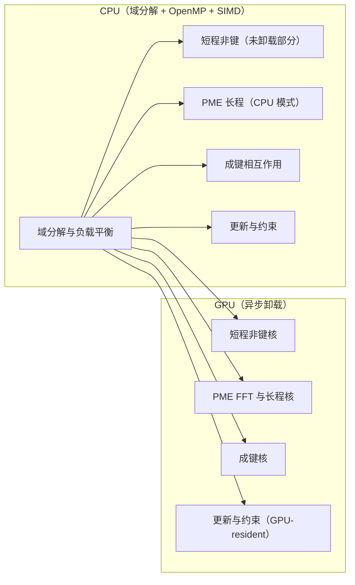
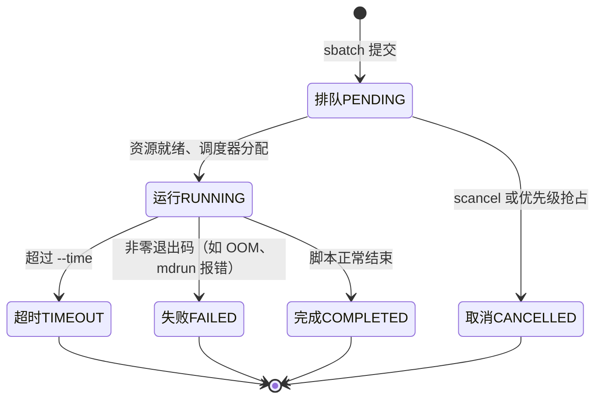
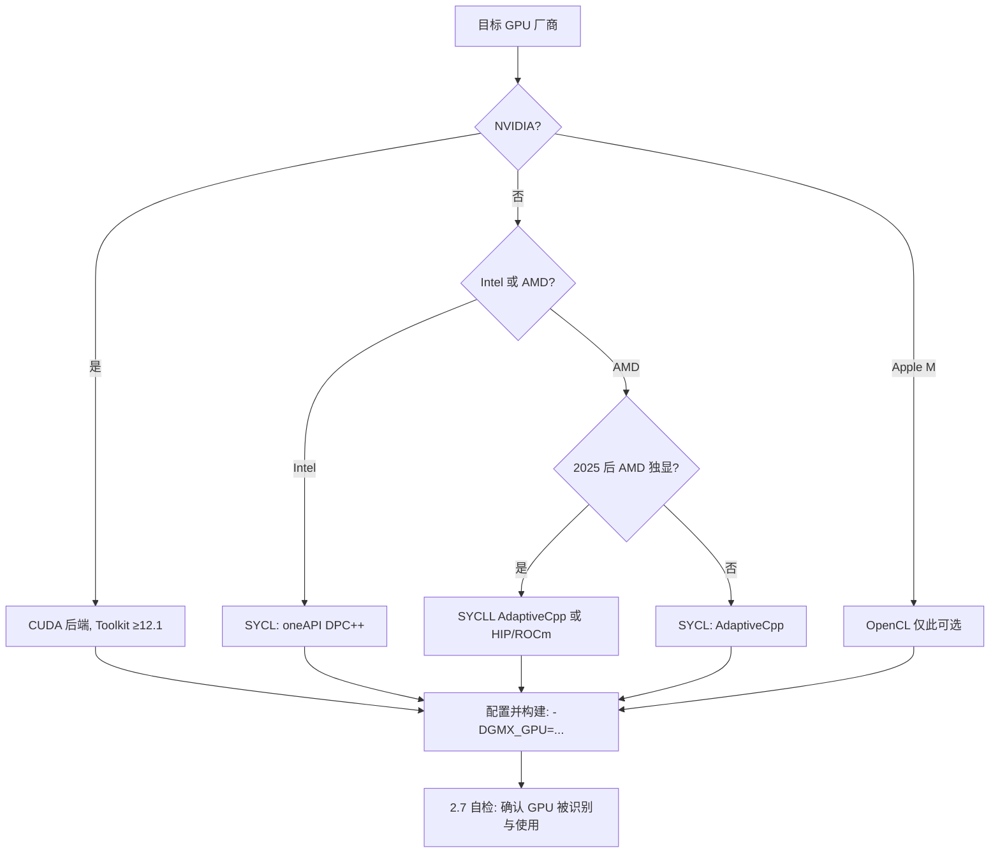

# 第 2 章 环境与工具链

分子动力学模拟的产出质量不仅取决于力场、算法与采样设计，还取决于承载这些计算的软硬件环境。一个未按目标硬件编译的 GROMACS 二进制、一个忽略了 GPU 后端差异的安装、或一个在作业调度系统中错误声明资源的提交脚本，均可能在运行阶段表现为性能下降、结果不可复现甚至数值发散。本章解决三类问题：在何种计算资源上运行模拟、如何搭建可复现的运行环境、以及如何验证安装与衡量性能。第 1 章确立了版本基线 GROMACS 2026.x（当前 2026.4）与平台矩阵；本章将该基线落为可操作的具体步骤，覆盖 Slurm 作业调度、Apptainer（原 Singularity）容器、CMake 构建选项、CUDA/OpenCL/SYCL 后端选择以及 MPI 与 thread-MPI 的取舍。后续第 6 章将在此基础上讨论运行期并行与性能诊断，第 10 章再把本章的目录约定与提交脚本模板化。

本章内容以可核查的官方文档为依据：凡涉及 GROMACS 2026.4 的安装默认值、CMake 选项语义与 GPU 后端支持范围，均引自随版本发布的官方安装指南与用户指南[1-3]；Slurm 行为以 SchedMD 官方文档为准[4-6]；容器工具的用法以 Apptainer 官方用户手册为准[7]。所有命令在说明其适用版本与平台后给出，未在本机实测的环节均在正文中注明推断依据，读者可据此在目标机器上复现。

## 学习目标

- 能依据体系规模、硬件预算与作业时长，独立估算 GROMACS 模拟所需的节点数、核心数与内存量，并识别 CPU 与 GPU 各自的计算职责。
- 能写出结构正确的 Slurm 提交脚本，正确声明节点数、任务数、每任务核数与 GPU 资源，并用 squeue、sacct、scancel 完成作业的监控、记账查询与撤销。
- 能区分 environment modules（Lmod）、conda/mamba 与 Apptainer 三类环境管理手段的适用边界，并在集群上以容器方式复现一次 GROMACS 运行。
- 能解释 GROMACS 2026.x 中 CUDA、OpenCL、SYCL 与 HIP 四种 GPU 后端的支持现状与推荐搭配，并据此选择 CMake 的 `GMX_GPU` 取值。
- 能说明 thread-MPI 与外部 MPI 的实现差异、适用场景与性能特征，并为给定硬件组合选择 `-ntmpi`、`-ntomp` 与 `-npme` 的初始取值。
- 能通过 `gmx --version`、回归测试与官方基准套件完成安装自检，并正确解读 md.log 中的性能指标。

## 前置知识

- 第 1 章的版本基线、平台矩阵与安装路线取舍（见第 1 章 1.5 节）。
- 本科水平的 Linux 使用经验：能操作文件系统并执行简单命令；不熟悉者应先完成第 1 章 1.7 节约定的命令书写规范后返回本章。
- 对编译流程的基本概念：源文件、编译器、链接器、动态库与静态库的区别。
- 后续章节依赖关系：第 3 章将复用本章建立的 conda 环境与数据目录约定；第 6 章的运行期并行配置（6.4 节）建立在本章 2.6 节的构建决策之上。

## 计算资源的形态与选择

### 工作站、集群与云平台

GROMACS 官方安装指南列出的受支持平台覆盖任意 Linux 发行版、macOS 与 Windows，以及 x86-64、POWER、ARM 与 RISC-V 等多种体系结构[3]，但模拟任务实际部署的形态可以归为三类：本地工作站、共享集群与云平台。三者并非等价替代关系，选择依据是任务的时间尺度和数据规模：一个 10^5 原子量级、需运行数百纳秒生产的体系，在工作站上与在集群上的墙钟时间差异受体系规模与硬件组合影响，通常相差显著，而云平台的按需弹性则对应了不同的成本结构。

本地工作站的典型配置为单台机器上的 8 至 64 个 CPU 核与一至四张 GPU 卡，适合代码调试、短时测试、小体系生产（约 10^4 至 10^5 原子量级）以及轨迹分析的批处理。此类机器上运行 GROMACS 通常不安装 MPI，直接使用默认构建内置的 thread-MPI 即可获得单节点内接近最优的并行效率[2]。共享集群由调度系统（常见为 Slurm）统一分配节点资源，用户以提交脚本而非直接命令的方式运行作业；其价值在于可动用数百至数万核与成百上千张 GPU，是生产级长尺度模拟的常规形态。云平台按需提供 GPU 实例，适合突发性算力需求与需要快速横向扩展的批次任务，但跨节点通信依赖实例间的高速网络，而 GROMACS 的 PME 算法需要全局（all-to-all）通信，网络带宽与延迟直接制约多节点扩展性[2]。表 2-1 汇总三种形态的关键差异。

表 2-1　计算资源形态对比

| 维度 | 本地工作站 | 共享集群 | 云平台 |
| --- | --- | --- | --- |
| 资源获取 | 一次购置，独占 | 调度系统按作业分配 | 按小时计费，弹性伸缩 |
| 典型规模 | 8–64 核、1–4 卡 | 数百至数万核、多卡节点 | 单实例至数百节点 |
| 并行方式 | thread-MPI（默认） | MPI 跨节点 + Slurm 脚本 | 同集群，网络为瓶颈 |
| 适用阶段 | 调试、小体系、分析 | 生产级长尺度模拟 | 突发需求、横向扩展 |
| 主要成本 | 硬件折旧与维护 | 排队时间与配额 | 机时费用与数据传输 |

### CPU 与 GPU 的职责分工

GROMACS 的异构并行设计将计算工作划分为短程非键、长程（PME）、成键、更新与约束等若干任务，再决定各任务在 CPU 还是 GPU 上执行[8]。短程非键相互作用（Lennard-Jones 与短程 Coulomb）是经典分子动力学中计算量占比最高的部分，也是 GPU 卸载的首要对象；Páll 等人在 2020 年发表的异构并行综述中系统描述了这种「CPU 与 GPU 同时工作、异步重叠」的设计：GPU 计算短程非键力的同时，CPU 上的 OpenMP 线程继续处理成键力与 PME 长程静电[8]。GPU 由此成为 CPU 的补充而非替代，官方安装指南明确「CPU 代码始终与 GPU 加速并存」[3]。

在 GROMACS 2026.x 中，运行期各任务的执行位置由 `gmx mdrun` 的命令行选项控制：`-nb`（短程非键）、`-pme`（长程静电与 FFT）、`-bonded`（成键相互作用）与 `-update`（积分更新与约束），默认值均为「auto」，即存在兼容 GPU 时自动卸载[2]。将 `-pme gpu`、`-bonded gpu`、`-update gpu` 同时开启时，GROMACS 进入 GPU-resident（常驻 GPU）模式，粒子坐标与速度常驻显存，CPU 仅保留域分解与少量控制逻辑；这一模式对 2.5 fs 及以下时间步长要求 `constraints=h-bonds`，并且不支持虚拟位点、副本交换等若干功能组合[2]。

CPU 侧的职责还包括三个层面：MPI/thread-MPI 层的域分解（domain decomposition，DD）与负载平衡；OpenMP 线程层在进程内的多核并行；以及 SIMD 指令层的内核算力。官方性能指南指出，OpenMP 在 Intel 与 AMD 处理器上分别可有效扩展到约 12–24 与 6–8 线程，超出后收益递减[2]。图 2-1 以三分图形式概括 GROMACS 在单个节点上的任务分配。



图 2-1　GROMACS 单节点任务分配示意：同一个域分解框架下，短程非键、PME、成键与更新任务可分别指定在 CPU 或 GPU 上执行（依据官方性能指南[2]绘制）

### 资源规模估算方法

资源估算的目标是把「模拟 N ns、期望墙钟 W 天」的抽象需求翻译成具体的节点数、核心数与内存量。GROMACS 以 ns/day 与 hour/ns 作为吞吐量指标，二者在每次运行结束后写入 md.log 的性能小结[2]。估算可按三步进行。第一步确定目标：由采样需要（见第 9 章关于遍历性与统计误差的讨论）确定总模拟时长 T_sim 与可接受的墙钟 W，得到所需吞吐量 T_sim/W。第二步实测基线：用官方基准套件（见 2.7.3 节）或与目标体系同量级的输入，在当前候选硬件上运行 `gmx mdrun`，记录单节点或单卡吞吐[2]。第三步外推：所需节点数等于目标吞吐除以实测单节点吞吐，向上取整并留出余量。

内存与显存的估算无法由单一公式给出，因为其随体系原子数、精度模式、并行配置与 PME 网格大小变化，且 GPU 卸载还会额外占用显存。可行的做法是：先在目标机器上以真实体系运行一个短作业，由 `mdrun` 起始阶段打印的资源信息与实际占用校准。需要指出的一般性倾向是：双精度构建（`-DGMX_DOUBLE=on`）的内存占用显著高于默认的混合精度[3]；百万原子以上体系对显存容量提出高要求[2]。

一个可复现的估算路径如下（以 2 万原子的蛋白水溶液体系为例，数值为量级示例、须实测修正）。坐标与速度在单精度下约占 24 字节/原子（3 个坐标分量与 3 个速度分量各 4 字节），2 万原子即约 0.48 MB；域分解与邻居列表的额外开销通常再增加一倍量级；PME 网格与 FFT 工作区按网格点数计算，典型值在数十至百余 MB。因此 2 万原子体系的常规内存需求以几十至百余 MB 计量，远低于单节点内存，真正的约束往往在显存：GPU 卸载时坐标、力缓冲、邻居列表与 PME 网格均驻留显存，单精度下百万原子体系的显存需求可达 4–8 GB 量级（依 `-nb gpu`/`-pme gpu` 卸载范围而定），超出显存容量时任务不会自动缩小体系，而是表现两类可观察行为：其一，`mdrun` 启动时报告 CUDA/HIP 内存分配失败并退出（此时应查看 stderr 中的 `out of memory` 字样）；其二，GPU 卸载被 mdrun 放弃、回退为 CPU 计算——这类回退可通过 md.log 开头的后端选择回显（`Using CPU` 或 `On host` 相关行）与 `Real cycle and time accounting` 表中 GPU 等待项的有无来识别。判定「是否发生回退」的可靠入口始终是 md.log 的后端回显与启动日志，而不是任务是否正常结束。Kutzner 等人的节点成本研究表明，硬件组合的选择对「单位模拟时间的成本」影响可达数倍，最优配置必须结合具体体系的实测吞吐判断，而非依据单卡峰值算力[9]。因此，本节给出的三步框架中的任何数值输出都应视为待实测修正的估计值。

## Linux 命令行最小集

### 文件与目录操作

GROMACS 的所有工作均在 Linux 命令行下完成，第 1 章 1.7 节已约定命令书写规范，本节只补充与模拟工作流直接相关的操作。路径方面需要区分绝对路径与相对路径：模拟任务通常以独立目录为单位组织，进入任务目录后所有命令均以相对路径书写，便于后续脚本化。目录操作的最小集合为 `pwd`、`ls -lh`、`mkdir -p`、`cd`、`cp -r`、`mv` 与 `rm -r`，其中 `mkdir -p` 可一次创建多级目录，`rm -r` 无回收站机制，删除前应核对路径。在集群上，`du -sh` 与 `df -h` 用于核查配额使用情况（见 2.8 节）。源码包的解压与放置也属于本类操作：

```bash
# 平台：Linux（bash）；版本：GROMACS 2026.4 源码包
mkdir -p ~/src && cd ~/src
tar xzf gromacs-2026.4.tar.gz
```

`find` 用于按名称或时间定位文件，如批量查找未完成的检查点文件；符号链接 `ln -s` 常用于把常用任务目录链接到短路径。辨析两个易混淆目录：`$HOME`（家目录，配额通常计入）与集群的 scratch 目录（临时高速盘，见 2.8 节），GROMACS 的轨迹与日志应写入前者或专门的核算目录，运行时临时文件尽量落在 scratch。

### 文本处理与管道

模拟流程中大量信息以文本形式存在：`md.log` 日志、`topol.top` 拓扑、`.xvg` 数值输出与 Slurm 作业输出文件。文本处理的最小命令集为 `head`、`tail`、`grep`、`wc`、`sort`、`uniq`、`cut` 与 `awk`，配合管道 `|` 与重定向 `>` 组合使用。管道把前一个命令的标准输出接为后一个命令的标准输入，重定向把输出写入文件，二者是 shell 数据流的基本机制。常用组合包括：

```bash
# 平台：Linux；用途：监控运行中的模拟（tail -f 持续输出新增行）
tail -f md.log

# 平台：Linux；用途：检查 md.log 是否出现致命错误
grep -n "Fatal error" md.log

# 平台：Linux；用途：统计拓扑文件中非注释、非章节标题行的原子条目
grep -v "^;" topol.top | grep -vc "^\["

# 平台：Linux；用途：查看 Slurm 作业输出文件的最后 30 行
tail -n 30 slurm-123456.out
```

`awk` 擅长按列抽取数据，例如从 `.xvg` 能量文件中提取时间与温度列再交给 Python 处理（第 3 章会给出更系统的方案）；`sed` 用于简单的文本替换，`sort` 与 `uniq` 用于去重统计（如按残基名统计拓扑条目）。文本处理能力的目标不是记住全部选项，而是能快速定位日志中的关键段、抽取数值列并转交给后续工具。注意 `tail -f` 是阻塞型命令，应配合远程会话保持机制使用（见 2.3 节），避免终端断开导致日志查看中断。

### 权限、属主与环境变量

Linux 的权限模型以用户（user）、组（group）与其他（other）三类主体和读、写、执行三种权限构成。`ls -l` 的第一列（如 `-rw-r--r--`）即权限位；`chmod` 修改权限，`chown` 修改属主，普通用户在集群计算节点上通常只有自己家目录内的写权限，`chmod u+x` 使脚本可执行。集群环境中常见的权限问题是：在登录节点创建的脚本与输出文件在计算节点上不可读，或从其他用户目录复制的文件权限过紧；排查时应先检查属主与权限位，再考虑 ACL（`getfacl`/`setfacl`）因素。`umask` 决定新建文件的默认权限，实践中保持系统默认即可。

环境变量是 shell 向进程传递配置的机制，模拟工作流最常接触的变量为 `PATH`（可执行文件搜索路径）与 `LD_LIBRARY_PATH`（动态链接库搜索路径），其次是 `OMP_NUM_THREADS`（OpenMP 线程数上限，`mdrun` 会优先采纳 `-ntomp`，缺省时参考此变量[2]）。GROMACS 安装完成后，执行 `source` 安装前缀下的 `GMXRC` 脚本即可一次性设置 `PATH`、库路径等环境[3]；不执行该步是「命令找不到 `gmx`」最常见的原因。持久化设置写于 `~/.bashrc` 或 `~/.profile`；登录 shell 与交互 shell 读取的启动文件不同，写入后需重新登录或手动 `source` 才生效。修改环境变量前应确认修改对象：仅当前终端生效的临时导出、写入启动文件的持久设置、以及由 environment modules 或 conda 代为管理的设置（见 2.4 节），三者作用范围不同，混用会引入隐蔽的环境串扰。

## 远程会话与长任务

### ssh 与密钥认证

对集群与远程机器的全部操作通过 SSH（Secure Shell）完成。基本用法为 `ssh 用户名@主机名`，随后进入登录节点；重要约束是：登录节点面向交互操作与文件管理，繁重计算须经作业调度系统提交到计算节点（见 2.5 节），在登录节点直接运行 `gmx mdrun` 会被集群策略拒绝或影响他人。密钥认证免去每次登录输入密码，是批量脚本与自动化流程（第 10 章）的前提。生成与安装密钥的命令如下：

```bash
# 平台：Linux/macOS 客户端；OpenSSH 8.0 及以上
ssh-keygen -t ed25519 -C "name@example.org"
# 私钥 ~/.ssh/id_ed25519 权限必须为 600（仅属主可读写）
chmod 600 ~/.ssh/id_ed25519
# 将公钥安装到远程主机的 ~/.ssh/authorized_keys
ssh-copy-id -i ~/.ssh/id_ed25519.pub 用户名@主机名
```

多台机器的连接参数（主机名、用户名、端口、跳板机）可写入 `~/.ssh/config`，以别名简化命令，例如 `Host cluster` 段定义 `HostName`、`User` 与 `ProxyJump`，此后 `ssh cluster` 即完成登录。经跳板机访问内部网络时，`ProxyJump` 链式转发免去逐跳登录的繁琐。密钥泄露的处置优先级高于更换密码：立即在服务器端从 `authorized_keys` 移除对应公钥，并重新生成密钥对。GROMACS 工作流中需要无交互登录的场景包括：定时任务从工作站向集群提交作业、脚本跨机器同步数据（配合 2.3.3 的 rsync），以及集群间复制大体积轨迹。

### 会话保持

交互式 SSH 会话在终端关闭、网络中断时即终止，其下启动的全部进程随之结束。避免长任务随会话消亡有三类手段，适用场景不同。第一类是 `nohup` 与输出重定向，使进程脱离终端挂起并在后台运行，适合一次性命令；其局限是进程仍附着于登录节点，无排队与资源隔离。第二类是终端复用器 tmux（及其前身 screen），提供可分离、可重连的会话：`tmux new -s md` 新建会话，`Ctrl-b d` 分离，`tmux attach -t md` 重连。tmux 的价值在于交互式开发与调试（如 `salloc` 申请到计算节点后的交互会话、`ccmake` 配置界面），进程可在断线后继续。第三类，也是集群上生产运行的唯一正道，是把长任务封装为作业脚本交给调度系统，由 Slurm 保证其在计算节点上运行、在断线后不受影响、并在结束时记录状态。三类手段不互斥：交互式调试用 tmux，正式生产用作业脚本，nohup 仅在无调度系统的单机上使用。判断该用哪种手段的依据是任务是否真正「长」：超过数十分钟的运行都应纳入调度系统管理，以便排队、记账与重试。

### 文件传输与增量同步

输入结构、拓扑与输出轨迹在本地与集群之间传输，常用的两类工具为 scp 与 rsync。scp 实现单次全量复制，适合少量小文件；rsync 在此基础上提供增量同步、断点续传与校验，适合大文件与周期性同步。轨迹文件往往达数十至数百 GB，重复全量拷贝既慢又占配额，rsync 的增量特性使其成为同步运行的默认选择：

```bash
# 平台：Linux/macOS；openrsync 或 rsync 3.x
# 上传整个任务目录（-a 保留权限与符号链接，-v 显示进度，-P 断点续传）
rsync -avP task1/ 用户名@集群:runs/task1/

# 下载轨迹与日志（--exclude 跳过中间的临时文件）
rsync -avP 用户名@集群:runs/task1/md.xtc ./  --exclude="*.edr"
```

同步方向应单向明确：计算产物（轨迹、日志、检查点）从集群下载，输入与脚本从本地上传，避免双向同时写同一目录造成版本混乱。GROMACS 的检查点文件 `state.cpt` 支持中断续算（见第 6 章），下载与上传时应与轨迹一并传输，防止本地分析与集群运行使用不同检查点。对超大轨迹，可先在远端用 GROMACS 工具压缩（如 `gmx trjconv` 重写为更低精度的 xtc）或删除中间帧后再传输，减少带宽与配额消耗。

## 环境管理

### 动态链接库与运行时环境

Linux 程序运行时按名称在库搜索路径中查找动态链接库（so 文件），搜索路径由 RPATH/RUNPATH、系统默认路径与 `LD_LIBRARY_PATH` 环境变量共同决定。`ldd` 命令列出可执行文件实际链接的库及其解析路径，是诊断「库版本错配」的第一工具。GROMACS 安装后常见的运行时依赖包括共享构建下的 `libgromacs`、FFTW（或 MKL）、启用 MPI 时的 MPI 运行库，以及 CUDA 构建的 CUDA 运行库[3]。`LD_LIBRARY_PATH` 的滥用是集群环境串扰的重要来源：设入该变量的搜索路径对同 shell 内启动的所有程序生效，若多个路径含有同名不同版本的库，加载顺序将决定最终命中的版本，可能让 GROMACS 静默链接到错误的 FFTW 或 MPI 库，表现为运行时报错或性能异常。`GMXRC` 脚本之所以只设置必要变量，正是因为缩小环境面可降低此类冲突[3]。排查库问题的顺序为：`ldd $(which gmx)` 查看解析结果、确认各库路径与该机器上预期安装一致、`echo $LD_LIBRARY_PATH` 检查是否有残留路径、必要时在干净 shell 中重新 `source GMXRC`。

### module 系统

共享集群上数十至数百个软件由系统管理员统一安装，用户通过 environment modules 机制按需加载。其原理是：模块文件描述名为 `module` 的 shell 函数，执行 `module load` 时动态修改 `PATH`、`LD_LIBRARY_PATH` 等环境变量，`module unload` 则撤销修改，从而实现同一机器上多版本软件的无冲突共存。Lmod 是当下最常用的实现，由得克萨斯高级计算中心（TACC）以 Lua 语言开发，支持按编译器、MPI 实现分层的模块树[10]。常用命令集为 `module avail`（列出可用模块）、`module load gromacs/2026.4`、`module unload gromacs`、`module list` 与 `module purge`；`module purge` 清除全部已加载模块，适合在提交脚本开头重置环境。集群上 GROMACS 模块的命名与可用版本随站点不同（如 `gromacs/2026.4-cuda` 表示带 CUDA 构建），应先用 `module avail` 核对。模块机制与 conda 的交互容易出错：conda 激活环境会重写 `PATH`，先 `module load` 后激活 conda，模块注入的路径可能被遮蔽；生产提交脚本中应只保留一种环境管理手段，并显式声明所需精确版本。

### conda 与 mamba 的隔离

conda 与 mamba 是包管理与虚拟环境工具，其隔离单位是独立的环境目录，每个环境拥有自己的 Python、动态库与可执行文件集合，`conda activate` 切换环境。mamba 以 C++ 重写了依赖解析，环境创建与安装速度显著快于 conda，两者共用相同的环境格式与通道体系，实际使用中常以 `mamba` 命令替代 `conda` 完成安装。conda-forge 社区维护的 gromacs 包提供了免编译安装路径[11]：

```bash
# 平台：Linux；conda ≥23 或 mamba ≥1.4；假设已激活基础环境
mamba create -n gmx2026 -c conda-forge gromacs
mamba activate gmx2026
gmx --version
```

该路径的价值在于数分钟内获得可用安装、无需处理编译器与依赖；代价是构建配置由发行维护者决定。conda-forge 的 gromacs 构建面向通用 x86-64，其 SIMD 指令集、精度与 GPU 后端等编译期设定是固定的（例如单一 SIMD 档位，与源码编译可按目标硬件定制不同）[12][11]。因此本节给出的建议是：conda/mamba 安装适合教程练习、分析工具链与快速原型；生产级长尺度生产运行，尤其是需要特定 GPU 卸载或 MPI 配置的集群部署，应转用源码编译（2.6 节）或镜像化部署（2.4.4 节）。环境中其他 Python 依赖（如 MDAnalysis、SciPy）同样经 conda-forge 安装，环境的完整清单可用 `conda env export` 导出，供第 3 章与第 10 章的依赖管理复用。

### 容器镜像：Apptainer 与 Singularity

容器把软件与全部依赖打包进单一镜像，解决「换一台机器就不能运行」的环境漂移问题。HPC 场景的容器运行时是 Apptainer，即原 Singularity 项目的后续版本：2021 年该项目移交 Linux 基金会后更名为 Apptainer[13][14]。与 Docker 的运行模型不同，Apptainer 无守护进程、在用户态运行、与宿主共享内核，且默认把宿主用户身份与家目录带进容器，天然适配共享集群的权限模型[13]。镜像为只读的单文件 SIF（Singularity Image File）格式，支持数字签名与校验，便于归档与溯源[7]。

从官方镜像建立并运行 GROMACS 容器是最快的容器化路径。GROMACS 项目维护官方 Docker 镜像，可经 Apptainer 的 `build` 命令转换为 SIF[15][7]：

```bash
# 平台：Linux；Apptainer ≥1.1；以官方镜像构建 SIF（标签以 Docker Hub 页为准）
apptainer build gromacs.sif docker://gromacs/gromacs:2026.4

# 运行容器内的 gmx；任务目录经 --bind 挂载进容器
apptainer exec --bind "$PWD":/work gromacs.sif gmx --version
```

从零构建容器则使用定义文件（definition file），声明基础镜像、构建期命令与运行期环境。以下为定义文件的骨架，`%post` 段在构建时执行安装命令，`%environment` 段设置运行期环境变量，`%runscript` 定义 `apptainer run` 时的默认动作[16]：

```bash
# 文件：gromacs-def.def（示意骨架，实际安装步骤视基础镜像而定）
Bootstrap: docker
From: ubuntu:24.04

%post
    # 在此安装 GROMACS 及其依赖，如经 conda-forge 或官方二进制
    echo "installation steps here"

%environment
    export GMX_MAXBACKUP=-1

%runscript
    exec gmx "$@"
```

GPU 容器需要在运行期把 GPU 设备与驱动库映射进容器，参数随 GPU 厂商与 Apptainer 版本而变，以所用版本的官方文档为准[7]：NVIDIA 环境用 `--nv`（透传 CUDA 驱动库与设备），AMD 环境用 `--rocm`（ROCm 栈，须宿主已装匹配的 ROCm 版本），NVIDIA 加 CUDA 独立库的进阶选项为 `--nvccli`（把驱动库选择交给 nvidia-container-cli 按容器内 CUDA 版本解析）。例如：

```bash
# NVIDIA GPU：--nv 透传驱动与设备；容器内 gmx 的 -nb gpu 正常启用
apptainer exec --nv --bind "$PWD":/work gromacs.sif gmx mdrun -s md.tpr -nb gpu
```

跨节点 MPI 容器还有一层匹配约束：容器内的 MPI 库与宿主 MPI 必须通过 PMIx 兼容层对接，否则 `srun apptainer exec ... gmx_mpi` 会因无法解析进程秩而失败——常见做法是容器内安装与宿主同一主版本的 OpenMPI/MPICH，并在 `srun` 中保持 `--mpi=pmix`（或站点约定方式）；这一问题的排查入口是 `srun` 的报错是否提及 `PMIx` 或 `tool_launch`。`APPTAINERENV_` 前缀可把环境变量注入容器（如 `APPTAINERENV_GMX_MAXBACKUP=-1`）；`apptainer sign/verify` 对 SIF 镜像做签名与验证，适合归档前固化镜像内容。GPU 容器适用于两类场景：跨站点复现（把整条工具链随论文存档）以及在无法获得 root 权限的集群上部署特定软件版本。表 2-2 对比三种环境管理手段的定位。

表 2-2　环境管理手段对比

| 维度 | environment modules | conda/mamba | Apptainer 容器 |
| --- | --- | --- | --- |
| 管理单位 | 模块（环境变量集合） | 环境目录（包集合） | 镜像文件（整个文件系统） |
| 权限要求 | 加载即可，无写权限 | 可写环境目录 | 构建需特权或 fakeroot，运行无需 |
| 版本并存 | 支持，按模块切换 | 支持，按环境切换 | 支持，按镜像切换 |
| 与宿主交互 | 直接共享 | 直接共享 | 隔离，绑定挂载显式交互 |
| 适用场景 | 集群标准化软件 | 个人工具链与语言生态 | 跨站点复现与部署 |

## 作业调度：Slurm

### Slurm 的资源模型

Slurm（原 Simple Linux Utility for Resource Management）是 Linux 集群上最普及的开源作业调度系统，2003 年由劳伦斯利弗莫尔国家实验室团队提出，设计目标是容错、可扩展与易部署[17]。调度系统解决的是资源仲裁问题：多个用户的作业竞争节点、核、内存与加速卡，由 Slurm 依据资源声明与优先级规则分配，任何作业都不得绕过调度器直接占计算节点。Slurm 的核心概念包括：partition（分区，节点按硬件或用途分组的队列，如 gpu、compute 分区）、node（计算节点，作业申领的最小物理单元）、job（作业，一次资源申请及其执行单元）、job step（作业步，作业内由 `srun` 启动的并行任务）、account 与 QoS（记账与服务质量等级，见 2.5.3）[18][6]。

Slurm 的命令分三类：提交类（`sbatch` 批处理、`srun` 交互或作业步、`salloc` 申请交互会话）、状态类（`sinfo`、`squeue`、`scontrol`）与记账控制类（`sacct`、`scancel`、`squeue`）。`sbatch` 把脚本提交给调度器排队执行，脚本内通常含一个或多个 `srun` 以启动并行任务[6]；`srun` 也可在已取得的分配内以交互方式运行作业步。资源模型中有一个容易混淆的点：`--nodes` 指作业占用多少个节点，`--ntasks` 指作业内启动多少个并行任务（MPI 视角的 rank 数），`--cpus-per-task` 指每个任务分配多少个 CPU 核（对应 OpenMP 线程数），三者相乘应不超过申请节点的物理核数；GPU 经 `--gres`（Generic RESources）单独申请[4][6]。

### 提交脚本的结构要素

提交脚本是「作业的资源声明 + 运行逻辑」的合一文件，`#SBATCH` 行声明资源，其后的 shell 命令在计算节点上执行。以下脚本提交一个单节点 GPU 作业，运行 GROMACS 的 NVT 平衡（thread-MPI 构建，无需外部 MPI）：

```bash
#!/bin/bash
#SBATCH --job-name=md-nvt          # 作业名，用于 squeue/sacct 识别
#SBATCH --partition=gpu            # 目标分区，须与集群配置一致
#SBATCH --nodes=1                  # 节点数
#SBATCH --ntasks=1                 # 并行任务数（thread-MPI 用 1 个 rank）
#SBATCH --cpus-per-task=16         # 每任务核数，对应 -ntomp
#SBATCH --gres=gpu:1               # 申请 1 张 GPU（部分集群用 --gpus=1）
#SBATCH --mem=32G                  # 内存上限
#SBATCH --time=24:00:00            # 最长运行时间，超时被强制终止
#SBATCH --output=slurm-%j.out      # 标准输出，%j 为作业号

module load gromacs/2026.4-cuda    # 加载站点提供的 GROMACS 模块
cd "$SLURM_SUBMIT_DIR"             # 回到提交目录，脚本可能从任意路径启动
gmx mdrun -s nvt.tpr -deffnm nvt -ntmpi 1 -ntomp 16
```

上例中 `--cpus-per-task=16` 与 `-ntomp 16` 构成了「资源声明 → 并行参数」的第一层对应；第二层是**核绑定（binding/affinity）**。调度器分配的核心集合不保证在物理核上连续分布，因此生产级作业还应在 `#SBATCH` 中声明核绑定，使 mdrun 的 OpenMP 线程被固定到互不冲突的物理核：`--cpu-bind=cores`（或按节点拓扑使用 `--cpu-bind=verbose,cores` 观察分配结果），OpenMP 侧配合 `OMP_PLACES=cores` 与环境变量 `OMP_PROC_BIND=true`；GROMACS 自身的线程绑定由 `mdrun` 的 `-pin off/auto/on/inherit` 系列控制，`-pin on` 会在线程数不超过物理核数时自动绑定，`-pinoffset` 指定起始核偏移（共享节点上与调度器分配的核区间对齐时用）。三者的意图一致：避免线程在核间迁移引起的缓存抖动与性能损失；核绑定不当的表现是同一输入两次运行的 ns/day 差异明显、`Real cycle and time accounting` 表中 `Wait` 相关行占比异常。

生产作业还应处理**可中断性（checkpoint 续算）**。`gmx mdrun` 周期性写检查点（默认每 15 分钟，`-cpt` 控制），因此作业被终止后可从最后一个 `.cpt` 续算；关键是让终止发生得干净。Slurm 在作业超时前发送 SIGTERM（可默认提前 `--signal` 指定时间，如 `--signal=B:TERM@23:50:00`：作业运行 23 小时 50 分时向批处理 shell 发送 SIGTERM，shell 捕获后先执行 `gmx mdrun -cpi md.cpt -deffnm md` 完成一次干净续算退出，或在 `sbatch` 的 `--time` 前留出余量让作业自然结束）。可中断作业骨架：

```bash
#!/bin/bash
#SBATCH --job-name=md-prod-cpi
#SBATCH --signal=B:TERM@23:50:00
#SBATCH --time=24:00:00
module load gromacs/2026.4-cuda
cd "$SLURM_SUBMIT_DIR"
trap 'echo "收到 SIGTERM，立即退出，留下检查点给续算"; exit 0' TERM
gmx mdrun -s md.tpr -deffnm md -cpi md.cpt -maxh 23.9
```

`-maxh 23.9`（小时）使 mdrun 在接近时限时自行写检查点并退出，与 `--signal` 双保险；再次提交续算作业时仅需将 `-cpi` 指向最新检查点（`-cpi md.cpt` 会查找 `md.cpt` 及历史 `md_prev.cpt`），新手常犯的错误是续算时重新执行 `grompp` 生成新的 `.tpr`，这会丢弃原有轨迹的连续性——续算必须沿用原始 `.tpr`，只用 `-cpi` 附检查点。

跨节点运行则需要 MPI 构建的 `gmx_mpi` 并以 `srun` 启动（2.6.4 节讨论构建差异）：

```bash
#!/bin/bash
#SBATCH --job-name=md-prod
#SBATCH --partition=compute
#SBATCH --nodes=2
#SBATCH --ntasks-per-node=32
#SBATCH --cpus-per-task=1
#SBATCH --time=72:00:00

module load gromacs/2026.4-mpi openmpi
srun gmx_mpi mdrun -s prod.tpr -deffnm prod
```

脚本要素的解析顺序是：调度器逐行读取 `#SBATCH` 指令得到资源声明，资源就绪后把脚本投放到首个被分配的节点执行，`--time` 超时即终止作业（`CANCELLED` 或超时状态）。两个常见错误值得提前防范：其一，`--ntasks` 与 `--cpus-per-task` 的乘积超过分区节点核数会导致排队不进展或运行失败；其二，作业数组（`#SBATCH --array=1-10`）适合批量处理同一套参数的多份副本（如多副本采样、多窗口伞形采样），数组索引经 `$SLURM_ARRAY_TASK_ID` 传入脚本，但每个数组元素仍是独立作业，须为每个元素分配独立输出文件避免互相覆盖[6]。交互式调试可用 `salloc --partition=gpu --gres=gpu:1 --time=01:00:00` 申请资源后直接执行命令，调试完毕 `exit` 释放资源。

### 队列策略与优先级

调度器面对超过可用资源的作业请求时，按优先级决定执行顺序。Slurm 的多因子优先级由记账（accounting）、公平份额（FairShare，依据历史使用量动态调整）、QoS 等级与分区配额等叠加计算，其具体权重由站点管理员配置[18]。对用户而言，向某个分区提交作业即接受该分区的排队规则：`squeue` 显示运行与排队状态，`sacct` 查询已完成作业的记账信息（开始结束时间、占用资源、退出码）[5]，`scancel` 撤销排队或运行中的作业，`sinfo` 查看各分区节点与空闲情况。表 2-3 汇总监控命令的最小集。

表 2-3　Slurm 作业生命周期常用命令

| 命令 | 用途 | 典型输出字段 |
| --- | --- | --- |
| `sbatch script.sh` | 提交批处理作业 | 返回作业号 job id |
| `squeue -u $USER` | 查看自己的作业状态 | JOBID、PARTITION、STATE、TIME |
| `scontrol show job <id>` | 查看单个作业的完整配置 | 节点、核数、依赖、出错原因 |
| `sacct -j <id>` | 查看作业历史与记账 | 状态、消耗核时、退出码 |
| `scancel <id>` | 撤销作业 | 无 |
| `sinfo` | 查看分区与节点资源 | PARTITION、AVAIL、NODES、STATE |

作业「排队但不运行」是集群使用的常态，排查顺序应为：`squeue` 看状态是否为 PENDING 与等待原因（reason 列），`scontrol show job` 看是否因资源不满足（核数、显存、分区限制）或优先级不足而等待，`sacct` 核对过往作业是否因超时或 OOM 反复失败。图 2-2 给出一个 GROMACS 作业从提交到收尾的状态机。



图 2-2　GROMACS 作业在 Slurm 中的状态迁移（依据 SchedMD 文档中的作业状态定义[18]绘制）

对只运行数十分钟的短作业，排队成本与运行成本相当，可考虑批量合并或优先级适中的分区；对长作业（数天），应在脚本内安排检查点续算逻辑，使作业被抢占或超时后可从 `state.cpt` 续跑（见第 6 章 6.2 节），这是生产流程与单机运行的显著差异。

## 安装 GROMACS 2026

### 二进制发行版与 conda-forge

GROMACS 的获取途径分为预编译二进制与源码编译两类。预编译途径包括 conda-forge 包、官方 Docker 镜像与部分发行版的软件仓库。conda-forge 途径已在 2.4.3 节给出，适合快速获得可用的 CPU 构建；官方 Docker 镜像（2.4.4 节）适合容器化部署；个别 Linux 发行版（如 Fedora）的官方仓库已打包 GROMACS 2026.4，可由系统的包管理器直接安装。GROMACS 官网提供源码、发布说明与各版本文档，2026 系列于 2026 年 1 月发布 2026.0[19][20]。三条预编译途径都是「拿来即用」，但共同的局限是构建参数不可定制：SIMD 指令集档位、GPU 后端、精度与 MPI 支持均由打包者预先决定，与目标硬件未必最优匹配。对需要确定性的生产环境（如集群统一部署、GPU 卸载、多节点 MPI），本章推荐源码编译，原因在于 CMake 配置阶段能够针对实际硬件显式设定 SIMD 档位、GPU 后端与 MPI，且编译过程可全程记录、便于复现（第 10 章的工程化约定会把它纳入脚本）。GROMACS 的多级并行架构（SIMD、OpenMP、MPI/thread-MPI 与 GPU 卸载的组合）在 Abraham 等人的软件论文中有系统描述[21]。预编译与源码编译并非二选一：同一台机器上可同时存在 conda 环境中的「快速验证版」与 `/usr/local/gromacs` 下的「生产编译版」，通过环境变量区分调用。

### 源码编译与 CMake 关键选项

GROMACS 自 4.6 起只使用 CMake 构建系统，2026.4 要求 CMake 3.28 及以上，编译器需完整支持 C99 与 C++17，官方支持的最小版本为 GCC 11、Clang 14 与 MSVC 2019；Intel 经典编译器 icc 不再受支持，应使用 oneAPI 的 Clang 系编译器或 gcc[3]。构建前需确认 FFT 库：GROMACS 的 PME 与部分分析工具依赖 FFTW3（或 Intel MKL），官方推荐优先使用 `-DGMX_BUILD_OWN_FFTW=ON` 让构建系统下载并编译单精度优化版 FFTW，或以源码方式自行编译并匹配精度（混合精度对应单精度 FFTW）[3]。下述命令序列对应「快速可用」的完整流程，适用于 Linux 上的首次编译：

```bash
# 平台：Linux（x86-64）；版本：GROMACS 2026.4；前置：CMake ≥3.28、gcc ≥11
tar xzf gromacs-2026.4.tar.gz
cd gromacs-2026.4
mkdir -p build && cd build
cmake .. -DGMX_BUILD_OWN_FFTW=ON
make -j 8
make check          # 运行回归测试（见 2.7.2 节）
sudo make install   # 安装至 CMAKE_INSTALL_PREFIX（默认 /usr/local/gromacs）
source /usr/local/gromacs/bin/GMXRC
```

CMake 采用 out-of-source 构建：源码目录与构建目录分离，`CMakeCache.txt` 记录全部配置，改动配置后重新运行 `cmake` 即可，但更换编译器必须删除构建目录重建——CMake 不允许配置中途更换编译器[3]。对集群场景，官方建议在登录节点（编译节点）执行配置，但须用 `-DGMX_SIMD` 明确指定计算节点的指令集，因为默认的「按编译机自动探测」只对同架构机器成立[3]。表 2-4 汇总生产部署中最常调整的选项及其语义，取值依据全部来自官方安装指南[3]。

表 2-4　GROMACS 2026.4 常用 CMake 选项

| 选项 | 取值 | 语义与推荐 |
| --- | --- | --- |
| `GMX_BUILD_OWN_FFTW` | ON/OFF | 让构建系统编译自带 FFTW；新手推荐 ON。注意该选项在 ninja 生成器、交叉编译与离线环境下存在限制（官方构建系统文档注明，见 [22]），常规 make 工作流无碍 |
| `GMX_FFT_LIBRARY` | fftw / mkl / fftpack | FFT 库选择；默认依编译器与构建类型而定（通常为 fftw），MKL 未必更快 |
| `GMX_SIMD` | None…AVX2_256 / AVX_512 / ARM 各档 | 目标 CPU 的 SIMD 档位；集群交叉编译必须显式指定 |
| `GMX_GPU` | OFF / CUDA / OpenCL / SYCL / HIP | GPU 后端；每构建只能选一个（见 2.6.3） |
| `GMX_MPI` | ON/OFF | 编译外部 MPI 支持，产物为 gmx_mpi |
| `GMX_DOUBLE` | ON/OFF | 双精度构建；默认关闭（混合精度），仅特殊数值需求开启 |
| `GMX_BUILD_SHARED_EXE` | ON/OFF | 生成共享库形式（libgromacs）并链接可执行文件；静态部署场景改与 `GMX_PREFER_STATIC_LIBS` 配合（官方静态构建开关，旧文档中的 `BUILD_SHARED_LIBS` 写法已非官方推荐）[22] |
| `CMAKE_INSTALL_PREFIX` | 路径 | 安装前缀；无 root 权限时设为家目录下路径 |
| `CMAKE_C_COMPILER` / `CMAKE_CXX_COMPILER` | 编译器名 | 指定编译器，或用 CC/CXX 环境变量 |
| `GMX_GPU_FFT_LIBRARY` | 默认 / VKFFT / oneMath 等 | GPU 端 FFT 库；SYCL/OpenCL 构建可选用 VkFFT |
| `GMX_HWLOC` | ON/OFF | 链接 hwloc 以改善运行时硬件识别 |

选项之间并非独立：`GMX_GPU=CUDA` 会自动引入 CUDA 工具链相关检查（工具包版本与 GPU 架构），`-DGMX_GPU=OpenCL` 额外要求 OpenCL 头文件与 ICD 装载器[3]；启用 `GMX_MPI` 与 GPU 时，可在编译期自动探测 MPI 实现的 CUDA-aware 支持，探测失败时运行期可用环境变量 `GMX_FORCE_GPU_AWARE_MPI=1` 强制启用（官方提示仍应谨慎核对正确性）[3]。双精度（`GMX_DOUBLE=on`）在官方文档中被明确标注为「更慢，通常无必要」[3]：GROMACS 默认的混合精度构建在力计算等热区使用单精度、累加等部位使用双精度（参考手册对精度模式的定义见该手册「Definitions and Units」章）[23]，已能满足绝大多数经典模拟的数值需求，双精度仅用于少数对舍入敏感的计算，且与 GPU 卸载不兼容，因此生产部署几乎总是保持默认关。

### GPU 后端：CUDA、OpenCL、SYCL 与 HIP

GROMACS 2026.x 支持四类 GPU 后端，一次构建只能配置其中一个[3]；官方构建系统文档对 `GMX_GPU` 列出的可取值是 CUDA、OpenCL 与 SYCL[22]，HIP 后端则由安装指南给出支持范围与工具链要求[3]。GPU 加速自 GROMACS 4.5 起引入，其多级并行设计（SIMD、OpenMP、MPI/thread-MPI 与 GPU 卸载的组合）在 Abraham 等人的软件论文中有系统描述[21]，Kutzner 等人在 2015 年对 GPU 节点的系统评估确立了「以 GPU 卸载为主的节点配置」的性价比实践[24]。官方安装指南按硬件给出的推荐搭配如表 2-5：NVIDIA 用 CUDA，Intel 与 AMD 的 GPU 用 SYCL，Apple M 系列用 OpenCL（该后端现已标记为过时），另有专用于 AMD 的 HIP 后端自 GROMACS 2025 引入、2026 起获得完整的卸载支持[3][1]。

表 2-5　GROMACS 2026.4 GPU 后端选型

| 后端 | 目标硬件 | 工具链要求 | 状态 |
| --- | --- | --- | --- |
| CUDA | NVIDIA 全系（compute capability ≥5.0） | CUDA Toolkit ≥12.1；`CMake 选项 -DGMX_GPU=CUDA` | 推荐，成熟 |
| SYCL | Intel 集显/独显、AMD GFX9/CDNA/RDNA | oneAPI DPC++ ≥2024.0（Intel）或 AdaptiveCpp ≥24.02（AMD，配 ROCm） | 推荐（Intel/AMD） |
| OpenCL | Apple M 系列、AMD GCN、旧 NVIDIA | OpenCL 头文件与 ICD 装载器 | 已标记过时，Apple 唯一路径 |
| HIP | AMD GFX9、CDNA 1/2/3、RDNA 1/2/3 | ROCm ≥5.2 | 2026 起全卸载支持 |

CUDA 后端的构建指定目标 GPU 架构以缩短编译时间并减小二进制体积：`-DCMAKE_CUDA_ARCHITECTURES` 接受分号分隔的算力编号（如 `60;75;86`），未指定时生成常见架构的通用码[3]。官方对 NVIDIA 平台的生产建议始终是 CUDA；SYCL 亦可运行 NVIDIA GPU，但官方论坛明确提示该组合为实验性质，生产环境仍推荐 CUDA[25]。SYCL 是 GROMACS 移植 Intel 与 AMD GPU 的长期路线：Alekseenko、Páll 与 Lindahl 的测量表明，SYCL（AdaptiveCpp）在 AMD GPU 上可达到与厂商特定后端接近的性能[26]，配合 VkFFT 等可移植 FFT 库，同一份 SYCL 构建可覆盖多厂商硬件。AMD 的 HIP 后端 2025 年仅含主要非键核，2026 补齐 PME 等卸载路径后进入完整支持[3][1]。OpenCL 当前的地位是「过时但未移除」：官方文档称其被 SYCL 取代[2]，仅在 Apple M 系列与个别旧硬件上仍是唯一选择。

选择后端的判定流程可概括为：先确定目标 GPU 厂商与型号，查表 2-5 得到候选后端与工具链要求，再确认驱动与工具链版本满足官方最低要求（CUDA 需 ≥12.1、compute capability ≥5.0；AdaptiveCpp ≥24.02；ROCm ≥5.2）[3]，最后配置单次构建。若集群节点混有多种 GPU，应分别构建对应后端的二进制并以模块或容器隔离。图 2-3 给出该决策流程；任何后端配置完成后都需要进入 2.7 节的自检环节确认 GPU 确被识别与使用。



图 2-3　GROMACS GPU 后端选择流程（依据官方安装指南的硬件-后端对照[3]绘制）

### MPI 与 thread-MPI 的取舍

GROMACS 的跨节点并行依赖 MPI（Message Passing Interface），单节点内则另有内置的 thread-MPI：它用线程模拟 MPI rank 通信层，是 GROMACS 自带的「伪 MPI」实现，无需安装任何 MPI 库，且在单节点内通常比真实 MPI 更快[2]。两个层次的并行同时存在：进程/rank 级（MPI 或 thread-MPI）之上叠加 OpenMP 线程级，`gmx mdrun` 的 `-ntmpi` 与 `-ntomp` 分别控制两者[2]。默认构建即含 thread-MPI，其编译开关为 `GMX_THREAD_MPI`；外部 MPI 构建由 `-DGMX_MPI=on` 启用，产物为带 `_mpi` 后缀的 `gmx_mpi`[3]。

取舍的关键判据是作业的节点边界：单节点内的模拟用 thread-MPI 构建即可获得最优性能，官方性能指南明确「真实外部 MPI 可用于单节点，但比 thread-MPI 版慢」[2]；跨节点模拟则必须使用外部 MPI，因为 thread-MPI 只能在一个进程内工作，且与多模拟模式（`-multidir`、副本交换）不兼容[2]。同一安装目录可同时容纳两个构建：先做一次默认构建，再做一次 `-DGMX_MPI=on` 的构建，二者文件名（`gmx` 与 `gmx_mpi`）不冲突[3]。MPI 实现推荐最新版 OpenMPI 或 MPICH（供应商库亦可），均需支持 MPI 3.0 标准[3]；对多 GPU 直接通信，建议 OpenMPI ≥4.1.0 与 UCX ≥1.10 的 CUDA-aware 组合[3]。

rank 数的设定遵循「足够少、够用即可」的原则：官方指南建议每张 GPU 对应 1–3 个 PP rank，GPU-resident 模式下 1 个 rank/GPU 通常最优；rank 数（或核数）过多反而因 GPU 共享开销与通信成本而性能下降[2]。对多节点多 GPU 作业，官方与 NVIDIA 联合发布的技术博客报告了通信路径优化带来的显著扩展性改进[27]，评价具体集群时应以本机与同型集群的实测为准。表 2-6 汇总两种并行方式的差异，供部署时对照。

表 2-6　thread-MPI 与外部 MPI 对比

| 维度 | thread-MPI | 外部 MPI |
| --- | --- | --- |
| 编译开关 | 默认启用（GMX_THREAD_MPI） | `-DGMX_MPI=on`，产物 gmx_mpi |
| 单节点效率 | 高（官方明确快于真实 MPI） | 略慢 |
| 跨节点 | 不支持 | 必需 |
| 多模拟（-multidir 等） | 不兼容 | 支持 |
| 依赖 | 无 | OpenMPI/MPICH 等 MPI 3.0 实现 |
| 典型用法 | 工作站、单节点集群作业 | 多节点集群作业 |

实际提交作业时二者的调用方式不同：thread-MPI 构建直接调用 `gmx mdrun -ntmpi ... -ntomp ...`，作业脚本只需申请一个任务（如 2.5.2 节的首个示例）；MPI 构建则经 `srun gmx_mpi mdrun ...` 启动，`--ntasks` 决定 rank 数（第二个示例）。两种构建在同一节点上的性能对比应在本机实测，官方数值（单节点内 thread-MPI 更快）的成立条件是默认编译与相近参数，个别场景（如 MPI 大会话数）差异方向可能反转，判断仍以实测为准[2]。

## 安装自检与基准测试

### 构建信息核对

安装完成并以 `source GMXRC` 装载环境后，第一步是核对此 `gmx` 确为预期构建。`gmx --version`（等价于 `gmx mdrun --version`）输出版本号、编译时的 CMake 选项集合、精度模式、SIMD 档位、GPU 后端与 FFT 库等信息：

```text
GROMACS version:    2026.4
Precision:          mixed
SIMD instructions:  AVX2_256
GPU support:        CUDA
FFT library:        fftw-3.3.10-sse2-avx-avx2-avx512f-avx512cd
```

（输出为示意，实际内容随构建选项与平台变化。）核对要点有三：版本号是否为部署基线（2026.x）；`GPU support` 是否显示预期后端——若该行为空或为 `none`，则 GPU 卸载未编译进构建；`SIMD instructions` 是否与计算节点匹配——官方性能指南提示，md.log 会在 SIMD 档位不理想时打印警告[2]。还应执行 `which gmx` 确认命令解析来自安装前缀而非其他路径，避免「调用了旧版本」的隐蔽错误。`gmx mdrun -version` 与 `gmx --version` 输出一致，但前者暴露的是 mdrun 程序的构建信息，排查运行期问题时更直接。官方已知问题页（known issues）按版本列出已确认的缺陷与规避方法，部署前应通读与自身平台相关的条目[28]。若版本、后端或 SIMD 与预期不符，回到 CMake 配置重新构建，而不是在运行期用选项试图「补」编译期缺失的功能——例如未编译 GPU 后端的构建无法通过运行期参数启用任何 GPU 卸载。

### 回归测试集

回归测试验证「修改后的代码没有破坏既有行为」，是安装正确性的强信号。源码构建默认支持 `make check`，它通过 CTest 运行单元测试与基础回归测试[29]；官方还提供独立的回归测试包，可在配置阶段以 `-DREGRESSIONTEST_DOWNLOAD=ON` 让构建系统自动下载，或在官网下载页面单独获取[30]。测试在构建目录内执行：

```bash
# 平台：Linux；在 GROMACS 构建目录内执行
make check                     # 运行全部可用测试（可能耗时较久）
ctest -N                       # 仅列出测试名，供挑选子集
```

`make check` 失败并不总是意味着系统不可用：常见原因包括测试环境与构建环境不一致（如计算节点 SIMD 档位、驱动版本）、回归测试包版本与源码不匹配，以及个别平台上的已知失败[28]。排查顺序为：记录失败测试名与输出、比对官方 known issues 是否有对应条目、在干净环境（重 `source GMXRC`、`module purge`）复跑、仍失败的测试若与日常使用无关（如特定 GPU 架构核）可在评估后跳过，但核心算路（非键、PME、约束）的测试失败必须定位原因后再部署。官方开发文档还描述了物理校验（physical validation）测试，它检查模拟结果是否符合物理预期，与纯数值的单元测试互补[29]，但通常只用于开发分支而非最终用户安装。运行期验证则以 md.log 的自检信息与能量行为的合理性判断为主（见第 6 章）。

### 基准测试与结果解读

基准测试回答「这套硬件上这套安装能跑多快」，其输出既是资源估算的外推基线（2.1.3 节），也是安装质量与调参成效的度量。GROMACS 官网发布官方基准输入（ADH、d.dppc、villin 等标准体系），可从官网基准目录下载[31]；另有一组由马克斯·普朗克生物物理化学研究所发布的基准集，覆盖 6k 至 12M 原子的大跨度体系，适合不同规模硬件的标定[32]。运行基准的标准方式为：

```bash
# 平台：Linux；以官方 ADH 基准（dihydrofolate reductase 体系，规模见随附说明）为例
gmx mdrun -s benchADH.tpr -nb gpu -pme gpu -update gpu -nsteps 10000 -deffnm benchADH
```

（`-nb/-pme/-update` 的组合决定卸载策略，`-nsteps` 控制步数，结果与体系、精度、硬件强相关。）除此之外，`gmx nonbonded-benchmark` 可快速比较非键核在不同 SIMD 档位或 GPU 上的吞吐，适合在构建后做粗略的性能标定[33]。性能结果的解读以 md.log 结尾的六项指标为准[2]：ns/day（体系吞吐，特定体系/条件/硬件下可比）、hour/ns（ns/day 的倒数，用于工期估计）、ms/step（与时间步长无关的每步墙钟）、Matom·steps/s（以原子数归一化的效率指标，跨体系可比）、Mnbf/s（以非键力次数归一化的算力指标）以及 MFlops（浮点吞吐估计，后两项须设置环境变量 `GMX_DETAILED_PERF_STATS` 才打印）[2]。表 2-7 汇总这些指标的适用场景。

表 2-7　md.log 报告的性能指标及其用途

| 指标 | 定义 | 适用比较 |
| --- | --- | --- |
| ns/day | 每日可完成的模拟时长 | 同体系同条件下的吞吐量统计 |
| hour/ns | 完成 1 ns 所需小时数 | 工期与资源申请估计 |
| ms/step | 每步墙钟时间 | 同一步长下的性能对比 |
| Matom·steps/s | 原子数×步数/秒 | 跨体系规模的效率比较 |
| Mnbf/s | 每秒处理的非键力次数（百万） | 硬件与算法效率（非键主导体系） |
| MFlops | 有效浮点运算吞吐 | 与硬件峰值比较（受估计模型限制） |

日志中段的 PP/PME 负载比用于诊断长短程负载失衡：当 CPU 侧 PME 与 GPU 侧非键完成时间差距大时，性能指南建议调整 `-npme`（专用 PME rank 数）或截断与网格参数[2]。基准数据的记录应连同条件一起归档：体系、原子数、力场、时间步长、精度模式、GPU 型号与驱动版本、CPU 型号；脱离条件的 ns/day 数值无比较意义。不同硬件间的横向比较优先使用 Matom·steps/s 等归一化指标，而非绝对值[2]。BioExcel 的 GROMACS 最佳实践指南对基准流程与运行参数给出进一步建议，可作教学性参考[34]。

## 存储、配额与数据布局

### 文件系统差异

集群的存储按性能与持久性分层，不同类型文件应放置于对应层级。本地盘（计算节点的 SSD/HDD）延迟低但随节点生命周期而消失，适合临时中间文件；共享家目录 `$HOME` 兼顾登录与计算节点访问，配额通常较紧；项目/全局目录（如 `/project`）面向长期数据，容量大但可能位于共享存储后端；scratch（如 `/scratch`、`$TMPDIR`）为高速暂存区，性能最好但定期清理。并行文件系统（Lustre、GPFS 等）支持跨节点并发读写，其元数据操作（创建/删除大量小文件）成本远高于顺序大块读写，具体特征随文件系统实现而异。GROMACS 的读写特征对这一分层高度敏感：轨迹与日志是顺序大文件写入，适合落 scratch 或项目盘；而数百个任务的目录结构（每任务数十个文件）会放大元数据压力，目录规划应避免「千任务一盘」的布局。经验法则（非官方规定）为：运行期输出写入本地或 scratch，完成后再归档到项目盘；`$HOME` 只放代码、脚本与小型输入。不同站点路径与策略各异，应以集群文档为准并实测性能差异。

### 目录结构与命名约定

统一的目录结构使多任务、多阶段的模拟可管理且可复现（第 10 章将其模板化）。推荐的单任务布局为：任务根目录下按阶段分子目录，输入与输出分离：

```text
rcsb6lu5/                        # 任务根目录：体系标识（如 PDB 或系统名）
├── prep/                        # 结构准备：pdb、力场文件、拓扑、tpr
│   ├── complex.pdb
│   └── complex.top
├── md/                          # 模拟阶段：minim / nvt / npt / prod
│   ├── minim/minim.tpr minim.log
│   ├── nvt/nvt.tpr nvt.log nvt.xtc nvt.edr
│   └── prod/prod.tpr prod.log prod.xtc prod.edr prod.cpt
├── analysis/                    # 结果分析：脚本与输出图
│   └── rmsd.xvg
└── runinfo.txt                  # 环境与命令记录（见第 9 章可复现性）
```

命名约定应编码三类信息：体系、阶段、副本（如 `prod_r1` 表示第 1 份生产副本）；`gmx mdrun -deffnm name` 让所有输出统一使用前缀，避免散落默认命名。轨迹文件默认已压缩（xtc），无需再次压缩；`GMX_MAXBACKUP=-1` 环境变量可禁止 GROMACS 为同名输出文件生成 `.#` 备份文件，避免运行目录被备份文件堆满。目录与命名约定一旦建立，应在课题组内统一执行并写入文档，因为分析脚本与归档脚本（第 10 章）都依赖该规范的稳定性。

### 归档与清理策略

归档的目标是「结果可复现、存储可承受」，清理的目标是「不损失可复现性」。按保留价值排序，必须长期保存：输入（结构、力场参数、topol 与 mdp 文件）、检查点 `state.cpt`（续算必需，见第 6 章）、轨迹（按分析需求取舍）与日志（性能与环境记录）；可定期清理：中间变量文件、可从头再生成的临时文件、超出分析阶段需求的冗余副本。归档前用 `du -sh` 核对目录体积，`quota -v`（或站点提供的配额工具）确认剩余空间；大轨迹归档到项目盘后从 scratch 删除。清理的边界应写入课题组文档，避免「都留一份」造成的存储膨胀与「全删了」造成的不可复现。对论文相关的模拟，还应把环境（精确版本号、构建选项、容器镜像哈希）与数据一并归档，这是第 9 章可复现性约束在存储层面的落地；归档完整性可用文件校验和（如 `sha256sum`）记录，追踪文件随镜像一并保存。

## 常见错误

1. **现象**：执行 `gmx` 报 `command not found`，或 `gmx --version` 显示与部署基线不符的旧版本。 **成因**：未 `source` 任何 `GMXRC`，或 `PATH` 中先命中别的 GROMACS 安装（如系统包、conda 环境），或写入 `~/.bashrc` 的路径在作业脚本的非交互 shell 中不生效。 **排查步骤**：`which gmx` 看解析路径；`echo $PATH` 看搜索顺序；在提交脚本中打印 `gmx --version` 复查。 **处置**：显式 `source /usr/local/gromacs/bin/GMXRC`（或 `module load` 站点模块），并置于脚本内命令前的固定位置；需要两个版本并存的场合，用环境变量或容器隔离，避免依赖 `PATH` 顺序。

2. **现象**：作业运行时 GPU 占用为零，md.log 中显示非键或 PME 在 CPU 上执行。 **成因**：构建未启用 GPU 后端（`GMX_GPU` 缺省为关闭），或运行参数显式/隐式指定了 CPU（如 `-nb cpu`），或 GPU 驱动与运行库不匹配导致 `mdrun` 放弃卸载。 **排查步骤**：`gmx --version` 检查 `GPU support` 字段；看 md.log 起始段的 GPU 识别信息与警告；对照 `-nb/-pme/-update` 的实际取值。 **处置**：GPU 能力属编译期属性，需重新配置 `-DGMX_GPU=...` 构建；驱动问题则升级或对齐驱动与 CUDA 运行库版本。

3. **现象**：在工作站编译的二进制放到集群计算节点后崩溃，报 `illegal instruction`，或 md.log 提示 SIMD 档位不理想。 **成因**：CMake 默认按编译机探测 SIMD 指令集（如 AVX-512），计算节点架构与之不符时生成非法指令；或集群头节点与计算节点微架构不同。 **排查步骤**：`lscpu` 对比两机指令集；`gmx --version` 与 md.log 查看 `SIMD instructions` 字段。 **处置**：在集群上使用 `-DGMX_SIMD=` 显式指定计算节点的档位（如 `AVX2_256`），并分别编译分析工具（可用低档位）与 mdrun（用最优档位）。

4. **现象**：`make check` 出现大量失败，或失败集中在某类测试。 **成因**：回归测试包版本与源码不匹配；测试运行环境被 `LD_LIBRARY_PATH` 等变量污染（命中其它 FFTW/MPI 库）；或平台已知问题（见官方 known issues 页）。 **排查步骤**：记录失败测试名与输出片段；比对 known issues；在干净环境（`module purge`、重 `source GMXRC`）重跑。 **处置**：先排除环境串扰；确属已知问题或与本机使用无关的测试（如特定 GPU 架构核）可跳过，但非键、PME、约束等核心算路测试失败必须先定位原因再部署。

5. **现象**：作业提交后长期处于 PENDING，或提交后立即以非零码 FAILED。 **成因**：资源声明超出分区上限（`--ntasks` 与 `--cpus-per-task` 乘积超核数、`--gres` 格式或数量不对、`--time` 超过分区时限），或脚本内命令在计算节点上找不到（模块未加载、`GMXRC` 未执行、路径不存在）。 **排查步骤**：`squeue` 查看 reason 列；`scontrol show job <id>` 看资源与限制；读 `slurm-<id>.out` 的首尾输出。 **处置**：修正 `#SBATCH` 资源段与计算节点上的环境准备；短时间测试用小分区验证脚本正确后再放大规模。

6. **现象**：多节点作业报 `srun: error` 或找不到 `gmx_mpi`，日志提示 MPI 初始化失败。 **成因**：作业脚本调用的是 thread-MPI 构建的 `gmx` 而非 MPI 构建的 `gmx_mpi`；或站点 MPI 实现与编译所用实现不一致；或 `srun` 参数（rank 数）与 `-ntomp` 乘积不合理。 **排查步骤**：`which gmx_mpi` 确认路径；核对构建时的 MPI 实现与 `module load` 的 MPI 是否一致；单节点先行自测。 **处置**：改用 `srun gmx_mpi mdrun ...`；统一 MPI 实现来源；跨节点作业必须使用 MPI 构建，thread-MPI 无法跨节点。

7. **现象**：容器内运行 `gmx mdrun` 时找不到 GPU，或报驱动/库版本错误。 **成因**：GPU 设备与驱动库未透传进容器，或镜像内驱动与宿主不匹配。 **排查步骤**：容器内执行 GPU 查询命令（如 `nvidia-smi`）确认设备可见性；对比宿主与容器的驱动与 CUDA 运行库版本。 **处置**：按所用 Apptainer 版本的官方文档启用 GPU 透传参数并重新绑定；优先使用与宿主驱动兼容的官方镜像标签。

8. **现象**：用 conda 或发行版包安装的 GROMACS 运行正常但性能显著低于预期，日志提示 SIMD 档位低。 **成因**：预编译包按通用 x86-64 目标采用较低的固定 SIMD 档位（如 AVX2_256 或更低），且构建期设定不可改。 **排查步骤**：`gmx --version` 对比 `SIMD instructions` 与目标 CPU 的能力；与源码编译版跑同一基准比较。 **处置**：对性能敏感的生产运行改用源码编译并按计算节点显式配置 `GMX_SIMD`；conda/发行版包保留用于开发、测试与非性能敏感任务。

9. **现象**：重新配置后 `cmake` 报错或行为未变化，怀疑配置未生效。 **成因**：`CMakeCache.txt` 缓存旧值，或直接在构建目录内改动了源文件，或更换编译器未清理构建目录。 **排查步骤**：查看缓存中的相关变量值；确认构建目录与源码目录分离。 **处置**：删除构建目录重建（缓存路径是硬编码的，复制缓存文件无效）；更换编译器必须从头构建。

10. **现象**：下载的轨迹与集群上的记录不一致，或续算失败。 **成因**：用 scp 而非 rsync 全量覆盖了大文件导致中断不完整，或检查点 `state.cpt` 未随轨迹一起传输，或本地与集群两侧同写同一目录。 **排查步骤**：比较两侧文件大小与校验和；核查 `state.cpt` 的时间戳。 **处置**：改用 `rsync -avP` 并保持同步方向单向；`state.cpt` 与轨迹同批次传输；续算前核对检查点与拓扑版本一致。

## 本章小结

- 计算资源选择以「体系规模 × 时间尺度 × 成本」为决策轴：工作站适合调试与小体系，集群承担生产级长尺度模拟，云平台应对突发与弹性需求；三者间的迁移须重测吞吐基线。
- CPU 与 GPU 的分工由 `-nb/-pme/-bonded/-update` 四组运行期选项决定，GPU 卸载是编译期能力（`GMX_GPU`）与运行期选择的叠加；GPU-resident 模式以 `constraints=h-bonds` 等前置为代价换取整步卸载。
- 环境管理三手段的边界：environment modules 管理站点软件版本，conda/mamba 隔离个人工具链，Apptainer 容器封装整套运行环境；生产脚本内只保留一种手段。
- Slurm 的资源声明（节点、任务、每任务核数、GPU）与 GROMACS 的并行参数（`-ntmpi`、`-ntomp`、`-npme`）必须按同一套硬件映射校准，排队与失败排查以 `squeue`、`scontrol`、`sacct` 为主线。
- 构建决策的编译期锁定是关键：SIMD 档位、GPU 后端（每构建一个）、精度（默认混合）、MPI（thread-MPI 或外部 MPI）都在 CMake 阶段固化，运行期无法补救。
- thread-MPI 面向单节点、外部 MPI 面向跨节点，二者产物（`gmx` 与 `gmx_mpi`）可共存于同一安装目录；取舍判据是作业是否跨越节点边界。
- 安装验收按「`gmx --version` 核对构建 → `make check` 回归测试 → 官方基准实测吞吐」三层执行；性能数据必须连同体系、力场、精度与硬件条件一起记录。
- 数据布局以「运行期落 scratch、长期存项目盘、`$HOME` 只放代码与输入」为默认，目录与命名约定一经确立即纳入课题组文档，保证第 10 章模板化与第 9 章可复现性的前提成立。

## 延伸讨论

环境层的三类「同机不同吞吐」来源值得作为排障总纲：硬件映射（绑核缺失导致线程漂移）、软件构建（SIMD 档位与 GPU 后端由安装决定）、调度环境（节点共享与显存挤占）。第 2 章给出的判据链——`gmx --version` 的构建回显、调度器的核绑定声明、md.log 的后端回显——覆盖了这三类；遇到「同配置性能异常」时按此顺序排查，多数问题在前两步即定位。

基准会话的纪律（固定配置、单变量调整、剔除初始化期、记录频率与功耗）不是仪式，而是把「参数四问」用于性能问题的必要条件：任何 ns/day 结论若未满足这些前提，都不具备比较价值。把基准与第 6 章 6.5.3 的测量协议、第 9 章 9.6 的记录规范连成一体，就构成完整的环境级可复现性证据链。

容器的价值在于把「环境漂移」这一误差来源从变量中移除：同一 SIF 镜像跨站点复现时，构建差异（编译器、SIMD、GPU 工具链）不再参与比较。代价是运维复杂度（驱动透传、MPI 版本匹配、缓存配额）；当且仅当研究结论敏感于环境时，这层复杂度才值得付出——这也是「何时用容器」的判断句。

## 参考文献

[1] GROMACS 2026.0 documentation. Release notes: Highlights[EB/OL]. https://manual.gromacs.org/2026.0/release-notes/2026/major/highlights.html（访问日期：2026-10-28）.
[2] GROMACS 2026.4 documentation. Getting good performance from mdrun[EB/OL]. https://manual.gromacs.org/current/user-guide/mdrun-performance.html（访问日期：2026-10-28）.
[3] GROMACS 2026.4 documentation. Installation guide[EB/OL]. (2026-10-02). https://manual.gromacs.org/current/install-guide/index.html（访问日期：2026-10-28）.
[4] Slurm Workload Manager. Generic Resource (GRES) Scheduling[EB/OL]. https://slurm.schedmd.com/gres.html（访问日期：2026-10-28）.
[5] Slurm Workload Manager. sacct[EB/OL]. https://slurm.schedmd.com/sacct.html（访问日期：2026-10-28）.
[6] Slurm Workload Manager. Quick Start User Guide[EB/OL]. https://slurm.schedmd.com/quickstart.html（访问日期：2026-10-28）.
[7] Apptainer. Quick Start[EB/OL]. https://apptainer.org/docs/user/main/quick_start.html（访问日期：2026-10-28）.
[8] Páll S, Zhmurov A, Bauer P, et al. Heterogeneous parallelization and acceleration of molecular dynamics simulations in GROMACS[J]. The Journal of Chemical Physics, 2020, 153(13): 134110. DOI: 10.1063/5.0018516.
[9] Kutzner C, Páll S, Fechner M, et al. More bang for your buck: Improved use of GPU nodes for GROMACS 2018[J]. Journal of Computational Chemistry, 2019, 40(27): 2418-2431. DOI: 10.1002/jcc.26011.
[10] Lmod. A New Environment Module System[EB/OL]. https://lmod.readthedocs.io/（访问日期：2026-10-28）.
[11] conda-forge. gromacs[EB/OL]. https://anaconda.org/conda-forge/gromacs（访问日期：2026-10-28）.
[12] GROMACS user forum. GROMACS conda version that uses AVX_512 with GPU[EB/OL]. https://gromacs.bioexcel.eu/t/gromacs-conda-version-that-uses-avx-512-with-gpu/13162（访问日期：2026-10-28）.
[13] Kurtzer G M, Sochat V, Bauer M W. Singularity: Scientific containers for mobility of compute[J]. PLoS ONE, 2017, 12(5): e0177459. DOI: 10.1371/journal.pone.0177459.
[14] Apptainer. Official website[EB/OL]. https://apptainer.org/（访问日期：2026-10-28）.
[15] Docker Hub. gromacs/gromacs[EB/OL]. https://hub.docker.com/r/gromacs/gromacs（访问日期：2026-10-28）.
[16] Apptainer. Definition Files[EB/OL]. https://apptainer.org/docs/user/main/definition_files.html（访问日期：2026-10-28）.
[17] Yoo A B, Jette M A, Grondona M. SLURM: Simple Linux Utility for Resource Management[C]//Job Scheduling Strategies for Parallel Processing (JSSPP 2003). Lecture Notes in Computer Science, vol. 2862. Berlin: Springer, 2003: 44-60. DOI: 10.1007/10968987_3.
[18] Slurm Workload Manager. Overview[EB/OL]. https://slurm.schedmd.com/overview.html（访问日期：2026-10-28）.
[19] GROMACS. Official website[EB/OL]. https://www.gromacs.org/（访问日期：2026-10-28）.
[20] GROMACS user forum. GROMACS 2026.0 official release[EB/OL]. https://gromacs.bioexcel.eu/t/gromacs-2026-0-official-release/13147（访问日期：2026-10-28）.
[21] Abraham M J, Murtola T, Schulz R, et al. GROMACS: High performance molecular simulations through multi-level parallelism from laptops to supercomputers[J]. SoftwareX, 2015, 1-2: 19-25. DOI: 10.1016/j.softx.2015.06.001.
[22] GROMACS 2026.4 documentation. Developer manual: Build system overview[EB/OL]. https://manual.gromacs.org/current/dev-manual/build-system.html（访问日期：2026-10-28）.
[23] GROMACS 2026.4 documentation. Reference manual: Definitions and Units[EB/OL]. https://manual.gromacs.org/current/reference-manual/definitions.html（访问日期：2026-10-28）.
[24] Kutzner C, Páll S, Fechner M, et al. Best bang for your buck: GPU nodes for GROMACS biomolecular simulations[J]. Journal of Computational Chemistry, 2015, 36(26): 1990-2008. DOI: 10.1002/jcc.24030.
[25] GROMACS user forum. GROMACS SYCL for NVIDIA GPUs[EB/OL]. https://gromacs.bioexcel.eu/t/gromacs-sycl-for-nvidia-gpus/6441（访问日期：2026-10-28）.
[26] Alekseenko A, Páll S, Lindahl E. GROMACS on AMD GPU-based HPC platforms: Using SYCL for performance and portability[C]//Proceedings of the Cray User Group Conference (CUG 2024). New York: ACM, 2024: 71-84. DOI: 10.1145/3725789.3725797.
[27] NVIDIA Developer Blog. Massively improved multi-node NVIDIA GPU scalability with GROMACS[EB/OL]. (2023-02-09). https://developer.nvidia.com/blog/massively-improved-multi-node-nvidia-gpu-scalability-with-gromacs/（访问日期：2026-10-28）.
[28] GROMACS 2026.4 documentation. User guide: Known issues[EB/OL]. https://manual.gromacs.org/current/user-guide/known-issues.html（访问日期：2026-10-28）.
[29] GROMACS 2026.4 documentation. Developer manual: Unit testing[EB/OL]. https://manual.gromacs.org/current/dev-manual/testutils.html（访问日期：2026-10-28）.
[30] GROMACS 2026.4 documentation. Downloads[EB/OL]. https://manual.gromacs.org/documentation/current/download.html（访问日期：2026-10-28）.
[31] GROMACS. Benchmark files (ftp.gromacs.org/pub/benchmarks)[EB/OL]. https://ftp.gromacs.org/pub/benchmarks/（访问日期：2026-10-28）.
[32] Grubmüller H, et al. A free GROMACS benchmark set[EB/OL]. https://www.mpinat.mpg.de/grubmueller/bench（访问日期：2026-10-28）.
[33] GROMACS 2026.4 documentation. gmx nonbonded-benchmark[EB/OL]. https://manual.gromacs.org/current/onlinehelp/gmx-nonbonded-benchmark.html（访问日期：2026-10-28）.
[34] BioExcel. GROMACS Best Practice Guide[EB/OL]. https://docs.bioexcel.eu/gromacs_bpg/（访问日期：2026-10-28）.
