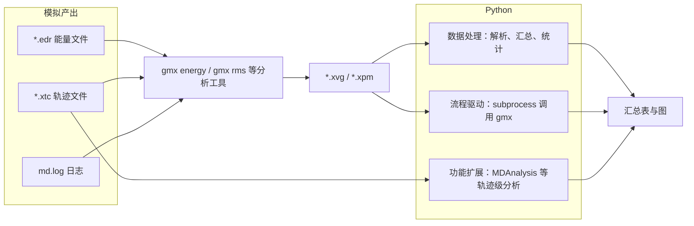
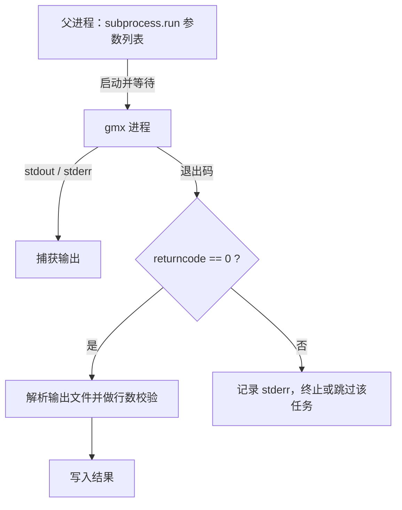

# 第 3 章 Python 数据处理最小集

　　分子动力学模拟的产出主要是大量文本与二进制文件：能量文件（*.edr）、轨迹文件（*.xtc）、以及分析工具输出的 xvg 文本。将原始输出整理为可检验、可复现的结果，是模拟工作流中不可回避的环节。本章讨论 Python 在这一环节中的位置：解析 xvg 文本、汇总多个模拟任务的结果、按出版规范批量作图、用 subprocess 驱动 gmx 命令行程序。第 2 章给出的 shell 手段足以处理单条命令与简单管道，但当任务跨越多体系、多副本或需要统计比较时，shell 的结构化数据能力明显不足，Python 的数组与表格生态成为更稳妥的选择[1,2,3]。本章先界定 Python 与 shell 的分工边界，再按照「语言最小集—文件与路径—数组计算—表格数据—作图—外部程序调用—代码组织—依赖管理」的顺序展开，每一节均以模拟数据场景为驱动。本章覆盖的内容是后续第 7 章轨迹分析、第 8 章自由能计算与第 10 章流程自动化的共同工具基础；第 7 章以后的分析代码将默认使用本章建立的解析、汇总与作图约定。

## 学习目标

- 能独立编写函数解析 gmx 工具输出的 xvg 文件，并转换为结构化数据表；
- 能对多个模拟任务的结果进行分组、聚合与透视，输出可复核的汇总表；
- 能依据出版规范设置 matplotlib 的字体、线宽与尺寸，并批量输出矢量图；
- 能用 subprocess 以参数列表方式调用 gmx 程序，正确处理返回码与输出流；
- 能判断脚本、模块与 notebook 的适用边界，并拆分数据与配置；
- 能锁定依赖版本并复核他人的数据处理结果。

## 前置知识

- 第 2 章：Linux 命令行、管道与重定向、环境管理；本书第 2 章对远程会话与作业调度的处理。
- 基础编程概念：变量、循环、函数（来自本科程序设计课程即可，本章 3.2 节会以模拟场景重述最小集）。
- GROMACS 基本命令的用法与输出物：gmx energy、gmx rms 的输出文件（对应本书第 5 章与第 7 章）。

## Python 在模拟工作流中的位置

### 三类任务：数据处理、流程驱动与功能扩展

GROMACS 是一个由数十个命令行工具构成的软件集合，gmx energy 提取能量项、gmx rms 计算均方根偏差、gmx rmsf 计算原子涨落，这些分析工具的输入是轨迹与结构文件，输出则以 xvg 文本与 xpm 矩阵为主，其文件格式细节由官方参考手册的「File format details」一节统一规定[4]。Python 在模拟工作流中的角色可以归为三类，各自对应不同的数据入口与输出形态。

第一类是数据处理。分析工具的 xvg 输出是纯文本列数据，进入统计环节前需要被读取、清洗、换算与汇总。这一任务的核心载体是 NumPy 数组与 pandas 表格：NumPy 提供同质的数值数组与向量化计算，pandas 在数组之上叠加行与列的标签，使「按温度分组求均值」这类操作可以直接表达[2,3]。第二类是流程驱动。一次完整的分析往往包含多步 gmx 调用与多次文件搬运，Python 通过 subprocess 以参数列表方式启动命令、检查返回码、收集输出，把手工敲命令变成可重放的程序，这一能力的边界与第 10 章的工作流自动化衔接。第三类是功能扩展。xvg 文本只承载了 gmx 内建工具的计算结果，轨迹本身是二进制格式，需要专门的库读取：MDAnalysis 以对象模型封装轨迹与拓扑，可为第 7 章的批量分析提供超越内建工具的视角[5]。三类任务并非并列关系而是分层关系：数据处理建立在分析工具的输出文件之上，流程驱动操纵的是这些命令本身，功能扩展则深入文件内部重新计算，图 3-1 给出其数据流。



图 3-1　Python 在模拟工作流中的三类任务及其数据流：数据处理消费 xvg 文本，流程驱动操纵 gmx 命令，功能扩展直接读取轨迹

三类任务对应着不同的验收方式。数据处理的结果是数值输出，必须可复核：同一输入应当得到相同数字，故解析与统计代码需要进入版本控制并锁定依赖（3.9 节）。流程驱动的结果是一次成功执行，判断标准是命令全部完成且产物齐全。功能扩展的结果需要与内建工具交叉验证，避免重复实现引入偏差。本章正文覆盖前两类任务并给出第三类的入口，功能扩展的细节交由第 7 章展开。

### 与 shell 脚本的分工边界

第 2 章建立的 shell 最小集（grep、awk、cut、sort、head、tail 与管道）适合三类操作：在日志中定位关键行、按列抽取单文件数据、对文本做一次性替换。这里给出更精确的判定：当任务是「从单个文件抽取少量信息、且不需要数值计算」时，shell 的一行管道比 Python 更短更快；一旦出现以下任一情形，应转入 Python——需要对数值做运算（求均值、标准差、拟合）、需要跨文件对齐（多个副本同一时间点的合并）、需要把结果进一步聚合或出图、或者同一处理要反复运行并将被复核。

以「统计三个副本 rmsd.xvg 在 200 ps 之后的均值」为例对比实现。awk 版本可以直接写出，但仅适用于列位置固定的单一文件：

```bash
# 平台：Linux；GROMACS 2026.4 输出 rmsd.xvg（两列：时间/ps、RMSD/nm），示意
awk '!/^[#@]/ && $1 > 200 {s += $2; n += 1} END {print s/n}' repeat1/rmsd.xvg
```

同一任务在 Python 中拆为「解析—筛选—统计」三步，任一步都可复用与扩展：

```python
# Python ≥3.12；示例环境：numpy 2.x
import numpy as np

t, rmsd = np.loadtxt("repeat1/rmsd.xvg", comments=("#", "@"), unpack=True)
print(rmsd[t > 200].mean())   # 200 ps 之后 RMSD 均值，单位 nm
```

两条路线的差异不在行数而在结构：awk 版把解析规则（跳过 # 与 @ 行、取第 2 列）隐式编进了脚本，Python 版把同一规则写成显式参数，后者在多任务汇总时可直接作为零件复用。shell 的另一个结构性限制是精度与类型：awk 的数值是双精度浮点，文本比较与数值比较混用时容易出错，而任何统计输出若没有数据类型与单位的显式声明，在论文复核阶段都难以追溯。因此本章建议的分工是：shell 保留在交互式探查与小型文本操作，凡是会进入方法与数据章节的数值产出，一律由 Python 管线生成并留档。

## 语言最小集

### 数据类型与容器

处理模拟数据的 Python 代码并不需要覆盖语言的全部特性，需要牢固掌握的类型只有四类：数值、字符串、布尔值与容器。数值类型中最核心的区分在浮点与整数：帧号、副本序号是整数（int），温度、能量、坐标是浮点（float）。字符串（str）承担三类职责：文件路径、分组名与单位标签，例如 "repeat3/rmsd.xvg"、"Protein"、"(nm)"。布尔值（bool）多用于掩码与过滤条件，如把 200 ps 之前的帧排除在统计之外。

容器层面需要分清四种结构的用途，这与模拟数据的组织方式直接对应。列表（list）保存有序、可重复的元素，例如一批待处理的 xvg 文件路径；元组（tuple）用于固定数量的返回值，例如统计函数返回（均值, 标准差）；字典（dict）把键映射到值，例如把副本名映射到对应目录；集合（set）保存互不重复的元素，例如从不同体系文件中收集全部残基名以核对是否一致。Python 官方教程的 Data Structures 一章对这四种容器给出完整接口与复杂度说明[6]。以下代码演示用列表收集各副本 200 ps 后的 RMSD 均值：

```python
# Python ≥3.12；依赖 numpy 2.x
import numpy as np

repeats = ["repeat1", "repeat2", "repeat3"]
means = []
for rep in repeats:
    t, rmsd = np.loadtxt(f"{rep}/rmsd.xvg", comments=("#", "@"), unpack=True)
    means.append(rmsd[t > 200].mean())
print(means)
```

这段代码把路径前缀存在列表里、把统计结果追加进另一个列表，是容器在元信息层面的典型用法。需要强调的边界是：容器适合装「数量级在成千上万以下」的对象，真正的数值通量——例如十万帧的轨迹数据——应当直接进入 NumPy 数组（3.4 节），用列表逐元素存储浮点会带来一个数量级以上的性能与内存代价，这一判断的依据是 NumPy 的同质连续内存布局[2]。

### 控制流与函数

Python 的控制流只有顺序、分支与循环三类，模拟脚本里对应三种固定场景。循环用于逐任务处理：for 遍历副本目录、遍历能量项、遍历温度档位；分支用于处理例外：判断某个任务的输出文件是否存在、某个 gmx 调用是否失败；顺序执行则对应单条管线上的固定步骤。Python 官方教程将这三类结构连同函数定义一并给出[7]，此处直接以函数形式组织。

函数是复用的最小单元。以「汇总一批 rmsd.xvg」为例，解析与统计应当封装成带签名的函数，输入为路径与起始时间，输出为统计结果：

```python
# Python ≥3.12；依赖 numpy 2.x
import numpy as np

def rmsd_summary(path: str, t_start: float = 200.0) -> tuple[float, float]:
    """返回 xvg 文件在 t_start（单位 ps）之后的 RMSD 均值与标准差，单位 nm。

    输入文件为 gmx rms 的 -o 输出，两列分别为时间与 RMSD。
    """
    t, rmsd = np.loadtxt(path, comments=("#", "@"), unpack=True)
    sel = t > t_start
    return float(rmsd[sel].mean()), float(rmsd[sel].std())
```

函数带来的直接收益是调用点只表达意图：`for rep in repeats: results[rep] = rmsd_summary(f"{rep}/rmsd.xvg")`。类型标注（`path: str`、`-> tuple[float, float]`）在 Python 3.12 中是运行时可选、但可供静态检查的文档性声明；文档字符串写明输入单位与输出单位，是模拟数据处理中防止「时间单位混淆」的第一道防线（3.4.4 节）。函数与变量命名遵循下划线小写（snake_case）惯例，完整命名规范在 3.2.4 节与 PEP 8 一并给出。

### 异常处理与上下文管理器

批量处理模拟数据时，异常处理解决的是一个真实痛点：单个坏任务不应中断整批汇总。典型情形是某个副本的 xvg 缺失、内容为空，或能量项列数与预期不符；若不捕获异常，一次 30 任务的汇总会因第 17 个文件出错而整体失败。Python 官方教程以「文件不存在」为例介绍了 try/except/else/finally 的结构[8]，应用到模拟场景，解析函数应当捕获 `FileNotFoundError` 与 `ValueError`，并把缺失信息（文件路径）写入异常消息：

```python
# Python ≥3.12
from pathlib import Path

def load_xvg(path: str | Path):
    p = Path(path)
    if not p.is_file():
        raise FileNotFoundError(f"缺少分析输出：{p}（请先运行对应 gmx 工具）")
    try:
        import numpy as np
        return np.loadtxt(p, comments=("#", "@"))
    except ValueError as exc:
        raise ValueError(f"{p.name} 列数不一致或含非数值行：{exc}") from exc
```

两点约定需要固定。其一，except 子句应当尽量出现具体异常类型，捕获裸 `except Exception` 会把编码错误也吞掉，反而掩盖问题；其二，重新抛出时用 `raise ... from exc` 保留原始回溯。上下文管理器（context manager）解决的是资源的确定性释放：`with open(path, encoding="utf-8") as f:` 保证文件在块结束即关闭，`with` 语句的语义由 Python 语言参考定义为进入时调用 `__enter__`、退出时调用 `__exit__`[9]。在数据处理脚本中，凡是打开文件、启动子进程或连接资源，一律用 `with` 管理，避免长循环中文件句柄泄漏。

### 模块与包的组织

当脚本超过几百行或存在多处复用，应当按职责拆分为模块。以一套「xvg 处理管线」为例，最小拆分为三个模块：`xvgio.py` 负责读取与解析，`summary.py` 负责统计与汇总，`plots.py` 负责出图。主程序只编排调用，不写具体实现。Python 官方教程的 Modules 一节规定了 import 语法与包目录结构[10]，这里给出对应的模拟分析包布局：

```text
analysis_project/
├── config.py           # 路径、温度、副本数等配置（3.8.2 节）
├── xvgio.py            # 解析 gmx 输出 xvg
├── summary.py          # 多任务汇总统计
├── plots.py            # 出版级作图
└── run_all.py          # 主入口，按顺序调用上述模块
```

模块间通过 `from xvgio import load_xvg` 引用，目录内放置 `__init__.py` 即成为包。`run_all.py` 作为入口，需要区分「被导入」与「被执行」两种状态：将主流程放在 `if __name__ == "__main__":` 块内，使模块既可被测试代码 import，又可在命令行直接运行。命名的规范性由 PEP 8 约束：模块名全小写、避免与标准库同名（如 `plot.py` 会遮蔽内置模块，宜改名 `plots.py`）、导入按「标准库—第三方—本地」分组排序[11]。这套组织约定是 3.8 节代码组织的预备，本节只要求读者能按此模式落盘。

## 文件与路径

### pathlib 的基本用法

路径操作是模拟数据处理的高频操作：任务目录、副本目录、输出文件名的拼接与遍历。Python 3.4 起标准库提供 pathlib 模块，以面向对象的方式表示路径[12]。与字符串拼接路径相比，`Path` 对象的优势在于跨平台分隔符处理与方法化操作：`Path("runs") / "T320" / "rmsd.xvg"` 会按当前操作系统生成正确分隔符，`.name`、`.stem`、`.suffix`、`.parent` 分别取出文件名、主名、扩展名与父目录，`is_file()`、`exists()` 做存在性检查。PEP 519 定义了文件系统路径协议（`os.PathLike`），自 Python 3.6 起标准库的 `open()`、`os` 函数与第三方库的读文件接口普遍接受 `Path` 对象[13]，因此模拟脚本中「先构造 Path 再传给 np.loadtxt 或 subprocess」是自然写法。

### 编码与换行

GROMACS 的文本输出（xvg、mol、日志）在 Linux 上按 UTF-8 或纯 ASCII 编码写出，换行符为 LF；若用户在 Windows 本地分析（例如把集群上的 rmsd.xvg 下载到 Windows 机器），文件可能被工具改写为 CRLF 行尾。Python 的文本模式读取默认启用通用换行识别，`\r\n` 与 `\n` 都能被正确解析，因此在 `open()` 时不指定 `newline` 参数即可；只有需要精确回写原始字节时才需要二进制模式。源文件编码方面，Python 3 规定源码默认 UTF-8，中文注释与字符串无需声明即可使用[14]。实际风险点不在换行而在分隔符假设：xvg 的数据列以空白（空格或制表符）分隔，读取时应依赖「任意空白分隔」而非硬编码单个空格；同理，统计脚本读到的第一列若是浮点时间（如 200.000），就不应再按整数处理。编码问题的排查手段是先用文本编辑器或 `head` 查看文件前几行确认行尾与字符集，再决定读取参数。

### 批量遍历与命名

模拟实验常见的布局是一组副本目录或一组温度目录：`repeat1/`、`repeat2/`、`repeat3/`，或 `T300/`、`T310/`、`T320/`，每个目录内各有一份 `rmsd.xvg`——后者是 gmx rms 的默认输出名[15]。批量处理的第一步是用 `Path.glob()` 收集文件，并显式排序，因为 `glob()` 的返回顺序不保证稳定，而汇总结果的顺序一旦抖动，跨任务对照表就会失真：

```python
# Python ≥3.12；假设目录结构 runs/T300/rmsd.xvg 等
from pathlib import Path

root = Path("runs")
xvg_files = sorted(root.glob("T*/rmsd.xvg"))   # T300、T310、T320 对应的路径
for p in xvg_files:
    temp = int(p.parent.name[1:])              # 从父目录名 "T310" 提取 310
    print(temp, p)
```

目录解析（把温度、副本号从路径中提取出来）是命名规范化的反向操作：若目录名与命名约定不一致，提取逻辑就会失败，因此模拟任务的目录命名应当从项目一开始固定（第 2 章的目录约定见「存储、配额与数据布局」一节）。输出文件同样需要可解析的命名，例如汇总表命名为 `rmsd_summary_T{T:03d}_rep{rep:02d}.csv`，其中的零填充保证字典序与数值序一致。此外，gmx 工具的默认输出名可能互相覆盖——同一目录下第二次运行 gmx rms 会覆盖上一次的 `rmsd.xvg`，批量场景中应在命令行显式指定 `-o` 输出名，或在运行前把旧文件归档，避免「汇总到一半发现文件被重跑覆盖」的脏数据问题。

## 数组计算

### ndarray 与形状语义

NumPy 的 ndarray（n 维数组）是科学 Python 生态的数值载体，其定义包含三个要点：元素类型同质、内存连续存储、形状（shape）与维数（ndim）显式声明[2]。对模拟数据而言，最常见的形状是二维矩阵「时间 × 量」，例如把 gmx energy 输出的能量.xvg 读入后得到形状为 (N 帧, M 列) 的数组，其中第 0 列始终是时间。形状语义要求所有操作显式区分轴：`arr.shape` 给出各维长度，`arr[:, 1]` 取全部帧的第 1 列，`arr[t > 200]` 返回满足条件的一个新数组（布尔掩码索引）。

掩码索引是模拟数据筛选的基本工具，平衡段截取即典型场景：判断能量最小化与平衡是否完成，通常只统计平衡之后（例如 NPT 平衡 200 ps 之后）的数据。以下代码演示数组形状与掩码的组合使用：

```python
# Python ≥3.12；依赖 numpy 2.x；数据：gmx energy 输出（时间、势能、温度三列）
import numpy as np

data = np.loadtxt("energy_prod.xvg", comments=("#", "@"))   # 形状 (N, 3)
print(data.shape)                                            # 例如 (10001, 3)
t = data[:, 0]                                               # 第 0 列：时间，ps
mask = t >= 200.0                                            # 平衡段掩码
potential = data[mask, 1]                                    # 平衡后势能，kJ/mol
print(potential.mean(), potential.std())                     # 均值与标准差
```

数组中可能混入掩码未覆盖的缺失记录（例如某帧能量为 0.0 的占位），此时需要结合 3.3 节的异常处理在解析时清洗，而不是在统计阶段依赖数值巧合。dtype 方面，GROMACS 的 xvg 数值默认为双精度输出，`np.loadtxt` 默认以 float64 读入，足以承载能量文本的全部有效数字；只有当列中包含非数值（如残基名字符串）时才需要结构化 dtype 或 pandas 处理（3.5 节）。值得记牢的边界是：ndarray 是「数值矩阵」而非「数据表」，它不携带列名与单位信息，单位只能靠 3.4.4 节的约定维护。

### 向量化与广播

向量化指对整组数据一次性执行运算，而非逐元素循环；广播（broadcasting）指形状不同的数组在运算时自动扩展成兼容形状的规则[16]。这两条机制决定模拟数据处理脚本的写法：能用整数组表达式写出的计算，就不应写成 for 循环。以单位换算为例，把能量从 kJ/mol 换算为 kcal/mol、把时间从 ps 换算为 ns，`data * factor` 的一行即完成全部帧；对多副本矩阵按列归一化，`arr / arr.max(axis=0)` 依赖广播把每一列的标量最大值扩展到整列。以下为按列换算与归一化的广播示例：

```python
# Python ≥3.12；依赖 numpy 2.x
import numpy as np

kJ2kcal = 1.0 / 4.184          # 1 kcal = 4.184 kJ
data = np.loadtxt("energy.xvg", comments=("#", "@"))
E_norm = data[:, 1] / np.abs(data[:, 1]).max()   # 势能列归一化到 [-1, 1]，示意
E_kcal = data[:, 1] * kJ2kcal   # 势能列换算，kJ/mol → kcal/mol

# 反例：逐行 Python 循环（仅作对照，不用于生产）
# for i in range(len(data)): data[i, 1] *= kJ2kcal
```

向量化的收益在大数组上才明显：对十万行的能量序列，numpy 表达式与等价 Python 循环差了一到两个数量级，这一量级差异来自循环在解释器中逐行执行而数组运算下沉到 C 层一次性完成[2]。但向量化不是目的本身：当代码因此变得不可读，或数组超过内存（轨迹级数据），应回到分块或专用库（第 7 章的 MDAnalysis 即内建分块遍历[5]）。广播的典型误区是「形状不兼容」：`(10001, 3)` 与 `(3,)` 可以广播相乘，`(10001, 3)` 与 `(10001,)` 则不能直接相乘，报错信息会提示轴对齐问题，而错误定位的第一步是打印两个操作数的 `shape`。

### xvg 文件的解析

xvg 是 GROMACS 分析工具的默认图形输出格式，其结构可以归纳为三类行：以 `#` 开头的注释行（记录文件生成信息）、以 `@` 开头的注解行（记录图题、坐标轴标签、曲线图例与格式指令）、以及后续的纯数据行（多列数值，以空白分隔）[4]。gmx 各工具通过统一的 `-xvg` 选项控制输出风格，取值 `xmgrace`（默认）、`xmgr` 与 `none`，其中 `none` 输出不带注解的纯数据，便于直接交给数值程序[17]。

解析策略取决于是否需要注解信息。若只需要数值，`np.loadtxt(path, comments=("#", "@"))` 一行即可跳过两类非数据行[18]——`comments` 参数接受单个字符或字符序列，把 `#` 与 `@` 都列为注释起始即覆盖 xvg 全部头部。表 3-1 汇总 xvg 三类行的前缀、内容与处理方式。

表 3-1　xvg 文件的行类型与解析处理

| 行类型 | 前缀 | 内容示例 | 解析处理 |
| --- | --- | --- | --- |
| 注释行 | `#` | `# This file was generated by gmx energy` | `np.loadtxt` 的 `comments` 参数跳过 |
| 注解行 | `@` | `@    xaxis label "Time (ps)"` | 需要单位/图题时单独读取 |
| 数据行 | 无 | `200.000  -74321.3  310.02` | 按空白分隔读为数值数组 |

下列解析函数在 loadtxt 之外额外读取注解行，把坐标轴标签里的单位抽取出来，供 3.4.4 节的量纲检查使用：

```python
# Python ≥3.12；依赖 numpy 2.x；解析 gmx 输出 xvg
import numpy as np
from pathlib import Path

def parse_xvg(path: str | Path):
    """读取 xvg 数据与坐标轴单位。

    返回 (data, yunit)，data 为 (N, M) 数组，yunit 为 y 轴标签中的单位字符串。
    """
    p = Path(path)
    unit = None
    for line in p.read_text(encoding="utf-8").splitlines():
        if line.startswith("@    yaxis  label"):      # 依实际缩进调整
            unit = line.split('"')[-2] if '"' in line else None
            break
    data = np.loadtxt(p, comments=("#", "@"))
    return data, unit
```

需要说明两点。其一，上述 `startswith` 里的缩进与引号格式以所用 GROMACS 版本的输出为准，解析注解行本身依赖格式约定，属于文档推定；数值读取则不受注解格式影响。其二，gmx energy 输出的能量.xvg 各列含义由交互式选择的能量项决定，官方在线帮助明确说明能量文件（edr）中保存了按 nstcalcenergy 步累加的全精度累计值，因此 gmx energy 打印的均值、RMSD 与漂移基于全部步长，而 xvg 只含按 nstenergy 抽样的帧——二者的统计口径可能不一致[17]。官方用户指南的 Tutorial material 一节提供配套的数据处理练习与示例数据[19]；这一差异是常见错误一节的重要素材。完整的解析管线如图 3-2 所示：三类行分流后，数值进入数组，单位与图题进入元信息，二者在统计阶段汇合。

```mermaid
flowchart LR
    X[*.xvg 文件] --> C{行首字符}
    C -- "#" --> N1[注释行：跳过]
    C -- "@" --> N2[注解行：提取单位与图题]
    C -- 数字/空白 --> N3[数据行：loadtxt 读入]
    N3 --> A[numpy 数组 形状 (N帧, M列)]
    N2 --> META[单位与图题元信息]
    A --> CLN[掩码截取平衡段 + 单位换算]
    CLN --> DF[DataFrame 长表]
    DF --> OUT2[统计汇总与出图]
    META --> CLN
```

图 3-2　xvg 解析管线：按行首字符分流，数值进数组、元信息进统计校验

### 物理量的单位换算与量纲一致性

GROMACS 采用一套内部单位制：长度 nm、时间 ps、能量 kJ/mol、温度 K、压力 bar[20]。这意味着 gmx 输出的时间列以 ps 计、RMSD 列以 nm 计、能量列以 kJ/mol 计；论文图表若需采用 kcal/mol 或 ns，就必须在脚本中做显式换算。数值必须附带单位与条件的规则同样适用于换算后的输出：报告「均方根偏差 0.23 nm」必须注明参考结构、拟合方式与温度，否则数值不可比。

量纲一致性的维护有三条具体做法。第一，换算因子集中定义并注释来源，不散落于循环体内；第二，在解析与统计之间做单位校验，例如从 xvg 注解中读出时间单位「ps」后，与脚本假设的单位比对，不一致即抛出异常；第三，把「时间、能量单位」这类全局约定写进配置（3.8.2 节），避免每个脚本各写一份因子。表 3-2 给出常用换算因子，数值以 scipy.constants 与 SI 定义为依据[21,22]。

表 3-2　模拟数据常用单位换算（精确因子以 scipy.constants 为准[22]）

| 量 | 换算 | 因子 | 说明 |
| --- | --- | --- | --- |
| 能量 | kJ/mol → kcal/mol | ÷4.184 | 1 cal = 4.184 J（热化学卡） |
| 长度 | nm → Å | ×10 | GROMACS 内部长度单位 |
| 时间 | ps → ns | ×10⁻³ | gmx 的 `-tu ns` 可直接输出 |
| 温度 | K → °C | T − 273.15 | 仅作展示，统计用绝对温度 |

若不想手工维护因子，scipy.constants 提供 `calorie`、`Angstrom` 等物理常数与单位对象，`scipy.constants.convert_temperature()` 处理温度换算[22]。此外，部分时间序列类工具（如 gmx rms）自带 `-tu` 选项控制输出时间单位，例如 `gmx rms -tu ns` 让 rmsd.xvg 的时间列直接以 ns 写出[15]，这一步在源头统一单位，比事后换算更稳；但 `-tu` 不影响能量等量的单位，能量换算仍须在脚本内完成。单位错误的常见形态是「把 ps 当 ns、把 kJ/mol 当 kcal/mol 而不自知」，因此最终输出前应抽查一帧的数值量级：以典型显式溶剂单蛋白体系（数百残基、AMBER 类力场、GROMACS 2026 默认设置）为参照，势能通常在 -10⁶ 至 -10⁵ kJ/mol（其量级据 GROMACS 官方教程对显式溶剂蛋白势能的表述[19]）、RMSD 通常在 0.1–1 nm 量级。这一区间只作便于发现单位或列错位错误的量级抽查示意，随体系规模、力场与软件版本而变（更大体系或粗粒化力场会系统性偏移），不构成判据（文档推定，本章未实测）；量级严重不符即触发人工复核。

## 表格数据

### DataFrame 基础

pandas 的 DataFrame 是在 NumPy 数组之上叠加行、列标签的二维表格结构，官方 API 参考给出其完整接口[23]；pandas 最初即为「带标签的统计计算」设计[3]。相比 ndarray，DataFrame 的收益在于三处：列名寻址（`df["T"]` 而非 `data[:, 2]`）、逐列不同类型（时间列 float、任务名列 str 可以共存）、以及内建的分组、合并、重采样算子。对模拟汇总而言，DataFrame 是「解析结果—汇总表」之间的标准载体。

从解析后的数组构造 DataFrame 只需指定列名，随后即可用 `.info()` 检查各列类型与非空计数、用 `.head()` 抽查前几行：

```python
# Python ≥3.12；依赖 pandas 2.x 与 numpy 2.x
import numpy as np
import pandas as pd

arr = np.loadtxt("energy_prod.xvg", comments=("#", "@"))
df = pd.DataFrame(arr, columns=["t_ps", "epot", "T"])
print(df.info())              # 各列 dtype 与缺失统计
print(df["epot"].mean())      # 按列名统计，单位 kJ/mol
```

DataFrame 的初始构造代价高于 ndarray（标签与索引的维护），因此规则是「先以 numpy 读入与清洗，再转为 DataFrame 做表级操作」，避免用 DataFrame 逐行 append——后者每次追加都重建索引，十万行数据会显著变慢，属于常见错误一节列出的性能反例。列名建议直接携带单位后缀（如 `t_ps`、`epot`、`T_K`），单位进列名是量纲一致性落到数据结构的做法，比在注释里声明更可检验。

### 分组与聚合

多副本、多温度实验的结构化形态是长表：每一行是一个「任务 × 帧」观测，列包括温度、副本号、时间、物理量。对长表做「按温度与副本分组、求均值与标准差」正是 split-apply-combine 模式：先用分组键把表切开，再对各组应用聚合函数，进而合并为汇总表[24]。以下代码把三个温度各三次副本的 RMSD 数据组织为长表，并输出「温度 × 副本」的均值与标准差：

```python
# Python ≥3.12；依赖 pandas 2.x 与 numpy 2.x
import numpy as np
import pandas as pd

frames = []
for temp in (300, 310, 320):
    for rep in (1, 2, 3):
        p = f"T{temp}/repeat{rep}/rmsd.xvg"
        t, rmsd = np.loadtxt(p, comments=("#", "@"), unpack=True)
        d = pd.DataFrame({"T": temp, "rep": rep, "t_ps": t, "rmsd": rmsd})
        frames.append(d[d["t_ps"] >= 200.0])          # 平衡段
long_df = pd.concat(frames, ignore_index=True)         # 长表
summary = long_df.groupby(["T", "rep"])["rmsd"].agg(["mean", "std"])
summary.to_csv("rmsd_summary.csv", float_format="%.4f")
```

这段代码示范了两个要点。其一，`groupby` 的分组键是「任务元数据列」，它们来自目录名解析（3.3.3 节）而非重新读文件，目录命名约定因此决定汇总的正确性；其二，聚合结果可用 `to_csv` 落盘，落盘的汇总表应保留生成脚本的版本标识（列如 `script_ver`），以便复核时追溯数值来源。需要注意的反模式：在 `agg(["mean", "std"])` 之前先确认 `rmsd` 列无缺失（`long_df.isna().sum()`），否则均值会被 NaN 污染而静默输出。

#### 误差语义：帧间标准差不是均值不确定度

把 `std` 写进汇总表之前，必须先明确它表达什么，否则「误差」一词会同时指代三种不同含义。**第一种：帧间标准差（spread）**，指分布自身的宽度——`df["rmsd"].std()`（默认 ddof=1）描述 RMSD 值在轨迹内的离散程度，反映体系涨落而非估计精度。**第二种：均值标准误（SEM）**，指样本均值相对总体均值的抽样不确定度，SEM = σ/√N——它才对「均值估计得准不准」负责，是误差棒的正确定义。**第三种：考虑自相关的有效样本数**——MD 轨迹相邻帧高度相关，N 帧并不等于 N 个独立样本，真实的均值不确定度应基于有效样本数 N_eff（而非帧数 N）计算，即 σ/√N_eff。三种误差在数值上可相差一个数量级：把帧间 std 直接当作均值的误差棒（第 1、2 种混用）是模拟数据报告中最常见的错误之一。统计口径的选择与实现见第 9 章（自相关与有效样本数、块平均估计 SE），本章汇总阶段应做到三件事：`std` 明确标注 ddof 与「帧间分布宽度」语义；需要报告均值不确定度时用 SEM 并注明「按帧数 N 计算、未做自相关修正」或直接用第 9 章的方法给出 N_eff；发表图件的误差棒语义（SD/SEM/CI）必须在图注中写明，这是第 9 章 9.6 记录规范的一部分，也是同行评审最先核对的点。

### 合并与透视

汇总需求常需要把多个来源的表按共同键拼接。典型场景是把能量表与结构表按时间对齐：gmx energy 输出能量随时间变化，gmx rms 输出 RMSD 随时间变化，两表若抽样频率一致，可 `merge` 按时间列连接；若频率不一致，需要重采样对齐（3.5.4 节）。pandas 的 merge 是 SQL 风格的键连接，`how="outer"`、`on="t_ps"` 等参数控制匹配方式与缺失处理[25]。透视（pivot）则把长表转成宽表：温度、副本从行索引变为列标题，适合做「温度 × 副本」的矩阵式对照与热图。以聚合后的汇总表为例：

```python
# Python ≥3.12；依赖 pandas 2.x
wide = summary.reset_index().pivot_table(
    index="T", columns="rep", values="mean"
)
print(wide)                 # 行：T=300/310/320；列：rep=1/2/3
wide.to_csv("rmsd_wide.csv")
```

宽表是可视化与报告的首选形态：三温度对三副本的 3×3 矩阵可直接交给热图或分组柱状图（3.6 节）。pandas 用户指南把 merge 与 pivot 分列于「合并、连接与比较」与「重塑与透视表」两章[25,26]。合并操作最常见的错误是索引对齐的误用：`df1["col"] = df2["col"]` 按索引标签对齐而非按位置对齐，若两表行序不同会静默产生 NaN；排查方法是在合并前打印两表的索引（`df.index[:5]`），确认对齐键的唯一性与一致性。

### 时间序列的重采样与滑动平均

能量、温度等随时间记录的观测量是密度不均匀的抽样序列，需区分两类时间处理。重采样（resample）把数据规整到新的时间网格，例如把每 2 ps 采样的能量序列降采样为每 100 ps 取均值，得到粗粒度趋势；滑动平均（rolling）在固定窗口内求均值，平滑短时间涨落而不改变抽样频率[27,28]。判据是「要保留什么尺度」：重采样改变时间基、服务跨表对齐与数据压缩；滑动平均保留原时间轴、服务于观察趋势。以下代码对 310 K 副本的能量序列做 1 ns（500 帧 × 2 ps）滑动平均：

```python
# Python ≥3.12；依赖 pandas 2.x
import pandas as pd

df = pd.read_csv("energy_T310.csv")            # 列：t_ps, epot
df["epot_smooth"] = df["epot"].rolling(window=500, center=True).mean()
print(df[["t_ps", "epot", "epot_smooth"]].head(10))
```

窗口长度是参数四问的典型对象。定义与量纲：`rolling` 窗口以帧数计，乘以抽样间隔得物理时间（此处 500 帧 × 2 ps = 1 ns）。为何需要：能量序列在平衡后围绕均值涨落，滑动平均把涨落滤掉以便目视判读趋势。推荐取值与依据：窗口应与体系的自相关时间同量级——严格依据在本书第 9 章关于自相关与有效样本数的讨论中给出，本章给出经验起点：窗口取轨迹总长的 1%—10% 以内、且不小于一个自相关时间量级，此处 1 ns 窗口即为按该原则选取的示意值（本章未实测）。取值不当的后果：窗口过小，平滑后仍残留高频抖动，趋势不可读；窗口过大，前期瞬态与后期稳态混叠，甚至把真实的漂移抹平，得出错误的「已平衡」结论。SciPy 的 savgol_filter 是滑动平均之外的备选平滑器，可保留峰形特征[29]，但参数（窗口与多项式阶数）同样需要依据信号特征选择，不适用于随意取默认。

#### 跨表时间对齐与重采样的实现前提

把能量表与结构表按时间合并是常见需求，但**「按时间 merge」有三个必须事先处理的前提**，忽略任何一个都会得到行数异常或成片 NaN——这正是「照书抄会报错」的典型场景。

第一，**时间键的数据类型必须一致**。`gmx energy` 的 xvg 时间列以浮点写出（如 `0.000`、`2.000`），而自定义解析若把时间读成字符串或把一表舍入到整数、另一表保留浮点，`merge` 会因键类型不匹配而全部失配。统一做法：读表后立即 `df["t"] = df["t"].astype(float)`，并在 merge 前打印两表键的 dtype 与 `min/max` 复核。

第二，**浮点时间做等值连接不可靠**。两个来源对同一时刻的浮点表示可能相差 1e-12（如 `100.00000000001` 与 `100.0`），`merge(on="t")` 的等值匹配会漏行。两个稳妥替代：改用**整数帧号键**（若两表抽样间隔相同，先按 `round((t - t0) / dt)` 算出帧号，再 `merge(on="frame")`——整数等值可靠）；或使用 pandas 的 `merge_asof`（按最近邻时间配准，`direction="nearest"/"backward"` 可容忍抽样时刻的微小错位，适合频率不一致的两表）[28]。

第三，**抽样频率不一致时先重采样再合并**。若能量每 2 ps、RMSD 每 10 ps，直接把两表 merge 会产生大量未匹配行。正确顺序：先对较密的表 `resample` 到较疏的时间网格（或双方统一网格），再按该网格合并；这使「对齐」从偶然巧合变成显式操作。三个前提对应三种可预判的症状：类型不一致 → merge 结果为空或键全 NaN；浮点错位 → 行数明显少于预期且无报错；频率不一致 → outer join 产生大量 NaN 行。排查入口统一是合并前后对比两表行数与 `df.isna().sum()`。

## 出版级作图

### figure 与 axes 模型

matplotlib 是科学 Python 生态中最普及的静态绘图库，其设计目标之一即出版级输出，Hunter 在 2007 年发表的原始论文中即将其定位为「面向应用开发、交互式脚本与出版质量图」的二维绘图环境[30]。理解 matplotlib 的关键是对象模型：Figure 是整张画布，Axes 是画布内的一个绘图区，图内所有可见元素（坐标轴、刻度、线条）都是 Artist 对象。官方 API 参考分别给出 Figure 与 Axes 的完整接口[31]。

代码层面存在两层接口。pyplot 便捷层（`plt.plot(...)`）维护一个隐式的当前 Figure 与 Axes，适合交互式探查；面向对象接口显式创建 `fig, ax = plt.subplots()`，此后所有操作都落在 ax 上，适合脚本与函数内使用——显式接口避免「隐式状态串台」，是本章采用的形式。以下给出单个能量面板的完整流程：

```python
# Python ≥3.12；依赖 matplotlib 3.x、numpy 2.x
import numpy as np
import matplotlib.pyplot as plt

t, epot = np.loadtxt("energy_prod.xvg",
                     comments=("#", "@"), usecols=(0, 1), unpack=True)
fig, ax = plt.subplots(figsize=(7.0, 3.5))          # 双栏宽，见 3.6.2 节
ax.plot(t, epot, lw=1.0, color="black")
ax.set_xlabel("t / ps")
ax.set_ylabel("$E_{pot}$ / (kJ/mol)")
fig.tight_layout()
fig.savefig("energy_T310.pdf")                       # 矢量输出，见 3.6.3 节
```

两点约定贯穿全书。其一，坐标轴标签一律「量 / 单位」格式，避免单位只出现在标题里而被裁剪丢失；其二，保存用 `savefig` 而非人工截图，并且保存前调用 `tight_layout()` 或使用 `constrained_layout`，防止标签被画布边缘裁掉。图题（caption）不写入图像，而由 Markdown 的「图 3-X　图题」承载（见本书写作规范的表格与图题约定），这与期刊「图自含、题外置」的惯例一致。

### 字体、线宽与尺寸规范

出版图的规格参数集中于 rcParams 全局配置，matplotlib 官方文档按其参数体系给出说明[32]。这里以四个参数为例回答「参数四问」，取值以化学类期刊的通用出版惯例为推断依据（本章未向期刊实测投稿校验，属文档推定，正文按惯例标注）。

`font.size`（定义与量纲：正文与刻度字体大小，单位 pt；为何需要：期刊审稿会以纸面或固定缩放比例检查可读性，字号过小直接导致图被要求重做；推荐取值及依据：正文 8–10 pt 是化学类期刊图件惯用区间，8 pt 为多面板紧排的下限，10 pt 为单面板舒适值，此区间为本节依据出版惯例归纳的建议起点，最终以目标期刊投稿指南为准；取错后果：小于 7 pt 在缩版后难以辨认，大于 12 pt 浪费版面且与正文字号失衡）。`lines.linewidth`（定义与量纲：数据线宽，pt；为何需要：过细在矢量图缩放下仍清晰但深色打印时偏淡，过粗则掩盖数据细节；推荐取值及依据：1.0–1.5 pt 为通用区间，多条曲线并绘时用 1.2 pt 起点；取错后果：0.5 pt 在期刊缩版后几乎不可见）。`figure.figsize`（定义与量纲：画布宽高，单位英寸；为何需要：决定排版后图件占总宽——单栏或双栏；推荐取值及依据：单栏 3.5 in（8.9 cm）、双栏 7.0 in（17.8 cm）为两类常见版芯宽度，高宽比按内容在 0.5–0.8 间取；取错后果：画布过宽在期刊排版中被强制缩放、字号相对变小）。`savefig dpi`（定义与量纲：位图分辨率，单位 ppi；为何需要：位图格式的分辨率决定打印清晰度；推荐取值及依据：投期刊的位图至少 300 ppi，矢量格式则不依赖 dpi；取错后果：150 ppi 的位图在印刷时出现可见锯齿）。

针对中文论文或含中文标注的图件，还需配置汉字字体：通过 `font.sans-serif` 列出系统中可用的中文字体名（如 Noto Sans CJK SC、SimHei），并配合 `axes.unicode_minus=False` 保证负号正常显示。中文标注以宋体或黑体为主，与正文字体保持一致；投英文期刊的图件则推荐 Times New Roman（serif）或 Helvetica（sans-serif）整套统一。配置集中在一个函数中执行：

```python
# Python ≥3.12；matplotlib 3.x
import matplotlib as mpl

def set_pubstyle(fig_width_in: float = 7.0):
    """按出版惯例设置全局作图参数；fig_width_in 取 3.5(单栏) 或 7.0(双栏)。"""
    mpl.rcParams.update({
        "font.size": 9,
        "font.sans-serif": ["Noto Sans CJK SC", "SimHei", "DejaVu Sans"],
        "axes.unicode_minus": False,
        "lines.linewidth": 1.2,
        "figure.figsize": (fig_width_in, fig_width_in * 0.6),
        "savefig.dpi": 300,
    })
```

字体配置的常见失败形态是「图像中文字显示为方块」：成因是 font.sans-serif 中的字体名在系统中不存在或不含中文，matplotlib 回退到默认字体；排查先用系统工具列出可用字体（Linux 的 `fc-list :lang=zh`），再核对 rcParams 中的字体名与之一致；处置是把确认真实存在的字体名写入配置。表 3-3 汇总本节推荐的默认规格，其数值区间与依据一并列出，供统稿时按目标期刊微调。

表 3-3　出版作图的 rcParams 推荐起点（依据：化学类期刊通用惯例，文档推定）

| 参数 | 推荐起点 | 依据与说明 |
| --- | --- | --- |
| font.size | 9 pt（8–10 pt 区间） | 缩版后仍可辨的最小可读区间 |
| lines.linewidth | 1.2 pt | 单线清晰、多线可区分 |
| figure.figsize | 3.5 in 或 7.0 in 宽 | 对应单栏/双栏版芯 |
| savefig.dpi | 300 ppi（位图） | 印刷最低门槛 |
| axes.unicode_minus | False | 中文负号渲染 |

### 批量出图与矢量输出

一套多温度、多副本实验的作图需求是结构化的：同一图型（RMSD 曲线、能量曲线）按任务重复渲染，只是数据与标题不同。批量出图即把 3.6.1 的画图流程封装为函数，对任务列表循环调用；这同时是现实中已被工具化的需求——专业期刊上已出现面向 GROMACS xvg 的批量出版作图工具，专为解决「以一致规格批量生成可发表图」的重复劳动[33]，说明该模式是领域普遍实践。批量渲染的实现要点有三个。第一，`savefig` 接收显式文件名，命名遵循 3.3.3 的约定（含温度与副本）；第二，循环内 `plt.close(fig)` 释放画布，避免上百张图累积内存；第三，矢量与位图的选择按用途定：PDF/SVG/EPS 适合论文插图与放大不失真，PNG 适合网页与审阅批注，`savefig` 由扩展名推断格式并支持 `format` 参数显式指定[34]：

```python
# Python ≥3.12；依赖 matplotlib 3.x、numpy 2.x
import numpy as np
import matplotlib.pyplot as plt

def plot_rmsd(path, out_pdf, t_min=200.0):
    t, rmsd = np.loadtxt(path, comments=("#", "@"), unpack=True)
    fig, ax = plt.subplots(figsize=(3.5, 2.6))
    ax.plot(t, rmsd, lw=1.2, color="black")
    ax.axvline(t_min, ls="--", lw=0.8, color="gray")
    ax.set_xlabel("t / ps"); ax.set_ylabel("RMSD / nm")
    fig.tight_layout(); fig.savefig(out_pdf); plt.close(fig)

for temp in (300, 310, 320):
    for rep in (1, 2, 3):
        plot_rmsd(f"T{temp}/repeat{rep}/rmsd.xvg",
                  f"fig_rmsd_T{temp}_rep{rep}.pdf")
```

批量出图的验收方式是「抽查」：随机挑取数张图核对坐标轴标签、单位与数值范围，防止某一个网格点上出现了单位换算错误却因批量输出未被发现。等宽、等高的一致性由统一函数保证，这是封装相比复制粘贴的实质收益。

### 多子图与共享坐标轴

当多个物理量需要并排对照（能量、温度、压力随时间的演化），`subplots(nrows, ncols, sharex=True)` 生成共享横轴的子图网格，`constrained_layout=True` 自动处理间距与标签避让[31]。共享横轴的意义在于时间轴对齐后可直接目视比较事件（如压力尖峰与能量跳变是否同时），避免各面板独立缩放的误导。以下代码生成三面板图：

```python
# Python ≥3.12；依赖 matplotlib 3.x、numpy 2.x
import numpy as np
import matplotlib.pyplot as plt

data = np.loadtxt("energy_prod.xvg", comments=("#", "@"))
t = data[:, 0]
fig, axes = plt.subplots(3, 1, sharex=True, figsize=(7.0, 6.0),
                         constrained_layout=True)
labels = ["$E_{pot}$ / (kJ/mol)", "T / K", "p / bar"]
for ax, col, lab in zip(axes, range(1, 4), labels):
    ax.plot(t, data[:, col], lw=1.0, color="black")
    ax.set_ylabel(lab)
axes[-1].set_xlabel("t / ps")
fig.savefig("energy_trio.pdf")
```

子图编号与引用要随图件进入正文：论文中插图以「图 X-Y」编号并在正文首次提及处引用，单图内的多个面板用 (a)、(b)、(c) 标记——本书的写作规范要求图题置于图下方，这一约定与本节的画布组织相互配合。多子图常见的排版问题是面板间标签重叠，`constrained_layout` 与 `tight_layout` 均可缓解，前者在 subplots 创建时声明、后者在保存前调用，任选其一即可，混用反而可能二次压缩。

## 调用外部程序

### subprocess 的参数传递

gmx 的全部工具都是命令行程序，Python 脚本驱动它们属于子进程管理。标准库 subprocess 模块的 `run()` 函数以「参数列表」方式启动进程：第一个位置参数是可执行文件与参数组成的列表，例如 `subprocess.run(["gmx", "rms", "-s", "topol.tpr", ...])`[35]。GROMACS 的软件架构以命令行工具集合为形态，这一事实自其科学与工程论文以来即如此表述[36]。

参数列表方式与 shell 字符串方式（`shell=True`）有本质区别：前者由系统调用直接传参，空格、引号等特殊字符作为单个参数原样传递；后者把整条命令交给 shell 解析，需要额外的转义与引用处理，并引入注入风险。当 xvg 路径含空格（Windows 文件名的常见情况）时，shell=True 需要手工加引号，而列表方式无此问题。因此本章的固定写法是列表传参，`shell=True` 一律不用。示例：

```python
# Python ≥3.12；Linux/macOS；GROMACS 2026.4；Python 进程等待 gmx 完成
import subprocess

cmd = ["gmx", "rms", "-s", "md.tpr", "-f", "traj.xtc",
       "-o", "rmsd.xvg", "-xvg", "none", "-tu", "ns"]
result = subprocess.run(cmd, capture_output=True, text=True)
print("返回码：", result.returncode)
```

`capture_output=True` 捕获 stdout 与 stderr 到内存，`text=True` 以文本解码。对分析类命令，输出量不大，捕获到内存是可行的；对 mdrun 这类长任务，应把输出重定向到日志文件（`stdout=open(...)` 或直接让作业调度器接管），避免内存占用与失控输出——mdrun 的自动化调度属于第 10 章范畴，本节只处理分析类短命令。subprocess 与 gmx 之间的数据流与错误处理逻辑如图 3-3 所示。



图 3-3　subprocess 驱动 gmx 的数据流：输出流捕获、返回码分支与文件级校验

### 输出解析与返回码处理

`subprocess.run` 返回 `CompletedProcess` 对象，其 `returncode` 是进程退出码：0 表示成功，非零表示失败，调用方必须检查。gmx 工具遇错时向 stderr 打印错误信息并以非零码退出，例如能量文件缺失、轨迹与拓扑不匹配等情形[17]。处理失败有三个层级，按需选用：放任不管（仅交互式探查适用，脚本中不可接受）；显式检查并写入日志；`subprocess.run(..., check=True)` 让失败自动抛出 `CalledProcessError`。后两者都应保留 stderr 内容供排查：

```python
# Python ≥3.12；依赖 numpy 2.x；Linux/macOS；GROMACS 2026.4
import subprocess
import numpy as np

proc = subprocess.run(
    ["gmx", "energy", "-f", "ener.edr", "-o", "energy.txt", "-xvg", "none"],
    input="16 0\n",            # 交互式选择第 16 项后以 0 结束，序号依版本而异
    capture_output=True, text=True,
)
if proc.returncode != 0:
    raise RuntimeError(f"gmx energy 失败（返回码 {proc.returncode}）\n{proc.stderr}")
data = np.loadtxt("energy.txt", comments=("#", "@"))   # -xvg none 时无 @ 行
```

这段代码同时示范了交互式工具的驱动：gmx energy 默认提示用户从列表中选择能量项，`input` 参数把选择序列写入其标准输入，从而在脚本中免交互运行。需要强调的是，选择项的编号随 GROMACS 版本与体系略有变化，生产脚本应先用一次手工运行确认编号，再固定进配置。返回码之外还有一类「成功但结果可疑」：命令退出 0，但输出文件为空或因能量文件异常而只有很少帧；此时应校验输出文件的行数与预期（如 `data.shape[0]`），把「文件级校验」并入解析函数——这也是常见错误一节「未检查返回码导致坏数据混入」的根治手段。关于 gmx energy 统计口径（终端的全精度均值与 xvg 抽样帧均值可能不同）已在本章 3.4.3 节说明，属同一类的文档推定，此处不再展开[17]。

### 并发的适用条件

当分析任务彼此独立（不同温度、不同副本的 gmx rms 互不依赖），它们可以并行执行以缩短墙钟时间。concurrent.futures 模块提供了线程池与进程池两种并发的统一接口[37]。选择依据是任务的性质：若任务是等待外部进程（gmx）完成或执行 I/O，用 `ThreadPoolExecutor`——GIL 只约束 Python 字节码的执行，不阻塞外部进程的并发；若任务是在 Python 内做大量计算（如解析与统计上千个 xvg），用 `ProcessPoolExecutor` 才能真正利用多核[37]。以并行解析为例：

```python
# Python ≥3.12；Linux/macOS；依赖 numpy 2.x
from concurrent.futures import ProcessPoolExecutor
import numpy as np

def rmsd_after(path, t_min=200.0):
    t, rmsd = np.loadtxt(path, comments=("#", "@"), unpack=True)
    return float(rmsd[t > t_min].mean())

tasks = [f"T{temp}/repeat{rep}/rmsd.xvg"
         for temp in (300, 310, 320) for rep in (1, 2, 3)]
with ProcessPoolExecutor(max_workers=4) as pool:
    means = list(pool.map(rmsd_after, tasks))
print(dict(zip(tasks, means)))
```

并发数量的取值要回答参数四问。定义与量纲：`max_workers` 是并行工作进程数，无量纲；为何需要：并行度决定等待时间与资源占用；推荐取值及依据：对占用大量内存的解析任务，取物理核数的一半到三分之二可兼顾吞吐与内存（依据：进程池中每进程一份内存映像，属工程惯例，文档推定），对外部 gmx 任务，`max_workers` 反映并发运行的 gmx 实例数，建议不超过机器核数并给 mdrun 自身的线程并行留余量；取错后果：`max_workers` 超过内存可承受范围导致交换，或与 gmx 内置并行叠加导致负载失衡，吞吐反降。并发场景的额外注意事项是输出文件的命名冲突：多个实例同时写同一文件名会互相覆盖，因此并发分支必须用 3.3.3 节的可解析命名，或让每个进程只写自己的目录。

## 代码组织

### 脚本、模块与 notebook 的边界

习惯上，Python 分析代码以三种载体存在：一次性脚本（.py 直接运行）、可复用模块（.py 被导入）、Jupyter notebook（.ipynb，交互式单元容器）。三者的边界由使用场景决定，而不是由「哪个更现代」决定[38]。Jupyter notebook 的价值在探索与叙述：逐单元执行、图件内联、代码与说明同文，原始论文将其定位为「可执行与可读并存的出版格式」[39]。但同一文献与后续大规模统计研究同时指出 notebook 的可复现缺陷：单元可任意顺序执行，最终状态不等于从上到下的执行结果，版本控制与依赖锁定也被弱化[38,39]。落实到模拟数据处理，判据是：交互式探查、教学演示、审稿回复用的中间过程适合 notebook；凡是「要反复重跑、要进方法学、要交给他人复核」的正式数值产出，应落在脚本与模块中，notebook 只作为其前端视图，不承载计算事实。

脚本与模块的分工在本章 3.2.4 节已给出最小形态。模块强调「可导入、可测试、可复用」，脚本强调「可复现的入口」：脚本内部只做参数解析、任务编排与结果落盘，具体算法放在模块里。一个分析项目的最小布局如下（路径约定沿用第 2 章的目录结构）：

```text
analysis/
├── config.py          # 全部路径与参数（3.8.2 节）
├── xvgio.py           # 解析 gmx 输出（3.4.3 节）
├── summary.py         # 汇总统计（3.5 节）
├── plots.py           # 绘图（3.6 节）
├── run_all.py         # 入口：读配置 → 解析 → 汇总 → 出图
└── outputs/           # 汇总表与图件，随代码一起归档
```

「入口脚本只编排、不实现」的收益在复核场景中显现：复核方先看 run_all.py 的调用顺序，再进入具体模块核对算法，路径与参数只在 config.py 一处修改，避免了「改一处忘一处」导致的交叉污染。notebook 与脚本共用同一批模块（`import xvgio`），保证探索时的结果与正式产出一致。

### 函数化与配置分离

函数化指把「做什么」（意图）与「怎么做」（实现）分离：调用点写明语义，实现细节封装在函数内，本章 3.2.2 节的 rmsd_summary 即最小示例[7]。配置分离指把会随实验变化的量——任务根目录、温度列表、副本数、参考时间、单位目标——从算法中拿出来，集中到配置层。这样做的直接原因是模拟工作流的参数化：同一套分析代码要复用在 NPT 平衡与生产段、不同温区、不同体系上，参数不集中，复制粘贴会引入隐蔽分歧。

配置层的最小实现是纯 Python 模块（config.py），其内容是模块级常量与简单数据结构；当配置增多或需要非 Python 使用者维护时，再引入 YAML/TOML 文件与解析库，本章以 config.py 为例[10]：

```python
# 文件：config.py（分析项目配置；路径与参数随实验修改）
ROOT = "runs"                     # 任务根目录，见第 2 章目录约定
TEMPS = [300, 310, 320]           # 温度档位，K
REPLICATES = [1, 2, 3]            # 副本编号
T_EQUIL_P = 200.0                 # 平衡段起点，ps
OUT_DIR = "outputs"
```

入口脚本从 config 读取全部参数：`for temp in config.TEMPS: ...`，且不在任何模块中重复书写魔法数字。一个值得固化的约定是：凡代码中出现裸数字，先问它是不是应该进 config；凡是同一数字出现两次以上，先考虑统一为常量。命令行参数（argparse）是配置的另一种形态，适合「每次运行的参数不同、不便写死」的场合；argparse 的取值覆盖 config 默认值，二者分工为「默认值进模块、覆盖值进命令行」。命名与风格继续遵守 PEP 8，函数与变量用 snake_case，模块内私有函数以下划线前缀标记，避免对外 API 膨胀[11]。单元测试作为函数化的自然延伸，将在第 11 章展开，本章只要求读者能写出「输入明确、输出可断言」的函数，为后续测试铺垫。

## 依赖管理

### venv、conda 与 uv

NumPy、pandas、matplotlib、SciPy 之间以及它们与 Python 解释器之间存在版本耦合：升级其中任一者的主版本可能破坏其余者的 API 约定。模拟项目必须为自身建立隔离的运行环境，把「解析、统计、作图」所依赖的包版本固定下来，也把环境中运行的 Python 解释器版本固定下来——本书版本基线为 Python 3.12 及以上。三类工具提供不同粒度的隔离。

venv 是 Python 标准库自带的虚拟环境工具，与 pip 配合创建最小隔离：`python -m venv .venv` 建环境，激活后 `pip install` 只影响该环境[40]。conda 提供环境与包的双重管理，可安装非 Python 的二进制依赖（如第 2 章用 conda-forge 安装 gromacs），其 `conda create -n <名> python=3.12` 显式锁定解释器版本[41]。uv 是新一代的 Python 包与项目管理器，目标之一是显著缩短解析与安装时间，并提供统一的锁文件机制[42]。三者的关系不是互相排斥而是各有定位：纯 Python 数据处理用 venv+uv 最轻；需要在同一环境里与 GROMACS 二进制共存时使用 conda；uv 可视为 pip/venv 流程的高性能替代。表 3-4 对照三种方式在模拟数据处理中的典型用法（命令以 Linux 为基准，Windows 上路径与激活命令略有差异）。

表 3-4　虚拟环境工具对照（Python 3.12；Linux）

| 工具 | 创建与安装 | 导出依赖 | 适用场景 |
| --- | --- | --- | --- |
| venv + pip | `python -m venv .venv; source .venv/bin/activate; pip install numpy pandas` | `pip freeze > requirements.txt` | 纯 Python 分析 |
| conda | `conda create -n mdpy python=3.12; conda activate mdpy; conda install numpy` | `conda env export > env.yml` | 与 gromacs 等二进制共存 |
| uv | `uv venv; uv pip install numpy pandas` / `uv add numpy` | `uv lock` 生成 uv.lock | 高速解析与统一锁定 |

环境命名的参数四问同样适用：环境名（定义：环境标识符，字符集限定；为何需要：多项目并存的区分；推荐：按用途命名如 md-analysis、mdpy，含 Python 版本信息更好区分；取错后果：名字含空格或路径分隔符会破坏激活脚本）。激活环境后运行 `python --version` 与 `pip list` 复查，是环境隔离生效的验收步骤；脚本内若需要程序化定位解释器，用 `sys.executable` 而非依赖 PATH，可避免「脚本在某环境跑、解释器却来自另一环境」的串扰。

### 版本锁定与复现

依赖固定（pinning）的目标是让「同一代码、同一依赖、同一结果」可重放。pip 的 requirements 文件支持精确固定：`numpy==2.1.3` 与范围说明符 `numpy>=2.0,<3`，前者适合锁定量产环境，后者适合保持兼容范围；说明符语法由 PEP 440 定义[43,44]。复核他人的数据处理结果，第一步就是重建其依赖环境：创建干净的虚拟环境，安装与对方一致的包版本，再运行其代码。完整的复核流程如下（Linux；Python 3.12）：

```bash
# 平台：Linux；Python 3.12
python -m venv .venv-recheck && source .venv-recheck/bin/activate
python -m pip install -r requirements.txt        # 需要提供者给出锁定版本
pip list                                          # 核对实际安装版本
python run_all.py                                 # 重跑并比对数值输出
```

过程中常见三类失败：对方未提供锁定版本（只有裸包名，安装到的是最新版）；锁定的版本在当前 Python 上不可用（例如某包尚未支持 3.12）；第三方依赖传递解析导致隐性升级。前两类的处置是向提供者索要精确版本与 Python 版本；第三类需要锁文件（lock file）才能根治——uv 的 uv.lock、conda 的环境 yml、pip-tools（pip-compile）生成的锁定 requirements.txt 均属此类，其共同点是记录传递依赖的完整解析结果[42,43]。本书的约定是：分析项目在仓库中同时维护 requirements.txt（人读的主依赖清单）与锁文件（机器读的完整解析），并把 Python 版本写进 README 或环境文件。

版本锁定与本章主题的收束关系在第 9 章可复现性一节展开，此处只强调一条纪律：任何声称「数值可由他人复现」的产出，必须能回答「在哪台机器的哪个环境、以哪个包版本、用哪个提交重跑得到」。若不能说清这三者，数据处理环节就没有完成，与模拟本身的采样统计无关。

## 常见错误

1. 现象：解析 xvg 时出现 `ValueError: could not convert string to float`，或统计结果包含明显的数量级错误。成因：xvg 的 `@` 注解行与 `#` 注释行被当作数据读入，浮点转换失败的位置恰是 `@    xaxis label "Time (ps)"` 这类行。排查步骤：用 `head` 或文本编辑器查看文件前 10 行，确认行首字符分布；打印报错行号与内容。处置：`np.loadtxt(path, comments=("#", "@"))` 同时跳过两类头部行；或运行 gmx 工具时加 `-xvg none` 生成纯数据文件[17,18]。

2. 现象：gmx energy 终端打印的均值与自行解析 xvg 后统计的均值不一致。成因：官方在线帮助说明，能量文件保存的是按 nstcalcenergy 步累加的全精度累计值，gmx energy 的统计（均值、RMSD、漂移）基于全部步长；xvg 只包含按 nstenergy 抽样的帧，抽样帧均值与全步长均值天然不同[17]。排查步骤：核对 `-b`、`-e` 是否一致，检查是否使用了 `-aver`；抽查一帧数值确认 xvg 未被截断。处置：报告数值采用与用途一致的口径，并在方法节写明「由 gmx energy 全精度统计」或「由 xvg 抽样帧统计」，二者不可混用。

3. 现象：同一脚本多次运行，汇总表行序不同；或跨任务对照时「第 3 个任务」实际指向不同目录。成因：`Path.glob()` 的返回顺序不保证稳定，未排序的路径列表在文件系统遍历顺序变化时抖动。排查步骤：打印 `[p.name for p in paths]` 与上一次运行的输出比对。处置：一律 `sorted(root.glob(pattern))`；依赖目录名解析元数据（3.3.3 节），保证路径顺序与数值顺序的解耦关系由排序显式建立。

4. 现象：时间轴标注错误、滑动窗口「看起来」覆盖了错误的时间段，或某一列的数值全部小/大若干数量级。成因：ps 与 ns、kJ/mol 与 kcal/mol 等单位在脚本中混用，未显式换算。排查步骤：核对 xvg 注解行中的单位字符串（如 `@    xaxis label "Time (ps)"`），检查 config 中换算因子是否集中定义。处置：把单位写进列名（`t_ps`、`epot`），换算因子集中在 config 并以 scipy.constants 或 SI 定义为准（3.4.4 节与表 3-2）[22]。

5. 现象：含空格的路径传入 gmx 命令后报「文件不存在」，或命令结果与手工执行不同。成因：`subprocess.run("gmx rms ...", shell=True)` 以字符串拼接命令，空格、引号被 shell 二次解析。排查步骤：打印 `cmd` 列表，检查路径元素是否被拆成多个参数。处置：始终以列表传参（`subprocess.run(["gmx", "rms", "-o", path])`），不使用 `shell=True`[35]。

6. 现象：某个任务失败但批处理继续，汇总表里该任务行是 0 或缺失值，整体却「运行成功」。成因：未检查 `returncode`，或只检查了进程退出而未校验输出文件内容的完整。排查步骤：打印 `proc.stderr` 与 `proc.returncode`，核对输出文件行数（`data.shape[0]`）是否等于预期帧数。处置：`check=True` 或显式判错并记录 stderr；解析后对形状做断言式校验（3.7.2 节）。

7. 现象：图中中文（或负号）显示为方块。成因：`font.sans-serif` 配置的字体名在系统中不存在，或未随中文字体一起安装，matplotlib 回退默认字体。排查步骤：`fc-list :lang=zh`（Linux）列出可用中文字体，与 rcParams 中的字体名逐一比对。处置：将真实存在的字体名写入 `font.sans-serif`，并设置 `axes.unicode_minus: False`；条件受限时改用英文标注（3.6.2 节）[32]。

8. 现象：`df1["新列"] = df2["列"]` 之后出现成片 NaN，且原表无缺失。成因：pandas 按索引标签对齐赋值，两表索引不同（如未 reset_index 的长表与宽表）时，标签不匹配的位置产生 NaN。排查步骤：打印两表索引（`df.index[:5]` 与 `len(df)`），核对对齐键。处置：合并类操作显式指定键（`merge(..., on="t_ps")`），赋值前 `reset_index(drop=True)` 或先核对索引一致性（3.5.3 节）[25]。
9. 现象：按时间把能量表与结构表 `merge(on="t")` 后行数明显少于预期，或出现成片 NaN，但两表本身无缺失。成因：浮点时间键做等值连接不可靠——两个来源对同一时刻的浮点表示可能相差 1e-12，`merge` 的等值匹配漏行；或时间键 dtype 不一致（一表为浮点、一表为字符串）。排查步骤：合并前打印两表键的 dtype、`min/max` 与行数；合并后对比 `isna().sum()` 与缺失比例。处置：改用整数帧号键（抽样间隔相同且已知时，`round((t-t0)/dt)` 后按 frame 合并），或对抽样时刻有微小错位的表用 `merge_asof` 按最近邻配准；频率不一致时先 `resample` 到统一网格再合并（见 3.5.3 节三个前提）[28]。

### 最小可复核的数据处理管线

把「从 xvg 到可发表图件」固化为一条可复核的最小管线，有两层收益：他人可独立校验每一步输出，自己半年后能重建同一结果。最小管线由五个环节构成：其一，原始数据不动——xvg/edr 等输入文件保持只读，所有派生表落 `analysis/` 或新目录，禁止覆盖源文件；其二，每个派生环节的脚本可重跑且幂等——同一输入两次运行产出逐位一致（哈希相同），为此脚本内不使用无种子的随机性、时间戳只能写入日志不能进数据列；其三，关键中间产物落盘并记录消—`summary.csv`、处理后的长表都应带生成脚本版本与输入文件哈希；其四，数值口径在脚本头部集中声明——单位（ps/ns、kJ/mol/kcal/mol）、ddof、是否去平衡段、汇总键（温度×副本）；其五，复核闭环——任何数字进入报告前按五步核对：脚本可重跑（`python script.py` 就地执行无报错）、输入哈希与记录一致（`sha256sum` 对比）、输出与上次运行哈希一致（幂等）、关键数值与 gmx 内建工具交叉验证（如均值、极值与 3.5.2 的误差语义核对）、图件与数值表一一对应（图上的均值/误差棒能从表复算）。这五步对应第 9 章 9.6 记录规范的执行层：管线工具化之后，「可复现」从口头承诺变成可自动校验的断言。

## 本章小结

- Python 在模拟工作流中的角色分为数据处理、流程驱动与功能扩展三类，本章建立了解析、汇总与作图的数据处理管线，其输出格式约定（列名带单位、汇总表落盘、矢量图命名）将贯穿第 7 章以后的章节。
- 与 shell 的分工判据是任务是否进入「解析—统计—可视化—复核」闭环；凡是需要跨文件对齐、数值统计或反复重跑的输出，一律转入 Python 并留档。
- xvg 解析的关键是识别三类行：`#` 注释、`@` 注解与数据行；数值读取用 `np.loadtxt(comments=("#", "@"))`，单位与图题从注解行提取，量纲一致性通过列名带单位与集中换算因子维护。
- 多任务汇总的标准形态是长表加分组聚合：目录名解析出任务元数据，`groupby` 生成「温度 × 副本」汇总，`pivot_table` 转宽表供对照与出图；时间处理区分重采样与滑动平均，窗口选择以自相关时间量级为原则（严格处理见第 9 章）。
- 出版级作图以 Figure/Axes 对象模型为骨架，规格（字体、线宽、尺寸、dpi）集中为 rcParams 配置；批量出图封装为函数并对产物抽查；gmx 外部调用以列表传参并处理返回码，批内并发按任务类型选择线程池或进程池。
- 代码组织遵循「入口脚本只编排、算法进模块、参数进配置」；依赖管理用 venv/conda/uv 隔离环境，以精确版本与锁文件支撑结果复核，这是数值产出可复现的前提。

## 延伸讨论

从 xvg 到发表图件之间，误差语义是守门环节：帧间标准差（spread）、均值标准误（SEM）与自相关修正后的不确定度（σ/√N_eff）三者在数值上可差一个数量级。把 `std` 直接当作误差棒是最常见的失步；本章的纪律是「报 SD 须注明 ddof 与语义、报告均值不确定度须注明是否经自相关修正」，严格的估计交给第 9 章。

时间对齐的三个前提（键 dtype 一致、整数帧号键或 `merge_asof`、先重采样再合并）值得固化为个人代码库的合并函数，而不是每次手写 `merge`——这三处是「照书抄会报错」级陷阱，封装后从源头消失。同理，`groupby` 前的缺失检查与幂等性校验（同输入同哈希）是所有批处理管线的通用纪律。

最小可复核管线（第 7 节）的五步闭环，本质是把第 9 章 9.6 的记录规范落到 Python 层：输入哈希、输出哈希、口径声明、交叉校验、图数对应。做到这五步，再复杂的分析也能在半年后重建；做不到，「可复现」只是愿望。

## 参考文献

[1] Python Software Foundation. The Python Tutorial[EB/OL]. https://docs.python.org/3/tutorial/index.html（访问日期：2026-10-28）.
[2] Harris C R, Millman K J, van der Walt S J, et al. Array programming with NumPy[J]. Nature, 2020, 585(7825): 357-362. DOI: 10.1038/s41586-020-2649-2.
[3] McKinney W. Data structures for statistical computing in Python[C]//Proceedings of the 9th Python in Science Conference (SciPy 2010). Austin, TX, 2010: 56-61. DOI: 10.25080/Majora-92bf1922-00a.
[4] GROMACS 2026.4 documentation. Reference manual: File format details[EB/OL]. https://manual.gromacs.org/current/reference-manual/file-formats.html（访问日期：2026-10-28）.
[5] Gowers R J, Linke M, Barnoud J, et al. MDAnalysis: A Python package for the rapid analysis of molecular dynamics simulations[C]//Proceedings of the 15th Python in Science Conference (SciPy 2016). Austin, TX, 2016: 98-105. DOI: 10.25080/Majora-629e541a-00e.
[6] Python Software Foundation. The Python Tutorial: Data Structures[EB/OL]. https://docs.python.org/3/tutorial/datastructures.html（访问日期：2026-10-28）.
[7] Python Software Foundation. The Python Tutorial: More Control Flow Tools[EB/OL]. https://docs.python.org/3/tutorial/controlflow.html（访问日期：2026-10-28）.
[8] Python Software Foundation. The Python Tutorial: Errors and Exceptions[EB/OL]. https://docs.python.org/3/tutorial/errors.html（访问日期：2026-10-28）.
[9] Python Software Foundation. The Python Language Reference: Context manager types / The with statement[EB/OL]. https://docs.python.org/3/reference/datamodel.html（访问日期：2026-10-28）.
[10] Python Software Foundation. The Python Tutorial: Modules[EB/OL]. https://docs.python.org/3/tutorial/modules.html（访问日期：2026-10-28）.
[11] van Rossum G, Warsaw B, Coghlan A. PEP 8: Style Guide for Python Code[EB/OL]. https://peps.python.org/pep-0008/（访问日期：2026-10-28）.
[12] Python Software Foundation. pathlib: Object-oriented filesystem paths[EB/OL]. https://docs.python.org/3/library/pathlib.html（访问日期：2026-10-28）.
[13] Cannon B, Zevenhoven K. PEP 519: Adding a file system path protocol[EB/OL]. https://peps.python.org/pep-0519/（访问日期：2026-10-28）.
[14] Python Software Foundation. Unicode HOWTO[EB/OL]. https://docs.python.org/3/howto/unicode.html（访问日期：2026-10-28）.
[15] GROMACS 2026.4 documentation. gmx rms[EB/OL]. https://manual.gromacs.org/current/onlinehelp/gmx-rms.html（访问日期：2026-10-28）.
[16] NumPy development team. Broadcasting[EB/OL]. https://numpy.org/doc/stable/user/basics.broadcasting.html（访问日期：2026-10-28）.
[17] GROMACS 2026.4 documentation. gmx energy[EB/OL]. https://manual.gromacs.org/current/onlinehelp/gmx-energy.html（访问日期：2026-10-28）.
[18] NumPy development team. numpy.loadtxt[EB/OL]. https://numpy.org/doc/stable/reference/generated/numpy.loadtxt.html（访问日期：2026-10-28）.
[19] GROMACS 2026.4 documentation. User guide: Tutorial material[EB/OL]. https://manual.gromacs.org/current/user-guide/index.html（访问日期：2026-10-28）.
[20] GROMACS 2026.4 documentation. Reference manual: Definitions and Units[EB/OL]. https://manual.gromacs.org/current/reference-manual/definitions.html（访问日期：2026-10-28）.
[21] Virtanen P, Gommers R, Oliphant T E, et al. SciPy 1.0: fundamental algorithms for scientific computing in Python[J]. Nature Methods, 2020, 17(3): 261-272. DOI: 10.1038/s41592-019-0686-2.
[22] The SciPy community. scipy.constants: Constants and units[EB/OL]. https://docs.scipy.org/doc/scipy/reference/constants.html（访问日期：2026-10-28）.
[23] The pandas development team. pandas.DataFrame[EB/OL]. https://pandas.pydata.org/docs/reference/api/pandas.DataFrame.html（访问日期：2026-10-28）.
[24] The pandas development team. Group By: split-apply-combine[EB/OL]. https://pandas.pydata.org/docs/user_guide/groupby.html（访问日期：2026-10-28）.
[25] The pandas development team. Merge, join, concatenate and compare[EB/OL]. https://pandas.pydata.org/docs/user_guide/merging.html（访问日期：2026-10-28）.
[26] The pandas development team. Reshaping and pivot tables[EB/OL]. https://pandas.pydata.org/docs/user_guide/reshaping.html（访问日期：2026-10-28）.
[27] The pandas development team. Time series / date functionality[EB/OL]. https://pandas.pydata.org/docs/user_guide/timeseries.html（访问日期：2026-10-28）.
[28] The pandas development team. pandas.DataFrame.rolling[EB/OL]. https://pandas.pydata.org/docs/reference/api/pandas.DataFrame.rolling.html（访问日期：2026-10-28）.
[29] The SciPy community. scipy.signal[EB/OL]. https://docs.scipy.org/doc/scipy/reference/signal.html（访问日期：2026-10-28）.
[30] Hunter J D. Matplotlib: A 2D graphics environment[J]. Computing in Science & Engineering, 2007, 9(3): 90-95. DOI: 10.1109/MCSE.2007.55.
[31] The Matplotlib development team. Matplotlib API reference: Figure / Axes[EB/OL]. https://matplotlib.org/stable/api/figure_api.html（访问日期：2026-10-28）.
[32] The Matplotlib development team. Customizing Matplotlib with style sheets and rcParams[EB/OL]. https://matplotlib.org/stable/users/explain/customizing.html（访问日期：2026-10-28）.
[33] Rosenbaum M K, van der Spoel D. plotXVG: Batch generation of publication-quality graphs from GROMACS output[J]. Journal of Chemical Information and Modeling, 2026, 66(6): 2955-2959. DOI: 10.1021/acs.jcim.5c02998.
[34] The Matplotlib development team. matplotlib.pyplot.savefig[EB/OL]. https://matplotlib.org/stable/api/_as_gen/matplotlib.pyplot.savefig.html（访问日期：2026-10-28）.
[35] Python Software Foundation. subprocess: Subprocess management[EB/OL]. https://docs.python.org/3/library/subprocess.html（访问日期：2026-10-28）.
[36] Abraham M J, Murtola T, Schulz R, et al. GROMACS: High performance molecular simulations through multi-level parallelism from laptops to supercomputers[J]. SoftwareX, 2015, 1-2: 19-25. DOI: 10.1016/j.softx.2015.06.001.
[37] Python Software Foundation. concurrent.futures: Launching parallel tasks[EB/OL]. https://docs.python.org/3/library/concurrent.futures.html（访问日期：2026-10-28）.
[38] Project Jupyter. Jupyter Documentation[EB/OL]. https://jupyter.org/documentation（访问日期：2026-10-28）.
[39] Kluyver T, Ragan-Kelley B, Pérez F, et al. Jupyter Notebooks—a publishing format for reproducible computational workflows[C]//Positioning and Power in Academic Publishing: Players, Agents and Agendas. Amsterdam: IOS Press, 2016: 87-90. DOI: 10.3233/978-1-61499-649-1-87.
[40] Python Software Foundation. venv: Creation of virtual environments[EB/OL]. https://docs.python.org/3/library/venv.html（访问日期：2026-10-28）.
[41] Anaconda Inc. conda documentation: Managing environments[EB/OL]. https://docs.conda.io/projects/conda/en/latest/user-guide/tasks/manage-environments.html（访问日期：2026-10-28）.
[42] Astral. uv: An extremely fast Python package and project manager[EB/OL]. https://docs.astral.sh/uv/（访问日期：2026-10-28）.
[43] Python Packaging Authority. pip: Requirements file format[EB/OL]. https://pip.pypa.io/en/stable/reference/requirements-file-format/（访问日期：2026-10-28）.
[44] Coghlan N, Stufft D. PEP 440: Version identification and dependency specification[EB/OL]. https://peps.python.org/pep-0440/（访问日期：2026-10-28）.