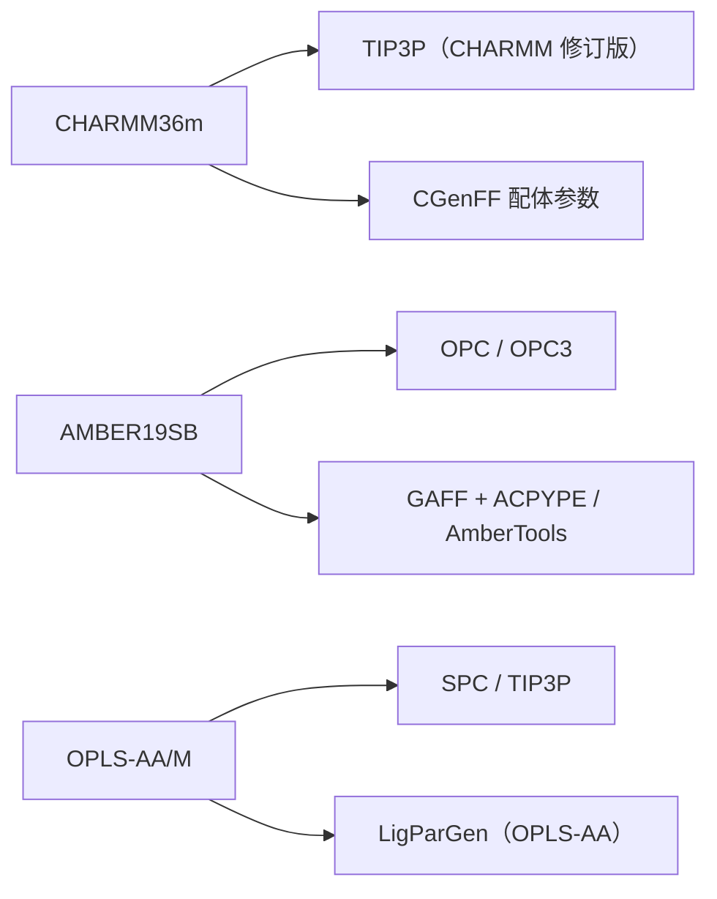

# 第 4 章 体系构建：从结构到拓扑

体系的构建是把「生物学对象」翻译成「可计算的粒子系统」的过程：一枚 PDB 结构文件记录的是坐标与残基序列，而一次分子动力学模拟需要的是一套完整的拓扑描述——每个原子的类型、电荷与质量，原子间的成键、键角、二面角与非键相互作用参数。这一翻译并非机械转换：质子化态需按 pH 判定，缺失的氢原子需按残基模板补齐，游离的水与离子需按目标盐浓度加入，而配体等非标准残基则需要专门的参数化工具为其生成力场参数。构建环节的每一个决定——力场、水模型、盒型、离子浓度、配体电荷方案——都会随模拟传播到后续所有分析结论中，因此本章是全书的枢纽：第 2 章建立的工具链在此落地为具体命令，第 5 章的能量最小化与平衡直接消费本章产出的拓扑与运行输入，第 7 章的分析结果是否可靠，亦取决于本章是否忠实还原了体系的化学组成。本章按数据流组织：先给出从结构文件到运行输入的整体流程与文件职责，再依次讨论结构文件的预处理、pdb2gmx 的拓扑生成机制、力场与水模型的选型、模拟盒与溶剂化、配体参数化三路线，最后以拓扑自检收尾。版本基线沿用第 1 章的 GROMACS 2026.x（当前 2026.4）[1]，凡涉及版本差异之处均注明适用区间。

## 学习目标

- 能依据体系的化学组成（蛋白质、核酸、膜、配体小分子）与所要回答的科学问题，独立完成力场与水模型的选型，并给出可追溯的取舍依据。
- 能使用 `gmx pdb2gmx` 把 PDB/mmCIF 结构转换为 GROMACS 拓扑，正确处理端基、二硫键与组氨酸质子化态（默认自动判定、需逐残基干预时用 `-his`）等常规情形，并解释输出拓扑中各个段的含义。
- 能说明 `editconf`、`solvate`、`genion` 三个命令的职责边界，独立完成模拟盒的设定、水的填充与体系电荷的中和，并控制目标盐浓度。
- 能沿 ACPYPE/AmberTools、LigParGen、OpenFF 三条路线之一为配体生成与 GROMACS 兼容的拓扑，并比较三条路线的输入、输出与适用边界。
- 能对构建完成的拓扑执行原子数、净电荷与参数完整性三项自检，并据此定位 pdb2gmx 与 grompp 阶段报错的成因。
- 能判断膜蛋白、金属位点、核酸与糖类等特殊体系在构建阶段的附加要求，并选择相应的处理工具。

## 前置知识

- 第 1 章的版本基线、单位与符号约定；第 2 章的 GROMACS 安装、`gmx` 命令调用与环境变量（见第 2 章 2.6 节）。
- 基础化学事实：原子电荷与极化、氢键、pKa 与质子化态、离子强度；本科有机化学对官能团命名的熟悉程度。
- 对文本文件的基本操作能力：本章大量工作是对 PDB、拓扑与日志文本的查看与编辑，第 2 章 2.2 节的文本处理命令集构成该能力。
- 后续依赖方向：第 5 章直接使用本章产出的 `.tpr` 与 `.top`；第 7 章分析所依赖的轨迹质量追溯至本章的构建决策；配体参数化涉及的 Python 工具链复用第 3 章的环境管理约定。

## 数据流全景

### 从结构文件到运行输入

体系构建的产出是两份相互绑定的文件：一份坐标（structure，常用 `.gro` 或 `.pdb` 格式）与一份拓扑（topology，`.top` 及其包含的 `.itp`）。GROMACS 官方「典型模拟流程」示意图给出从坐标到运行的基本次序：`pdb2gmx` 由结构文件生成拓扑与坐标，`editconf` 定义模拟盒，`solvate` 填充水，`grompp` 把坐标、拓扑与运行参数合并为二进制的运行输入文件 `.tpr`，`mdrun` 只消费这一个文件[2]。需要指出，官方流程图止于溶剂化，并未包含离子步骤[2]；带净电荷的体系应在 `solvate` 之后先用一次 `grompp` 生成含完整坐标、拓扑与盒信息的 `.tpr`，经 `genion` 加入离子（见 4.7.2）后再重新 `grompp`。图 4-1 在官方基线之上并入这一离子扩展，构成本章讨论的完整数据流，其中每一步的命令与产物将在本章后续小节逐一展开。

```mermaid
flowchart LR
    A[PDB/mmCIF 结构] --> B["gmx pdb2gmx"]
    B --> C["topol.top + 坐标 .gro"]
    C --> D["gmx editconf"]
    D --> E["定好盒尺寸的坐标"]
    E --> F["gmx solvate"]
    F --> G["含水分子的坐标与拓扑"]
    G --> H["gmx grompp → ions.tpr"]
    H --> I["gmx genion"]
    I --> J["含离子的坐标与拓扑"]
    J --> K["gmx grompp"]
    K --> L["topol.tpr（运行输入）"]
    L --> M["gmx mdrun（能量最小化/平衡/生产）"]
```



图 4-1　从结构文件到运行输入的构建数据流（官方「典型模拟流程」[2] 止于溶剂化；图中的离子加入与第二次 `grompp` 为带电荷体系的必要扩展）

需要说明的是，图 4-1 中的 `grompp` 在流程中出现两次：第一次仅用于为 `genion` 提供含完整坐标、拓扑与盒信息的 `.tpr`（`genion` 据此确定溶剂组并随机替换水分子，`-conc` 的目标浓度亦按该文件的盒体积计算），第二次才生成真正的运行输入。中间任何一个环节的产物发生变化，后续所有步骤原则上都应重做，因为拓扑与坐标必须逐原子对应；这正是第 10 章将整个流程脚本化的原因。

### 各文件的职责与依赖关系

构建阶段涉及的每个文件都有明确职责，且存在单向依赖关系：拓扑描述分子内部（原子、成键、电荷、质量与相互作用参数），坐标描述分子位置，二者通过原子顺序隐式绑定，`grompp` 对二者做一致性检查[3]。表 4-1 列出本章涉及的输入输出文件；更完整的格式说明见官方文件格式指南[4]与拓扑文件格式章节[5]。

表 4-1　体系构建阶段的主要文件及其职责

| 文件 | 内容与职责 | 产生/消费方 |
| --- | --- | --- |
| `.pdb` / `.mmcif` | 实验结构：残基序列、坐标、B 因子、占有率；不含相互作用参数 | 输入；`pdb2gmx` 消费 |
| `topol.top` | 体系级拓扑：`#include` 力场与分子片段，`[ molecules ]` 段给出各分子型数量；分子型级描述在 `.itp` 中 | `pdb2gmx` 产生，`solvate`/`genion`/`grompp` 依次更新或消费 |
| `.itp` | 单个分子型（水、离子、配体、蛋白链）的原子与相互作用参数 | 力场目录提供；配体参数化工具生成 |
| `.gro` / `.pdb`（坐标） | 原子坐标与盒向量；`.gro` 可含速度 | 构建各步骤之间传递 |
| `.mdp` | 运行参数（步数、时间步、截断、系综控制） | 用户编写；`grompp` 消费 |
| `.tpr` | 展开后的原子级运行输入，含全部参数；`mdrun` 的唯一输入 | `grompp` 产生 |

拓扑文件分为两个层次。分子型（moleculetype）层面的拓扑描述每种分子的原子、电荷、质量与成键参数，写在力场目录或独立的 `.itp` 中；体系层面的 `.top` 通过 `#include` 把这些片段拼装起来，并用 `[ molecules ]` 段声明每种分子的拷贝数。`grompp` 展开拓扑时把分子型描述复制为原子级描述，因此 `.tpr` 中不再有 `#include` 与条件语句；要查看展开结果，可在 `grompp` 时加 `-pp` 选项输出预处理后的拓扑[3]。理解这一层次关系是后续排查「拓扑与坐标原子数不符」类错误的基础。

## 结构文件

### PDB 与 mmCIF 的信息内容

PDB（Protein Data Bank）格式是结构生物学的历史标准，其坐标段以固定列宽排列：每条 `ATOM`/`HETATM` 记录包含原子序号、原子名、残基名、链标识、残基序号与 x/y/z 坐标，可选列给出占有率（occupancy）与温度因子（B-factor）[6]。该格式的局限在于列宽固定（原子与残基名最长四字符）、无法表达任意元数据，且氢原子在多数晶体结构中缺失。mmCIF（macromolecular Crystallographic Information File）是 wwPDB 自 2010 年代起力推的替代格式：它以字典驱动、无固定列宽，能承载任意数量的数据项，目前 PDB 存档的新结构与绝大多数更新均以 mmCIF 发布[6]；wwPDB 自 2019 年 7 月起对晶体学方法解出的结构强制采用 PDBx/mmCIF 作为唯一沉积格式[7]。

对模拟构建而言，两种格式提供的信息等价：序列、原子名、坐标与链划分。需要强调，结构文件**不含**任何相互作用参数，也不含键序（化学键连接关系须由参数化工具依据残基模板或化学规则重建）；因此「结构文件齐全」绝不等于「拓扑可用」。GROMACS 的 `pdb2gmx` 能直接读取两种格式，但一些小工具（如部分网络服务器）仍只接受 PDB，准备输入时需按目标工具选择格式。

### 缺失原子、氢原子与质子化态

实验结构存在三类信息缺失，必须在构建阶段显式处理。第一类是可溶区缺失残基与侧链：中低分辨率（分辨率大于约 2.5 Å）的晶体结构常缺失无序环区残基，部分侧链只有主链密度（教学性经验概括：缺失范围随晶体与数据处理而异，应以实际结构文件为准）。缺失残基若位于研究区域，需用同源建模工具补全；若位于远端表面，可在文档中注明并接受缺失，因为 `pdb2gmx` 无法猜测缺失原子。第二类是氢原子：X 射线结构在常规分辨率下几乎不提供氢坐标，`pdb2gmx` 默认按残基模板几何加氢，命令选项 `-ignh` 指示忽略输入文件中已有的氢——旧结构中的氢原子位置往往与所选力场的加氢几何不一致，工程上通常建议显式使用 `-ignh` 后按模板重建，此为通行做法而非官方教程规定[8]。第三类是质子化态：组氨酸侧链咪唑环可呈 δ-氮质子化（HID）、ε-氮质子化（HIE）与双质子化（HIP）三种形态，`pdb2gmx` 默认按最优氢键几何自动判定（该自动判定自早期版本起即为默认行为，并非 2026 年引入），需要逐残基干预时可用 `-his` 交互指定；Asp、Glu、Lys、Arg 等可电离侧链的质子化态由所选力场 `.rtp` 模板内的电荷与原子设定固定——`pdb2gmx` 直接按模板取用，不会逐残基询问，若要改变（如把 Asp 写成质子化的 ASH），须在输入结构中改用对应质子化残基名或手工编辑拓扑。`-ter` 仅用于肽链 N 端与 C 端的变体选择（见 4.2.3 节），不控制侧链质子化[8]。

质子化态的选择直接改变体系净电荷与氢键网络。经验值仅作起点（His 在生理 pH 下呈 δ/ε 单质子化、Asp/Glu 去质子化、Lys/Arg 质子化），对活性位点等关键区域应使用 pKa 预测工具：PROPKA3 依据三维结构与经验规则给出残基 pKa 及其对周围环境的敏感度[9]，H++ 服务器把 pKa 计算与加氢、电荷分配整合为一条流水线[10]。构建记录中应保存质子化态决策及依据，因为同一 PDB 在不同 pH 假设下会得到不同净电荷，进而影响离子数（见 4.7 节）。

### 结构质量检查

结构质量检查回答「这份坐标能否安全地进入能量最小化」。常用指标来自 MolProbity 一类的全原子验证：clashscore（≥0.4 Å 重叠的非键原子对数量）、Ramachandran 离群率、rotamer 离群率与侧链翻转（Asn/Gln/His 的 180° 误排）[11]。对模拟而言，最直接的风险是原子间未消除的立体冲突：它会令初始势能在最小化第一步就发散或产生剧烈结构松弛（见第 5 章）。建议在构建前用 MolProbity（或集成该指标的 Phenix/CCP4 工具）检查研究区域，重点关注配体与口袋、多聚体界面的冲突；分辨率与 MolProbity 评分也可作为从同一蛋白多个存档结构中选择起始结构的依据[11]。检查结果应写入方法与数据一节，作为可复现性记录的一部分。

## pdb2gmx 的工作机制

### 残基数据库与力场目录

`pdb2gmx` 的核心是把「残基序列 + 坐标」翻译为「原子级参数」，其依据是选定力场目录中的数据库文件[8][12]。每个力场以 `.ff` 目录组织，例如 `charmm36m.ff`、`amber14sb.ff`；目录内各文件的职责为：`forcefield.itp` 声明原子类型、质量与相互作用参数族；`residuetypes.dat` 与 `aminoacids.dat` 定义残基分类（蛋白质/核酸/水/离子等）；`.rtp`（residue topology）给出每个残基的原子名、电荷与内部成键模板；`.hdb` 给出加氢的几何规则；`.n.tdb` 与 `.c.tdb` 定义 N 端与 C 端变体；`specbond.dat` 定义特殊键（二硫键、辅因子连接）的判定距离；`ions.itp` 与各 `.itp` 文件定义离子与水的分子型[12]。GROMACS 按 `GMXLIB` 环境变量与当前目录搜索力场目录，`pdb2gmx` 启动时会打印实际使用的力场路径，这是排查「改了个力场文件却不生效」的第一步[12]。

匹配流程分两步：先按残基名查 `.rtp`，再按原子名把坐标中的原子对应到模板原子。因此残基名与原子名必须与所选力场的命名一致——同一残基在不同力场中的原子名可能不同（如 AMBER 系组氨酸常用 HID/HIE/HIP 命名，而 CHARMM 系使用 HIS 加询问），这是换力场后常见报错的根源。力场目录本身还限定了可生成的内容：`pdb2gmx` 只能处理 `.rtp` 与端基数据库覆盖的残基，配体与修饰残基不在其列，需走 4.8 节的参数化路线。

### 端基处理与二硫键

多肽链的端基默认按游离形式处理：N 端氨基质子化（NH₃⁺）、C 端羧基去质子化（COO⁻），二者合计贡献净电荷而影响后续离子数。`-ter` 选项允许对每条链逐一交互选择端基变体；乙酰化 N 端、酰胺化 C 端等修饰需要端基数据库中有对应变体，否则只能由用户自行补写拓扑。多聚体结构应确认链划分是否正确：`grompp` 依据 `.top` 中的分子型边界决定哪些原子属于同一链，链间错误连接会在最小化阶段表现为异常成键张力。

二硫键的生成依赖 `specbond.dat` 的距离判据：当两个 Cys 的 Sγ–Sγ 距离落入参考距离（默认条目约 0.20 nm，各力场以实际文件为准）的 ±10% 容差内，`pdb2gmx` 将其识别为候选二硫键并把参与残基改写为 specbond.dat 指定的二硫键残基（AMBER 系默认条目为 CYS2，CHARMM 系为 CYX）；需要逐对确认时可用 `-ss` 交互指定[8]。自 2024 版本起 GROMACS 会把直接在输入中命名为 CYX 的半胱氨酸对自动按二硫键处理[13]。常见问题是晶格中的对称拷贝造成假距离，或 Sγ–Sγ 距离落在容差之外导致漏检；处置方式是按化学而非单纯距离确认每一对二硫键，并在构建记录中列出。

### 常见失败原因

`pdb2gmx` 的失败几乎都可归入三类。其一，残基名不识别：输入文件中的残基名不是所选力场 `residuetypes.dat` 的标准名（如把质子化天冬氨酸写成 ASH 而非 ASP、把硒代甲硫氨酸写成 MSE），报错形如「Residue 'XXX' not found in residue database」。处置是改回标准名，或在确认该残基确非标准后改用对应的自定义拓扑。其二，原子名不匹配：坐标中某残基的原子无法对应 `.rtp` 模板（例如缺少主链原子、原子名拼写差异），说明该残基破损或不完整，需回到结构文件修正。其三，内容超出范围：输入含配体、金属或非标准修饰时，`pdb2gmx` 会直接报不支持或静默忽略，正确做法是先对蛋白部分单独运行 `pdb2gmx`，再由 4.9 节的方法把异种组分并入。此外，输入文件中水分子（SOL/HOH 残基）通常应在 `pdb2gmx` 前移除，因为水应由 `solvate` 按目标密度统一加入，逐晶格水拷贝会引入密度误差。

## 力场

### 力场的构成

力场（force field）是势能函数的参数集：函数形式给定「势能如何随原子坐标变化」，参数集给定「每个原子与每类相互作用的强度」。绝大多数生物分子力场采用相同的基本形式：键伸缩（两体）、键角弯曲（三体）、二面角扭转（四体，含平面外保持平面性的 improper 项），以及非键的 Lennard-Jones 与 Coulomb 项；各力场在函数细节上存在差异，例如 CHARMM 系使用 CMAP 形式的骨架二面角修正项[14]，AMBER 系对各二面角项采用不同的周期性展开[15]，OPLS 系则以凝聚相性质与二面角能学为拟合目标[16]。原子类型（atom type）是力场的核心抽象：每个原子被赋予一个类型标识，该标识同时决定质量、电荷规则与所有相互作用参数的查表入口；同一元素在不同化学环境（sp² 碳、芳香碳、羰基碳）中属于不同原子类型，这是力场能够区分化学环境而保持参数表可管理的原因[12]。

GROMACS 的力场目录把「原子类型与参数」和「残基模板（rtp/hdb/tdb）」分层存放[12]。对使用者而言，最关键的性质是**一致性**：参数必须整体取自同一力场族。蛋白质、水模型、离子与配体参数各自独立发展，混用不同族的参数（如 CHARMM 蛋白配 OPLS 配体参数）会使非键相互作用失去热力学自洽，属于构建阶段必须避免的错误（见 4.4.4 与 4.8.5）。表 4-2 汇总本章讨论的三个全原子蛋白质力场族的概况。

表 4-2　全原子蛋白质力场族对比

| 特性 | CHARMM36m | AMBER ff19SB | OPLS-AA/M |
| --- | --- | --- | --- |
| 开发脉络 | CHARMM22[17]→CHARMM36[14]→CHARMM36m[18] | ff94[15]→ff99[19]→ff99SB[20]→ILDN[21]→ff14SB[22]→ff19SB[23] | OPLS-AA 蛋白二面角修订[16] |
| 骨架表示 | CMAP 交叉项 | 常规傅里叶展开 + 氨基酸特异 CMAP（ff19SB）[23] | 傅里叶展开 |
| 典型水模型 | TIP3P（CHARMM 修订版）[24] | TIP3P / OPC[23] | TIP3P / SPC |
| GROMACS 中的来源 | MacKerell 实验室发布的 GROMACS 版文件[25] | 2026 起原生 AMBER14SB/AMBER19SB[1] | 随发行包内建（OPLS-AA/L） |
| 适用侧重 | 折叠蛋白与无序蛋白（IDP）平衡良好[18] | 序列特异性、突变与设计研究[23] | 配体较多的小分子-蛋白体系 |

### 蛋白质力场：CHARMM36m、AMBER ff19SB、OPLS-AA/M

CHARMM36m 是 CHARMM36 针对主链骨架系综的修订，其动机是解决早期 CHARMM 力场对无序肽段螺旋含量偏高的问题：通过重新标定主链二面角与 CMAP 项，36m 在保持折叠蛋白行为的同时显著改善无序蛋白（IDP）的构象系综[18]。它继承了 CHARMM 系与脂质、核酸、糖类参数的家族内兼容性，是膜蛋白与多组分体系的全原子默认选择之一。GROMACS 发行不内置 CHARMM36 文件，需从 MacKerell 实验室网站获取与 GROMACS 兼容的版本，并按官方页面给出的 mdp 设置使用：`rcoulomb=rvdw=1.2 nm`、`rvdw-switch=1.0 nm`、`vdw-modifier=force-switch` 且关闭色散校正[25]。

AMBER 系在 GROMACS 中经历了两次阶段。2026 之前，GROMACS 原生支持 AMBER94/96/99/99SB/99SB-ILDN 与 AMBER03/AMBERGS[25]，更现代的 ff14SB 与 ff19SB 需经第三方移植（如 ffamber 端口）使用；2026.0 起，ff14SB 与 ff19SB 被正式移植为 AMBER14SB 与 AMBER19SB，并随附 OPC/OPC3 等新水模型[1]。ff19SB 的改进集中在主链：针对全部 20 种氨基酸以水相量子力学势能面为参照拟合氨基酸特异的 φ/ψ 参数，并引入 CMAP 项，使螺旋倾向等序列特异性性质显著改善；其作者在验证中同时指出 ff14SB 对螺旋含量的低估被 TIP3P 水过度紧凑的倾向部分抵消，故推荐 ff19SB 与 OPC 水搭配使用[23]。对一般可溶蛋白，ff19SB/OPC 已成为当代默认组合之一。

OPLS-AA/M 不是独立的生物大分子力场，而是在 OPLS-AA 基础上专门修订了肽与蛋白的二面角参数：Robertson 等人以量子化学势能面为参照重新拟合骨架与侧链扭转项，显著改善了二面角能学，同时保留了 OPLS-AA 对小分子的成熟覆盖——这一点使 OPLS-AA/M 在「蛋白 + 一系列配体类似物」的体系（如虚拟筛选后续模拟）中具有独特吸引力[16]。GROMACS 发行包内建的 OPLS 力场为 OPLS-AA/L 版本[12]，需取得 OPLS-AA/M 参数后自行组装；使用前应核对发行说明与参数来源。

### 粗粒化力场：Martini 3

当体系的时间与空间尺度超出全原子可行范围（如膜自组装、蛋白质凝聚、纳米材料界面）时，粗粒化（coarse-grained，CG）力场把约四个重原子合并为一个相互作用中心（bead），使可模拟时长提升数个量级。Martini 是生物分子领域应用最广的 CG 力场：其 2.x 版本确立了珠类型按化学极性划分的框架[26]，2021 年发布的 Martini 3 重新平衡了各类珠的相互作用强度，引入更细的化学倾向亚标签，并扩展了对氢键与电子极化效应的显式表达能力，显著改善了分子堆积与界面性质的预测[27]。Martini 3 的参数、拓扑与工具链（martinize2、insane 等）由官方项目网站维护，可直接用于 GROMACS[28]。

使用 Martini 3 需要接受其适用边界：它不保留原子级立体化学信息，质子化态只能通过珠上的显式电荷近似表达；静电与氢键以有效方式打包进相互作用参数，因此不能回答依赖偶极取向细节的问题。构建路径与全原子不同：由 `martinize2` 等工具把全原子结构映射为珠坐标与拓扑，再把蛋白质珠、脂质珠与 Martini 水珠组装进盒子；后续 `solvate`/`genion` 流程与全原子相同，但溶剂使用 Martini 水珠（单珠代表数分子水）[28]。力场选择应把「问题需要什么分辨率」作为第一判据，粗粒化是分辨率不足时的加速手段而非默认路径。

### 力场选择的判据

力场选择没有普适最优解，需按问题约束排序：体系组成、目标性质、可用的配套参数、计算预算与研究组的可复现性管理。表 4-3 给出按体系组成的推荐路线。判据的核心是**参数覆盖率优先于单项精度**：一个参数完备、与目标性质验证匹配的力场，通常优于一个理论上更先进但缺参数的力场；同时应优先选择本领域近期文献广泛使用、有明确验证记录的力场，以便与已有结果比较（方法学陈述依据见各力场原始论文，表 4-3 标注出处）。

表 4-3　按体系组成推荐的全原子力场路线

| 体系组成 | 推荐路线 | 关键注意事项 |
| --- | --- | --- |
| 可溶蛋白（折叠） | CHARMM36m 或 AMBER19SB/OPC | 与同族水模型搭配 |
| 可溶蛋白（无序/部分折叠） | CHARMM36m[18] | 避免早期 AMBER 变异株 |
| 膜蛋白 + 脂质 | CHARMM36（蛋白+脂质同族） | 需完整 CHARMM36 脂质参数文件 |
| 蛋白 + 配体 | CHARMM36m + CGenFF，或 OPLS-AA/M + LigParGen，或 AMBER + GAFF | 配体参数必须取自同一力场族（见 4.8） |
| 核酸（DNA） | AMBER 系 + parmbsc1 修正[29] | 核实 GROMACS 内建核酸残基覆盖 |
| 糖类 | GLYCAM06 + AMBER 蛋白[30] | 注意 1-4 作用尺度差异 |

## 水模型

### 常见水模型的结构与参数

水是绝大多数生物体系的主体，水模型的选择直接影响密度、扩散系数与溶剂化自由能的定量结果。常见水模型按相互作用位点数分类：三位点模型把电荷放在 O 与两个 H 上（TIP3P、SPC/E）；四位点模型把氧上的负电荷移到偏离原子的 M 位点，以更真实地描述电子分布（TIP4P-Ew、TIP4P/2005、OPC）；五位点模型把负电荷放在两个孤对位点（TIP5P），代价是计算量上升。各模型均以刚性几何约束保持键长键角不变，其中 OPC 的几何参数为自由优化所得而非取自实验值；模拟中由约束算法维持。表 4-4 汇总本章涉及模型的关键参数与定位。

表 4-4　常见非极化刚性水模型的参数与定位

| 模型 | 位点 | 电荷配置 | 参数来源 | 定位 |
| --- | --- | --- | --- | --- |
| TIP3P | 3 | −0.834（O），+0.417（H） | Jorgensen 1983[31] | 计算便宜；与多数 AMBER 力场配套；扩散偏快[32] |
| SPC/E | 3 | −0.8476（O），+0.4238（H） | Berendsen 1987[33] | 引入自极化修正，电荷略增强[33] |
| TIP4P-Ew | 4 | −1.048（M 位点） | Horn 2004[34] | 针对 Ewald 求和的四点点位模型重标定 |
| TIP4P/2005 | 4 | −1.1128（M 位点） | Abascal & Vega 2005[35] | 相图普适性好，最大密度温度接近实验值[35] |
| OPC | 4 | 三位点电荷 + 一虚位点；几何自由优化 | Izadi 2014[36] | 以较少的位点数复现大批体性质，推荐与 ff19SB 搭配[36][23] |

GROMACS 发行自带的 `spc216.gro` 是三种三位点模型通用预平衡水盒，`tip4p.gro`/`tip5p.gro` 等对应其他模型；水分子型定义位于力场目录的 `tip3p.itp`、`opc.itp` 等文件[25]。选择水模型的直接判据是与力场的一致性（见下节），而非孤立比较水模型本身的性质精度。

### 水模型与力场的搭配约束

水模型与溶质力场构成一个热力学整体：溶质参数（尤其是电荷与范德华参数）在开发时即以特定水模型为溶剂拟合，把任一组件换成异族成员会系统性偏移溶剂化自由能与构象平衡。两条明确规则：其一，AMBER 蛋白力场与 TIP3P 的搭配是长期验证基准，ff19SB 官方推荐改用 OPC[23]；其二，CHARMM36 族使用其修订版 TIP3P[24]，其 GROMACS 移植版中氢原子带 Lennard-Jones 参数[37]，并使用与 CHARMM 静电参数匹配的截断方案，见 4.4.2[25]。OPC3 是 OPC 的三位点版本，随 GROMACS 2026 的 AMBER 移植一并提供，用于希望在三位点成本下获得 OPC 级溶剂化精度的情况[1]。判断「能否混搭」的准则：查阅目标力场的原始文献与维护方声明；没有声明支持的组合应视为未验证组合，需要自行用密度、纯溶剂焓等可观测量作基准测试（依据类型为方法学推断，正文已标注）。图 4-2 概括了蛋白力场、水模型与配体参数化路线之间的同族一致性约束。



图 4-2　蛋白力场—水模型—配体参数路线的同族搭配关系：三条纵向链各自共享电荷方案与非键参数约定（依据各力场开发方文档与原始论文[25][23][24][38][39][40]绘制）

### 可极化效应的近似

所有固定电荷模型都把电子极化平均进有效参数：SPC/E 通过在势能中加入自极化修正项（把平均偶极对体系能量的贡献显式补回）获得比 SPC 更好的密度与扩散行为[33]；TIP4P-Ew 与 TIP4P/2005 的电荷参数也是对极化效应的有效折中[34][35]。当问题对氢键方向性、界面或离子-蛋白相互作用的空间电荷重分布敏感，且预算允许时，显式可极化是更高保真的选项：Drude 振子模型给每个原子的电荷附加一个可位移的偶极振子，CHARMM 族的 Drude 蛋白力场即基于该框架[41][42]；多极展开模型（如 AMOEBA）则用原子多极矩描述电荷分布。GROMACS 参考手册对可极化相互作用（Drude 类）有原生支持，但参数集通常需从对应开发方的发行物获取。实际工程判断是：除非所研究的问题明确依赖极化效应（如金属位点的电荷转移、疏水界面），否则固定电荷模型仍是默认，因为可极化力场在参数完备性、兼容工具链与计算成本三方面均不占优。

## 模拟盒

### 盒型选择

周期性边界条件（periodic boundary conditions，PBC）下体系被置于一个可复制的盒（box）中，盒型的选择决定单位体积内的原子数即计算效率。GROMACS 的 `editconf -bt` 支持 triclinic（一般三斜）、cubic（立方）、dodecahedron（菱形十二面体）、octahedron（截角八面体）四类盒型[43]；膜体系常用的正交长方体（rectangular）并非 `-bt` 的独立取值，而是 triclinic 盒取正交（90°）晶格角的特例，可用 `-box` 配合 `-angles` 设定。立方盒任意两方向的边等长，实现简单但体积冗余最大；菱形十二面体在相同的最近邻距离下体积仅为立方的约 0.71 倍，是各向同性体系的默认推荐（官方教程与常规做法的默认选择）；截角八面体体积因子约 0.77，亦为常见选择。盒体积直接影响水分子数与算力，故对溶剂化蛋白质体系应优先使用高堆叠密度盒型；Wassenaar 与 Mark 的系统研究表明，在保证最小镜像距离的前提下，盒型改变对蛋白质动力学性质的影响有限，缩小体积带来的收益是纯计算性的[44]。表 4-5 汇总常用盒型。

表 4-5　常用盒型对比（体积比为同一最近邻距离下的相对值，依据[44][43]）

| 盒型 | 相对体积 | 适用场合 |
| --- | --- | --- |
| cubic 立方 | 1.00 | 各向同性小体系、教学示例 |
| dodecahedron 菱形十二面体 | 约 0.71 | 溶剂化蛋白等各向同性体系的默认选择 |
| octahedron 截角八面体 | 约 0.77 | 各向同性体系备选 |
| rectangular 正交长方体（triclinic 的 90° 角特例） | 视长宽比 | 膜体系、界面体系；非 `-bt` 选项取值，需按三斜盒设定 |
| triclinic 三斜 | 任意 | 由晶格向量定义的定制盒 |

### 最小镜像原理与截断的关系

PBC 下每个粒子既与真实邻居作用，也与镜像副本作用；最小镜像约定（minimum image convention）规定只考虑「每个粒子最近的镜像」之间的相互作用，其成立前提是非键截断半径 R_c 不大于盒最短边长的一半。GROMACS 在 `grompp` 阶段校验该条件：当盒过小或截断过大而违反 `L ≥ 2R_c` 时给出警告或报错[45]。静电长程项由 PME（particle mesh Ewald）以网格傅里叶变换求和处理[46]，其短程直接空间部分仍受截断约束，因此 `rlist`（邻居表距离）与 `rcoulomb`、`rvdw` 的取值必须与盒尺寸联合校验。工程上的常见失配是：为省水而把盒做得只比 2R_c 略大，导致溶质绕过镜像边界与自身副本相互作用，表现为计算出的回旋半径、氢键数目出现截断伪影；处置留出余量（见下节）。

### 盒尺寸的确定

盒尺寸的确定遵循「溶质尺寸 + 溶剂缓冲层」两步：先用 `editconf` 把溶质居中，再按缓冲距离 d 设定盒边（`-d d` 表示溶质表面到盒壁的最小距离，`-c` 表示居中）。缓冲距离的推荐下限是 1.0 nm：在非键截断 1.2 nm（CHARMM 36 系）下，该值保证溶质任何原子到最近镜像副本的最小距离不小于截断半径，避免镜像自相互作用[25][43]。对膜蛋白等非各向同性体系，x/y 面内按 1.0 nm 缓冲、z 方向按「膜平面两侧各有约 1.5 nm 以上水层」取值；对需要曲率或大浓度梯度的体系，还需为溶胀预留空间。盒取小的后果是镜像伪影与截断误差；盒取大的后果是水分子数按体积线性增长、算力浪费。经验法（非官方规定）：先用 1.0 nm 缓冲构建，能量最小化后检查溶质到盒壁的最小距离，若任何原子距离盒壁小于 0.5 nm 则应加大缓冲重建。

## 溶剂化与离子

### solvate 的处理逻辑

`solvate` 把预平衡的溶剂盒（默认 `spc216.gro`，可由 `-cs` 更换为其他模型的水盒）复制并平移到目标盒中，剔除与溶质原子重叠的溶剂分子，最后把正确数量的溶剂分子追加进拓扑的 `[ molecules ]` 段[47]。其重叠判据基于范德华排斥半径（`-radius`，默认 0.105 nm 级别），因此若溶质结构本身存在异常接近的原子对，`solvate` 不会识别——重叠清除只在溶质-溶剂之间进行。执行 `solvate` 前必须已用 `editconf` 定好盒，且拓扑中必须已包含水的 `#include`（力场目录的 `tip3p.itp` 等）；`solvate` 输出的坐标与拓扑必须成对使用，后续任何一步只更新其中一个都会造成原子数失配（见 4.10 节的核对方法）。对非水溶剂（如辛醇、环己烷双相体系），`-cs` 指向对应预平衡盒并配合专门的力场定义。

### 电荷中和与盐浓度

周期性体系若带净电荷，PME 会在背景中引入均匀补偿电荷（grompp 对非零净电荷给出警告），该近似对静电自由能有系统性偏差，因此带净电荷的蛋白必须中和。工具是 `genion`：它读取 `grompp` 生成的 `.tpr`，在选定溶剂组（通常为 SOL）中随机选取位置，把水分子替换为单原子离子，并同步更新拓扑[48]。典型命令链为：先用任意一个最小化用 `.mdp` 生成 `ions.tpr`，再执行：

```bash
# 平台：Linux（bash）；GROMACS 2026.x；力场为 CHARMM36m（离子名须与本力场 ions.itp 一致）
gmx grompp -f ions.mdp -c solv.gro -p topol.top -o ions.tpr
# 交互选择组 SOL 后：
gmx genion -s ions.tpr -o solv_ions.gro -p topol.top -pname NA -nname CL -neutral
```

`-neutral` 添加恰好中和净电荷的离子；`-conc X` 与 `-neutral` 联用则在中和基础上把盐浓度提高到目标值，浓度按 `.tpr` 中的盒体积计算[48]。需要指明的是，`-conc` 的语义是「添加至指定浓度」，已有离子不参与计算，且最终浓度受替换精度限制，构建记录中应同时记下目标浓度与实得离子数。离子名称自 GROMACS 4.5 起统一为元素符号大写（NA、CL），不再随力场变化；输入文件中的离子残基名可能与原子名不同，`-pname/-nname` 接受的是分子型名，填错（如写成 Cl-）会在 grompp 阶段报「No such moleculetype」[49][48]。生理条件下的盐浓度常用 0.15 mol/L（NaCl，该值属生理学常用近似而非普适设定），也可按实验条件改写。

### 离子位置与参数

随机替换为长期默认行为：官方档案自 4.0.1 起即注明 `-random` 选项默认开启、因基于静电势的选位计算不可靠；该选项在 GROMACS 4.6 系列后期被移除，当前版本的帮助文本与选项表中已无 `-random` 项，`genion` 一律在选定溶剂组中随机选取位置替换水分子[48]。`-rmin` 控制离子与非溶剂（溶质）之间的最小距离[48]。离子参数（电荷、范德华参数）位于力场目录的 `ions.itp`，不同力场的离子参数互不通用：例如 CHARMM 系离子参数针对其非键方案标定，而 AMBER 系在三类水模型中各有对应的单原子离子参数集，GROMACS 2026 的 AMBER 移植随附按水模型区分的离子文件（如 `ions_tip3p.itp`）[1]。对二价与多价离子（Ca²⁺、Mg²⁺、Zn²⁺），参数化远未标准化，其水合半径与配位行为对参数敏感（见 4.9.2）；模拟前应核对所选力场是否提供该离子、其参数针对何种水模型标定，并把这一信息写进方法记录。

离子参数存在「族」的概念，选择规则可归纳为一句话：**同一体系内的离子参数须取自同一参数族，整套使用 12-6 或 12-6-4 而不混搭，并按水模型配套**。AMBER 族常见的离子参数族包括：与 TIP3P 等水模型配套标定的标准 12-6 单原子离子（Joung–Cheatham 2008 为最常引用的系统性标定之一，JPCB 112(30):9020–9041[50]）、以及为二价/过渡金属发布的 12-6-4 附加参数（Li, Song & Merz 2015，JPCB 119(3):883–895[51]），后者在 12-6 基础上引入显式的离子-配体相互作用校正项，改善水合与配位描述但必须整套使用。工程上的两个易错点：其一，混用不同族的离子参数（如蛋白配体用标准 12-6、金属位点用 12-6-4）会导致静电与范德华口径不一致；其二，离子参数对水模型敏感，换水模型应同步核对对应离子文件（GROMACS 2026 的 AMBER 移植按水模型分文件即为此设计[1]）。CHARMM 系离子参数与其非键方案绑定，同样遵循「同族配套、不跨族混用」原则；NBFIX 一类针对特定离子-原子对的非键修正视作同一族的补充而非替代。在方法部分应写清离子参数族与来源（引用相应标定文献或力场版本），供评审方追溯。

## 配体参数化

### 电荷与原子类型的确定

配体参数化的任务是为「不在任何生物大分子力场残基库中的小分子」生成完整的原子类型、电荷与成键参数。第一步是确定原子类型：它以化学图（键序、芳香性、形式电荷）为输入，按规则（GAFF 的原子类型感知、SMIRKS 模式匹配等）为每个原子分配类型标识，类型决定范德华参数与成键参数查表范围[52][53]。第二步是确定原子电荷，两条主流路线：RESP 拟合以量子化学静电势为参照，用约束最小二乘把电荷拟合成与势能面匹配的最优值，多构象多分子版本用于生物大分子[54]；AM1-BCC 用半经验 AM1 计算加上经验键荷修正（bond charge correction）快速得到凝聚相质量电荷，且不依赖昂贵的高水平量化计算，是全自动参数化流程的默认选择[55]。第三步是核对电荷合理性与净电荷：配体通常带整数形式电荷，参数化工具的产物应与输入化学图一致，任何非整数净电荷都提示输入结构或参数化参数出错。

### ACPYPE 与 AmberTools 流程

ACPYPE（AnteChamber PYthon Parser interfacE）是 ANTECHAMBER 的 Python 包装，把 Amber 工具链的产物转换为 GROMACS 拓扑[56]。完整流程为：用 `antechamber` 生成带 GAFF/GAFF2 原子类型与电荷的 mol2，用 `parmchk2` 补全缺失成键参数生成 `.frcmod`，用 `tleap` 组装成 `prmtop/inpcrd`，最后用 `acpype` 转成 GROMACS 的 `.top` 与 `.gro`[38][56]。GAFF 是 AMBER 系面向有机小分子的通用力场，其参数与 AMBER 蛋白/核酸力场在电荷方案与 1-4 作用尺度上配套，因此该路线天然适合与 AMBER 蛋白力场（含 GROMACS 2026 原生的 AMBER14SB/19SB）联用[38]。命令序列如下：

```bash
# 平台：Linux（bash）；依赖：AmberTools ≥22（conda 安装：mamba install -c conda-forge ambertools）、acpype（pip 安装或源码）
# 第一步：SDF 输入 → GAFF2 原子类型 + AM1-BCC 电荷 → mol2
antechamber -i lig.sdf -fi sdf -o lig.mol2 -fo mol2 -c bcc -at gaff2 -s 2 -rn LIG
# 第二步：补全成键参数（缺失项写入 lig.frcmod）
parmchk2 -i lig.mol2 -f mol2 -o lig.frcmod -s gaff2
# 第三步：tleap 组装 prmtop/inpcrd（leaprc.gaff2 已含 gaff2 定义）
tleap -f - <<EOF
source leaprc.gaff2
LIG = loadmol2 lig.mol2
check LIG
loadamberparams lig.frcmod
saveamberparm LIG LIG.prmtop LIG.inpcrd
quit
EOF
# 第四步：ACPYPE 转换为 GROMACS 拓扑（产物：LIG_GMX.top、LIG_GMX_processed.gro 等）
acpype -p LIG.prmtop -x LIG.inpcrd
```

产出的 `LIG_GMX.top` 以 `#include` 引用了力场定义与 `posre.itp`（位置约束文件），使用时把它并入体系 `topol.top`：在 `[ system ]` 段之前添加 `#include "LIG_GMX.top"`，并在 `[ molecules ]` 段登记 `LIG 1`。该路线适用边界：GAFF 覆盖面以常见有机官能团为主，`parmchk2` 报告的缺失项若无法由类似环境近似，必须回到量子化学层面补参；同时产物原子名基于 mol2，与蛋白部分拼接时需确认无重名冲突。

### LigParGen

LigParGen 是耶鲁 Jorgensen 组的网络服务，输入 SMILES 或三维 SDF，输出 OPLS-AA 参数族的小分子拓扑（含 GROMACS 格式的 `.top/.gro` 与 `.itp`），电荷默认取 1.14\*CM1A-LBCC 方案——在半经验 CM1 电荷基础上按局域键荷修正，专为凝聚相模拟标定，避免 RESP 级别的量化开销[39][57]。该路线的价值在于与 OPLS-AA 蛋白力场（含 OPLS-AA/M，见 4.4.2）的族内一致性，适合「OPLS 蛋白 + 配体系列」的研究；输出通常给出一个完整的溶剂化示例体系，用户取其小分子片段并入自己的拓扑。边界与注意事项：服务端以药学相关分子空间为主要校验范围，含硼、金属或特殊杂环的分子可能缺参；使用前应确认服务当前可用性与版本，并把下载时间与所用参数版本写进记录。OPLS-AA 族的另一条路线是 CGenFF 之于 CHARMM、GAFF 之于 AMBER 的同类服务化入口；CGenFF 本身是 CHARMM 系的通用力场，其自动服务器对「药物样分子 + CHARMM 蛋白」场景常用[40]。

### OpenFF 工具链

OpenFF（Open Force Field）项目以 SMIRNOFF 格式改写力场定义方式：参数不再按离散原子类型查表，而是用 SMIRKS 化学子结构模式直接匹配化学图中的每个作用项，即「直接化学感知」，从而消除原子类型体系难以扩展、参数冗余的问题[53]。在此基础上发展出的小分子通用力场 Parsley（OpenFF 1.0）[58] 与 Sage（OpenFF 2.0）[59] 以开放数据集与可复现管线优化参数。其 Python 工具链在 GROMACS 中的用法是：用 `openff-toolkit` 建分子与力场对象，用 `openff-interchange` 参数化后直接写出 GROMACS 拓扑[60]：

```python
# 平台：Linux/macOS/Windows；Python 3.10+；依赖 openff-toolkit、openff-interchange（版本以官方文档为准）
from openff.toolkit import Molecule, ForceField
from openff.interchange import Interchange

mol = Molecule.from_smiles("c1ccc(cc1)C(=O)O")     # 苯甲酸示例
mol.generate_conformers(n_conformers=1)
sage = ForceField("openff-2.1.0.offxml")           # Sage 力场
interchange = Interchange.from_smirnoff(sage, [mol])
interchange.to_gromacs("lig")                     # 写出 lig.top 与 lig.gro
```

该路线适合对可复现性要求高、希望以版本化力场文件（`.offxml`）管理参数的研究组；其边界是：Sage 面向药物样小分子，蛋白等生物大分子仍需传统力场，混合体系需经 `openmmforcefields` 把 SMIRNOFF 小分子与蛋白力场组装后统一导出（过程见 OpenFF 官方示例[60]）。三类路线与蛋白力场的族匹配关系汇总于表 4-6。

表 4-6　配体参数化三路线对比

| 维度 | ACPYPE/AmberTools | LigParGen | OpenFF 工具链 |
| --- | --- | --- | --- |
| 输入 | SDF/MOL2 或 PDB | SMILES/SDF | SMILES/SDF（RDKit/OpenEye） |
| 电荷方案 | AM1-BCC（可改 RESP）[55][54] | 1.14\*CM1A-LBCC[57] | AM1-BCC（默认）/ 自定义 |
| 成键参数来源 | GAFF/GAFF2[38] | OPLS-AA[39] | Parsley/Sage[58][59] |
| 输出格式 | GROMACS top/gro[56] | GROMACS top/gro | GROMACS top/gro（经 Interchange）[60] |
| 配套蛋白力场 | AMBER 系 | OPLS-AA/M | 任意（经 openmmforcefields） |
| 主要依赖 | AmberTools + Python | 网络服务 | Python 包（开源） |
| 适用边界 | 常见有机官能团；需查 parmchk 缺口 | 药学相关分子空间 | 药物样小分子；需会装 Python 工具链 |

### 参数质量的验证方法

参数化产物在进入模拟前应通过五类检查。其一，净电荷与化学式核对：`qtot`、原子数须与输入化学一致。其二，原子名与质子化态核对：产物中的原子名必须与坐标逐一对上，质子化态应与目标 pH 一致（含羧酸、胺类配体的常见错误是把未质子化形式当作中性）。其三，缺失参数检查：`grompp` 阶段的「No default X types」「Incorrect number of atomtypes」类报错直接指向参数缺口，应回到参数化步骤补参而非用 `-maxwarn` 跳过（见第 6 章对 grompp 警告级别的讨论）。其四，几何合理性：用量子化学低水平方法优化单个构象，与力场完成几何优化的结果对比键长键角，偏差异常提示类型分配错误[61]。其五，抽检模拟：把配体放入水盒做短时平衡（见第 5 章流程），检查能量不发散、结构不碎裂；这一步能暴露参数化未覆盖的成键项。mdtutorials 的蛋白-配体教程强调逐项核对电荷与原子类型，并把「不要盲目接受参数化输出」列为第一原则[61]；参数化的每一条路线都应留下版本记录与检查日志，供第 9 章的可复现性审计使用。

### 配体拓扑与坐标的拼装闭环

参数化只解决了「配体的拓扑」，把配体放进复合物还差最后一步：**把配体的坐标与拓扑并入体系的坐标与拓扑**。这一步是蛋白-配体复合物构建的第一道坎，同行最常见的失败点不在参数化而在拼装后的「拓扑-坐标错位」。闭环分三步：

第一步，**原子名与原子顺序一致性核对**。`grompp` 通过原子顺序把拓扑与坐标绑定：拓扑 `[ atoms ]` 段的第 i 行对应坐标文件中第 i 个原子。参数化工具（ACPYPE、LigParGen、OpenFF 等）产出的坐标与拓扑通常自洽，但手工编辑或从不同来源拼接时顺序极易错位。核对方法是：比较 `gmx editconf -f lig.gro -o /dev/null` 输出的原子序列与 `topol_lig.top` 的 `[ atoms ]` 段逐行对应，或用 `gmx check` 对坐标与拓扑做一致性检查。

第二步，**物理合并坐标**。把配体坐标并入蛋白水溶液体系有两种常用路径：若蛋白已达平衡终点（坐标含盒向量），用 `gmx insert-molecules -ci lig.gro` 把配体放入指定位置（`-nmol 1 -try 500` 控制尝试次数），该命令只改坐标、不改拓扑，随后需手动把 `[ molecules ]` 段追加配体条目；或编程式合并——MDAnalysis 读入蛋白体系与配体，用 `mda.Merge` 拼接后统一写出 `.gro`，再把蛋白拓扑与配体拓扑合并。工程要点：**坐标合并与拓扑合并必须同步进行**，配体的 `[ molecules ]` 条目（名称+分子数）须与坐标文件中配体原子块的位置一致，蛋白与配体的原子类型命名互不冲突。

第三步，**拼接后立即自检**。合并产物在进入 `grompp` 之前至少应确认四件事：原子总数 = 蛋白原子数 + 配体原子数 × 拷贝数；体系总电荷 = 蛋白净电荷 + 配体电荷（叠加离子中和，见 4.7 节）；配体原子坐标落在蛋白预定的结合位置（无原子重叠，最小化第一步不爆炸）；`gmx grompp` 无「moleculetype 未定义」「原子数不匹配」类错误。为此可给配体参数化单独准备一个「期望产物核对清单」：输入化学式与分子量、原子数、净电荷、`qtot`、未缺失的原子类型、坐标原子名与拓扑 `[ atoms ]` 一一对应、键合项覆盖环系与不饱和度——每项在进入复合物拼装前逐条打勾。以苯甲酸（C₇H₆O₂）为例：输入化学式 C7H6O2、重原子 9 个、净电荷 −1（羧酸去质子化）或 0（质子化，取决于 pH 设定）；参数化产物应通过 `gmx check` 的原子一致性检查、`qtot=-1` 或 0、C1–C7 芳香环与羧基氧的键合项齐全；拼装后复合物原子数为蛋白原子数 + 9、总电荷等于蛋白电荷 −1（或 0），再进入能量最小化。

## 特殊体系

### 膜蛋白与脂质

膜蛋白体系的构建难点在脂质双层的组装：需要确定的参数包括脂质种类与比例、双层两侧的水层厚度、蛋白相对膜平面的朝向与深度。全原子路径优先选择与蛋白同族的脂质参数：CHARMM36 提供与蛋白参数同族的完整脂质集，是最常用的组合；AMBER 系的膜模拟则常借助 Slipids 等第三方脂质参数，使用时须核对原子命名与 1-4 尺度是否与蛋白力场一致。实践中膜体系的组装几乎不用手工摆放，CHARMM-GUI 的 Membrane Builder 提供超过 180 种脂质的双层搭建，可把任意朝向的膜蛋白嵌入指定组成的双层，并直接输出 GROMACS 格式的输入与平衡协议[62][63]；蛋白的膜朝向可由 OPM 服务器等取向数据库提供。粗粒化层面，Martini 3 的脂质珠型与自组装能力使「从随机混合出发自组装双层」成为可行策略[27]。膜体系的盒要求见 4.6.3：x/y 按膜平面堆叠、z 方向在膜两侧各留足量水层，且通常采用半各向异性压力耦合（见第 5 章）。

### 金属位点

金属离子的模拟是力场参数化的重灾区，因为金属-配体相互作用含显著的方向性与电荷转移成分，而经典非键模型只有球对称的 Lennard-Jones 与 Coulomb 项。Li 与 Merz 的综述把经典处理归纳为四类：非键模型（离子以带 LJ 参数的原子参与作用）、成键模型（金属-配体显式建键）、阳离子假原子（dummy atom）模型与极化/多体模型，并指出不同模型对水合自由能、配位几何与结合热力学的预测能力差异很大[64]。工程上的经验法则：一价离子（Na⁺、K⁺、Cl⁻）用所选力场的标准非键参数即可；二价与过渡金属须先确认力场是否提供该离子参数、针对何种水模型标定，参数缺失时应采用与该力场配套的专项参数集（如 Merz 组为 AMBER 系发布的 12-6-4 参数），并在方法部分如实描述建模层次（推断依据为[64]）。若金属位点参与化学事件（底物配位改变、氧化态变化），应放弃纯经典处理，改用 QM/MM 或成键模型，见第 8 章的自由能方法框架。

### 辅因子与共价修饰

辅因子（血红素、黄素、糖链）与共价修饰（磷酸化、乙酰化、糖基化）的共同点是：它们既不在标准残基库中，又不能简单当作独立配体——修饰基团与蛋白共价连接，成键拓扑跨越修饰残基边界。处理策略分三步。其一，参数来源：优先查力场族的扩展库（CHARMM 系的 CGenFF[40] 与官方非标准氨基酸扩展，AMBER 系对磷酸化氨基酸的专项参数），其次用 4.8 节的路线参数化修饰后的「连接残基」整体，而非只参数化修饰基团。其二，拓扑拼接：需要手工编写或修改 `.rtp`/`.itp` 中该残基的条目，使蛋白侧链与修饰基团共享正确的成键与电荷；共价连接若为二硫键型的特殊键，可借助 `specbond.dat` 机制处理[13]。其三，放置与取向：辅因子按晶体结构坐标经 `insert-molecules`（`-ci` 指定单独坐标文件）放入特定位置，而不是随机填充[65]。该过程任何一步都改变电荷与原子数，完成后必须重跑 4.10 的自检。

### 糖类与核酸

核酸与糖类各需要一个前提意识：它们在 GROMACS 内建残基库中的覆盖随力场而异，且原子命名比其他分子更易出错。DNA 模拟的首选修正为 parmbsc1：它针对早期 AMBER 核酸力场的 α/γ 构象伪影重新拟合，在近百个 DNA 体系上验证[29]；使用前须确认所选力场端口包含该修正（GROMACS 2026 的 AMBER14SB/19SB 移植是否随附 bsc1 等修正应由当次安装核对——文档推定，见核查日志）。RNA 的力场修正仍为研究热点，选择时应以近期文献的基准测评为依据。糖类：GLYCAM06 是与 AMBER 蛋白友好的糖类力场，但其 1-4 作用尺度与 AMBER 蛋白不同，混用时需处理尺度差异（正文按[30]的方法学陈述，细节以 GLYCAM 官方文档为准）；CHARMM 系则有同族的糖类参数。糖环的椅式构象与异头碳构型必须从输入结构精确继承，`pdb2gmx` 不会验算糖环手性——这是糖类体系最常见的静默错误来源。Martini 3 对核酸与糖类另有粗粒化扩展，适用尺度判断同 4.4.3[27]。

## 拓扑自检

### 原子数与电荷核对

体系构建的最后一步是核对「拓扑声称的原子」与「坐标给出的原子」完全一致。核对清单包含四项：坐标原子数（`.gro` 第二行给出总数）、拓扑 `[ atoms ]` 总行数、`[ molecules ]` 段各分子型计数与其原子数的乘积、以及净电荷（`qtot`）。其中净电荷还可从 `pdb2gmx` 输出与 `genion` 的离子计数交叉验证。`grompp` 会检查坐标与拓扑的原子数匹配，并在净电荷非零时报警[3]，因此「能通过 grompp」本身是最低限度的自检；常见失配来源是构建步骤只更新了拓扑或只更新了坐标（例如手改拓扑后未重跑 solvate 的输出），或文件行尾损坏（`genion` 报「No line with moleculetype 'SOL' found」多数是 `[ molecules ]` 段后缺换行或 CRLF 换行所致）。可复制的最小核对命令：

```bash
# 平台：Linux；GROMACS 2026.x；核对坐标原子数（.gro 第 2 行）
sed -n '2p' solv_ions.gro
# 核对拓扑中分子型计数
grep -A999 '\[ molecules \]' topol.top | grep -v '^;' | grep -v '^\[' | awk '{s+=$2} END{print s}'
```

### 参数缺口的识别

参数缺口在 `grompp` 阶段以三类典型信息暴露：「unknown atomtype」（原子类型未被力场定义，常见于原子类型拼写或 `#include` 缺失）、「No default X types」（成键项类型组合无参数，常见于配体拓扑残缺）、以及「Incorrect number of atomtypes for dihedral」（二面角行格式错误，常见于手工编辑拓扑时弄丢了函数类型列）。处置原则是回到参数来源修复，而不是用 `-maxwarn` 或 `-zero` 压过警告：`-maxwarn` 只允许忽略指定数量的警告，`-zero` 会把无默认参数的成键项置零，二者都可能掩盖真实错误并产出无法解释的体系[3]。对复杂体系，用 `gmx grompp -pp processed.top` 输出展开后的拓扑逐项检查，或用 `gmx check` 比较两个 `.tpr` 的一致性（例如核对续算前后的拓扑未变）[3]。配体相关的缺口应回到参数化工具的补参步骤（4.8.5 的验证清单）。

### 拓扑可视化

文本核对之外，拓扑可视化能把「参数存在」升级为「化学合理」。两类工具互补：VMD 的 TopoTools 插件与 PyMOL 能把成键与原子类型以图形呈现，便于目检二面角、环系与金属配位是否与化学直觉一致；MDAnalysis 以编程方式读入拓扑（底层即解析 ITP/TOP 的 ITPParser），可对原子数、电荷、成键作批量断言[66]：

```python
# 平台：任意；Python 3.10+；依赖 MDAnalysis ≥2.0
# ITPParser 解析 ITP/TOP；#include 的力场片段先按相对路径在当前目录寻找，
# 找不到时经 include_dir 定位（默认 /usr/local/gromacs/share/gromacs/top/，
# 且不读取 GMXLIB 环境变量），力场目录不在这些位置时应显式传入
import MDAnalysis as mda
u = mda.Universe("topol.top", "solv_ions.gro",
                 topology_format="ITP",   # .top 扩展名在 GROMACS/AMBER 间有二义性，显式指定
                 include_dir=".")         # #include 的力场片段与 topol.top 同目录时可传 "."
print("原子数:", u.atoms.n_atoms)
print("净电荷:", u.atoms.total_charge())
# 配体（以残基名 LIG 为例）的原子构成
lig = u.select_atoms("resname LIG")
print("配体原子:", lig.n_atoms, "电荷:", lig.total_charge())
```

该断言式检查适合纳入第 10 章的自动化构建脚本：任何一步修改了输入，重新运行脚本即可在进入采样前拦截静默错误。拓扑可视化与断言属于「参数存在且自洽」层面，不评估参数数值质量——后者依赖 4.8.5 的验证方法与第 5 章起的模拟判据。

## 常见错误

1. **现象**：`gmx pdb2gmx` 报 `Residue 'XXX' not found in residue database`。 **成因**：输入结构中的残基名不是所选力场 `residuetypes.dat` 的标准名（ASH、HIE、MSE、配体残基等），或换力场后旧命名未同步。 **排查步骤**：grep 输入文件中该残基的全部出现位置，对照力场目录 `residuetypes.dat` 与实际命名。 **处置**：若为标准残基的不同命名（如 HIS/HID/HIE），按所选力场的命名规范改名；若为配体或修饰残基，从结构文件中移除，按 4.8/4.9 节路线单独处理。

2. **现象**：`gmx grompp` 报告 `System has non-zero total charge`，且 `topol.top` 末尾 `[ atoms ]` 段的 qtot 非零。 **成因**：未执行 `genion -neutral`，或质子化态假设错误导致净电荷与设计不符（如 His 双质子化数量偏多）。 **排查步骤**：回看 `pdb2gmx` 输出与 `topol.top` 的 qtot；按 pH 复核端基与 His 选择；确认配体电荷与形式电荷一致。 **处置**：以 `genion -neutral` 中和（保留合理盐浓度选项），或修正质子化态后从 `pdb2gmx` 重跑。

3. **现象**：`gmx genion` 报 `Fatal error: No line with moleculetype 'SOL' found`，而 `topol.top` 中明明有 SOL 行。 **成因**：`[ molecules ]` 段后缺少换行符，或文件为 CRLF/带 BOM 的行尾，导致解析错位。 **排查步骤**：`file` 与 `head` 查看拓扑尾部字节；用十六进制查看最后几行行尾。 **处置**：`dos2unix topol.top`（或 `sed -i 's/\r$//'`）规整行尾后重跑；同时确认其余被编辑过的 `itp` 文件行尾一致。

4. **现象**：能量最小化第一步即发散（能量 NaN 或数值爆炸），或原子飞离。 **成因**：初始结构存在未被解除的立体冲突：盒太小导致镜像副本重叠、`solvate` 未能清除的溶质-溶剂重叠、或配体初始坐标与蛋白口袋冲突。 **排查步骤**：`gmx mindist` 或 VMD 检查原子间最小距离；`gmx editconf -f ...` 换算溶质到盒壁距离。 **处置**：加大 `editconf -d` 缓冲重建盒；对配体先用软势或低精度短步长松弛；确认溶剂化时未把水分子嵌入蛋白内部（用 `-radius` 与实际结构的尺度核对）。

5. **现象**：蛋白与配体拓扑各自都能通过 grompp，拼在一起后报 `Incorrect number of atomtypes for dihedral` 或 `No default ... type`。 **成因**：配体参数来自与蛋白不同族的力场（如 CHARMM 蛋白 + GAFF 配体），或配体 `itp` 的 `#include` 顺序错误导致类型定义缺失。 **排查步骤**：核对配体 `itp` 头部引用的是哪个力场文件；比较蛋白与配体的原子类型命名空间。 **处置**：用与蛋白同族的参数化路线重建配体（表 4-6），并保证 `#include` 的力场文件只出现一个定义源。

6. **现象**：生物体内已知存在的二硫键在模拟中被拉断，或拓扑中根本没有该二硫键。 **成因**：`pdb2gmx` 按 `specbond.dat` 距离判据未能识别（Sγ–Sγ 距离落在参考值的 ±10% 容差之外），或构建时未处理 CYS→CYX 转换。 **排查步骤**：VMD/PyMOL 测量候选 Cys 的 Sγ-Sγ 距离；grep 拓扑确认残基仍为 CYS 而非 specbond.dat 指定的二硫键残基（AMBER 系 CYS2、CHARMM 系 CYX）。 **处置**：用 `-ss` 交互指定，或手动把成键对改写为 specbond.dat 指定的二硫键残基后重跑；距离过远时应先检查结构是否正确解析了硒代/氧化态。

7. **现象**：同一套命令在别人机器上正常，在本机报坐标与拓扑原子数不符。 **成因**：构建链中某一步只更新了坐标或只更新了拓扑（如手改 `topol.top` 后未重跑 `solvate`），或文件经 Windows 编辑器保存引入了行尾/BOM 变化。 **排查步骤**：对照 `[ molecules ]` 段计数与坐标原子数（4.10.1 的核对命令）；`diff` 原始与改动后的拓扑。 **处置**：从最近的完整构建点重跑全部后续步骤；把整个构建链写入脚本（第 10 章），杜绝手工中间态。

8. **现象**：`-conc 0.15` 添加离子后实际浓度明显偏离目标，或离子数异常偏多。 **成因**：误解了 `-conc` 语义（它是「添加到该浓度」，已有离子不参与计算），或在中和后继续加浓度叠加了不想要的额外离子。 **排查步骤**：读取 `genion` 输出中实际添加的离子数，按盒体积换算浓度。 **处置**：需「中和 + 指定浓度」时把 `-neutral -conc` 同用；需纯生理盐浓度时核算目标总浓度后选择参数；把实得离子数写入方法记录。

## 本章小结

- 体系构建的本质是把坐标与化学信息翻译成自洽的拓扑-坐标对，任何构建决策（力场、水模型、质子化态、离子数）都会传播到后续全部采样与分析结果。
- 数据流是单向依赖链：`pdb2gmx → editconf → solvate → genion → grompp`，中间产物一旦变化，后续步骤必须重做；`grompp` 是原子级一致性的第一道自动关卡。
- 结构文件（PDB/mmCIF）不含键序与相互作用参数；缺失原子、氢原子与质子化态必须在进入采样前显式处理，关键区域的质子化态应使用 PROPKA3/H++ 等预测工具而非经验默认。
- `pdb2gmx` 的匹配机制按「残基名 → rtp 模板 → 原子名」展开，失败集中于命名不一致与超出残基库范围两类；二硫键依赖 `specbond.dat` 距离判据，需按化学确认。
- 力场选择以「参数覆盖率与族内一致性」为第一判据：CHARMM36m、AMBER19SB/OPC、OPLS-AA/M 各有侧重，水模型与配体参数必须取自同一力场族。
- Martini 3 以珠模型把可模拟尺度提升数个量级，但以丢失原子级化学细节为代价，是「分辨率不足时的加速手段」而非默认路径。
- 盒尺寸必须满足最小镜像条件（缓冲下限 1.0 nm 对应 1.2 nm 截断），菱形十二面体等紧凑盒型是各向同性体系的默认选择；膜体系在 z 方向需按水层厚度单独核算。
- 配体参数化三路线（ACPYPE/AmberTools、LigParGen、OpenFF）以电荷方案与成键参数来源相区分，选择须与蛋白力场同族；参数化产物须经电荷、原子名、参数缺口与短时平衡四层验证。
- 膜蛋白、金属位点、辅因子与核酸糖类是构建错误的高发区，优先使用维护完善的工具（CHARMM-GUI、GLYCAM、parmbsc1）并如实记录建模层次。
- 拓扑自检以「原子数、净电荷、参数缺口、可视化」四步收尾，核对应纳入可重复脚本，作为第 9 章可复现性约束的起点。

## 延伸讨论

构建阶段的错误具有「传播性」：质子化态决定净电荷与离子数，离子参数族决定长程静电口径，拼装顺序决定拓扑-坐标一致性——任何一个错误都会被后续全部采样与分析继承，且往往以「统计噪声」而非「崩溃」的形态出现。这也是本章强调五类自检（原子数、净电荷、参数缺口、几何、抽检模拟）而非仅靠 grompp 报错的原因：自检的价值在于把错误挡在代价最低的环节。

配体拼装的三步闭环（原子名一致性→坐标合并→四项自检）与离子参数族的一致性规则（同体系同族、全 12-6 或全 12-6-4、按水模型配套），本质是同一原则的两个投影：**拓扑与坐标、参数与口径，必须同源配套，不得混搭**。这条原则同样适用于力场-水模型选择（第 4 章 4.4.2 的搭配表）与第 9 章的报告要素清单——「配套」是贯穿全书的一致性词汇。

对同行最有价值的收束是「化学决策前置」：力场、质子化、离子、水模型的选择都应在进入 grompp 之前以书面形式确定（记录在案），而不是以试错的方式在运行中「调平衡」。第 4 章的每一条路线都值得以决策清单的形式固化，供后续章节与同行评审追溯。

## 参考文献

[1] GROMACS 2026.0 documentation. Release notes: Highlights[EB/OL]. (2026-01-19). https://manual.gromacs.org/2026.0/release-notes/2026/major/highlights.html（访问日期：2026-10-28）.
[2] GROMACS 2026.4 documentation. Getting started: Flowchart of typical simulation[EB/OL]. https://manual.gromacs.org/current/user-guide/getting-started.html（访问日期：2026-10-28）.
[3] GROMACS 2026.4 documentation. gmx grompp[EB/OL]. https://manual.gromacs.org/current/onlinehelp/gmx-grompp.html（访问日期：2026-10-28）.
[4] GROMACS 2026.4 documentation. File formats[EB/OL]. https://manual.gromacs.org/current/user-guide/file-formats.html（访问日期：2026-10-28）.
[5] GROMACS 2026.4 documentation. Reference manual: Topology file formats[EB/OL]. https://manual.gromacs.org/current/reference-manual/topologies/topology-file-formats.html（访问日期：2026-10-28）.
[6] Berman H M, Westbrook J, Feng Z, et al. The Protein Data Bank[J]. Nucleic Acids Research, 2000, 28(1): 235-242. DOI: 10.1093/nar/28.1.235.
[7] Adams P D, Afonine P V, Baskaran K, et al. Announcing mandatory submission of PDBx/mmCIF format files for crystallographic depositions to the Protein Data Bank (PDB)[J]. Acta Crystallographica Section D: Structural Biology, 2019, 75(4): 451-454. DOI: 10.1107/S2059798319004522.
[8] GROMACS 2026.4 documentation. gmx pdb2gmx[EB/OL]. https://manual.gromacs.org/current/onlinehelp/gmx-pdb2gmx.html（访问日期：2026-10-28）.
[9] Olsson M H M, Søndergaard C R, Rostkowski M, et al. PROPKA3: Consistent treatment of internal and surface residues in empirical pKa predictions[J]. Journal of Chemical Theory and Computation, 2011, 7(2): 525-537. DOI: 10.1021/ct100578z.
[10] Anandakrishnan R, Aguilar B, Onufriev A V. H++ 3.0: automating pK prediction and the preparation of biomolecular structures for atomistic molecular modeling and simulations[J]. Nucleic Acids Research, 2012, 40(W1): W537-W541. DOI: 10.1093/nar/gks375.
[11] Williams C J, Headd J J, Moriarty N W, et al. MolProbity: More and better reference data for improved all-atom structure validation[J]. Protein Science, 2018, 27(1): 293-315. DOI: 10.1002/pro.3330.
[12] GROMACS 2026.4 documentation. Reference manual: Force field organization[EB/OL]. https://manual.gromacs.org/current/reference-manual/topologies/force-field-organization.html（访问日期：2026-10-28）.
[13] GROMACS documentation. Release notes: Improvements to GROMACS tools (2024)[EB/OL]. https://manual.gromacs.org/documentation/nightly/release-notes/2024/major/tools.html（访问日期：2026-10-28）.
[14] Best R B, Zhu X, Shim J, et al. Optimization of the additive CHARMM all-atom protein force field targeting improved sampling of the backbone φ, ψ and side-chain χ1 and χ2 dihedral angles[J]. Journal of Chemical Theory and Computation, 2012, 8(9): 3257-3273. DOI: 10.1021/ct300400x.
[15] Cornell W D, Cieplak P, Bayly C I, et al. A second generation force field for the simulation of proteins, nucleic acids, and organic molecules[J]. Journal of the American Chemical Society, 1995, 117(19): 5179-5197. DOI: 10.1021/ja00124a002.
[16] Robertson M J, Tirado-Rives J, Jorgensen W L. Improved peptide and protein torsional energetics with the OPLS-AA force field[J]. Journal of Chemical Theory and Computation, 2015, 11(7): 3499-3509. DOI: 10.1021/acs.jctc.5b00356.
[17] MacKerell A D, Bashford D, Bellott M, et al. All-atom empirical potential for molecular modeling and dynamics studies of proteins[J]. The Journal of Physical Chemistry B, 1998, 102(18): 3586-3616. DOI: 10.1021/jp973084f.
[18] Huang J, Rauscher S, Nawrocki G, et al. CHARMM36m: an improved force field for folded and intrinsically disordered proteins[J]. Nature Methods, 2017, 14(1): 71-73. DOI: 10.1038/nmeth.4067.
[19] Wang J, Cieplak P, Kollman P A. How well does a restrained electrostatic potential (RESP) model perform in calculating conformational energies of organic and biological molecules?[J]. Journal of Computational Chemistry, 2000, 21(12): 1049-1074. DOI: 10.1002/(SICI)1096-987X(20000715)21:9%3C1049::AID-JCC3%3E3.0.CO;2-F.
[20] Hornak V, Abel R, Okur A, et al. Comparison of multiple Amber force fields and development of improved protein backbone parameters[J]. Proteins: Structure, Function, and Bioinformatics, 2006, 65(3): 712-725. DOI: 10.1002/prot.21123.
[21] Lindorff-Larsen K, Piana S, Palmo K, et al. Improved side-chain torsion potentials for the Amber ff99SB protein force field[J]. Proteins: Structure, Function, and Bioinformatics, 2010, 78(8): 1950-1958. DOI: 10.1002/prot.22711.
[22] Maier J A, Martinez C, Kasavajhala K, et al. ff14SB: Improving the accuracy of protein side chain and backbone parameters from ff99SB[J]. Journal of Chemical Theory and Computation, 2015, 11(8): 3696-3713. DOI: 10.1021/acs.jctc.5b00255.
[23] Tian C, Kasavajhala K, Belfon K A A, et al. ff19SB: Amino-acid-specific protein backbone parameters trained against quantum mechanics energy surfaces in solution[J]. Journal of Chemical Theory and Computation, 2020, 16(1): 528-552. DOI: 10.1021/acs.jctc.9b00591.
[24] Price D J, Brooks C L. A modified TIP3P water potential for simulation with Ewald summation[J]. The Journal of Chemical Physics, 2004, 121(20): 10096-10103. DOI: 10.1063/1.1808117.
[25] GROMACS 2026.4 documentation. Force fields in GROMACS[EB/OL]. https://manual.gromacs.org/current/user-guide/force-fields.html（访问日期：2026-10-28）.
[26] Marrink S J, Risselada H J, Yefimov S, et al. The MARTINI force field: coarse grained model for biomolecular simulations[J]. The Journal of Physical Chemistry B, 2007, 111(27): 7812-7824. DOI: 10.1021/jp071097f.
[27] Souza P C T, Alessandri R, Barnoud J, et al. Martini 3: a general purpose force field for coarse-grained molecular dynamics[J]. Nature Methods, 2021, 18(4): 382-388. DOI: 10.1038/s41592-021-01098-3.
[28] Martini Force Field Initiative. Martini: coarse-grained force field for biomolecular simulations[EB/OL]. https://cgmartini.nl/（访问日期：2026-10-28）.
[29] Ivani I, Dans P D, Noy A, et al. Parmbsc1: a refined force field for DNA simulations[J]. Nature Methods, 2016, 13(1): 55-58. DOI: 10.1038/nmeth.3658.
[30] Kirschner K N, Yongye A B, Tschampel S M, et al. GLYCAM06: a generalizable biomolecular force field. Carbohydrates[J]. Journal of Computational Chemistry, 2008, 29(4): 622-655. DOI: 10.1002/jcc.20820.
[31] Jorgensen W L, Chandrasekhar J, Madura J D, et al. Comparison of simple potential functions for simulating liquid water[J]. The Journal of Chemical Physics, 1983, 79(2): 926-935. DOI: 10.1063/1.445869.
[32] Mark P, Nilsson L. Structure and dynamics of the TIP3P, SPC, and SPC/E water models at 298 K[J]. The Journal of Physical Chemistry A, 2001, 105(43): 9954-9960. DOI: 10.1021/jp003020w.
[33] Berendsen H J C, Grigera J R, Straatsma T P. The missing term in effective pair potentials[J]. The Journal of Physical Chemistry, 1987, 91(24): 6269-6271. DOI: 10.1021/j100308a038.
[34] Horn H W, Swope W C, Pitera J W, et al. Development of an improved four-site water model for biomolecular simulations: TIP4P-Ew[J]. The Journal of Chemical Physics, 2004, 120(20): 9665-9678. DOI: 10.1063/1.1683075.
[35] Abascal J L F, Vega C. A general purpose model for the condensed phases of water: TIP4P/2005[J]. The Journal of Chemical Physics, 2005, 123(23): 234505. DOI: 10.1063/1.2121687.
[36] Izadi S, Anandakrishnan R, Onufriev A V. Building water models: a different approach[J]. The Journal of Physical Chemistry Letters, 2014, 5(21): 3863-3871. DOI: 10.1021/jz501780a.
[37] MacKerell Lab. CHARMM force field files: CHARMM36 files for GROMACS[EB/OL]. https://mackerell.umaryland.edu/charmm_ff.shtml（访问日期：2026-10-29）.
[38] Wang J, Wolf R M, Caldwell J W, et al. Development and testing of a general amber force field[J]. Journal of Computational Chemistry, 2004, 25(9): 1157-1174. DOI: 10.1002/jcc.20035.
[39] Dodda L S, Cabeza de Vaca I, Tirado-Rives J, et al. LigParGen web server: an automatic OPLS-AA parameter generator for organic ligands[J]. Nucleic Acids Research, 2017, 45(W1): W331-W336. DOI: 10.1093/nar/gkx312.
[40] Vanommeslaeghe K, Hatcher E, Acharya C, et al. CHARMM general force field: a force field for drug-like molecules compatible with the CHARMM all-atom additive biological force fields[J]. Journal of Computational Chemistry, 2010, 31(4): 671-690. DOI: 10.1002/jcc.21367.
[41] Lamoureux G, Roux B. Modeling induced polarization with classical Drude oscillators: theory and molecular dynamics simulation algorithm[J]. The Journal of Chemical Physics, 2003, 119(6): 3025-3039. DOI: 10.1063/1.1589749.
[42] Lopes P E M, Huang J, Shim J, et al. Polarizable force field for peptides and proteins based on the classical Drude oscillator[J]. Journal of Chemical Theory and Computation, 2013, 9(12): 5430-5449. DOI: 10.1021/ct400781b.
[43] GROMACS 2026.4 documentation. gmx editconf[EB/OL]. https://manual.gromacs.org/current/onlinehelp/gmx-editconf.html（访问日期：2026-10-28）.
[44] Wassenaar T A, Mark A E. The effect of box shape on the dynamic properties of proteins simulated under periodic boundary conditions[J]. Journal of Computational Chemistry, 2006, 27(3): 316-325. DOI: 10.1002/jcc.20341.
[45] GROMACS 2026.4 documentation. Reference manual: Algorithms[EB/OL]. https://manual.gromacs.org/current/reference-manual/algorithms/index.html（访问日期：2026-10-28）.
[46] Essmann U, Perera L, Berkowitz M L, et al. A smooth particle mesh Ewald method[J]. The Journal of Chemical Physics, 1995, 103(19): 8577-8593. DOI: 10.1063/1.470117.
[47] GROMACS 2026.4 documentation. gmx solvate[EB/OL]. https://manual.gromacs.org/current/onlinehelp/gmx-solvate.html（访问日期：2026-10-28）.
[48] GROMACS 2026.4 documentation. gmx genion[EB/OL]. https://manual.gromacs.org/current/onlinehelp/gmx-genion.html（访问日期：2026-10-28）.
[49] Lemkul J A. Lysozyme in Water: A GROMACS Tutorial[EB/OL]. http://www.mdtutorials.com/gmx/lysozyme/index.html（访问日期：2026-10-28）.
[50] Joung I S, Cheatham T E III. Determination of alkali and halide monovalent ion parameters for use in explicitly solvated biomolecular simulations[J]. The Journal of Physical Chemistry B, 2008, 112(30): 9020-9041. DOI: 10.1021/jp8001614.
[51] Li P, Song L F, Merz K M Jr. Parameterization of highly charged metal ions using the 12-6-4 LJ-type nonbonded model in explicit water[J]. The Journal of Physical Chemistry B, 2015, 119(3): 883-895. DOI: 10.1021/jp505875v.


[52] Wang J, Wang W, Kollman P A, et al. Automatic atom type and bond type perception in molecular mechanical calculations[J]. Journal of Molecular Graphics and Modelling, 2006, 25(2): 247-260. DOI: 10.1016/j.jmgm.2005.12.005.
[53] Mobley D L, Bannan C C, Rizzi A, et al. Escaping atom types in force fields using direct chemical perception[J]. Journal of Chemical Theory and Computation, 2018, 14(11): 6076-6092. DOI: 10.1021/acs.jctc.8b00607.
[54] Bayly C I, Cieplak P, Cornell W D, et al. A well-behaved electrostatic potential based method using charge restraints for deriving atomic charges: the RESP model[J]. The Journal of Physical Chemistry, 1993, 97(40): 10269-10280. DOI: 10.1021/j100142a004.
[55] Jakalian A, Bush B L, Jack D B, et al. Fast, efficient generation of high-quality atomic charges. AM1-BCC model: I. Method[J]. Journal of Computational Chemistry, 2000, 21(2): 132-146. DOI: 10.1002/(SICI)1096-987X(20000130)21:2%3C132::AID-JCC5%3E3.0.CO;2-P.
[56] Sousa da Silva A W, Vranken W F. ACPYPE - AnteChamber PYthon Parser interfacE[J]. BMC Research Notes, 2012, 5: 367. DOI: 10.1186/1756-0500-5-367.
[57] Dodda L S, Vilseck J Z, Tirado-Rives J, et al. 1.14\*CM1A-LBCC: localized bond-charge corrected CM1A charges for condensed-phase simulations[J]. The Journal of Physical Chemistry B, 2017, 121(15): 3864-3870. DOI: 10.1021/acs.jpcb.7b00272.
[58] Qiu Y, Smith D G A, Boothroyd S, et al. Development and benchmarking of open force field v1.0.0—the Parsley small-molecule force field[J]. Journal of Chemical Theory and Computation, 2021, 17(10): 6262-6280. DOI: 10.1021/acs.jctc.1c00571.
[59] Boothroyd S, Behara P K, Madin O C, et al. Development and benchmarking of open force field 2.0.0—the Sage small molecule force field[J]. Journal of Chemical Theory and Computation, 2023, 19(11): 3251-3275. DOI: 10.1021/acs.jctc.3c00039.
[60] Open Force Field Initiative. OpenFF Ecosystem documentation: Prepare a SMIRNOFF ligand with openmmforcefields and Interchange[EB/OL]. https://docs.openforcefield.org/en/latest/examples/openforcefield/openff-interchange/experimental/openmmforcefields/smirnoff.html（访问日期：2026-10-28）.
[61] Lemkul J A. Protein-Ligand Complex: A GROMACS Tutorial[EB/OL]. http://www.mdtutorials.com/gmx/complex/index.html（访问日期：2026-10-28）.
[62] Wu E L, Cheng X, Jo S, et al. CHARMM-GUI Membrane Builder toward realistic biological membrane simulations[J]. Journal of Computational Chemistry, 2014, 35(27): 1997-2004. DOI: 10.1002/jcc.23702.
[63] CHARMM-GUI. Membrane Builder[EB/OL]. https://www.charmm-gui.org/input/membrane（访问日期：2026-10-28）.
[64] Li P, Merz K M. Metal ion modeling using classical mechanics[J]. Chemical Reviews, 2017, 117(3): 1564-1686. DOI: 10.1021/acs.chemrev.6b00440.
[65] GROMACS 2026.4 documentation. gmx insert-molecules[EB/OL]. https://manual.gromacs.org/current/onlinehelp/gmx-insert-molecules.html（访问日期：2026-10-28）.
[66] MDAnalysis documentation. MDAnalysis.topology.ITPParser[EB/OL]. https://docs.mdanalysis.org/2.2.0/_modules/MDAnalysis/topology/ITPParser.html（访问日期：2026-10-28）.
