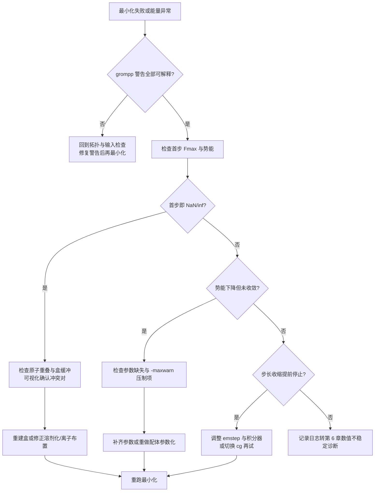
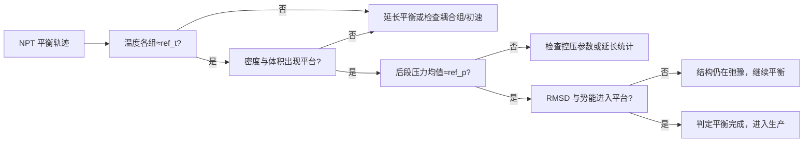

# 第 5 章 能量最小化与平衡

上一章构建出的坐标与拓扑只是把化学信息翻译成了力场语言，这一翻译结果通常远非力场的平衡态：补上的氢原子可能与邻近重原子重叠，溶剂分子可能卡在溶质表面，键长键角相对力场平衡值有可观偏离。若直接把这样的结构交给以 2 fs 时间步推进的动力学积分器，巨大的初始力会使体系在第一步就发散。能量最小化（energy minimization，EM）与平衡（equilibration）是采样之前必经的两级准备：最小化沿势能面把体系弛豫到初始构型附近的局部极小，消除立体冲突与异常受力；平衡（通常按 NVT 再 NPT 的顺序）以受控的恒温恒压方案把体系引导到目标热力学状态，使溶剂重排、体积调整与温度均匀化在受控条件下完成，为生产模拟（production run）提供统计意义上的初始条件。官方工作流在运行层面要求先完成能量最小化再做动力学[1]；教程实践进一步把动力学前的准备细分为 NVT 与 NPT 两步平衡，与最小化、生产一起构成四个连续阶段（阶段划分见 5.1.2 节）。本章处理前两个准备阶段。本章先讨论最小化的目的与两类算法（最速下降、共轭梯度）及其收敛判据，再处理最小化失败的系统化诊断；随后讨论初始速度的生成与可复现性，介绍 NVT 与 NPT 平衡所依赖的控温控压方案及其系综性质；平衡是否完成需要可操作的判据，密度、压力与结构指标各自回答不同层面的问题；最后一节把前文参数整理为 mdp 参数体系并给出可直接复制的模板。第 4 章提供了输入，第 6 章将接续讨论运行期性能与数值不稳定性的诊断，第 7 章的分析对象正是平衡后开始的轨迹。本章所有 GROMACS 行为与默认值均以 2026.4 版官方文档为准[2-4]，教学性取值的依据为官方教程[5]；GROMACS 软件的并行架构见文献[6,7]。凡属推断或惯例的内容均在正文注明依据类型。

## 学习目标

- 能运行一次能量最小化并解读 md.log 与屏幕输出，区分「收敛」「达到步数上限」「步长收缩无法继续」三种结局，并依据最大力、势能与步数判断体系是否适合进入动力学。
- 能为给定体系选择最速下降或共轭梯度积分器，并为 emtol、emstep、nsteps 给出带依据的取值，说明取值不当的后果。
- 能解释 gen_vel、gen_temp、gen_seed 的语义与作用阶段，并为多副本模拟设计可复现的初始速度方案。
- 能比较 Berendsen、v-rescale、Nosé–Hoover 与 Langevin 四种控温方案的系综性质与适用阶段，写出 NVT 平衡的 tcoupl 配置。
- 能比较 Berendsen、C-rescale 与 Parrinello–Rahman 三种控压方案的适用阶段，并为各向同性、半各向异性体系选择 pcoupl 与 tau-p。
- 能利用密度、压力与 RMSD 等指标判断平衡是否完成，并识别未平衡体系的典型症状。

## 前置知识

- 第 4 章：体系构建产物 topol.top 与 conf.gro，力场、水模型与离子的选择依据；本章的输入正是第 4 章的输出。
- 第 2 章：Linux 命令行与 gmx 命令调用约定；第 3 章：xvg 与能量文件的解析约定，本章的能量判据输出将按第 3 章的约定处理。
- 大学热力学与统计物理基础：温度与动能的关系、麦克斯韦分布、等温压缩率、平衡态与系综的概念；本章涉及 NVT（正则）与 NPT（等温等压）两类系综。

## 能量最小化的目的

### 初始结构的应力来源

实验结构数据库中的坐标是测量条件下的静态模型：X 射线晶体学给出电子密度拟合的原子位置，冷冻电镜给出密度图拟合的构象，二者都不携带力场所需的氢原子与化学计量细节。第 4 章的构建流程在这一坐标上叠加了三类修改：pdb2gmx 补氢并按质子化态调整原子与电荷、solvate 在盒中布置水分子、genion 以离子替换溶剂分子。每类修改都可能把原子置于力场势能面的高能区域：补入的氢原子与相邻重原子的距离可能小于其范德华半径之和；溶剂化算法只保证分子间不重合的最小距离，不保证溶质—溶剂间已弛豫；离子替换则可能把电荷布置在偶极取向未调整的溶剂环境中。此外，第 4 章讨论过的质子化态选择错误会直接放大静电冲突。这些高能构型在坐标空间对应巨大的力梯度——按力场定义，原子受力为势能对坐标的负梯度[3]，重叠构型下受力可远大于 emtol 默认值 10 kJ·mol⁻¹·nm⁻¹ 数个量级，进而使切入点处的动能与位置更新失去数值意义。能量最小化的任务正是把体系沿势能面推进到最近的局部极小，使全部原子受力降到可接受阈值以下，为动力学积分提供数值上可用的初始条件[1,5]。

### 势能面的局部极小

对 N 个原子的体系，势能 V(r₁,…,r_N) 是 3N 维函数；局部极小定义为梯度为零且 Hessian 半正定的点，即任意无穷小位移都不降低能量的位置。最小化算法只能到达「出发构型所在吸引域」内的极小，无法保证全局极小；高维势能面存在数目庞大的局部极小，力场所描述的蛋白质势能面尤其如此。因此「最小化收敛」仅表示初始结构附近的应力已被解除，不表示体系处于热力学平衡：最小化是零温几何弛豫，而平衡（本章 5.5–5.7 节）是有限温度下的动力学过程，溶剂重排、体积调整与构象重新分布只有通过受控的动力学才能完成。这一区分决定了对最小化结果的解读方式：收敛后残余的键角二面角应力与溶剂分布不需要为「未达到全局极小」而担心，但必须有把握初始结构本身没有建模错误。官方工作流把最小化放在动力学之前[1]；教程实践再以 NVT、NPT 两步平衡衔接最小化与生产[5]。从最小化到生产的阶段依赖可由图 5-1 概括：每个阶段只改变「引导机制」，坐标、拓扑与相互作用设置在阶段间保持连续——这一原则直接决定 5.8 节模板的设计（截断与静电参数在各阶段保持一致）。本章 5.3 节专门处理最小化失败时的诊断，5.7 节再给出判断平衡完成的可检验指标。


图 5-1　从最小化到生产的平衡工作流：最小化解除冲突，NVT 建立温度与溶剂分布，NPT 调整密度与体积，生产采样在平衡后的状态上开始（阶段次序参照官方工作流[1]，NVT/NPT 划分依教程实践[5]绘制）

## 最小化算法

### 最速下降法

最速下降法（steepest descent，SD）沿负梯度方向反复下降：第 n 步由当前位置 x_n 与梯度 g_n = ∇V(x_n) 确定试探点 x_{n+1} = x_n − λ g_n，步长 λ 由参数 emstep 给出上限，若该点能量高于当前点则把 λ 减半重试，直到能量下降才接受该步。算法只利用一阶梯度信息，实现简单、对远离极小的起点稳健，是解除立体冲突的首选；其代价是在极小附近收敛缓慢，因为相邻两步的负梯度方向近乎正交，轨迹呈锯齿形。GROMACS 的 integrator=steep 即此实现：官方 mdp 选项页说明「最速下降用于能量最小化，最大步长为 emstep，容差为 emtol」[2]。对平衡流程，常见做法是只运行一次 SD 最小化，将最大力降到教程建议的阈值（见 5.2.3 节）即可进入动力学；只有在需要极小残余力（如简正模分析前的构型）时才追求更深的收敛。

### 共轭梯度法

共轭梯度法（conjugate gradient，CG）构造与先前搜索方向关于 Hessian 共轭的方向序列，使 n 维二次型理论上至多 n 步收敛；非线性情形下方向更新式中系数 β 取 Fletcher–Reeves 形式 β_k = g_{k+1}·g_{k+1}/(g_k·g_k)[8] 或 Polak–Ribière 形式 β_k = g_{k+1}·(g_{k+1}−g_k)/(g_k·g_k)[9]，前者存储少、后者对非二次函数更稳健。GROMACS 的 integrator=cg 实现共轭梯度最小化，容差同为 emtol，并以 nstcgsteep 控制每隔多少步插入一次最速下降步以提升远离极小时的稳健性[2]；官方文档还提示，简正模分析之前需要非常高精度收敛时，应使用双精度编译的 GROMACS[2]。CG 在极小附近比 SD 收敛快，但不能替代 SD 处理剧烈冲突——冲突体系起始梯度极大时，CG 可能因方向重置频繁而退化。平衡流程中 CG 的典型用途是：SD 已把最大力降到数百单位后，需要更低的 Fmax（如 10 kJ·mol⁻¹·nm⁻¹ 量级）以便进行简正模或严格初始构型检查时切换使用。

### 收敛判据：emtol、emstep 与最大力

能量最小化的收敛由三个参数直接控制，其语义与默认值出自 GROMACS 2026.4 官方 mdp 选项页[2]。emtol 是最大力阈值，单位 kJ·mol⁻¹·nm⁻¹，默认 10.0；其含义是「当最大力小于该值时最小化判定收敛」。为何需要：最大力（Fmax）直接度量体系中残余应力最大的位置，比势能更能反映「有没有未解除的冲突」；势能本身是累积量，一处大冲突可能被整体负值掩盖。推荐取值：教程惯例在最小化阶段使用 emtol=1000[5]，即只要求解除明显冲突——1000 kJ·mol⁻¹·nm⁻¹ 对下一步 2 fs 动力学仍偏大，但结合温度耦合足以维持稳定，且消耗步数少；若体系将由约束较强的拓扑（如 h-bonds）承接，或需要更干净的起点，可降至 100 或 10，代价是最小化步数可能增至数千上万。取值不当的后果：emtol 过大会把尚未放松的应力带进动力学，典型表现为 NVT 前几步温度飙升或 LINCS 警告；emtol 过小则浪费机时且可能永远无法收敛。emstep 是初始步长，单位 nm，默认 0.01；它设定第一步沿负梯度方向的最大位移，能量上升时自动减半，因而「过大」通常只会多耗几步而不至于发散，但对冲突剧烈的体系把 emstep 降到 0.001 可显著减少能量过冲次数。nsteps 是最大步数，默认 0；对最小化必须显式给出（教程用 50000[5]），否则运行按零步直接结束。停止共有三种结局：Fmax 降至 emtol 以下报告收敛；达到 nsteps 上限仍未收敛，此时应判读 Fmax 的数值是否已可接受；步长因反复减半收缩到无法继续或能量不再变化而提前停止，这意味着当前积分器配置下无法进一步降低 Fmax，需要回到 5.3 节诊断。

## 最小化失败的诊断

### 原子重叠与立体冲突

最小化失败的最常见形态是第一步就发散：mdrun 报告的能量为 NaN、Inf 或数量级失控，或结构文件中的原子坐标被拉到异常数值。成因几乎总是几何层面的立体冲突，可归为四类。其一是补氢冲突：pdb2gmx 按残基模板放置的氢原子与相邻重原子过近，此类冲突常见于侧链拥挤或二硫键邻域。其二是溶剂化冲突：solvate 的最小间距判据按原子的范德华半径计算，不能保证溶质界面上水分子的偶极取向合理，个别水分子可能落入狭缝。其三是离子位置不当：genion 在随机位置替换溶剂，替换点若靠近带电基团会继承未弛豫的局域电场。其四是盒尺寸过小：盒壁与溶质的缓冲不足时，镜像副本之间的相互作用参与了非键计算，若截断设置（见 5.8.2 节）与第 4 章的最小镜像条件不匹配，会引入人工冲突。排查步骤按「先看几何、再看数值」进行：以 -v 运行最小化观察第一步的 Fmax 与势能是否异常；用可视化软件或距离检查确认是否存在小于范德华半径之和的原子对；核对盒尺寸与 rlist、rcoulomb、rvdw 的关系。处置上，立体冲突优先从构建端解决——适当增大 solvate 的缓冲距离重建盒，或对配体先单独弛豫再并入体系；数值端的临时手段是把 emstep 降到 0.001、对蛋白先加位置约束让水与离子弛豫再逐步释放约束，但这类手段只能推迟问题，长期的正确做法是修正构建。

### 参数缺失

第二类失败在最小化的更早阶段就被拦截：grompp 在构建 tpr 时即报错，提示缺少原子类型、成键参数或定义了非零总电荷，因此严格说它不属于 mdrun 的最小化阶段。但实践中存在两种「带病通过」的情形值得注意。其一，用户以 -maxwarn 压制警告强行通过 grompp，拓扑中缺失的参数被置零或跳过，最小化时这些位置表现为无相互作用或异常相互作用，能量曲线出现莫名的平台或突变。其二，配体或非标准残基的参数化质量低劣（见第 4 章 4.8 节）：电荷方案与力场不兼容时，短程静电会在最小化中表现为缓慢下降却始终无法收敛的势能曲线。排查步骤应回到拓扑本身：核对 [ atoms ] 段的原子类型是否存在定义、净电荷是否为零（或已中和）、成键参数是否有缺口（第 4 章 4.10 节的拓扑自检命令）；同时检查 grompp 输出的全部警告原文，确认压制的每一条都有明确处置。处置原则是「不在参数缺失时进入最小化」——补齐参数或换用与体系匹配的参数化路线，而不是靠调小 emstep 硬跑。

### 处置流程

当最小化出现上述任一症状，宜按固定顺序排查，避免并行试探掩盖真实原因。图 5-2 给出整条诊断流程：从「grompp 警告是否全部可解释」开始，依次检查首步能量与 Fmax、结构几何（冲突原子对与盒缓冲）、拓扑参数完整性，最后才是调整最小化数值参数。该顺序的依据是四类原因的出现频率与修复成本：构建与拓扑层面的错误应当修复，数值参数只是权宜。流程中每步都记录 md.log 与屏幕输出的关键数值（首步 Fmax、势能、终止原因），这些记录是第 6 章数值不稳定诊断链的输入。图 5-2 与第 4 章的拓扑自检（4.10 节）衔接：自检通过是进入最小化的前提，最小化失败的一半原因本可在自检中拦截。



图 5-2　能量最小化失败的诊断流程：按「输入警告—首步数值—几何冲突—参数完整性—数值参数」的顺序排查，构建与拓扑层修复优先于数值层调整（依据官方手册与教程惯例[2,5]绘制）

## 初始速度

### Maxwell 分布与 gen_vel

原子速度是动力学积分的另一半初始条件。温度为 T 时，质量为 m_i 的原子某个速度分量的平衡分布为麦克斯韦–玻尔兹曼分布 p(v_i) = √(m_i/(2πkT))·exp(−m_i v_i²/(2kT))[3]。GROMACS 的初速生成算法由参考手册描述：先以 12 个 [0,1) 均匀随机数之和减 6.0 近似标准正态随机数，乘以该分量的标准差 √(kT/m_i)，得到各速度分量；随后扣除体系质心速度，并把全部速度整体缩放，使体系动能精确对应目标温度[3]。这一流程由 mdp 参数控制：gen_vel=yes 指示 grompp 按麦克斯韦分布在 gen_temp 指定的温度下生成初速，随机性由 gen_seed 提供[2]。三个参数中，gen_temp 默认 300 K，gen_seed 默认 -1（表示由 grompp 自动生成种子）[2]；官方说明 gen_vel 只在 integrator=md 时有意义[2]，即随机积分器（sd）与布朗动力学（bd）的噪声并非由这套参数产生。初速只应在第一个动力学阶段生成：续算（从检查点继续）时 gen_vel 必须为 no，速度由检查点文件携带，否则会把体系重新随机化；grompp 文档明确，gen_vel=yes 时从轨迹读入的速度将不被使用[10]。最小化阶段不需要速度，生成初速是 NVT 平衡的第一步。

### 随机种子与可复现性

gen_seed 决定初速的随机数流起点。显式给定种子时，同一输入文件与同一 GROMACS 构建在 grompp 中生成相同的初速序列，这是「同一种子复现初速」的基础；但完整轨迹的逐位复现还受编译选项、并行划分与硬件浮点运算顺序影响，因此跨机器、跨版本复现结果不应以初速 bit 级一致为前提——这一限制属于软件数值行为的文档推定，正文不作未经验证的断言。种子取 -1 时 grompp 自动生成种子，保证两次运行初速不同，适合单次运行；对需要统计对照的多副本模拟，处理方式有两种：显式给每个副本不同的 gen_seed，或共享同一初速但用后续随机过程（如不同控温种子）区分——后者的随机性来源需要单独设计。自动种子存在一个已记录的风险：GROMACS 2020.4 版本说明报告，部分 AMD Ryzen 3000 系列 CPU 的硬件随机数发生器在故障时固定返回相同数值，导致自动种子退化、多个副本实际得到相同初速；官方给出的对策正是「关键副本显式设置种子」[11]。可复现性纪律（第 9 章会系统化）要求把每个阶段的 gen_seed 值记入实验记录，使初速可以被精确重建。

### 质心运动与温度定义

温度由动能换算而来，而动能与自由度数相关：½N_df kT = Σ ½m_i v_i²，其中自由度数 N_df = 3N − N_c − N_com，N_c 为约束数，N_com 为质心运动占用的自由度（周期性体系通常为 3，真空体系为 6）[3]。若质心速度未被扣除，其携带的动能会虚增表观温度；且长期运行中数值误差会在质心运动上累积，官方手册明确指出质心速度通常每步置零，并说明尤其在使用温度耦合时这一消除必不可少[3]。GROMACS 通过 comm-mode=Linear 与 nstcomm=100 实现质心速度的定期扣除，默认的 comm-grps 为全体原子[2]。对平衡流程，这一机制的实际意义有二：其一，最小化后生成的初速已经过质心扣除（见 5.4.1 节），无需额外处理；其二，平衡阶段应检查日志中按耦合组统计的温度——若 Protein 组与溶剂组温度长期不一致，多数情况不是质心问题，而是耦合组划分或热交换不足（见 5.5.1 节）。

## NVT 平衡

### 控温的必要性与耦合组

最小化后的结构处于势能极小附近，动能由初速决定，体系整体尚不处于目标温度的平衡态：溶剂需要时间重排到蛋白周围，局域热斑需要传导消除，目标温度下的体积与密度分布尚未建立。若直接进入恒能（NVE）积分，温度由初始动能决定且可能漂移，任何过剩热都无法排出；恒温（NVT）阶段的控温器充当热浴，吸收生成初速与弛豫过程中的多余动能，同时把体系温度驱动到设定值。控温器按耦合组（tc-grps）分别作用，每组独立指定目标温度 ref_t 与耦合时间常数 tau_t（单位 ps）[2]。为什么要分组：蛋白、水与离子的热驰豫时间不同，单独耦合可避免冷热不均，也便于在日志中分别检查各组的定义温度；教程惯例把体系分为 Protein 与 Water_and_ions 两组[5]，含脂质体系常把脂质单独分组。分组后各组温度应最终收敛到各自的 ref_t；若某组温度持续偏离，需怀疑分组错误（如溶剂被误并入蛋白组）或体系存在异常的强耗散元件。控温频率由 nsttcouple 控制，其默认值由官方选项页给出，平衡阶段一般沿用即可[2]；tau_t 的取值与控温方案有关（见 5.5.2–5.5.4 节），常用的 0.1 ps 是指温度以指数式微扰趋近目标、又不显著干扰体系固有涨落的经验区间，教程以该量级为典型取值[5]；官方选项页未给 tau_t 的一般典型值，仅对 sd 恒温单独建议 tau_t 取 2 ps[2]。

### Berendsen 弱耦合的局限

Berendsen 弱耦合是最早进入 GROMACS 的控温方案：体系温度 T 以弛豫方程 dT/dt = (T_ref − T)/τ 指数趋近目标温度，等效于按 √(1 + Δt/τ·(T_ref/T − 1)) 的因子整体缩放速度[12]。它一阶、稳定、实现简单，把体系快速带向目标温度时几乎不出问题，因此在旧版教程中占据主导地位。其局限在于系综性质：缩放因子是确定性的，速度涨落被系统性压缩，体系并不采样正确的正则系综——经典统计力学要求动能围绕其期望值按正则涨落分布，而 Berendsen 缩放抑制了这部分涨落。后果以「飞行的冰立方」效应（flying ice cube）著称：动能由分子组分向整体平动泄漏，等配分被破坏，热力学性质系统失真；Braun、Moosavi 与 Smit 在 2018 年发表的论文中指出（期刊版与 arXiv 预印本双出处见文献[13]），这一效应的根源是速度缩放违反细致平衡，Berendsen 恒温器与简单速度缩放均受影响，而随机速度缩放（CSVR，即下一节的 v-rescale）满足细致平衡[13]。因此 Berendsen 恒温器只应作为平衡初期的快速驱动手段或教学示例，不得用于生产采样；官方 mdp 选项页虽保留该选项，但现代教程与推荐配置均不再把它用于正式阶段[2,5]。若平衡时确实遇到 v-rescale 难以收敛的体系，应优先检查初速与构建，而不是退回 Berendsen。

### V-rescale 的构造

v-rescale（随机速度缩放）由 Bussi、Donadio 与 Parrinello 于 2007 年提出[14]，构造思路是在 Berendsen 式整体缩放之上叠加一个随机项：每步以目标温度对应的动能期望值 K_ref 为参考，把当前动能 K 以因子 α 缩放，α 的设计使动能采样满足正则系综的涨落统计，同时保留一个可监测的守恒量用于检验积分精度[14]。与 Berendsen 相比，它保留了「快速把温度拉向目标」的稳健性，又恢复了正确的动能涨落；与 Nosé–Hoover 相比，它对耦合参数不敏感，几乎不存在遍历性问题，实现也更简单。官方 mdp 选项页将其列为温度耦合的可用算法之一[2]，现代教程在 NVT 与 NPT 平衡阶段均采用 tcoupl=v-rescale[5]。使用要点：ref_t 与 tau_t 按组给出，tau_t 取 0.1 ps 量级即可；平衡与生产阶段可以沿用同一组参数，不必在切换阶段更换控温算法（更换控温器本身会引入新的瞬态，需重新平衡）。v-rescale 唯一的注意点是它仍是随机过程，其随机数由 ld_seed 控制的随机数发生器提供；ld_seed 默认取 -1，表示由程序自动生成种子，用户通常无需干预[2]。日志中可检查其动能涨落是否与正则系综的预言一致，作为平衡质量的辅助证据。

### Nosé-Hoover 与 Langevin 的适用场合

Nosé–Hoover（NH）恒温器以扩展变量把热浴纳入动力学：引入一个与体系耦合的虚变量，其质量与 tau_t 相关，使相空间统计严格对应正则系综[15,16]。它确定、可逆、存在守恒量（守恒量写入能量与日志文件，可用于检验积分精度[2]），适合对「严格正则统计」有要求的场景。要注意 tau_t 语义不同：官方文档明确指出，NH 的 tau_t 控制平衡温度涨落的周期，严格说不是弛豫时间[2]。NH 的已知弱点是遍历性：对自由度数少或强耦合的体系，单个热浴变量可能无法充分采样动能分布，链条式扩展（Nosé–Hoover 链）缓解该问题[17]。GROMACS 以 nh-chain-length 控制链长，默认值即可满足常规体系[2]。Langevin 方案在 GROMACS 中对应 integrator=sd 的随机动力学：运动方程加入摩擦项与高斯白噪声[18]，等同于以耦合强度直接替代控温器；温度由 ref_t 设定，tau_t 即逆摩擦常数的量纲化表达，随机种子由 ld_seed 指定[2]。官方选项页给出 sd 恒温的实际建议：tau_t 取 2 ps 合适，因为该摩擦低于水的内摩擦、又足以排出多余热量，且温度偏差的衰减速度是同样 tau_t 下 Berendsen 的两倍[2]。适用场合的划分：常规全原子蛋白—水体系，NVT 平衡与生产均可使用 v-rescale；需要可逆、确定轨迹或严格系综统计时选 NH；粗粒化（第 4 章 Martini）或容易产生局部热斑的强驱动体系，Langevin 的强耦合更具稳健性。表 5-1 汇总四种方案。

表 5-1　控温方案对比（依据官方 mdp 选项页与原始文献[2,12-18]整理）

| 方案 | 系综性质 | 确定性 | tau_t 语义 | 典型取值 | 推荐场合 |
| --- | --- | --- | --- | --- | --- |
| Berendsen | 非正则（涨落被抑制） | 确定 | 弛豫时间 | 0.1 ps | 仅快速预弛豫，不可用于生产 |
| v-rescale | 正则（CSVR） | 随机 | 弛豫时间 | 0.1 ps | 平衡与生产的默认选择 |
| Nosé–Hoover | 正则（扩展变量） | 确定 | 涨落周期 | 0.5–2 ps 量级 | 需可逆轨迹与严格统计；小体系结合链式扩展 |
| Langevin（sd） | 正则（朗之万方程） | 随机 | 逆摩擦 | 2 ps（官方建议） | 粗粒化、强弛豫、消除热斑 |

## NPT 平衡

### 控压的基本原理

压力张量由动能张量与维里张量之差除以体积得到，标量压力取其迹的三分之一[3]：瞬时压力是坐标与速度的瞬时函数，涨落远大于其平均值——温度控制不需要理会这一噪声，但一旦要固定压力，就必须处理压力涨落的短时统计。控压器（barostat）的作用是通过周期性地缩放盒向量与原子坐标，使体系平均压力收敛到设定的参考压力 ref_p[19]。缩放的依据是等温压缩率：单位压力变化引起的体积相对变化，记为 κ_T；compressibility 参数即提供该值，其作用是决定「压力偏差多大时体积应调整多少」。各向同性体系三个方向同步缩放；各向异性体系按盒向量分量独立缩放。控压与控温在方程层面耦合（压力含动能项），因此 NPT 模拟必须同时启用控温器。实际操作的顺序安排是：NVT 平衡先建立正确的温度与溶剂分布，NPT 平衡再把体积与压力调到位，最后进入生产——这与官方工作流一致[1]。

### Berendsen 与 C-rescale

Berendsen 控压沿用 5.5.2 节的弱耦合思路：一阶指数弛豫调整体积，平衡过程中高效稳健；但它与 Berendsen 恒温器犯同样的错误——体积涨落不正确，不产生等压系综的统计性质[12]。Bernetti 与 Bussi 在 2020 年的论文中点明社区配方：用 Berendsen 控压做平衡，再换用二阶或蒙特卡洛控压器生产[19]，并据此提出 C-rescale（随机细胞缩放）：在一阶缩放中引入适当的噪声项，使体积涨落与等压系综一致，平衡效率不减、生产正确性具备[19,20]。C-rescale 由此成为现代工作流中平衡阶段的默认控压方案：它也常直接沿用为生产控压器[19]。使用参数：pcoupl=C-rescale、pcoupltype 按体系对称性取 isotropic 或 semiisotropic、compressibility 取体系的等温压缩率：官方选项页明示水在 1 atm、300 K 时的等温压缩率为 4.5×10⁻⁵ bar⁻¹，水体系通常直接采用该值[2]；ref_p 取 1.0 bar。compressibility 取值不当有两个方向：偏大会使体积对瞬时压力噪声过度响应、单元抖动加剧，偏小则体积调整迟缓、密度收敛变慢；对以水为主的体系，4.5×10⁻⁵ bar⁻¹ 是官方选项页给出的起点[2]，含大量有机相的体系应按混合体系的等温压缩率估算。

tau_p 的取值有版本化的硬约束：GROMACS 2025.4 版本说明记录，2023 版提高了 nstpcouple 默认值后，C-rescale 在 tau_p 小于推荐值 5 ps 且时间步不小于 2 fs 时可能给出过大的体积涨落，官方已强制每周期至少 25 个积分步[4]——实际操作中把 tau_p 取 5 ps 或以上，即可避开该区间。

### Parrinello-Rahman 与 MTTK

Parrinello–Rahman（P–R）控压把恒定压力的思想推广到一般单元：盒的三个基向量作为动力学变量，允许单元形状随压强张量变化，适合各向同性、半各向异性与各向异性耦合（triclinic 盒）[21]。GROMACS 的实现基于马提娜等人的扩展系综框架（MTTK 可逆积分器，常与 Nosé–Hoover 恒温器组合）[22]，因而 P–R 具备二阶控压的精确性：体积（单元）围绕期望值振荡，长时间平均给出正确的等压系综。代价是振荡的惰性大、对起始状态敏感：若体系尚未平衡就启用 P–R，单元可能在压力震荡下剧烈摆动甚至失稳。为此平衡流程的惯例是：先用 C-rescale（或 Berendsen）把密度与体积调到稳态，再切换为 P–R 继续平衡一段时间，最后进入生产——切换本身需要一段过渡以吸收瞬态[19]。P–R 的 tau_p 取 5 ps 量级（与水体系的时间尺度匹配），且同样受版本化约束：2025.4 版本说明强制每周期至少 200 个积分步，即 tau_p 与 dt 的比值至少 200[4]。表 5-2 对比三种控压方案。

表 5-2　控压方案对比（依据官方 mdp 选项页、原始文献与版本说明[2,12,19-22]整理）

| 方案 | 系综性质 | 体积涨落 | 特点 | 推荐场合 |
| --- | --- | --- | --- | --- |
| Berendsen | 非等压 | 不正确（被抑制） | 一阶，高效稳健 | 仅预平衡（社区配方，平衡首选已让位 C-rescale） |
| C-rescale | 等压 | 正确 | 一阶+随机噪声，平衡与生产皆可 | 平衡首选，亦可用于生产 |
| Parrinello–Rahman | 等压 | 正确 | 二阶，可变形盒，启动需已平衡体系 | 生产标准选择；半各向异性/各向异性体系 |

### 半各向异性与表面张力

膜与界面体系需要不对称的盒响应：脂质双层的面积与厚度由不同物理机制决定，各向同性缩放会把面积变化与厚度变化搅在一起，产生虚假的横向张力。pcoupltype=semiisotropic 允许 x/y 平面与 z 方向独立耦合：compressibility 与 ref_p 分别按 (xy 值, z 值) 给出，例如标定薄膜面积时把 xy 方向压缩率置零、只让 z 方向调节[2]。这类体系的经典构建-平衡流程由 CHARMM-GUI 等工具承载：其 Membrane Builder 生成的技术说明与配套输入把平衡分解为多阶段，逐步释放约束并采用半各向异性 NPT[23]。表面张力耦合（pcoupltype=surface-tension）面向含真空界面的片层体系（如薄水膜夹层），以表面张力为控制量，其 ref_p 分量与 surface-tension 参数按协议设置[2]。操作要点：半各向异性与表面张力类型都要求 compressibility 与 ref_p 按分量书写；生产阶段的 pcoupltype 应与平衡阶段一致，避免切换引入不对称瞬态；膜体系平衡的判据除体积外还应关注单脂面积与双层厚度（见第 7 章分析，第 4 章 4.9 节已有构建细节）。各向异性（anisotropic）类型用于晶体等需要独立控制六个单元分量的场合[2]，生物体系罕见。

## 平衡判据

### 密度与体积的收敛

NPT 平衡的第一个可检验量是体积与密度。开启控压后，盒体积从构建值向参考压力对应的平衡值过渡，这一过渡通常远快于压力的统计收敛：液体的体积弛豫以数十皮秒计（经验量级），教程以 NVT 100 ps、NPT 500 ps 的两段平衡覆盖这一弛豫，密度在 NPT 阶段即可进入平台区[5]。判读方法：用 gmx energy 读取能量文件中的 Volume 与 Density 项，观察时间序列是否出现平台；平台期的均值即体系在该力场、温度与压力下的平衡密度。比较基准的选择有讲究：平衡密度应贴近所选水模型的参考值，而非实验值——TIP3P、SPC 与 SPC/E 在 298 K 的密度彼此不同，Mark 与 Nilsson 的对比研究系统记录了三种三位点模型的平衡密度差异[24]，Vega 与 Abascal 的综述给出了更广范围内的模型表现[25]。若密度平台明显偏离模型参考值，先检查体系组成（盒内是否多算或少算了分子）与控压参数（compressibility、ref_p），再考虑是否混入了错误的成分比例；对含溶质的体系，密度需按整体混合体系理解，不能只对照纯水模型。体积时间序列的持续漂移（无平台）是未平衡的硬信号，应延长时间而不是急于进入生产。

### 压力的涨落特征

瞬时压力是强涨落量，其短时序列几乎不携带信息，平衡的判断必须基于时间平均[3]。正确做法是提取 NPT 阶段后段的压力序列，用滑动平均或分块平均（块平均方法见第 9 章）估计均值，检查其是否在 ref_p 的统计误差范围内；单帧压力、甚至几十皮秒的均值都可能在 −数十到数百 bar 之间摆动（经验量级，随体系大小与截断设置而变），不能据此判定平衡失败。压力涨落的幅度还受控压算法影响：Berendsen 控压抑制体积涨落，其压力序列的表观稳定性是假象[19]；C-rescale 与 P–R 恢复正确的体积涨落，压力序列的涨落反映真实状态。平衡时长方面，教程采用 NVT 100 ps（50000 步）与 NPT 500 ps（250000 步，dt 均为 2 fs）[5]；但时长本身不是判据——若后段压力均值的统计误差仍大于预期，应延长时间或检查第一阶段是否已经污染了统计。需要明确的边界是：压力收敛是平衡的必要条件而非充分条件，溶剂构象与蛋白结构可能尚未弛豫（见 5.7.3 节）。

### 结构指标的平台期

热力学量（温度、压力、密度）的收敛只说明系综层面的稳定，不保证结构已就位。补充判据来自结构指标：蛋白相对于参考结构的均方根偏差（RMSD）随时间进入平台或仅缓慢漂移，总体势能与各组温度稳定，守恒量（v-rescale 与 Nosé–Hoover 各对应可在日志中检查的守恒量[2,14]）无明显漂移。RMSD 的参考结构取最小化后的构型（或平衡轨迹的第一帧），平台高度反映体系在力场下偏离初始结构的程度；持续上升而无平台，说明构象仍在漂移，需要更长平衡或检查构建问题（如叠合错误、未弛豫的配体位姿）。Braun 等人的最佳实践文档把「监测温度、压力、密度等关键可观测量直至稳定」列为模拟基础规范之一[26]，本章的判据清单据此组织为表 5-3，图 5-3 给出判读流程。需要强调的组合原则：任何单一指标都不可靠——热力学量可能早已稳定而结构仍在漂移，反之亦然；多指标（温度、密度、压力均值、RMSD、守恒量漂移）同时进入平台，才构成「平衡完成」的可检验证据；这一判断的依据是各指标采样不同时间尺度的物理量，其组合覆盖了从快过程（温度、动能）到慢过程（体积重排、构象弛豫）的时间谱。

表 5-3　平衡判据清单与检验命令（工具命令以 GROMACS 2026.4 为准）

| 指标 | 检验方式 | 收敛特征 | 局限 |
| --- | --- | --- | --- |
| 温度（各组） | md.log 各耦合组温度；gmx energy 选 Temperature | 各组均值接近 ref_t | 只反映动能，不反映结构 |
| 密度/体积 | gmx energy 选 Volume、Density | 后段出现平台 | 对慢构象弛豫不敏感 |
| 压力均值 | gmx energy 选 Pressure；分块平均 | 均值在 ref_p 统计误差内 | 涨落大，需足够后段时长 |
| 势能与守恒量 | gmx energy；md.log 守恒量字段 | 无系统性漂移 | 守恒量随控温方案不同 |
| RMSD | gmx rms（参考最小化构型） | 平台或缓慢漂移 | 依赖参考结构选择 |
| 末段速度分布 | 直方图对比麦克斯韦分布（第 3 章方法） | 分布吻合 | 定性检查，非标准化判据 |



图 5-3　平衡完成的多指标判读流程：温度、密度、压力与结构指标依次检查，全部通过才判定平衡完成（依据[26]与本章 5.7 节归纳）

## mdp 参数体系

前文各节分别讨论了最小化、初速、控温与控压参数；表 5-4 汇总裁决了这些参数在本章语境下的默认值与使用要点，默认值一律以 GROMACS 2026.4 官方 mdp 选项页为准[2]；选项页未列出默认值、须按体系给出的参数在表中注明「须显式给出」，避免依赖版本未定的隐含值。五列依次为参数、量纲、默认值、最小化/平衡使用要点与出处。

表 5-4　最小化与平衡相关的 mdp 参数总览（默认值据 GROMACS 2026.4 官方选项页[2]）

| 参数 | 量纲 | 默认值（2026.4） | 最小化/平衡使用要点 | 出处 |
| --- | --- | --- | --- | --- |
| integrator | — | md（leap-frog） | 最小化设 steep 或 cg；平衡用 md | [2] |
| dt | ps | 0.001 | 平衡常用 0.002，须配合 constraints=h-bonds | [2] |
| nsteps | 步 | 0 | 最小化必须显式给出（教程用 50000） | [2,5] |
| emtol | kJ·mol⁻¹·nm⁻¹ | 10.0 | 教程在平衡前用 1000；需深收敛降至 10 | [2,5] |
| emstep | nm | 0.01 | 冲突剧烈时可降至 0.001 | [2] |
| gen_vel | — | no | 仅首个动力学阶段设 yes | [2] |
| gen_temp | K | 300 | 应与目标温度保持一致 | [2] |
| gen_seed | — | -1（自动） | 多副本显式分配并记录 | [2,11] |
| tcoupl | — | no | 平衡阶段显式设为 v-rescale | [2,5] |
| tau_t | ps | 须显式给出 | v-rescale 常用 0.1（教程取值） | [2,5] |
| ref_t | K | 须显式给出 | 每耦合组一个值 | [2] |
| pcoupl | — | no | NVT 阶段保持 no；NPT 平衡显式设为 C-rescale | [2,19] |
| tau_p | ps | 5 | ≥5 ps；满足每周期积分步约束 | [2,4] |
| compressibility | bar⁻¹ | 须显式给出（水 4.5e-5，选项页明示） | 水体系用 4.5e-5；按体系等温压缩率调整 | [2] |
| constraints | — | none | 平衡/生产用 h-bonds | [2] |
| constraint-algorithm | — | lincs | 最小化不可用 SHAKE | [2,27] |
| cutoff-scheme | — | Verlet | group 方案已不再支持 | [2] |
| coulombtype | — | Cut-off | 必须显式设 PME | [2] |
| rvdw / rcoulomb | nm | 1.0 | 各阶段保持一致 | [2] |
| fourierspacing | nm | 0.12 | PME 默认即可，无需改动 | [2] |
| nstxout-compressed | 步 | 0 | 必须显式设置才有轨迹输出 | [2] |
| nstlog / nstenergy | 步 | 1000 | 平衡按默认即可 | [2] |

### 时间步长与约束

时间步长 dt 默认 0.001 ps[2]，常规全原子体系（含刚性水与氢键约束）取 0.002 ps，即 2 fs；这是显式水蛋白体系的标准算法权衡：氢原子键伸振动周期约 10 fs（分子模拟教科书的常用量级），若不约束这些振动，2 fs 步长无法稳定积分高频运动，因此 2 fs 方案必须搭配 constraints=h-bonds——把所有含氢键转换为约束，消除最高频自由度，其余键的约束由专门的求解算法承担。约束求解器方面有一条官方明示的限制：SHAKE 不能用于能量最小化[2,27]，最小化阶段若拓扑要求 SHAKE，应改用 LINCS 或待进入动力学后再启用约束；常规做法是以 LINCS 求解多数分子的键约束（并行部署时自动切换到 P-LINCS）、以 SETTLE 刚性化水分子[28,29,30]。时间步长与约束是成对参数，回答的是同一个问题：哪些自由度被显式积分。取值依据：2 fs + h-bonds 是力场教程与生产模拟的事实标准[5]；若要 4 fs，需要虚拟位点几何或质量重分配（mass-repartition-factor=3 配合 h-bonds 官方说明「通常可将步长提升至 4 fs」[2]），代价是氢原子动力学被进一步粗化；对无约束的柔性分子或高精度定量工作，回到 1 fs 并关闭氢约束。取值不当的后果：步长过大而约束不足时，LINCS 警告与能量漂移在平衡阶段即出现（第 6 章 6.6 节展开其诊断链）；约束过强（all-bonds）会冻结对用户重要的振动信息，影响性质计算；平衡阶段的约束设置应与生产一致，避免中途变更引入瞬态。

### 截断与 PME 设置

非键相互作用的截断与长程静电设置决定力的精度与成本，也决定最小化与平衡阶段的行为一致性。GROMACS 2026.4 默认 cutoff-scheme=Verlet（基于缓冲邻表的精确截断方案），group 方案已被官方标记为不再支持[2]；rvdw 与 rcoulomb 默认 1.0 nm，rlist 在动力学下由 verlet-buffer-tolerance 自动确定（默认容差 0.005 kJ·mol⁻¹·ps⁻¹，最小化等无动力学阶段按最大截断加 5% 缓冲自动设置）[2]。静电处理必须显式选择：coulombtype 的官方默认是 Cut-off 截断，而平衡与生产阶段的标准配置是 PME；漏设 coulombtype=PME 或沿用默认截断，会放大静电截断误差（默认 1.0 nm 对静电并不充分），第 4 章已说明最小镜像条件与截断的关系。PME 参数使用官方默认即可：fourierspacing=0.12 nm、pme-order=4、ewald-rtol=1e-5；官方说明网格间距 0.1 nm 配合三次插值即可获得 2–3×10⁻⁴ 的静电力精度，0.12 nm 是精度与成本的平衡[2]。长程范德华修正由 DispCorr 控制（EnerPres 同时修正能量与压力），各向同性液体体系建议开启，体系异质性明显时按力场惯例处理。平衡阶段应采用与生产一致的截断与 PME 设置：阶段间切换截断会改变相互作用面，迫使重新平衡。PME 方法的原始文献为 Essmann 等[31]与 Darden 等[32]，其数值性质与并行实现在第 6 章讨论。

### 输出频率与压缩

平衡阶段同时是「看」的阶段，输出频率设置不当时会出现两种浪费：输出过密使磁盘与带宽被无谓轨迹占满，输出过疏则事后无法回查平衡过程。GROMACS 的一处常见陷阱是默认不写轨迹：nstxout、nstvout、nstfout 与 nstxout-compressed 默认均为 0，即 trr 与 xtc 都不写；不显式设置 nstxout-compressed 的平衡运行不会产出可分析的轨迹。nstxout-compressed 相对 trr 是有损压缩（compressed-x-precision 默认 1000），体积小得多，是常规选择——平衡阶段建议 nstxout-compressed=500（dt=2 fs 下每皮秒一帧），能量与日志输出 nstenergy=nstlog=1000[2]。若需要精确位置/速度用于诊断或续算，再临时加开 nstxout 与 nstvout——但全精度 trr 磁盘代价大，检查后应关闭。能量输出的统计语义值得利用：nstenergy 之间按 nstcalcenergy 区间（默认 100 步）存储精确的和与涨落，因此即使增大写盘间隔，gmx energy 仍能给出各能量项的正确平均值与涨落[2]，这不影响 5.7 节判据的使用（判据所需数据可从低频能量序列获取）。输出频率对运行性能的影响（能量计算的全局通信瓶颈）由官方 mdp 选项页说明[2]；GROMACS 的异构并行架构及其对运行效率的影响见 Páll 等[7]，与第 6 章的并行讨论衔接。

### 最小化与平衡的 mdp 模板

以下三份 mdp 可作为起点模板，参数依据前文各节：默认值与语义出自官方 mdp 选项页[2]，教学性取值出自教程[5]，控压版本约束出自版本说明[4]。模板面向常规显式水蛋白体系（GROMACS 2026.x，Linux 命令行），数值随体系与目标条件调整；命令以 gmx 为入口，文件命名沿用第 4 章约定。

```bash
# 平台：Linux；版本：GROMACS 2026.x；用途：能量最小化（em.mdp）
integrator = steep        ; 最速下降；冲突体系首选
nsteps     = 50000        ; 必须显式设置；默认 0 步
emtol      = 1000         ; 教程惯例：仅解除明显冲突（kJ mol-1 nm-1）
emstep     = 0.01         ; 初始步长（nm）；冲突剧烈可降至 0.001
cutoff-scheme = Verlet    ; 缓冲邻表方案（默认）
coulombtype  = PME        ; 必须显式；默认是 Cut-off 截断
rvdw = 1.0 ; rcoulomb = 1.0      ; 与生产一致的截断
fourierspacing = 0.12 ; pme-order = 4 ; ewald-rtol = 1e-5
```

```bash
# 平台：Linux；版本：GROMACS 2026.x；用途：NVT 平衡（nvt.mdp）
integrator = md ; dt = 0.002 ; nsteps = 50000     ; 100 ps，2 fs
gen_vel = yes ; gen_temp = 300 ; gen_seed = 12345 ; 仅第一步生成初速
tcoupl = v-rescale ; tc-grps = Protein Water_and_ions ; tau_t = 0.1 0.1 ; ref_t = 300 300
pcoupl = no        ; NVT 阶段不控压
constraints = h-bonds ; constraint-algorithm = lincs
cutoff-scheme = Verlet ; coulombtype = PME ; rvdw = 1.0 ; rcoulomb = 1.0
nstxout-compressed = 500 ; nstlog = 1000 ; nstenergy = 1000
```

```bash
# 平台：Linux；版本：GROMACS 2026.x；用途：NPT 平衡（npt.mdp）
integrator = md ; dt = 0.002 ; nsteps = 250000   ; 500 ps，2 fs（教程 NPT 时长）
gen_vel = no                ; 续算：速度来自检查点
tcoupl = v-rescale ; tc-grps = Protein Water_and_ions ; tau_t = 0.1 0.1 ; ref_t = 300 300
pcoupl = C-rescale ; pcoupltype = isotropic       ; 半各向异性体系改为 semiisotropic
tau_p = 5.0 ; compressibility = 4.5e-5 ; ref_p = 1.0   ; tau_p≥5 ps（2025.4 版本约束）
constraints = h-bonds ; constraint-algorithm = lincs
cutoff-scheme = Verlet ; coulombtype = PME ; rvdw = 1.0 ; rcoulomb = 1.0
nstxout-compressed = 500 ; nstlog = 1000 ; nstenergy = 1000
```

模板的执行序列为 gmx grompp -f 对应 mdp 逐个生成 tpr 并 gmx mdrun；grompp 会输出 mdout.mdp 回显全部生效参数，应以该文件而非自述为准核对一次[10]。三份模板刻意保持截断、静电与约束设置完全一致，只有温度、压力与初速控制不同——这是平衡设计的原则：阶段间仅切换「引导到目标状态」的机制，不切换相互作用设置。

## 常见错误

1. **现象**：最小化第一步势能即报 NaN、Inf，或能量数值在几步内失控炸开。 **成因**：构建端遗留的立体冲突未解除——补氢重叠、溶剂化分子插入过近、离子位置不当、盒缓冲不足导致镜像副本出现在截断半径内。 **排查步骤**：以 `gmx mdrun -v -deffnm em` 观察首步 Fmax 与势能；用可视化工具检查小于范德华半径之和的原子对；核算盒尺寸与 rlist、rcoulomb 的缓冲关系。 **处置**：从构建端解决，加大溶剂化缓冲重建盒或让配体单独弛豫后再并入；数值端仅以 `emstep=0.001` 暂时过渡，并明确这只是推迟问题的手段。

2. **现象**：最小化提前停止，日志提示步长收缩到无法继续或能量不再变化，而 Fmax 仍远超可接受值。 **成因**：当前配置在势能面的数值陷阱附近无法继续下降，SD 的步长反复减半直至失效。 **排查步骤**：读取终止前的 Fmax 及其原子编号，判断是全局性还是局部性问题；换 integrator=cg 观察 Fmax 是否继续下降。 **处置**：切换共轭梯度或 l-bfgs 重跑；若两种算法都停滞，回到 5.3 节检查几何冲突与参数缺失，而不是继续堆步数。

3. **现象**：最小化报告「已收敛」，但日志中的最大力接近 emtol 上限（如 900 余而阈值 1000）。 **成因**：教程的 `emtol=1000` 是宽松阈值，收敛只表示冲突已降至可接受区间，并非力已很小——这是设计行为而非程序错误。 **排查步骤**：确认收敛输出的 Fmax 数值；对照目标判断该阈值是否满足下一步动力学需求。 **处置**：若后续动力学警告频繁，把 emtol 降至 100 或 10 并相应延长 nsteps 后重跑；切勿把「收敛」误读为「结构已完全松弛」。

4. **现象**：NVT 运行前几步即出现大量 LINCS 警告，或体系迅速坍塌、原子飞离。 **成因**：最小化不充分（残留应力过大），或 dt 与约束不匹配——2 fs 时间步未使用 `constraints=h-bonds`，氢键高频振动无法稳定积分。 **排查步骤**：核对最小化日志的最终 Fmax；检查 mdp 中 constraints 与 dt 的配对；查看 NVT 前几步的温度曲线是否陡升。 **处置**：把最小化 emtol 降档重跑，或修正约束设置；若使用 SHAKE 约束的拓扑，注意 SHAKE 不能用于最小化（官方文档明示），应使用 LINCS。

5. **现象**：NPT 阶段盒尺寸剧烈振荡，或体积持续单向变化不收敛。 **成因**：Parrinello–Rahman 在体系未充分预平衡时被过早启用；或 tau_p 取值过小——GROMACS 2023 提高 nstpcouple 默认值后，小 tau_p 配合 2 fs 步长会放大体积涨落，官方已在后续版本强制每周期最少积分步数。 **排查步骤**：对比切换控压器前后的密度轨迹；核算 tau_p 与 dt 的比值是否满足 C-rescale 每周期至少 25 步、P–R 每周期至少 200 步的版本约束。 **处置**：先以 C-rescale 平衡至密度平台，再切换 P–R 并留过渡段；tau_p 取 5 ps 或以上。

6. **现象**：多个副本模拟的初始结构与早期轨迹雷同，统计独立假设失效。 **成因**：各副本沿用相同 gen_seed，或全部依赖 -1 自动种子而随机源异常（官方曾记录部分 AMD CPU 硬件随机数故障使自动种子退化）。 **排查步骤**：核对生成各副本 tpr 时实际使用的 gen_seed 值（grompp 输出的 mdout.mdp 中可见）。 **处置**：为每个副本显式设置互不相同的 gen_seed 并记入实验记录；关键副本不依赖自动种子。

7. **现象**：NPT 平衡后密度平台明显偏离该水模型的已知参考值（经验阈值，偏离数量级为数个百分点）。 **成因**：体系组成错误（分子数与成分比例不符）、控压参数错误（compressibility 或 ref_p 与目标不符），或比较基准错用——拿实验密度直接对照模型密度。 **排查步骤**：核对 topol.top 的 [ molecules ] 计数与盒体积；检查 compressibility 与 ref_p；对照该模型在同类条件下的已发表密度。 **处置**：修正组成或参数；模型偏差属于力场性质，不应通过人为调参掩盖。

## 本章小结

- 能量最小化是零温几何弛豫，只解除初始结构的立体冲突，不建立热力学平衡；「收敛」不等于「可采样」，二者之间隔着 NVT 与 NPT 平衡。
- 收敛判据是最大力 Fmax 与 emtol 的比较，停止共有收敛、达步数上限、步长收缩三态；minimization 的 nsteps 默认 0，必须显式设置。
- 最速下降稳健适合解除冲突，共轭梯度在极小附近更快；教程以 emtol=1000 作为平衡前的充分阈值，需要更深收敛时降至百或十量级并考虑双精度。
- 初速按麦克斯韦分布在 gen_temp 下生成（gen_vel=yes），种子由 gen_seed 控制；显式分配种子是多副本可复现性的前提，自动种子存在碰撞风险。
- 控温方案的系综性质决定用途：v-rescale 兼具稳健与正确的正则统计，是平衡与生产的默认；Berendsen 抑制动能涨落只能预弛豫；Nosé–Hoover 牺牲部分稳健换取严格可逆统计；Langevin 以强耦合换取快速弛豫。
- 控压同理分层：C-rescale 是平衡首选，Parrinello–Rahman 承担生产；tau_p 存在版本化下限约束，切换控压器必须留过渡段。
- 平衡完成必须由多指标联合判定：温度、密度、压力均值、RMSD 与守恒量同时进入平台才构成证据，单一指标（尤其瞬时压力）不可靠。
- mdp 模板原则是阶段间只切换引导机制（控温控压与初速），截断、静电与约束设置全程保持一致；轨迹输出默认关闭，需显式设置 nstxout-compressed。

## 参考文献

> 在线文档访问日期为 2026-10-29。全部 32 条文献的六项信息（标题、作者、期刊、年份、卷期页、DOI）均已核验齐全，DOI 以 Crossref 登记为准。

[1] GROMACS 2026.4 documentation. Getting started: Flowchart of typical simulation[EB/OL]. https://manual.gromacs.org/current/user-guide/getting-started.html（访问日期：2026-10-29）.
[2] GROMACS 2026.4 documentation. Molecular dynamics parameters (.mdp options)[EB/OL]. https://manual.gromacs.org/current/user-guide/mdp-options.html（访问日期：2026-10-29）.
[3] GROMACS 2026.4 documentation. Reference manual: Molecular Dynamics[EB/OL]. https://manual.gromacs.org/documentation/current/reference-manual/algorithms/molecular-dynamics.html（访问日期：2026-10-29）.
[4] GROMACS 2026.4 documentation. Release notes: GROMACS 2025.4[EB/OL]. (2025-11-21). https://manual.gromacs.org/documentation/current/release-notes/2025/2025.4.html（访问日期：2026-10-29）.
[5] Lemkul J A. Lysozyme in Water: A GROMACS Tutorial[EB/OL]. http://www.mdtutorials.com/gmx/lysozyme/index.html（访问日期：2026-10-29）.
[6] Abraham M J, Murtola T, Schulz R, et al. GROMACS: High performance molecular simulations through multi-level parallelism from laptops to supercomputers[J]. SoftwareX, 2015, 1-2: 19-25. DOI: 10.1016/j.softx.2015.06.001.
[7] Páll S, Zhmurov A, Bauer P, et al. Heterogeneous parallelization and acceleration of molecular dynamics simulations in GROMACS[J]. The Journal of Chemical Physics, 2020, 153(13): 134110. DOI: 10.1063/5.0018516.
[8] Fletcher R, Reeves C M. Function minimization by conjugate gradients[J]. The Computer Journal, 1964, 7(2): 149-154. DOI: 10.1093/comjnl/7.2.149.
[9] Polak E, Ribière G. Note sur la convergence de méthodes de directions conjuguées[J]. Revue française d'informatique et de recherche opérationnelle, Série rouge, 1969, 3(16): 35-43.（无 DOI，原文见 Numdam：https://www.numdam.org/item/M2AN_1969__3_1_35_0/）
[10] GROMACS 2026.4 documentation. gmx grompp[EB/OL]. https://manual.gromacs.org/current/onlinehelp/gmx-grompp.html（访问日期：2026-10-29）.
[11] GROMACS 2020.4 documentation. Release notes: GROMACS 2020.4[EB/OL]. (2020-10-06). https://manual.gromacs.org/documentation/2020.4/release-notes/2020/2020.4.html（访问日期：2026-10-29）.
[12] Berendsen H J C, Postma J P M, van Gunsteren W F, et al. Molecular dynamics with coupling to an external bath[J]. The Journal of Chemical Physics, 1984, 81(8): 3684-3690. DOI: 10.1063/1.448118.
[13] Braun E, Moosavi S M, Smit B. Anomalous effects of velocity rescaling algorithms: the flying ice cube effect revisited[J]. Journal of Chemical Theory and Computation, 2018, 14(10): 5262-5272. DOI: 10.1021/acs.jctc.8b00446.（预印本：arXiv:1805.02295, 2018）
[14] Bussi G, Donadio D, Parrinello M. Canonical sampling through velocity rescaling[J]. The Journal of Chemical Physics, 2007, 126(1): 014101. DOI: 10.1063/1.2408420.
[15] Nosé S. A molecular dynamics method for simulations in the canonical ensemble[J]. Molecular Physics, 1984, 52(2): 255-268. DOI: 10.1080/00268978400101201.
[16] Hoover W G. Canonical dynamics: Equilibrium phase-space distributions[J]. Physical Review A, 1985, 31(3): 1695-1697. DOI: 10.1103/PhysRevA.31.1695.
[17] Martyna G J, Klein M L, Tuckerman M. Nosé-Hoover chains: The canonical ensemble via continuous dynamics[J]. The Journal of Chemical Physics, 1992, 97(4): 2635-2643. DOI: 10.1063/1.463940.
[18] van Gunsteren W F, Berendsen H J C. A leap-frog algorithm for stochastic dynamics[J]. Molecular Simulation, 1988, 1(3): 173-185. DOI: 10.1080/08927028808080941.
[19] Bernetti M, Bussi G. Pressure control using stochastic cell rescaling[J]. The Journal of Chemical Physics, 2020, 153(11): 114107. DOI: 10.1063/5.0020514.
[20] Bussi G, Zykova-Timan T, Parrinello M. Isothermal-isobaric molecular dynamics using stochastic velocity rescaling[J]. The Journal of Chemical Physics, 2009, 130(7): 074101. DOI: 10.1063/1.3073889.
[21] Parrinello M, Rahman A. Polymorphic transitions in single crystals: A new molecular dynamics method[J]. Journal of Applied Physics, 1981, 52(12): 7182-7190. DOI: 10.1063/1.328693.
[22] Martyna G J, Tuckerman M E, Tobias D J, et al. Explicit reversible integrators for extended systems dynamics[J]. Molecular Physics, 1996, 87(5): 1117-1157. DOI: 10.1080/00268979600100761.
[23] Wu E L, Cheng X, Jo S, et al. CHARMM-GUI Membrane Builder toward realistic biological membrane simulations[J]. Journal of Computational Chemistry, 2014, 35(27): 1997-2004. DOI: 10.1002/jcc.23702.
[24] Mark P, Nilsson L. Structure and dynamics of the TIP3P, SPC, and SPC/E water models at 298 K[J]. The Journal of Physical Chemistry A, 2001, 105(43): 9954-9960. DOI: 10.1021/jp003020w.
[25] Vega C, Abascal J L F. Simulating water with rigid non-polarizable models: a general perspective[J]. Physical Chemistry Chemical Physics, 2011, 13(44): 19663-19688. DOI: 10.1039/C1CP22168J.
[26] Braun E, Gilmer J, Mayes H B, et al. Best practices for foundations in molecular simulations[J]. Living Journal of Computational Molecular Science, 2019, 1(1): 5957. DOI: 10.33011/livecoms.1.1.5957.
[27] Ryckaert J P, Ciccotti G, Berendsen H J C. Numerical integration of the Cartesian equations of motion of a system with constraints: molecular dynamics of n-alkanes[J]. Journal of Computational Physics, 1977, 23(3): 327-341. DOI: 10.1016/0021-9991(77)90098-5.
[28] Hess B, Bekker H, Berendsen H J C, et al. LINCS: A linear constraint solver for molecular simulations[J]. Journal of Computational Chemistry, 1997, 18(12): 1463-1472. DOI: 10.1002/(SICI)1096-987X(199709)18:12<1463::AID-JCC4>3.0.CO;2-H.
[29] Hess B. P-LINCS: A parallel linear constraint solver for molecular simulation[J]. Journal of Chemical Theory and Computation, 2008, 4(1): 116-122. DOI: 10.1021/ct700200b.
[30] Miyamoto S, Kollman P A. Settle: An analytical version of the SHAKE and RATTLE algorithm for rigid water models[J]. Journal of Computational Chemistry, 1992, 13(8): 952-962. DOI: 10.1002/jcc.540130805.
[31] Essmann U, Perera L, Berkowitz M L, et al. A smooth particle mesh Ewald method[J]. The Journal of Chemical Physics, 1995, 103(19): 8577-8593. DOI: 10.1063/1.470117.
[32] Darden T, York D, Pedersen L. Particle mesh Ewald: An N·log(N) method for Ewald sums in large systems[J]. The Journal of Chemical Physics, 1993, 98(12): 10089-10092. DOI: 10.1063/1.464397.