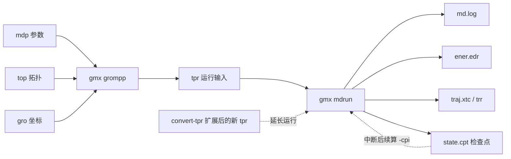
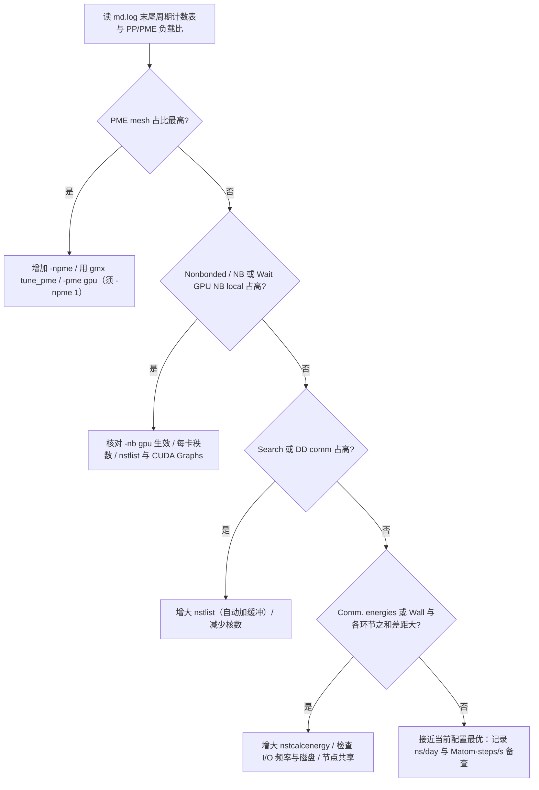
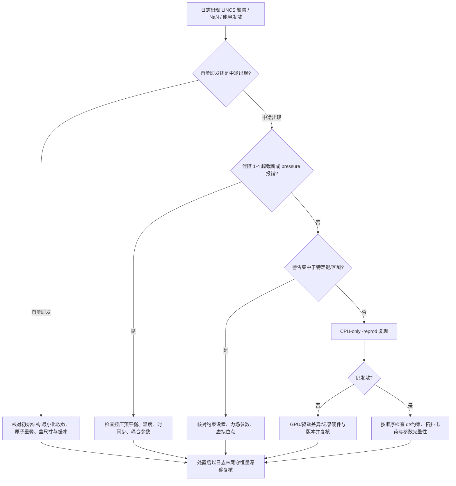

# 第 6 章 运行、性能与故障诊断

分子动力学模拟的生产环节由两个程序承担：grompp 把参数文件（.mdp）、拓扑（.top）与坐标（.gro）预处理为二进制运行输入（.tpr），mdrun 据此执行积分并产出日志（md.log）、能量（ener.edr）、轨迹（.xtc/.trr）与检查点（state.cpt）。第 5 章已经解决了"如何设置平衡阶段的参数"，本章解决三类运行期问题：如何理解 grompp 的检查与警告并以正确的方式放行；如何读懂 md.log 中的能量、温度、压力与性能信息；以及当模拟失稳或性能不佳时，应当按照怎样的顺序定位并处置。第 2 章给出了构建与硬件的决策基础，第 11 章将从算法层面重述域分解与 GPU 卸载的原理，本章处于二者之间的运行期位置：以 GROMACS 2026.x（本书基线 2026.4）的官方文档为准，给出可复制的命令、可核对的数据口径以及可重复的排查流程。

本章的事实依据分级如下：grompp 与 mdrun 的行为、参数默认值与错误信息语义引自对应版本的官方用户指南、参考手册与联机帮助[1-3]；检查点与续算的机制引自官方用户指南的「Managing long simulations」一节[4]；性能指标与并行映射引自官方性能指南[5]；方法学来源（LINCS、PME、GPU 异构并行）引原始文献[7-10]。凡属教科书共识或未经本机实测的推断，均在正文标明依据类型（文档推定或教材共识），读者可在目标机器上按本章给出的命令复现核对。

## 学习目标

- 能逐条解释 grompp 输出的 note、warning 与 error 三类消息的含义，并判断哪些警告可以安全放行、哪些必须修复，能正确使用 `-maxwarn` 而不掩盖真实问题。
- 能说明检查点文件的内容构成与默认写入频率，并用 `-cpi`、`-noappend`、`gmx convert-tpr` 完成断点续算、轨迹追加与运行延长，且能识别续算不精确的来源。
- 能解读 md.log 中能量项、温度、压力与六项性能指标的物理含义，并借「Real cycle and time accounting」表定位性能瓶颈。
- 能为给定 CPU/GPU 硬件组合选择 `-ntmpi`、`-ntomp`、`-npme` 与 GPU 卸载选项的初始取值，并说明其依据。
- 能沿 LINCS 警告—1-4 超截断—NaN 的诊断链，判断数值发散源于初始结构、参数、时间步长还是硬件差异，并执行对应的处置。
- 能用 `gmx check`、帧数核算与文件校验完成轨迹质检，并区分轨迹损坏、周期边界断裂与磁盘写入故障三类输出异常。

## 前置知识

- 第 1 章的版本基线（GROMACS 2026.x，当前 2026.4）与命令书写规范。
- 第 2 章的运行环境、Slurm 作业脚本与并行构建决策（thread-MPI 与 MPI 的取舍见 2.6.4 节）。
- 第 5 章的能量最小化判据（Fmax、emtol）、平衡阶段控温控压参数（5.5、5.6 节）与 mdp 参数体系（5.8 节）。
- 基础热力学与统计力学概念：温度由动能定义、压强由维里定理给出、能量守恒与涨落。

## grompp 的处理逻辑

### 输入检查与预处理

grompp 是运行前的唯一预处理环节，其输入为参数文件（.mdp）、拓扑文件（.top 及其 `#include` 的 .itp）、坐标文件（.gro/.pdb）以及可选的索引文件（.ndx）与参考坐标（-r），输出为二进制运行输入文件 .tpr。.tpr 一经生成即固定，mdrun 运行过程中不会再读取 .mdp 与 .top，因此 grompp 阶段相当于把「运行意图」冻结为一份自洽的快照：盒尺寸与截断、PME 网格与精度参数、约束算法与迭代次数、初速度与随机种子、输出频率等均被写入 .tpr。这一设计的直接后果是：修改 .mdp 中的任何参数都必须重新运行 grompp（或对检查点续算的 tpr 执行 `gmx convert-tpr`，见 6.2.3 节），而不能在 mdrun 命令行上就地更改。

预处理完成两类工作。第一类是文本处理：grompp 调用 C 预处理器展开 .mdp 的 `define` 字段（例如 `-DPOSRES` 激活 `#ifdef POSRES` 定义的位置约束），并把拓扑中的原子类型、键、角、二面角与 1-4 参数按力场规则组合成完整的相互作用表。第二类是物理合理性检查：坐标原子数与拓扑分子总原子数是否一致、体系净电荷是否接近整数、成键参数是否齐全、1-4 相互作用是否需要按 fudge 因子重新生成、截断距离是否满足最小镜像条件、耦合组是否过小、位置约束索引是否越界、约束键的振动周期是否远小于时间步。官方错误指南按错误出现的位置把 grompp 的错误单列一节[1]，近年发布说明记录了 grompp 多项检查行为的调整[6]。

在作业调度环境下，grompp 的价值在于把错误暴露在提交大量计算资源之前：一次失败的 grompp 仅消耗毫秒级 CPU 时间，而一次在 256 核上运行 24 小时后才暴露的参数错误则可能浪费数千核时。官方文档的典型工作流把 grompp 置于 mdrun 之前[11]，欧洲超算培训中心的材料据此把「在提交批量作业前先行 grompp」列为固定流程（教材共识）。本节建议的底线是：任何进入生产运行（production）的 .tpr，都应当由同一份 .mdp、.top 与 .gro 从零生成并保留三者副本，以便故障时可重建。

### 警告的级别与含义

grompp 的输出消息分为三个级别：note（提示）、warning（警告）与 error（错误），在屏幕上分别以 NOTE、WARNING 与 Fatal error 前缀出现。三者的性质由官方发布说明中的实例可以清楚区分：GROMACS 2020 把「分子解耦但未用随机动力学积分器」的 warning 降级为 note，理由是存在合理的普通 MD 用例；同一版本新增了「.mdp 的 define 宏在拓扑中从未被使用」的 warning，帮助用户发现 `-DPOSRES` 之类的宏拼写失误[6]。也就是说，note 用于说明一种虽非主流但合法的用法，warning 用于提示用户正在做的事情可能与建模物理不一致，error 则代表输入已无法自洽解释。官方错误指南对 warning 与 error 逐条的展开正体现了这一设计意图：每一条消息都指明问题出现在哪个文件与哪一行、偏离了什么物理假设，并给出针对性的处置建议，从而把「判断是否放行」所需的依据交到用户手里[1]。

表 6-1　grompp 消息级别与处理策略

| 级别 | 屏幕前缀 | 对 tpr 产出的影响 | 推荐处理 | 典型实例 |
| --- | --- | --- | --- | --- |
| note | `NOTE:` | 不影响 | 阅读即可 | 分子解耦但未用 SD 积分器[6] |
| warning | `WARNING:` | 超过 `-maxwarn` 时不生成 tpr[3] | 逐条核对成因后决定放行与否 | 体系净电荷非零[1]；耦合组原子占比过小[1]；define 宏未被使用[6] |
| error | `Fatal error:` | 终止，不生成 tpr | 必须修复 | 坐标数与拓扑不符[1]；截断超半盒长[1] |

对警告的处理原则是「先懂后放」：每一条 warning 都带有文件名与行号（如 `WARNING 1 [file topol.top, line 42]`），应顺着该位置核对成因，而不是因为「它只是警告」而一律放行。一个典型的误判是体系净电荷警告：当电荷偏离整数是由浮点舍入造成时确实无害，但当残基电荷累计偏离整数时，往往意味着拓扑中残基质子化态或端基处理错误，放任该警告会让 PME 在带净电荷的周期体系上产生人工漂移[1]。同理，grompp 对键振动周期小于约 5 倍时间步长的键会给出约束相关的提示，通常意味着应设置 `constraints=h-bonds` 或减小时间步（文档推定，依据 grompp 实际输出的警告文本）；此类警告若被忽略，失稳会在 mdrun 阶段以 LINCS 警告的形式复现（见 6.6 节）。

### 典型报错与对策

官方错误指南列出的 grompp 常见错误及其对策如下[1]，按出现频率排序：

- 「Number of coordinates in coordinate file does not match topology」：坐标文件原子数与 `[ molecules ]` 汇总数不一致，常见于溶剂化或加离子后未更新拓扑。对策是核对 .gro 与 .top 末段 `[ molecules ]` 的数量与顺序。
- 「XXX non-matching atom names」：拓扑与坐标文件中原子顺序或命名不一致。若属于旧版（4.5 之前）离子命名（如 NA、CL）与现行命名间的差异可放行，其余情况应视为致命，因为 grompp 依据坐标顺序把参数映射到原子。
- 「Fatal error: No such moleculetype」：`[ molecules ]` 引用了未定义的分子类型，多为 `#ifdef`/`#include` 条件编译未按预期展开。
- 「System has non-zero total charge」：体系总电荷非整数。检查位置在 pdb2gmx 输出拓扑的电荷列：每个残基之后累计电荷应为整数；非整数说明质子化态或终端处理有误。
- 「The cut-off length is longer than half the shortest box vector…」：截断违反最小镜像约定，原子将与自身的镜像相互作用。对策是加大盒子或减小截断；若使用控压，还需考虑平衡阶段盒长收缩的余量。
- 「Found a second defaults directive / Invalid order for directive」：拓扑指令顺序被破坏，常见于把分子 .itp 的 `#include` 插到了 `[ defaults ]` 之前或两个 `[ defaults ]` 并存。
- 「Atom index n in position_restraints out of bounds」：位置约束文件的原子索引应按分子类型内部编号，而非体系全局编号；多分子共享一份 posre 文件是常见病因，官方错误指南给出了正确的 `#ifdef`/`#include` 组织方式[1]。
- 「An input file contains a line longer than 4095 characters」：多为 DOS/Windows 换行符（CRLF）混入，用 dos2unix 转换后再提交（文档推定，依据既有发布说明对换行错误提示的改进记录）。

当 grompp 因警告而中止时，可以用 `-maxwarn N` 放行至多 N 条警告：

```bash
# 平台：Linux（bash）；版本：GROMACS 2026.x
gmx grompp -f em.mdp -c solvated.gro -p topol.top -o em.tpr -maxwarn 2
```

`-maxwarn` 的官方语义是限制输入处理阶段允许的警告条数[3]。官方错误指南对此有一句需要牢记的告诫：仅仅因为 `-maxwarn` 选项存在，并不意味着应当在未读懂警告的情况下使用它，盲目放行几乎必然导致体系在后续运行中失稳[1]。正确的流程是：先不带 `-maxwarn` 运行 grompp，逐条阅读警告来源；对确认无害的条目记录理由，再以恰好覆盖这些条目的 N 值放行，并把「为何放行」写入任务目录的 README（见第 10 章的记录规范）。

## mdrun 执行

### 运行阶段与日志结构

mdrun 是 GROMACS 唯一的动力学引擎，除分子动力学外还承担能量最小化、随机动力学与正常模式分析等任务，其统一入口与输出文件约定见联机帮助[12]。一次 mdrun 运行按时间顺序分为四个阶段：初始化、调优、主循环与收尾。初始化阶段读取 .tpr 并打印运行参数摘要（体系原子数、时间步、积分器、截断与 PME 设置、约束算法、并行配置），随后进行若干千步之内的自动调优：确定邻域搜索间隔、执行 CPU-GPU 负载平衡的试探性调节、建立与负载平衡域分解。主循环按 `nstlog` 指定的间隔向 md.log 追加一行摘要，报告步号、时间与即时性能；收尾阶段写出最终坐标、关闭能量与轨迹文件，并在日志末尾写出统计块。

mdrun 的主要输出文件及其内容如下：md.log（人类可读日志，含全部关键决策与报错）、ener.edr（二进制能量文件，含各能量项、温度、压力、体积与涨落统计）、confout.gro（末帧结构）、traj.trr（全精度轨迹，含坐标、速度与可选力）、traj_comp.xtc（有损压缩轨迹，默认 3 位小数精度）、state.cpt（周期检查点）[12]。输出文件的命名可由 `-deffnm` 统一指定：`gmx mdrun -deffnm md` 会把默认输出分别写为 md.log、md.edr、md.xtc 等，这是脚本化流程推荐的写法，可避免默认名（如 ener.edr、traj.xtc）在不同任务间互相覆盖。

日志结构中最值得读者熟悉的三类是：开头的运行参数与警告（包括并行配置回显、GPU 检测结果、SIMD 配置提示）、主循环的步进行，以及结尾的「Statistics over … steps」与「Real cycle and time accounting」两个统计块。步进行典型形如：

```text
Step 100000, time 200 (ps)  Performance: 234.5 ns/day, 0.102 hour/ns
```

（示意，数值随硬件与版本变化。）

开机后若目标输出文件已存在，mdrun 会先将其改名为 `#原文件名.1#` 再新建（日志中打印 `Back Off! I just backed up …`），这是防止覆盖既有成果的默认保护行为（文档推定，依据联机帮助对输出文件的表述[12]）。多级并行视角下，mdrun 在单节点上默认使用 thread-MPI 与 OpenMP 的组合、在跨节点场景使用外部 MPI；mdrun 会探测硬件并按探测结果自动分配秩数与线程，这一并行层次的全部决策都在初始化阶段写入日志，官方性能指南明确说明日志与标准输出用于打印这些决策及其后果的诊断信息[5]。

### 检查点机制

检查点文件（默认 state.cpt）是 mdrun 运行期状态的完整快照，包含全精度坐标与速度、积分器内部状态，以及控温控压等算法（如 Nosé-Hoover 链、Parrinello-Rahman 与随机热浴的辅助变量）的历史信息；相比之下 .gro 文件只保存 3 位小数的坐标与速度，且不携带任何耦合算法的状态，因此只有检查点能够支撑「与未中断运行等价」的续算[4]。官方用户指南明确：以 .gro 携带的速度重启虽然可行，但其连续性劣于正常一步 MD[4]。

检查点的写入由 `-cpt` 控制，单位为分钟，默认 15 分钟[12]。每次写入新检查点时，mdrun 先把旧文件改名为 state_prev.cpt，再写新文件，从而保证即使写入中途断电，也总有一个近期状态可用[4,12]。检查点还保存全部输出文件的校验和：续算时 mdrun 会核对每个待追加文件的校验和，任何被修改、破坏或删除的文件都会触发致命错误而不是静默混入，这从机制上排除了「不同模拟段的数据被错误拼接」的可能[4,12]。这些校验和也意味着：备份、迁移或手工编辑过输出文件后，续算前必须让文件与检查点记录的状态重新一致。图 6-1 给出 grompp 到 mdrun 再到检查点续算的完整数据流。



图 6-1　从 grompp 到 mdrun 的运行数据流与检查点续算闭环（依据官方文档[4]与 mdrun 联机帮助[12]绘制）

### 续算与轨迹追加

续算分为两类：恢复（restart）与延长（extend）。恢复针对被中断的运行，直接读取最近的检查点：`gmx mdrun -cpi state.cpt`，此时 mdrun 从检查点记录的时间步继续积分；若 `-cpi` 指定的文件不存在，mdrun 会输出警告 `Warning: No checkpoint file found` 并从 .tpr 的第一步重新开始——这一行为并非静默，但脚本中误写检查点文件名仍可能使运行从头重跑而不被立即察觉[12]（官方问题跟踪器记录了该缺省行为，属于文档推定，本机未实测）。恢复时输出默认追加到既有文件：`-noappend` 则强制每个续算段写入独立文件并在文件名中插入 `.part0000` 之类的段号，段号从零递增且与步数无关[4]。

延长针对已正常完成的运行，需要先生成覆盖更长时段的 .tpr，再把检查点状态导入：

```bash
# 平台：Linux（bash）；版本：GROMACS 2026.x
gmx convert-tpr -s md.tpr -extend 50000 -o md_ext.tpr
gmx mdrun -s md_ext.tpr -cpi state.cpt
```

`gmx convert-tpr` 支持 `-extend`（增加时长）、`-until`（延长至指定时刻）与 `-nsteps` 三种方式修改 tpr 的运行长度[13]。若不仅要延长还要修改其他运行参数（例如改变输出频率），则用 grompp 重新生成 tpr，并把检查点作为初始状态传入：

```bash
# 平台：Linux（bash）；版本：GROMACS 2026.x
gmx grompp -f new_prod.mdp -p topol.top -c confout.gro -t state.cpt -o new.tpr
gmx mdrun -s new.tpr -cpi state.cpt
```

`-t state.cpt` 使 grompp 把检查点中的全精度坐标与速度复制进新 tpr[4]。此时有三条必须遵守的约定：其一，不要在改参数的重启动中重新生成速度（`gen-vel` 保持关闭），因为 grompp 的速度生成是一次性操作；其二，新 tpr 的 `tinit` 与其开始时间设置需与续算意图一致，避免时间轴错位；其三，涉及约束体系时选择不重复施加约束的启动方式（`continuation`，旧名 `unconstrained-start`），使约束在首个积分步之前不被二次施加[4]。若不做这些处理，续算段的轨迹会在时间轴或约束状态上出现可检测的跳变（见 6.7.1 的帧数核算）。

关于「续算是否逐位等价」，官方用户指南给出的结论是：使用相同代码、编译器与硬件架构、相同进程数且不用 GPU 时，检查点续算可以达到二进制一致；但在默认的动态负载平衡与 GPU 非确定性和序下，轨迹会因浮点和序不同而快速分叉——这不是错误，两种轨迹同为合法采样[4]。因此，需要严格可复现场景（如调试一个可疑的数值行为）时应使用 `-reprod` 并在求和中固定秩数[12]。官方 2022.2 发布说明还记录过一类与续算相关的正确性判据：若体系中约束处理的并行路径出错，正确性可以从日志末尾守恒量（conserved quantity）的漂移判断——错误运行的能量漂移会比正确运行大一到两个数量级，这一点在 6.3.3 与 6.6.4 中还会用到[14]。

把「生产—续算」固化为一个最小闭环，可保证任意时长生产被作业时限拆断后仍能自动接续：提交脚本以「若存在最新检查点则用 `-cpi` 续算」为分支条件，作业结束前用 `-maxh` 收尾并写检查点：

```bash
# 平台：Linux（bash）+ Slurm；版本：GROMACS 2026.x
# 每次提交都从「最新检查点（state.cpt 或 state_prev.cpt）」续算，没有则从头
if [ -f state.cpt ]; then
    gmx mdrun -s md.tpr -deffnm md -cpi state.cpt -maxh 23.9
elif [ -f state_prev.cpt ]; then
    gmx mdrun -s md.tpr -deffnm md -cpi state_prev.cpt -maxh 23.9
else
    gmx mdrun -s md.tpr -deffnm md -maxh 23.9
fi
# 闭环三要素：-maxh 保证作业时限前主动收尾；检查点保留 state_prev.cpt 兜底；
# 下一轮提交沿用同一 tpr（不重跑 grompp），仅以 -cpi 附检查点。
```

三种续算方式的边界与用途对照见表 6-6。

表 6-6　三种续算方式对照（续算语义依据官方用户指南[4]与 mdrun 联机帮助[12]）

| 续算方式 | 输入 | 语义 | 典型用途 | 风险点 |
| --- | --- | --- | --- | --- |
| `-cpi` 恢复 | 原 tpr + state.cpt | 从检查点时刻继续，输出默认追加 | 作业中断后的接续 | 文件校验和拒绝被编辑过的输出 |
| `convert-tpr` + `-cpi` 延长 | 新（更长）tpr + 检查点 | 保留状态、延长运行窗口 | 500 ns 生产分批接续 | 时间轴由 tpr 决定，须核对 `tinit` |
| grompp `-t state.cpt` 重生成 | 新参数 + 检查点初值 | 改参数后从检查点状态重启 | 换输出频率/换控温参数 | `gen-vel` 必须关闭、`continuation` 开启 |

**GPU 环境的续算可复现性边界**：上述逐位一致的结论明确以「不用 GPU」为前提——GPU 非确定性的浮点和序使续算段与原运行段快速分叉。工程含义有三：其一，跨节点迁移续算（换机型/换卡型）不保证轨迹连续，但仍是合法采样；其二，统计性质比较应基于轨迹的分块统计（第 9 章），不应基于逐位比较；其三，调试数值行为时须回 CPU、固定秩数并加 `-reprod`。这些边界与第 9 章 9.6 的记录规范呼应：记录中应写明「该轨迹为 GPU 续算拼接，跨段分叉属预期」。

## 日志解读

### 能量项

md.log 的主循环步进行通常分两行：第一行给出步号与时间，第二行给出该时刻的能量列。对 leap-frog 积分器，能量列固定包含势能（Potential）、动能（Kinetic）、总能（Total）与温度（Temperature），压力耦合开启时再追加压力列（Pressure (bar)），单位为 kJ·mol⁻¹（压力为 bar）[2]。各能量项的定义在参考手册「Molecular dynamics」一章给出：温度由动能按 ½N_df k_B T = E_kin 定义，压力张量由动能与维里项构成，标量压力取其迹的三分之一[2]；这些定义与第 5 章 5.5、5.6 节的判据一致，无须在本章重述。

能量文件中记录的项比日志行更细：ener.edr 按能量项分列存储（键、角、二面角、LJ-14、Coul-14、LJ-SR、Coul-SR、Coul-rec 等），并按 `nstcalcenergy` 区间保存精确和与涨落统计，可用 `gmx energy` 按名称交互挑选后导出为 .xvg 或直接打印统计[15-16]。读取能量文件时应区分的两件事：一是文件在物理上是「区间精确和」——每个区间内的精确能量只计算一次（`nstcalcenergy` 控制频率），而每个 `nstenergy` 输出区间写入一次结果[17]；二是涨落统计（波动、均方根）只在区间足够长时才可靠，过短的 `nstcalcenergy` 会把热噪声当信号。判断运行是否守恒，应比较连续区间的总能漂移：NVE 下总能在 k_B T 量级涨落内平台化，NVT/NPT 下守恒量（见 6.6.4）漂移量级是核对约束等算法正确性的依据[14]。

守恒量漂移判据的完整用法需要三样东西：**读取位置、量级刻度、积分器语义**。读取位置：`md.log` 末尾「Statistics over … steps」统计块中标注的守恒量字段（常标 `Conserved En.`，v-rescale、Nosé–Hoover、C-rescale 分别给出各自守恒量的统计），取该字段在整个运行区间的最大值减最小值作为漂移量；或 `gmx energy` 选择 `Total-Energy`/`Conserved En.` 项，看其时间序列的区间差。量级刻度：对常规全原子蛋白—水体系、2 fs 步长，守恒量的总漂移在数 kJ·mol⁻¹ 量级、与体系自身的动能涨落同量级属正常（教材共识刻度，严格值应按体系实测校准）；若漂移比正常运行大 1–2 个数量级，几乎必然对应约束失效、步长过大或控温控压耦合异常。积分器语义：leap-frog（`integrator=md`）下日志能量列中的 `Total Energy` 不是严格守恒量——动能的半步错位使其在每一步都含周期性抖动（对称化平均后才接近守恒），因此以 `gmx energy` 的 `Total-Energy` 列做区间差会把这种半步抖动误判为漂移；正确做法是从统计块读 `Conserved En.` 字段，而不是能量列的总能。NVE 下还应区分「守恒量漂移」与「总能绝对涨落」：前者度量算法误差，后者含热涨落成分。

### 温度与压力

温度与压力列是平衡判据的直接读数，也是诊断失稳的第一现场。温度列在正常平衡段应围绕 `ref_t` 涨落，涨落幅度与自由度数和耦合强度有关；若温度持续偏离目标或出现单步巨变，几乎总是力发散的伴随信号（见 6.6 节）。压力列对 NPT 运行特别需要注意：瞬时压力涨落幅度可达数百 bar，单帧读数没有判据意义，应有环境与区间统计（`gmx energy` 打印的均值与标准差）配合 5.7 节的平衡判据使用[2,17]。读取压力时还应核对两点：其一，`pcoupl` 为各向同性时压力列为标量，半各向异性或表面张力控压时需按张量分量读取；其二，耦合组的质量分数会影响温度计算（耦合组过小时自由度处理易出问题，grompp 会据此给出警告，见表 6-1 与 6.8.2 节）。

### 性能报告

md.log 末尾的「Statistics over … steps」给出整体性能与「Real cycle and time accounting」表，后者按计算环节逐行给出「该环节如果单独运行所能达到的 ns/day」。官方性能指南没有固定给出逐行明细——周期计数表的**行名随 GROMACS 版本而变**，以本机 `md.log` 实际输出为准：较老版本（约 2021 及以前）采用 `Comp 1–N` 编号（如 Comp 1 - DD comm、Comp 2 - Search、Comp 5 - PME mesh、Comp 6 - Nonbonded），较新版本（2023/2024 起）改为语义化行名，常见为 `Force`、`PME mesh`、`NB X/F buffer ops`、`Domain decomp. comm` 以及 GPU 相关等待项等。表内还打印 PP/PME 负载比，负载失衡严重时给出显式警告[5]。无论行名形式如何，判定逻辑一致：某环节行的数值明显低于其他行，说明该环节是当前配置的串行瓶颈；瓶颈识别与处置按语义环节处理（见 6.5.2，以「PME 网格」「非键」「邻域搜索/域分解通信」等语义为准，不依赖具体行名编号）。官方性能指南特别提醒，GPU 驻留模式（`-update gpu`）下频繁的能量或维里计算开销不会完整计入周期计数器，CPU 等待 GPU 的时间以 `Wait GPU NB local` 行单独报告[5]。2026 系列还支持多时间步选项 `mts=yes`，把 PME 网格计算隔步执行以缓解 PME 瓶颈；官方明确指出该特性仅在使用 CPU 积分路径（`-update cpu`）时可用（当前文档在性能指南中给出该建议）[5]。

## 并行与硬件映射

### 域分解

域分解（domain decomposition，DD）把模拟盒按空间分成三维子域，每个子域归属一个 MPI 进程（rank），进程负责其子域内全部短程非键相互作用与成键相互作用，并只与本邻域通信[5]。DD 有两个与运行直接相关的约束。其一，子域尺寸有下限：最小元胞尺寸受最大电荷组或成键相互作用范围、rvdw/rlist/rcoulomb 中最大者与约束（P-LINCS）连接范围共同限制，小体系配大进程数会导致「不存在与给定盒和最小元胞尺寸兼容的分解」，mdrun 会在日志中打印最小尺寸的计算明细[1,5]。其二，DD 通信在跨节点场景是扩展性的主要敌人：PME 的三维 FFT 需要全局通信，参与秩数越多并行效率越差，这是引入专职 PME 秩的动因[5,8]。与 DD 相关的命令行选项包括 `-dd`（手动指定分解网格）、`-rdd`（成键相互作用最大距离，同时作为动态负载平衡下元胞尺寸下限）、`-dds`（动态缩放余量）与 `-dlb`（动态负载平衡开关），默认值均由 mdrun 依据初始坐标自动确定[5,12]。当出现「不存在与给定盒和最小元胞尺寸兼容的分解」报错时，除减少秩数这一常见出路外，还有一个针对约束的调钮：`-rcon` 影响元胞尺寸下限的约束部分——约束原子不应越过最小元胞，必要时可减小 LINCS order 并增加迭代次数来收紧约束求解，从而放松元胞下限；这是该报错场景下「拧哪个旋钮」的官方答案之一（依据 mdrun 联机帮助对 `-rcon` 的说明[12]）。动态负载平衡（DLB）按实测墙钟时间逐步调整子域边界，是单节点与多节点运行吞吐的关键机制，但也是续算逐位不可复现的来源之一（见 6.2.3 节）。

### MPI 进程与 OpenMP 线程的配比

mdrun 的并行层次分为进程级（MPI/thread-MPI 秩）与线程级（每秩若干 OpenMP 线程）：`-ntmpi` 指定秩数，`-ntomp` 指定每秩 OpenMP 线程数，`-nt` 指定总线程数。三者默认值均为 0（自动）：无 GPU 时 `-ntmpi` 默认一核一秩，有 GPU 时默认一卡一秩；`-ntmpi` 与 `-ntomp` 的乘积应接近节点可用核数，过度订阅（乘积显著大于核数）会导致线程迁移与上下文切换开销[5,12]。配比的经验依据有两条：其一，OpenMP 多线程在 Intel 上通常可扩展至 12–24 线程、在 AMD 上至 6–8 线程，超出后收益递减，此时应增加秩数[5]；其二，多卡节点上不宜让秩数等于核数，每 GPU 配 1–3 个秩通常最优，GPU 驻留模式配合直接通信时一卡一秩最佳[5]。thread-MPI 版本内部实现 MPI 语义但只跑在单节点，跨节点必须用编译了 `GMX_MPI` 的二进制并由外部 MPI 启动（srun/mpirun），秩数与节点数的约束由调度器承接（见第 2 章 2.5、2.6 节）。

除配比外，**线程是否真的被钉（pin）在核上**同样决定并行效率——超订与线程漂移恰恰最常发生在未钉住的共享节点上。`-pin` 的取值（auto/on/inherit/off）控制 mdrun 是否把 OpenMP 线程绑定到物理核：`auto` 下，独占整个节点且调度器未设置外设亲和时，mdrun 自动钉线程；**共享节点或调度器已设置亲和时，auto 不钉线程**（行为不同而非冲突），此时应显式处理。在多实例同节点（或与其它 MPI 任务共存）时，用 `-pinstride` 与 `-pinoffset` 把各实例的线程错开到不同核区间；`-pin inherit` 在外部给定的亲和掩码内钉、`-pin on` 全局钉。配合 OpenMP 一侧的 `OMP_PROC_BIND=true` 与 `OMP_PLACES=cores`（见第 2 章 2.5 节调度器绑定的呼应），构成「调度器分配 → mdrun 钉核」的双层控制。官方性能指南还说明 GROMACS 可从超线程（SMT）获得「moderate free performance boost」，运行日志会给出该机器是否可启用超线程的提示——「12–24 线程（Intel）/6–8（AMD）后收益递减」的阈值是在物理核细度上讨论的，启用 SMT 后应按逻辑核数重新评估。

PME 秩数 `-npme` 的默认是 -1（自动）：总线程数不少于 12 时，mdrun 自动划出约四分之一的秩专职处理 PME 长程部分[5,12]。为什么需要专职 PME 秩：PME 的全局 FFT 通信随参与秩数增加而劣化，官方经验是「四分之一到一半的秩」参与 PME 时最快[5]；把 PME 限制在少数组上，其余秩专职短程力（PP），可同时缓解 PP 与 PME 的负载失衡。`gmx tune_pme` 可在给定体系中自动扫描 `-npme`、`-dd` 与 PME 网格间距，寻找最优组合，是大规模 PME 运行的首选调参工具[18]。注意一切自动取值都是「初始建议」：官方性能指南明确，即使报告的小幅失衡，也可能仍存在通过调整参数获得的性能空间，需要按目标体系实测微调（教材共识，依据官方性能指南的表述[5]）。规模化并行配置的实践性总结可参考 BioExcel 的最佳实践指南[19]。常见场景的初始配置速查见表 6-2。

表 6-2　常见场景的并行配置初始取值（依据官方性能指南与 mdrun 联机帮助[5,12]，初始值须按目标体系实测微调）

| 场景 | `-ntmpi` | `-ntomp` | `-npme` | `-nb`/`-pme` | 依据要点 |
| --- | --- | --- | --- | --- | --- |
| 单节点 CPU，32 核 | 4–8 | 4–8（乘积≈核数） | -1（自动） | auto | OpenMP 超 12–24 线程（Intel）后收益递减[5] |
| 单节点，1 GPU + 16 核 | 1 | 8–16 | -1；PME 上卡时为 1 | auto | 单个 PP 秩配单卡对短程力最有效[5] |
| 单节点，4 GPU + 64 核 | 4（每卡一秩） | 8–16 | 1 | auto | 每 GPU 1–3 秩，GPU 驻留时一卡一秩最佳[5] |
| 跨节点，每节点 2 GPU | 2×节点数 | 2–4 | 1 | auto | 高并行时 PME 秩取总秩的 1/4–1/2[5] |

### 短程力与 PME 的 GPU 卸载

短程非键力、成键力、PME 长程与坐标更新/约束四类任务可用 `-nb`、`-bonded`、`-pme`、`-update` 四个选项分别指定执行端（cpu/gpu/auto），默认均为 auto：有兼容 GPU 时短程非键与 PME 自动卸载，成键力仅在 GPU 承担短程力且 CPU 承担长程时才上卡，坐标更新与约束在可行时上卡[12]。全部四类任务同时上卡的配置称为 GPU 驻留模式，配合 `-pmefft gpu`（默认随 GPU PME 开启）可以把整个 PME 计算留在卡上[5,12]。GROMACS 对 GPU 卸载的实现历史与负载平衡机制见异构并行原始文献[9]与 GPU 节点利用文献[10]：非键内核在 GPU 上执行的同时，CPU 并行计算成键力与 PME 网格，启动阶段通过伸缩静电截断与网格间距做若干步试探，把 CPU 与 GPU 的负载调到接近相等[5]。

四个选项的取值存在互相约束，最容易被忽视的一条是：GPU 上执行 PME 不支持多个 PME 秩，一旦 `-pme gpu` 生效，`-npme` 必须为 1[12]。另有限制记录在发布说明中：域分解结合 GPU 更新的运行一度不允许 PME 留在 CPU、GPU 更新与 SETTLE/LINCS 约束组合存在维里计算缺陷，二者分别于 2021.2 与 2021.6 修复[20-21]。卸载决策还应考虑构建端：GPU 后端（CUDA/OpenCL/SYCL/HIP）与 SIMD 指令集在安装时决定，见第 2 章 2.6 节与安装指南[22]。2026 基线的另一处边界是 PME 的 GPU 分域：以 `GMX_GPU_PME_DECOMPOSITION` 构建的版本允许把 PME 分解后放到多张卡（配合 `GMX_PME_NUM_FFTS` 等环境变量控制分解粒度），**默认构建仍须保持 `-pme gpu` 与 `-npme 1`**——多 PME 秩上卡的组合在默认构建下不成立（依据发布说明与 mdrun 联机帮助的边界表述[12]，使用前请核对本机构建是否启用该特性）。

### 多卡与 GPU 直连

多卡运行的基本映射关系是「一个域配一张卡」：每张 GPU 承担一个 PP 域的短程非键工作，因此 GPU 数量须与参与 PP 的进程数匹配，单节点多卡与跨节点多卡都通过域分解实现[5]。`-gpu_id` 限定本节点可用的 GPU 编号（用于共享节点或屏蔽显示卡），`-gputasks` 把每个 GPU 任务映射到具体设备——例如 `gmx mdrun -gputasks 0001 -nb gpu -pme gpu -npme 1 -ntmpi 4` 把前三个 PP 任务放到 GPU 0、PME 任务放到 GPU 1，日志会打印该映射[5,12]。多卡扩展性由三件事决定：每卡的原子数不能太少（官方建议单卡域至少数千粒子[5]）、GPU 间通信带宽（同节点内 PCIe/NVLink，跨节点走网络）、以及 PP 与 PME 分别在不同卡上时的同步等待。历史上多卡直连通信存在特定缺陷：2022.6 发布说明记录了使用 `GMX_ENABLE_DIRECT_GPU_COMM` 直连通信时、三个及以上 GPU 的 PME 展开与同步问题，提示该环境变量属试验性、应在关键生产运行前用小规模复现验证[23]。GROMACS 自 2016 起把线程、MPI 与 GPU 卸载整合为多级并行框架，其设计与扩展性结论分别见基本文献[24]与实测文献[9-10]。

## 性能诊断

### ns/day 的解读

md.log 中报告的六个性能指标在官方性能指南中有明确口径[5]：ns/day（纳秒/天）是「特定体系、特定条件、特定硬件」下的总吞吐，最直观但不可跨体系比较；hour/ns 是 ns/day 的倒数，用于估算跑完目标时长所需的墙钟时间；ms/step 与步长无关，直接度量每步墙钟成本，适合衡量给定体系的单步开销；Matom·steps/s（百万原子·步/秒）按原子数归一，在同类体系中近似线性可比，是衡量「每原子效率」的指标；Mnbf/s（百万非键力/秒）只归一非键工作量，适合非键主导时比较硬件或算法；MFlops 是估算的浮点吞吐，可与硬件峰值对比，注意它是「有用浮点运算」的估计而非编译器实际发出的指令。最后两项仅在设置环境变量 `GMX_DETAILED_PERF_STATS` 时输出[5]。六项指标的口径与适用场景汇总于表 6-3。

表 6-3　md.log 性能六指标的口径（依据官方性能指南[5]）

| 指标 | 单位 | 口径 | 适用场景 |
| --- | --- | --- | --- |
| ns/day | ns·day⁻¹ | 每日模拟时长（特定体系、条件、硬件） | 同体系、同硬件的直观总吞吐比较 |
| hour/ns | h·ns⁻¹ | ns/day 的倒数 | 估算跑完目标时长所需的墙钟时间 |
| ms/step | ms | 每步墙钟时间，与步长解耦 | 衡量给定体系的单步计算成本 |
| Matom·steps/s | — | 按原子数归一（百万原子·步/秒） | 同类体系跨规模比较「每原子效率」 |
| Mnbf/s | — | 按非键力数量归一（百万非键力/秒） | 非键主导时比较硬件或算法效率（需 `GMX_DETAILED_PERF_STATS`） |
| MFlops | — | 有用浮点运算的估计（百万次/秒） | 与硬件理论峰值对比（需 `GMX_DETAILED_PERF_STATS`） |

ns/day 的数值没有绝对好坏，只有相对意义：同一体系、同一硬件、同一精度下，改动参数前后的 ns/day 差才有诊断价值。跨体系比较时应退化到 Matom·steps/s 或 Mnbf/s，跨硬件比较建议直接用官方基准体系（ftp.gromacs.org/pub/benchmarks 提供不同规模的 benchmark 输入，覆盖蛋白-水、膜、核糖体等典型组成）跑同一输入[25]。记录性能时必须同时记录四个条件：体系规模（原子数与组成）、硬件（CPU 型号与核数、GPU 型号与数量）、配置（`-ntmpi×-ntomp`、`-npme`、卸载选项）、精度（单/双精度）——缺任一条件的 ns/day 数值不具可解释性（教材共识）。

### 瓶颈识别

识别瓶颈的入口是 md.log 末尾的周期计数表与 PP/PME 负载比[5]。判断按「占比最高的计算环节」分叉（环节以语义为准，行名随版本而异、见 6.3.3）：若 **PME 网格（PME mesh）** 最高，出路是增加 PME 秩数、用 `gmx tune_pme` 扫描、或把 PME 卸载到 GPU（注意 `-pme gpu` 要求 `-npme 1`）[5,12,18]；若 **非键（Nonbonded / NB）** 或 `Wait GPU NB local` 占高，说明非键计算（常为 GPU 侧）是瓶颈，核对 `-nb gpu` 是否生效、每卡秩数是否合理、邻域列表是否过密（对 GPU 驻留模式，官方建议多卡运行时自动抬升的 nstlist 往往偏保守，可取 200–300 并配合默认 Verlet 缓冲容差，且避免奇数 nstlist 以配合 CUDA Graphs）[5]；若 **邻域搜索（Search）** 或 **域分解通信（DD comm）** 占高，增大 `nstlist`（使用 Verlet 缓冲容差时 mdrun 会自动加缓冲保持能量漂移不变）或减少核数[5]；若 `Comm. energies` 占高，增大 `nstcalcenergy`[5]。GPU 驻留模式下频繁能量计算与频繁控温控压本身有固定开销，`nstcalcenergy` 与耦合频率（建议 ≥50–100 步一次）需要相应放宽[5]。图 6-2 把该判断流程整理为可复用的决策图。



图 6-2　性能瓶颈判定流程（依据官方性能指南的检查清单绘制[5]）

### 规模扩展性

扩展性指增加计算资源后吞吐的增长方式，分强扩展（固定体系、增加核/卡数）与弱扩展（体系规模与资源同比例增长）两类。GROMACS 的强扩展受 Amdahl 定律与通信成本双重约束：串行部分（初始化、部分成键、同步）占比随资源增大而相对放大，PME 的全局 FFT 通信随秩数增长而劣化，因此强扩展曲线在每域粒子数降到数千以下后急剧变差（教材共识，量级依据参考实测文献[9-10]）。弱扩展在给定同类体系时近似线性，但每域粒子数的下限与 PME 秩占比共同决定斜率[5]。判断扩展性是否正常的一个粗略口径：记录 1 卡与 N 卡各自达到的 Matom·steps/s，若 N 卡吞吐低于 1 卡的 N×0.6–0.8 倍（同体系、同配置），先怀疑通信或负载失衡而不是直接加卡（教材共识，数值为经验区间）。官方文献给出的扩展性结论可直接作为参照：异构并行论文报告了 GPU 集群上从小体系到大体系的加速比曲线[9]，GPU 节点利用论文给出了多节点 CPU-GPU 联合扩展的实测[10]。

## 数值不稳定的诊断链

### LINCS 警告的成因

LINCS 是 GROMACS 默认的键长约束算法（并行版本为 P-LINCS，见原始文献[7,26]）。其数值前提是约束方向在单步内近似不变，因此当某条键在一步内旋转超过 `lincs-warnangle`（默认 30°）或约束解不收敛时，md.log 会输出 `LINCS WARNING`，并列出「旋转超过 30 度的键（atom 1 atom 2 angle previous, current, constraint length）」与最大偏差，失稳严重时还会写出前后坐标的 .pdb 文件供检查（示意输出，见运行日志）[17]。官方错误指南对约束类警告给出的判断顺序是：约束算法通常不是病根，而是体系发散时最先失效的环节——如果体系正在爆炸，约束必然先失败，应排查更底层的物理不合理之处而非约束参数本身[1]。实践中 LINCS 警告的成因可归三类：初始结构残留冲突（最小化不充分，警告集中于首千步）；时间步与最快运动不匹配（未用 `constraints=h-bonds`、或步长过大，警告集中于特定键）；拓扑参数异常（虚拟位点、柔性水、异常力常数的键）。处置原则按 6.6.4 的排查顺序执行，不建议通过调大 `lincs-warnangle` 或 `lincs-iter` 掩盖问题[17]（掩盖只会推迟爆炸）。

### 1-4 相互作用超出截断

mdrun 的典型报错是「1-4 interaction … at distance … which is larger than the table limit」一类（1-4 相互作用距离超出查表范围），官方错误指南将其列为专门条目并给出明确告诫：**不要为了消除该错误而增大截断**——该错误的实际含义是体系中有原子在飞速运动，分子正在炸开，1-4 距离超出截断只是症状[1]。常与之相伴的报错还有配对列表截断问题：自由能计算中「存在 N 个微扰非键对超出 rlist」，常见于 `couple-intramol=no` 且分子内部最长距离超过 rlist 的体系，官方发布说明记录了该错误的成因并指向增大 rlist/nstlist 或改用 `couple-intramol=yes`[21]。处理顺序应回到成因：若错误发生在运行最早期，体系未平衡充分、含坏接触，应补做能量最小化；若发生在运行中途，检查温度是否过高、时间步是否过大，再检查拓扑参数的有效性[1]。2022.2 发布说明还记录了一个细分行为：能量最小化阶段该检查的严重级别被降低（错误降级为警告、警告降级为提示），因为最小化本身可能修复这类距离问题[14]。

### NaN 与能量发散

NaN（Not a Number）与 Inf 出现在能量列中意味着某条计算路径产生了非有限值。官方错误指南列出了两种直接表现：其一是能量最小化的「force on at least one atom is not finite」——两个原子过近，力超出表达范围，最小化无法继续；其二是「Simulation running but no output」——体系产生 NaN 后（例如除零），后续计算触发浮点异常，整体变慢数个量级，表现为日志长时间无更新[1]。发散的本质是力场在异常几何下给出爆炸性力：初始结构的原子重叠、参数表外推、时间步对最快运动过大、盒尺寸违反最小镜像等（教材共识，征兆清单见官方错误指南[1]）。诊断时先看发散发生的步号：第 0–1 步发散几乎必是初始结构或拓扑问题；运行中途发散则先排除控压振荡（`Pressure scaling more than 1%`，常因预平衡不足或 tau_p 过小）与约束失效[1]。定位具体原子可用 `mdrun -pforce`：它打印超过阈值的原子力，并在出现非有限力时终止运行，把爆炸的源头原子暴露出来[12]。

### 系统化排查顺序

官方错误指南与术语部分把失稳诊断归纳为「由征兆回溯成因」的顺序，本节整理为可执行的六步，对应图 6-3。第一步，固定变量：用 CPU-only（`-nb cpu -pme cpu`）、`-reprod` 复现发散，排除 GPU 非确定性与驱动差异——若 CPU 下不发散而 GPU 下发散，按硬件问题处理并记录报告（见 6.8.3）；若依旧发散，进入第二步（文档推定，依据 `-reprod` 与卸载选项的语义[12]）。第二步，定位爆炸步：读取日志中首个异常能量或 LINCS 警告所在步号与原子编号。第三步，核对初始结构：发散在首个千步内出现时，检查最小化收敛值（Fmax）、原子重叠与盒缓冲。第四步，核对时间步与约束：2 fs 步长必须配 `constraints=h-bonds`，键振动周期小于约 5 倍步长时减小 dt 或改约束（见 6.1.2 节）；粗粒化等软势体系注意相互作用参数的有效性。第五步，核对控温控压：Parrinello-Rahman 在不平衡体系上过早启用是「Pressure scaling」报错的常见来源，先以 C-rescale 平衡至平台再切换[1]（参数取值见第 5 章）。第六步，核对拓扑电荷与参数完整性：净电荷、缺失的 1-4 参数、虚拟位点与异常力常数会以各种姿势触发发散，必要时回到第 4 章的拓扑自检流程。任何一步的处置后都应当用「守恒量漂移」复核：正确运行的日志末尾守恒量漂移比约束算法出错的运行小一到两个数量级[14]。



图 6-3　数值失稳的系统化排查顺序（依据官方错误指南与术语章节整理[1,12,14]）

六类最常见征兆及其首要排查方向汇总于表 6-4，详细处置见相应小节。

表 6-4　数值失稳征兆速查（依据官方错误指南与 mdrun 联机帮助[1,12]）

| 征兆（日志线索） | 直接含义 | 首要排查方向 |
| --- | --- | --- |
| LINCS WARNING 洪水 | 约束解不收敛、键旋转过大 | 初始结构、时间步与约束设置（6.6.1） |
| 1-4 distance … larger than table limit | 原子高速运动、体系正在炸开 | 预平衡、温度、时间步（6.6.2） |
| 能量列出现 NaN/Inf | 计算路径产生非有限值 | 原子重叠、参数外推、除零（6.6.3） |
| A charge group moved too far between two domain decomposition steps | 电荷组飞越子域边界 | 未平衡体系、温度过高、盒偏小（6.8.2） |
| Pressure scaling more than 1% | 盒尺寸单步剧变 | 预平衡不足、tau_p 过小、步长过大（6.8.2） |
| water … can not be settled | 水分子几何失稳 | 重叠接触、步长过大（6.8.1） |

## 输出质检

### 轨迹完整性

轨迹质检的第一层是核对「文件写全了没有」。`gmx check -f traj_comp.xtc` 会扫描轨迹并报告帧数、时间范围与文件完整性；对检查点文件可用 `gmx check` 与 `gmx dump` 查询其内容（官方文档明确推荐这两个工具）[4,27]。帧数核算应独立进行：压缩轨迹帧数应符合「nsteps/nstxout-compressed + 1」的量级（初始帧存在时），时间轴末帧对应 tpr 总时长；续算段用 `-noappend` 分文件输出时，各 part 文件的帧数与时间范围应无缝衔接，任何时间回退或跳变都提示 `tinit`/续算参数错误（见 6.2.3 节）。ener.edr 的完整性用 `gmx check -e ener.edr` 检查，其步数范围应与日志末尾统计一致[27]。这里有一个容易误判的细节：xtc 是有损压缩格式，默认 3 位小数精度，帧内坐标的逐位比较毫无意义，完整性判断只看帧数、时间与文件能否读通[15]。

### 周期性边界断裂

「周期性边界断裂」指分子因精度或周期处理不当而跨盒撕裂：轨迹中的分子一部分在盒子一侧、其余在另一侧，或分子整体位移跨越盒边界后未重新包裹，导致可视化与后续分析（距离、氢键、RMSD）出现假象。成因有两类：一是压缩精度导致的漂移——xtc 的 3 位小数精度会让长链分子随帧数积累逐渐偏离整分子构型；二是工具有损转换时未做周期修正。处置用 `gmx trjconv`：`-pbc whole` 仅把断裂的分子拼合完整，`-pbc mol` 按分子质心放入盒子（官方文档明确该选项需要 `-s` 提供运行输入以获得分子定义），`-pbc res` 与 `-pbc atom` 分别按残基与单个原子包裹，`-pbc nojump` 修正跨盒跳变从而保持轨迹连续[28]；输出分析用轨迹前先做 `-pbc whole` 再加 `-pbc mol` 的两次预处理——官方文档提示 `-pbc` 与其他选项的组合未必能一次完成，分步处理是常见做法——这是第 7 章所有距离类分析的前置约定[28]。质检方法：预处理后在可视化软件中检查蛋白主链是否连续、水盒子是否完整，并抽查若干帧的分子内最大距离是否小于半盒长。

### 磁盘与写入故障

写入故障以「磁盘满」「文件系统不可写」与「输出被截断」三类形式出现。磁盘满的经典表现是 mdrun 报 I/O 错误前先出现日志长时间无更新——输出有缓冲，mdrun 不会立即察觉无法写入，官方错误指南把「Simulation running but no output」列为独立排查项，并给出 `GMX_LOG_BUFFER=0` 关闭日志缓冲以便尽早暴露问题的做法[1]。官方「Managing long simulations」节对灾难性中断（断电、磁盘满、网络故障）的处理建议是：把每个时段结束时的 state.cpt 单独归档，用 rsync 等工具在模拟进行中周期把输出镜像到远程存储，文件系统不可靠时不要只依赖本地副本[4]。恢复路径依赖检查点机制：`-cpi` 有三种结局——无同名文件时新建输出、同名且校验和匹配时追加、校验和不匹配时拒绝写入并报致命错误，因此被截断输出文件的正确处理是恢复备份或删除后以 `-noappend` 重开新段，而不是手工拼接[12]。磁盘配额还应预留写入放大余量：频繁输出轨迹会成倍放大写入量，长运行时合理设置 `nstxout-compressed` 与 `xtc-precision` 既是性能问题也是可靠性问题（教材共识）。运行结束后的文件级质检清单见表 6-5。

表 6-5　输出文件质检清单（依据文件格式说明与 gmx check 联机帮助[15,27]）

| 文件 | 检查方法 | 合格判据 | 异常处置 |
| --- | --- | --- | --- |
| md.log | 阅读末尾统计块 | 「Statistics」与周期计数齐全 | 缺失说明非正常结束，回溯中断原因 |
| ener.edr | `gmx check -e` / `gmx energy` | 步数与时间范围匹配 tpr | 截断则从检查点续算或重跑 |
| traj.xtc | `gmx check -f` + 帧数核算 | 帧数≈nsteps/nstxout-compressed+1 | 帧数不足按 6.7.1 判据回收或补跑 |
| confout.gro | 与 tpr 的一致性 | 原子数一致、盒信息完整 | 缺失说明未完成正常收尾 |
| state.cpt | `gmx check` | 可读、步号不早于日志末步 | 损坏则回退 state_prev.cpt |

## 错误案例库

本节按「成因大类」组织三类高频故障，每个案例给出可照抄的定位线索；详细处置承接 6.1.3、6.6 与 6.7 各节。

### 结构类错误

结构类错误的共同特征是：错误在最小化或运行第一步即爆发，且难以通过调参数绕过。典型案例一：坐标文件原子数与拓扑不符或顺序错乱（`Number of coordinates…`），多发生在溶剂化/加离子后忘记更新拓扑——这是 grompp 阶段最频繁的报错之一，处理是核对 `[ molecules ]` 与坐标文件[1]。案例二：补氢或插入分子造成原子重叠，最小化报「force on at least one atom is not finite」或水分子 SETTLE 失败（`water molecules starting at atom X can not be settled`），处理是先能量最小化、检查重叠区与盒缓冲，而不是减小步长硬闯（减小步长只推迟问题）[1]。案例三：分子跨盒断裂或盒尺寸不满足最小镜像（`cut-off longer than half the shortest box vector`），常见于控压平衡收缩后盒变小的运行，处理是加大盒余量并把该检查前移到 grompp[1]。结构类错误的系统化避免依赖第 4 章的构建检查（净电荷、缺失原子、质子化态）。

### 参数类错误

参数类错误的特征是 grompp 能通过、运行一段后才爆发，最典型的是「Pressure scaling more than 1%」：压力耦合使盒尺寸单步变化超过 1%，通常源于未充分预平衡就启用 Parrinello-Rahman、tau_p 过小，或步长过大（如 5 fs 且无约束）[1]。处置是退回 C-rescale 平衡、加大 tau_p、或减小 dt[1]。第二类是高发的时间步与约束不匹配：dt=2 fs 未设 `constraints=h-bonds` 时，键振动周期远小于步长，grompp 的约束提示与 mdrun 的 LINCS 警告会相继出现（见 6.1.2、6.6.1 节）。第三类是耦合组过小：官方错误指南明确警告为每种分子类型单独建耦合组是坏实践，会引入难以预测的伪影，`T-Coupling group XXX has fewer than 10% of the atoms` 是其直接征兆[1]。第四类是自由能相关的配对列表截断问题（`perturbed non-bonded pair interactions beyond the pair-list cutoff`），处置见 6.6.2 节[21]。

### 硬件与编译类错误

硬件与编译类错误在运行初期或以性能异常形式出现。案例一：SIMD 配置与硬件不匹配——mdrun 日志会给出「编译所用 SIMD 指令集低于本机可用指令集」的提示，性能损失可达数倍，处置是按目标机器的指令集重新构建（`-DGMX_SIMD`）[5,22]；历史上还存在编译器缺陷导致特定组合下结果错误（如 gcc 7 的 AVX512 非键计算缺失，2018.7 修复）[29]。案例二：GPU 检测或内核失败——驱动过旧、显存不足、OpenCL 后端不被支持（如 AMD RDNA 的 OpenCL 问题，2022.4 起明确标记不受支持）都会使 `-nb gpu` 失败或运行即崩，处置是核对已知问题清单与驱动/后端选择[30-31]。案例三：随机数硬件故障——2020.4 发布说明记录 AMD Ryzen 3000 系列 RDRAND 缺陷会使自动种子退化为相同值，多副本模拟因此同构，处置是显式设置 `gen_seed`[32]。案例四：并行配置错误——进程数含大素因子时 mdrun 提示 `-dd` 手动分解或改秩数；小体系配大量进程时报 DD 无兼容分解（见 6.4.1），处置分别是调整 `-ntmpi`、减少秩数[1,12]。最后，任何「日志无错误但崩溃（segmentation fault）」都应先复现再报告，且报告需附完整版本与硬件信息（教材共识，依据官方问题报告的惯例）。

## 常见错误

1. **现象**：运行目录里出现 `#md.log.1#`、`#traj.xtc.1#` 等备份文件，而新任务与预期文件名对不上。 **成因**：目标输出已存在，mdrun 的默认防覆盖机制把旧文件改名备份。 **排查步骤**：查看日志头部的 `Back Off! I just backed up …` 行与文件时间戳。 **处置**：确认旧文件归属后归档或删除；脚本化流程使用 `-deffnm` 并保证任务目录干净（依据联机帮助对输出文件的表述，文档推定[12]）。

2. **现象**：续算运行时间轴从头开始，或帧数与检查点对不上。 **成因**：`-cpi` 指定的检查点不存在，mdrun 输出警告后从头运行。 **排查步骤**：核对命令行检查点路径存在性；比对日志起始步号与检查点步号。 **处置**：修正 `-cpi` 路径后重跑；用 `gmx check` 确认检查点可读[4,12,27]。

3. **现象**：续算报致命错误，提示输出文件与检查点校验和不匹配。 **成因**：输出文件被移动、编辑或部分损坏，检查点的校验和验证拒绝追加。 **排查步骤**：确认待追加文件是否被手工改动或由其他工具重写。 **处置**：恢复备份，或删除该段输出并以 `-noappend` 重开新段[4,12]。

4. **现象**：grompp 报 `Atom index n in position_restraints out of bounds`。 **成因**：位置约束索引按分子类型内部编号编写，误用了体系全局编号或多分子共享 posre 文件。 **排查步骤**：对照 itp 内该分子类型的原子数与 posre 索引范围。 **处置**：按官方错误指南给出的 `#ifdef`/`#include` 组织方式逐分子引用 posre[1]。

5. **现象**：md.log 显示 `Performance: 0.0 ns/day` 或明显慢于同配置历史任务且日志无报错。 **成因**：日志缓冲掩盖了写入异常、GPU 根本没被使用（卸载选项失效）、或 SIMD 指令集不匹配。 **排查步骤**：关缓冲（`GMX_LOG_BUFFER=0`）观察；核对日志中 GPU 检测与 SIMD 提示；比对周期计数表。 **处置**：按 6.5.2 与 6.8.3 的流程定位并修复[1,5]。

6. **现象**：运行数小时后 mdrun 被调度器杀死，「statistics」块缺失。 **成因**：作业超时未留续算准备，或未用 `-maxh` 主动收尾。 **排查步骤**：检查 Slurm 的作业时长与 `-maxh` 设置。 **处置**：以 `-maxh` 在时限前主动写检查点平滑退出，用 `-cpi` 续算；未写检查点的运行需返回分析丢失范围（依据调度与检查点机制，见 2.5 节与 6.2 节，文档推定[12]）。

7. **现象**：xtc 帧数少于预期，或末尾时间不到 tpr 总时长。 **成因**：运行被中断于输出周期之间，或 `nstxout-compressed` 设置不符合预期。 **排查步骤**：`gmx check -f` 读取实际帧数并核算。 **处置**：确认是否为预期内的中断回收；按 6.7.1 的核算口径判断是否需要重跑或补跑[27]。

8. **现象**：mdrun 启动数秒即退出，stderr 报 CUDA/HIP 内存分配失败（`out of memory` / `allocation failed`），或 GPU 驻留模式悄悄退化为 CPU 计算。 **成因**：体系规模与卸载范围（`-nb gpu`/`-pme gpu`）合计的显存需求超出设备容量；多任务同卡（与其它作业共享）挤占显存。 **排查步骤**：核对 nvidia-smi/rocm-smi 的显存占用与他用；按第 2 章 2.1.3 的显存估算量级复核本体系需求；检查日志开头后端选择回显与周期计数表中 GPU 等待项。 **处置**：减小体系或拆分 `-nb gpu`/`-pme gpu` 的卸载范围（如仅短程上卡）；单节点改用多卡分解；或换更大显存设备——判定「是否发生回退」的可靠入口是日志后端回显而非任务是否正常结束。
9. **现象**：续算或换机提交报 `tpr file was written for a different number of processors` 或直接无法读入。 **成因**：`.tpr` 与执行运行所用 mdrun 版本/构建不匹配（tpr 依赖版本序列化），或续算时误用 `grompp` 重新生成了新 tpr。 **排查步骤**：`gmx --version` 与 tpr 生成时的版本比对（第 9 章记录规范中的版本六要素）；检查续算命令是否只带 `-cpi` 而未重跑 grompp。 **处置**：生产链中 tpr 生成与 mdrun 执行固定同一版本（模块化部署时锁定模块）；跨版本重跑需重新走 5.8 的参数体系并从原始输入重建，而不是拿旧 tpr 硬读[3]。

## 本章小结

- grompp 的唯一产物是自洽的 .tpr 快照，运行期不再读取 .mdp 与 .top；三类消息按 note/warning/error 分级，警告处理原则是「先懂后放」，`-maxwarn` 只用于放行已核对的警告。
- mdrun 输出 md.log、ener.edr、confout.gro、traj.trr、traj_comp.xtc 与 state.cpt，`-deffnm` 统一命名是脚本化流程的底线约定；日志头尾分别承载运行决策与统计块。
- 检查点是全精度状态快照，默认每 15 分钟写入并保留 state_prev.cpt；续算按校验和验证追加，`-noappend` 生成带段号的新文件；同硬件同配置时检查点续算可二进制一致，默认动态负载平衡下不保证逐位复现。
- 日志能量列与 ener.edr 分别提供低频读数与分项统计；温度与压力按参考手册定义读取，瞬时压力无判据意义；守恒量漂移是算法正确性的定量判据。
- 域分解按空间划分子域，元胞尺寸下限约束进程规模；`-ntmpi×-ntomp` 应接近核数，OpenMP 扩展性在 12–24 线程（Intel）/6–8 线程（AMD）后递减；`-npme` 默认自动且约四分之一秩，GPU PME 要求 `-npme 1`。
- 性能六指标中 ns/day 仅同体系可比，跨规模用 Matom·steps/s，跨硬件用官方基准体系；瓶颈定位读周期计数表的分环节速率，PP/PME 负载比是首要线索。
- 数值失稳按「固定变量—定位步号—核对结构—核对步长约束—核对控温控压—核对拓扑」六步排查，LINCS 警告与 1-4 超截断是症状而非病根，处置后以守恒量漂移复核。
- 输出质检分三层：用 gmx check 与帧数核算查完整性，用 trjconv -pbc 修复周期边界，用检查点档案与 rsync 兜底磁盘与写入故障。

## 延伸讨论

性能诊断的三件套值得反复练习直到肌肉记忆：周期计数表按语义环节解读（行名随版本而异）、PP/PME 负载比、`-pin` 与调度器掩码的双层绑定。瓶颈判定的通用句式是「占比最高环节 + 对应旋钮」——PME 高则调秩与卸载，非键高则查 GPU 生效与 nstlist，搜索/通信高则查核数与拓扑。

守恒量漂移是「数值正确性」的定量判据，其用法依赖三件事：从统计块的 `Conserved En.` 读、按体系校准量级（常规体系数 kJ·mol⁻¹ 量级、教材共识）、区分 leap-frog 的 Total Energy 与严格守恒量。这三件事缺一，判据就从「定量」退化为「印象」。

续算闭环（`-maxh` 收尾 + `-cpi` 续算 + 不重跑 grompp）与 GPU 复现边界（跨段分叉属预期）合起来回答了一个同行高频问题：「生产被作业时限拆断后，轨迹还算一条吗？」答案是——物理上仍是一条合法采样（第 9 章口径），工程上应记录拼接事实并避免把逐位比较当判据。

## 参考文献

> 在线文档访问日期：2026-10-29。B 级文献六项均经 Crossref 复核；[7] 的 Wiley 字符型 DOI 已确认存在，[26] 的 DOI 已补录为 10.1021/ct700200b。

[1] GROMACS 2026.4 documentation. User guide: Common errors when using GROMACS[EB/OL]. https://manual.gromacs.org/current/user-guide/run-time-errors.html（访问日期：2026-10-29）.

[2] GROMACS 2026.4 documentation. Reference manual: Molecular dynamics[EB/OL]. https://manual.gromacs.org/documentation/current/reference-manual/algorithms/molecular-dynamics.html（访问日期：2026-10-29）.

[3] GROMACS 2026.4 documentation. gmx grompp[EB/OL]. https://manual.gromacs.org/current/onlinehelp/gmx-grompp.html（访问日期：2026-10-29）.

[4] GROMACS 2026.4 documentation. User guide: Managing long simulations[EB/OL]. https://manual.gromacs.org/current/user-guide/managing-simulations.html（访问日期：2026-10-29）.

[5] GROMACS 2026.4 documentation. User guide: Getting good performance from mdrun[EB/OL]. https://manual.gromacs.org/current/user-guide/mdrun-performance.html（访问日期：2026-10-29）.

[6] GROMACS documentation. Release notes: Miscellaneous (GROMACS 2020)[EB/OL]. https://manual.gromacs.org/2020.2/release-notes/2020/major/miscellaneous.html（访问日期：2026-10-29）.

[7] Hess B, Bekker H, Berendsen H J C, et al. LINCS: A linear constraint solver for molecular simulations[J]. Journal of Computational Chemistry, 1997, 18(12): 1463-1472. DOI: 10.1002/(SICI)1096-987X(199710)18:12<1463::AID-JCC4>3.0.CO;2-H.

[8] Essmann U, Perera L, Berkowitz M L, et al. A smooth particle mesh Ewald method[J]. The Journal of Chemical Physics, 1995, 103(19): 8577-8593. DOI: 10.1063/1.470117.

[9] Páll S, Zhmurov A, Bauer P, et al. Heterogeneous parallelization and acceleration of molecular dynamics simulations in GROMACS[J]. The Journal of Chemical Physics, 2020, 153(13): 134110. DOI: 10.1063/5.0018516.

[10] Kutzner C, Páll S, Fechner M, et al. More bang for your buck: Improved use of GPU nodes for GROMACS 2018[J]. Journal of Computational Chemistry, 2019, 40(27): 2418-2431. DOI: 10.1002/jcc.26011.

[11] GROMACS 2026.4 documentation. User guide: Getting started — Flowchart of typical simulation[EB/OL]. https://manual.gromacs.org/current/user-guide/getting-started.html（访问日期：2026-10-29）.

[12] GROMACS 2026.4 documentation. gmx mdrun[EB/OL]. https://manual.gromacs.org/current/onlinehelp/gmx-mdrun.html（访问日期：2026-10-29）.

[13] GROMACS 2026.4 documentation. gmx convert-tpr[EB/OL]. https://manual.gromacs.org/current/onlinehelp/gmx-convert-tpr.html（访问日期：2026-10-29）.

[14] GROMACS documentation. Release notes: GROMACS 2022.2[EB/OL]. https://manual.gromacs.org/documentation/2023.1/release-notes/2022/2022.2.html（访问日期：2026-10-29）.

[15] GROMACS 2026.4 documentation. Reference manual: File formats[EB/OL]. https://manual.gromacs.org/documentation/current/reference-manual/file-formats.html（访问日期：2026-10-29）.

[16] GROMACS 2026.4 documentation. gmx energy[EB/OL]. https://manual.gromacs.org/current/onlinehelp/gmx-energy.html（访问日期：2026-10-29）.

[17] GROMACS 2026.4 documentation. Molecular dynamics parameters (.mdp options)[EB/OL]. https://manual.gromacs.org/current/user-guide/mdp-options.html（访问日期：2026-10-29）.

[18] GROMACS 2026.4 documentation. gmx tune_pme[EB/OL]. https://manual.gromacs.org/current/onlinehelp/gmx-tune_pme.html（访问日期：2026-10-29）.

[19] BioExcel. GROMACS Best Practice Guide[EB/OL]. https://docs.bioexcel.eu/gromacs_bpg/（访问日期：2026-10-29）.

[20] GROMACS documentation. Release notes: GROMACS 2021.2[EB/OL]. https://manual.gromacs.org/2021.2/release-notes/2021/2021.2.html（访问日期：2026-10-29）.

[21] GROMACS documentation. Release notes: GROMACS 2021.6[EB/OL]. https://manual.gromacs.org/documentation/2021.6/release-notes/2021/2021.6.html（访问日期：2026-10-29）.

[22] GROMACS 2026.4 documentation. Installation guide[EB/OL]. https://manual.gromacs.org/current/install-guide/index.html（访问日期：2026-10-29）.

[23] GROMACS documentation. Release notes: GROMACS 2022.6[EB/OL]. https://manual.gromacs.org/documentation/2022.6/release-notes/2022/2022.6.html（访问日期：2026-10-29）.

[24] Abraham M J, Murtola T, Schulz R, et al. GROMACS: High performance molecular simulations through multi-level parallelism from laptops to supercomputers[J]. SoftwareX, 2015, 1-2: 19-25. DOI: 10.1016/j.softx.2015.06.001.

[25] GROMACS. Benchmark files[EB/OL]. https://ftp.gromacs.org/pub/benchmarks/（访问日期：2026-10-29）.

[26] Hess B. P-LINCS: A parallel linear constraint solver for molecular simulation[J]. Journal of Chemical Theory and Computation, 2008, 4(1): 116-122. DOI: 10.1021/ct700200b.

[27] GROMACS 2026.4 documentation. gmx check[EB/OL]. https://manual.gromacs.org/current/onlinehelp/gmx-check.html（访问日期：2026-10-29）.

[28] GROMACS 2026.4 documentation. gmx trjconv[EB/OL]. https://manual.gromacs.org/current/onlinehelp/gmx-trjconv.html（访问日期：2026-10-29）.

[29] GROMACS documentation. Release notes: GROMACS 2018.7[EB/OL]. https://manual.gromacs.org/documentation/2023.1/release-notes/2018/2018.7.html（访问日期：2026-10-29）.

[30] GROMACS 2026.4 documentation. User guide: Known issues[EB/OL]. https://manual.gromacs.org/current/user-guide/known-issues.html（访问日期：2026-10-29）.

[31] GROMACS documentation. Release notes: GROMACS 2022.4[EB/OL]. https://manual.gromacs.org/documentation/2022.4/release-notes/2022/2022.4.html（访问日期：2026-10-29）.

[32] GROMACS documentation. Release notes: GROMACS 2020.4[EB/OL]. https://manual.gromacs.org/documentation/2020.4/release-notes/2020/2020.4.html（访问日期：2026-10-29）.
