# 第 7 章 常规轨迹分析

轨迹分析是分子动力学模拟产出科学结论的必经环节。mdrun 输出的坐标轨迹记录了体系中每个粒子随时间的运动，但原始轨迹文件本身并不回答任何科学问题：蛋白质是否保持折叠、柔性残基位于何处、水分子如何环绕溶质、哪些残基对形成稳定接触，都需要经过专门的几何与统计处理才能转化为可检验的数值。第 4 章构建的拓扑与第 6 章保存的轨迹是本章的数据基础。本章讨论常规轨迹分析的三类任务：结构稳定性指标（均方根偏差、均方根涨落、回转半径与溶剂可及表面积）、二级结构与分子间相互作用（二级结构判定、氢键、盐桥），以及空间分布与溶剂化（径向分布函数、密度剖面、水分子驻留）。进入具体指标之前，必须先处理两类前置问题：周期性边界效应带来的分子断裂，以及索引组与选择语法所定义的"统计哪些原子"。二者处理不当，会使下游全部数值失真。第 8 章的自由能计算与第 9 章的统计检验建立在本章分析产物之上，本章给出的收敛判定与结果解读方式与第 9 章误差分析衔接。本章以 GROMACS 2026.x（当前 2026.4）为版本基线，`gmx do_dssp` 更名为 `gmx dssp`、`gmx hbond` 重写等工具行为变化均注明适用区间；命令与参数语义以官方在线帮助与参考手册为准，凡未在本机复测之处均标明推断性质与依据来源。

## 学习目标

- 能依据轨迹状态选择合适的 `gmx trjconv -pbc` 模式完成分子整体化与去跳变，并判断居中操作对下游分析的影响。
- 能用 `gmx make_ndx` 与选择语法定义并导出索引组，正确解析 `resname`、`within`、`byres` 等关键字的语义。
- 能计算并解读 RMSD、RMSF、回转半径与 SASA，针对给定科学问题选择拟合组、参考结构与探针半径并说明依据。
- 能运行 `gmx dssp`（及旧版 `do_dssp`）与 `gmx hbond`（及旧实现 `gmx hbond-legacy`），区分二者参数接口与版本适用范围。
- 能用 `gmx rdf`、`gmx density` 与 `gmx trjorder` 分析径向分布、密度剖面与水壳驻留，并解释第一溶剂化壳层的几何含义。
- 能用 MDAnalysis 或 MDTraj 复现至少一项内建工具的结果，并设计一致性校验流程判断两种实现是否等价。

## 前置知识

- 第 2 章的 Linux 命令行、xvg 文本处理与 GROMACS 安装自检。
- 第 3 章的 NumPy 数组、xvg 解析与出版级作图。
- 第 4 章的周期性边界条件与模拟盒设置（最小镜像约定见 4.6 节）。
- 第 6 章的轨迹输出频率、压缩与检查点机制（6.7 节轨迹完整性）。
- 本科物理化学的统计系综与分布函数概念；对径向分布函数仅需直观理解，本章 7.6 节给出定义。

## 分析前的必要处理

### 周期性边界修正的三个层次

模拟盒施加周期性边界条件（periodic boundary conditions，PBC）后，粒子在盒子边界附近会遇到三种与"直线连接"相悖的情形，必须区分对待。第一种是分子被盒壁切开：某个分子的一部分坐标落在盒子一侧、其余部分落在对侧，形成"断裂分子"（broken molecule）。第二种是由跳变导致的轨迹不连续：粒子穿过盒壁时，其原始坐标会发生与盒边长相等的突变，多数基于距离的统计量若不考虑周期镜像就会出错。第三种是整体平移：分子的质心可能在盒子内任意位置，甚至靠近盒角，导致视觉与部分几何量（如密度剖面）失真。三者对应不同的修正操作：整体化（make whole）把断裂分子沿化学键接回；去跳变（`-pbc nojump`）把每帧坐标衔接成连续轨迹；居中（`-center`）把选定分子的几何中心移回盒中心。需要强调的是，分析工具默认都会在距离计算层面考虑周期镜像（多数工具带 `-[no]pbc` 选项且默认开启），因此"未预处理就不能算距离"并不成立；预处理的真正价值在于三点：让涉及分子内排序、参考结构对比与可视化的任务得到与化学直觉一致的坐标；让"分子是否完整"类判据（如 SASA 的蛋白质表面积、氢键的供体辨识）不因断裂产生假象；让输出坐标可以进入不感知 PBC 的外部软件。图 7-1 给出三者与工具选择的关系。

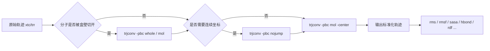

图 7-1　周期性边界修正的选择逻辑：先判定分子断裂，再决定是否去跳变，最后居中并进入下游分析（依据 gmx trjconv 帮助文本[1]绘制）

### 居中的意义与 -pbc 选项语义

`gmx trjconv` 是轨迹变换的唯一标准入口，其 `-pbc` 选项提供七种取值：`none`、`mol`、`res`、`atom`、`nojump`、`cluster`、`whole`[1]。各模式的含义与适用场景见表 7-1。三种"放入盒子"型模式（`mol`、`res`、`atom`）分别把分子、残基、原子的质心/中心移入盒子，配合 `-ur` 的 `rect`、`tric`、`compact` 三种单位胞表示可改变盒坐标的呈现方式，其中 `compact` 把所有原子放到距盒中心最近的位置，适合截断八面体与菱形十二面体等紧凑盒型的可视化[1]。

表 7-1　gmx trjconv -pbc 七种模式的语义与适用场景（依据 GROMACS 2026.4 帮助文本[1]）

| 模式 | 行为 | 适用场景 |
| --- | --- | --- |
| `none` | 不做任何处理 | 确认无需修正时的显式声明 |
| `whole` | 仅把被切开的分子的原子沿键接回 | 分子内距离、成键几何、SASA |
| `mol` | 把分子质心移入盒内（需配合 `-s` 提供运行输入） | 溶质距盒壁的计算、可视化 |
| `res` | 把残基质心移入盒内 | 残基尺度断裂的修正 |
| `atom` | 把所有原子单独移入盒内 | 无需保持分子完整性的场合 |
| `nojump` | 检测并回补跨盒跳变，保持轨迹连续 | 扩散、均方位移等需要连续坐标的分析 |
| `cluster` | 把所选索引组的原子聚到质心附近（迭代更新） | 多聚体整体呈现 |

`-pbc` 的默认值为 `none`，`-center` 默认关闭[1]。居中操作把选定的参考组（通常是蛋白质）的几何中心平移到盒中心，`-boxcenter` 决定"盒中心"的定义（`tric` 为盒矢量之和的一半，`rect` 为盒对角线一半，`zero` 为原点，默认 `tric`）[1]。帮助文本明确指出，`-pbc`、`-center`、`-ur` 与 `-fit` 的组合并非总能一次完成，必要时应分多次调用[1]。一个实用的蛋白质-溶剂体系预处理链如下：

```bash
# 平台：Linux（bash）；版本：GROMACS 2026.x（选项自早期版本沿用至今）
# 第一步：分子整体化 + 质心入盒 + 居中（交互选择组：选 Protein 做居中参考，再选 System）
gmx trjconv -s md.tpr -f md.xtc -o md_whole.xtc -pbc mol -center -ur compact <<< $'1\n0'

# 第二步：若后续需要连续坐标（MSD、跨盒扩散），再做去跳变
gmx trjconv -s md.tpr -f md_whole.xtc -o md_nojump.xtc -pbc nojump <<< $'0'
```

命令中的 `<<<` 以字符串形式喂入两次组选择：第一次选组的序号因体系而异，以 `gmx trjconv` 运行时的组列表为准。`-pbc mol` 要求 `-s` 提供 `.tpr` 以识别分子，这是该模式的硬性前提[1]。

### 跳帧、时间原点与分析窗

轨迹分析普遍支持 `-b`（起始时间）、`-e`（结束时间）、`-dt`（按步长抽帧）三个时间窗选项，单位默认皮秒，可用 `-tu` 切换为 ns 等[1]。`gmx trjconv` 的 `-dt` 依赖输入轨迹内时间戳的准确性，时间戳不可靠时先用 `-timestep` 修正[1]。抽样频率的选择直接影响两类分析：平衡后的结构指标（RMSD、SASA）只需纳秒级的稀疏抽样即可收敛；而氢键寿命、水分子驻留等动力学量要求帧间隔远小于所研究的特征时间（见 7.4.3 与 7.5.3），此时应以模拟输出频率为准，而非事后抽稀。时间原点的选择同样关键：RMSD 与 RMSF 的参考帧取自轨迹起始时间之后的结构时，其数值基准会整体偏移（见 7.3.1）。

### 分析链的顺序约束

常规分析存在固定的依赖顺序，违反顺序会产生可识别的错误：第一，RMSD 与 RMSF 要求参考结构（通常为平衡后的第一帧或实验结构）与轨迹坐标可比，因此轨迹须先经过整体化与拟合预处理；第二，SASA 要求蛋白质分子完整，须先用 `-pbc whole` 或 `-pbc mol` 消除断裂；第三，氢键分析中供体与受体的化学辨识依赖成键信息，断裂分子会引入虚假的分子内外判断；第四，RDF 等基于选择语法的工具在距离计算层面自动处理 PBC（其 `-pbc` 与 `-rmpbc` 均默认开启），但 `-rmpbc` 的逐帧整体化要求轨迹分子完整，否则距离与归一化都会失真[2]；密度剖面按盒切片统计，同样要求先整体化轨迹，避免分子跨盒截面被重复计数[3]。官方手册在多个工具中默认开启 `-rmpbc`，这一点常被忽视。经验顺序为：`trjconv` 预处理 → 结构指标 → 相互作用指标 → 空间分布指标 → 可视化副本；任何后续步骤若需要不同时间窗，应在预处理阶段生成多个标准化轨迹副本，而不是在每个工具中重复处理原始轨迹。

## 索引组与选择语法

### make_ndx 的工作方式

索引组（index group）是几乎所有 GROMACS 分析工具的共同输入，它定义"统计哪些原子"。官方帮助文本指出，多数工具都能生成默认索引组，只有当需要特殊组时才必须运行 `gmx make_ndx`[4]。默认索引组包括整个体系（System）、蛋白质的九类常用组（如 Protein、Backbone、C-alpha、SideChain 等，随拓扑自动生成）、以及按残基名生成的组（如 SOL、NA、CL）[4]。`gmx make_ndx` 读取结构文件（`-f`）与已有索引文件（`-n`）后进入交互编辑器，支持按原子、残基、链名或编号选择，提供布尔运算、按链/残基/原子拆分、删除与改名等操作，编辑器内键入 `h` 可查看全部命令[4]。一处易错点是索引文件与坐标文件中的原子编号均从 1 开始，而 Python 工具链普遍从 0 开始（见 7.8 节）。`-twin` 选项按 `-natoms` 偏移复制全部组，用于计算电生理学双层膜等镜像体系[4]。最小可用调用为：

```bash
# 平台：Linux（bash）；版本：GROMACS 2026.x
gmx make_ndx -f md.gro -o index.ndx
# 交互示例：输入 "name 2 Protein_A" 重命名第 2 组；输入 "q" 退出保存
```

### 选择语法的构成

自 GROMACS 5.1 起，一批分析工具支持基于"选择语法"（selection syntax）的 `-select`、`-ref`、`-sel` 参数，把"定义原子集合"从交互式索引编辑器提升为可写进脚本的表达式语言，详细说明见 `gmx help selections`[5]。选择语法由关键字、修饰符与布尔运算符构成：基础关键字按名称（`name CA`）、残基名（`resname ARG`）、残基编号（`resid 10-20`）、原子类型（`type`）与预定义组（`protein`、`backbone`、`sidechain`、`water`、`ion`）选择原子；布尔运算符 `and`、`or`、`not` 与括号组合出任意布尔集合；几何修饰符 `within`、`same`、`byres`、`around` 依据距离与连接关系扩展选择；位置修饰符 `com`（质心）、`prop`（坐标属性）定义几何量；含 `within`、`com`、`prop` 等帧相关表达式的选择会自动逐帧更新，不存在任何"动态选择"专用关键字[5]。表 7-2 列出常规分析中最常用的关键字及其含义。

表 7-2　选择语法常用关键字（依据 gmx select 帮助与 `gmx help selections`[5]）

| 关键字 | 示例 | 含义 |
| --- | --- | --- |
| `name` | `name CA` | 按原子名选择（Cα 等） |
| `resname` | `resname ARG GLU` | 按残基名选择 |
| `resid` | `resid 1-50` | 按残基编号范围选择（两端含） |
| `type` | `type OA` | 按原子类型选择 |
| `protein` | `protein and not name H*` | 预定义蛋白质原子集合并剔除氢 |
| `within` | `within 0.35 of (resname SOL)` | 距某选择给定距离内的原子（PBC 感知） |
| `byres` | `byres (name OW)` | 把原子选择扩展为整个残基 |
| `same` | `same residue as (name OW)` | 与某选择共享残基的全部原子 |
| `com` | `com of (name CA)` | 质心位置（用于近似中心） |

关键字对大小写敏感，残基名与原子名因力场而异，写错名称时选择结果为空集而非报错，这是选择语法最常见的静默失败方式[5]。

### 组的复用与保存

索引文件（`.ndx`）是纯文本，结构为多个以 `[ 组名 ]` 开头、随后逐行列出原子编号（每行数量不限）的段。索引文件可跨工具复用，因此应把"会反复使用"的组（蛋白质、结合口袋残基、配体、水壳）集中保存，并在脚本中固定其名称。`gmx select` 提供 `-on` 选项，把选择表达式的结果直接写成索引文件，是把表达式固化为组的推荐途径[5]。此外，`gmx make_ndx` 帮助文本特别提醒：`gmx select -on` 覆盖了 `gmx make_ndx` 的几乎全部功能，且表达能力更强，新工作流应优先使用选择语法[4]。对 Python 用户，MDAnalysis 的 `SelectionWriter` 可将 `AtomGroup` 导出为 GROMACS 索引组（mdanalysis001、mdanalysis002 等名称），实现"Python 侧选组、GROMACS 侧复用"的桥接[6]。

## 结构稳定性

### RMSD 的计算与参考结构选择

均方根偏差（root-mean-square deviation，RMSD）衡量结构与参考结构的整体偏离程度。GROMACS 参考手册给出的定义为：对选定的 N 个原子，先按最小二乘把当前结构与参考结构叠加（superposition），再计算质量加权平均平方距离的平方根[7]：

$$RMSD(t_1,t_2)=\left[\frac{1}{M}\sum_{i=1}^{N}m_i\left\|\mathbf{r}_i(t_1)-\mathbf{r}_i(t_2)\right\|^2\right]^{\frac{1}{2}},\quad M=\sum_{i=1}^{N}m_i$$

其中 $\mathbf{r}_i(t)$ 为原子 i 在时刻 t 的位置，$m_i$ 为原子质量。最优叠加旋转由 Kabsch 算法解析求解[8][9]，`gmx rms` 默认进行质量加权的旋转与平移拟合（`-fit rot+trans`），拟合原子与计算 RMSD 的原子可以不同——例如用主链原子拟合、对整个蛋白质计算 RMSD[7]。参考结构由 `-s` 给出的结构文件决定，常见选择有三类：模拟开始时的结构（观测相对起始构象的漂移）、实验晶体结构（观测相对实验状态的偏离）、以及平衡后期某帧（观测相对"稳态系综代表"的波动）。三者数值不可直接比较，报告时必须注明参考结构与拟合组。`-what` 除 RMSD 外还提供 rho 与 rhosc 两种尺度无关相似度参数，其判据出自 Maiorov 与 Crippen 的研究[10]。作为经验参照，球蛋白模拟平衡段的 RMSD 多在 0.1–0.3 nm 量级（该区间仅为经验范围而非严格界限，具体数值随体系、力场与温度变化），"RMSD 平台期"与"平均 RMSD"的判读见 7.9 节。典型调用：

```bash
# 平台：Linux（bash）；版本：GROMACS 2026.x
# 以 md.tpr 中第一帧为参考；交互选择两次组：先选拟合组，再选 RMSD 计算组（示例均选 Protein=1，序号以运行时列表为准）
gmx rms -s md.tpr -f md_whole.xtc -n index.ndx -o rmsd.xvg -fit rot+trans <<< $'1\n1'
```

### RMSF 与柔性分析

均方根涨落（root mean square fluctuation，RMSF）是原子位置的时间标准差，表征单个原子（或残基）围绕平均结构的柔性。`gmx rmsf` 在可选的参考帧拟合之后，计算轨迹中原子位置的 RMSF，`-res` 开关按残基平均输出，`-oq` 把 RMSF 转换为晶体学 B 因子写入 PDB 文件（B = 8π²⟨u²⟩/3，u 为原子位移），`-ox` 写出平均坐标[11]。拟合与否（`-fit` 默认开启）对 RMSF 影响显著：不做拟合时，蛋白质整体的转动与平动会叠加到每个原子上，使柔性普遍高估，因此 RMSF 必须基于已对齐的轨迹，或直接使用 `gmx rmsf -fit`。RMSF 用于定位柔性环区、结合口袋的动态性质与构象变化热点；与实验 B 因子比较时须保持参考坐标一致，因为各向异性位移张量（`-aniso`）的方向依赖参考取向[11]。命令示例：

```bash
# 平台：Linux（bash）；版本：GROMACS 2026.x
gmx rmsf -s md.tpr -f md_whole.xtc -n index.ndx -o rmsf.xvg -res -oq bfac.pdb <<< $'1'
```

### 回转半径

回转半径（radius of gyration，$R_g$）描述分子质量相对于质心的分布紧密程度，定义为质量加权均方距的平方根：$R_g^2=\frac{1}{M}\sum_i m_i\|\mathbf{r}_i-\mathbf{r}_{cm}\|^2$。`gmx gyrate` 计算所选原子集合的回转半径以及绕 x、y、z 轴的分量随时间的变化，原子默认按质量显式加权，例如 x 分量为 $R_g(x)=\sqrt{\frac{\sum_i w_i(R_i(y)^2+R_i(z)^2)}{\sum_i w_i}}$，其中 $w_i$ 为原子权重[12]。自 GROMACS 2024 起 `gmx gyrate` 为全新实现：`-sel` 用选择语法指定计算回转半径的原子集合，`-mode` 选择原子加权方式（`mass` 质量加权、`charge` 电荷加权、`geometry` 几何加权，默认 `mass`），`-o` 默认输出文件名为 `gyrate-taf.xvg`，`-rmpbc` 默认开启逐帧把分子整体化[12]。`-p`（相对主轴的回转半径）、`-nmol`（把分析组等分为若干分子分别计算）与 `-nz`（沿 z 轴切片在 xy 平面内的二维回转半径）并非新实现选项，而是旧工具于 GROMACS 2023 及更早版本 `gmx gyrate` 中的接口，2024 起必须显式调用 `gmx gyrate-legacy` 才可使用，其 `-o` 默认输出名为 `gyrate.xvg`[12][13]。$R_g$ 对构象展开高度敏感：折叠蛋白的 $R_g$ 随温度升高而增大是常见的去折叠信号，配体解离常伴随结合态与自由态 $R_g$ 的差异。$R_g$ 在纯旋转与平移下不变，因此不需要预先拟合。调用：

```bash
# 平台：Linux（bash）；版本：GROMACS 2024 及以上（新实现，选择语法）
gmx gyrate -s md.tpr -f md_whole.xtc -sel 'protein' -mode mass -o gyrate-taf.xvg

# 平台：Linux（bash）；GROMACS 2024 及以上如需旧接口（-p/-nmol/-nz 为 legacy 专属选项；2023 及更早直接使用 gmx gyrate）
gmx gyrate-legacy -s md.tpr -f md_whole.xtc -n index.ndx -o gyrate.xvg -p -nmol 1 <<< $'1'
```

### 溶剂可及表面积

溶剂可及表面积（solvent-accessible surface area，SASA）是滚动探针球在分子表面扫过的包络面面积，探针半径通常取水分子有效半径 1.4 Å（0.14 nm），这一约定源自 Lee 与 Richards 的溶剂可及性定义[14]与 Shrake–Rupley 的数值方法[15]。SASA 是疏水效应、结合面积与构象暴露的常用代理量。`gmx sasa` 的数值实现基于 Eisenhaber 等人的双立方格点算法（手册所引出处为 J. Comput. Chem. 16, 273-284）[16]，必须用 `-surface` 指定表面积计算组（应当包含全部非溶剂原子），用 `-output` 指定额外的子组（须为计算组的子集）[16]。`-o` 输出总面积随时间变化，`-or` 与 `-oa` 分别输出按残基与按原子的平均面积，`-odg` 按单位面积的原子溶剂化能估算溶剂化自由能，`-tv` 输出总体积与密度（该值仅为近似）[16]。PBC 默认开启，但手册明确提醒：`-pbc` 开启时须保证分子未被盒子切开，否则结果无意义；体积与密度的结果非常近似，解释时应谨慎[16]。SASA 的典型用途包括：跟踪去折叠过程（总面积增大）、比较结合前后界面面积、按残基定位表面暴露残基。命令：

```bash
# 平台：Linux（bash）；版本：GROMACS 2026.x；-surface 计算组须为全部非溶剂原子，-output 子组须为其子集
gmx sasa -s md.tpr -f md_whole.xtc -n index.ndx -surface "protein" -output "resname LIG" \
         -o sasa.xvg -odg dgsolv.xvg -or resarea.xvg
```

表 7-3　结构稳定性四项指标的属性速查（定义与量纲、参考选择、主要用途）

| 指标 | 定义与量纲 | 参考结构 | 典型用途 |
| --- | --- | --- | --- |
| RMSD | 叠加后的质量加权均方距平方根，长度（nm） | 初始帧/晶体结构/稳态帧 | 整体偏离、收敛性、构象转变 |
| RMSF | 原子位置时间标准差，长度（nm） | 拟合参考帧（可选） | 残基柔性、B 因子比较 |
| Rg | 质量加权均方距平方根，长度（nm） | 无需参考 | 紧密程度、去折叠信号 |
| SASA | 探针球包络面积，面积（nm²） | 无需参考 | 暴露度、结合面积、疏水效应 |

## 构象系综分析

前几节处理的 RMSD、RMSF、回转半径与 SASA 都是把整条轨迹压缩为单个数值或单原子曲线，回答「整体偏离多少」「哪里柔性大」；构象系综分析则回答另一类问题：**轨迹在构象空间中如何分布、存在哪些可区分的亚态、不同区域之间如何相互转换**。这类分析把每一帧看作高维空间的点（维度等于所选原子的坐标分量数或特征数），用线性或非线性方法降维到可观察的低维子空间，再对分布做统计。本节给出主成分分析（PCA）、动力学互相关矩阵（DCCM）、自由能面（FEL）、残基距离接触矩阵（RDCM）、轨迹聚类、tICA 与非线性降维、马尔可夫状态模型（MSM）的完整操作链。书中图示引用开源工具 DuIvyProcedures（DIP）/DuIvyTools（DIT）的分析结果图（DOI: 10.5281/zenodo.10646113），便于对照本节参数含义与输出形态；所用方法学的科学定义与文献依据均在正文给出。

### 主成分分析（PCA）

主成分分析（principal component analysis，PCA）对选定原子的坐标涨落做协方差矩阵的特征分解，找出方差最大的正交方向，是构象系综分析最基础的线性方法。设某帧构象用选定原子的 3m 维位移向量表示：x(t) = (x₁,y₁,z₁,…,x_m,y_m,z_m)ᵀ，先把轨迹对齐到参考结构（见 7.1.1 节），去掉整体平动与转动，再构造协方差矩阵

C = ⟨(x − ⟨x⟩)(x − ⟨x⟩)ᵀ⟩，

⟨·⟩ 为时间平均。对 C 做特征分解 C v_i = λ_i v_i，特征向量 v_i 称为第 i 个主成分（PC），特征值 λ_i 等于轨迹沿该方向的方差[17]。归一化特征值 λ_i/Σλ 给出该方向占总波动的比例：前两三个主成分通常即可解释很大一部分协同波动，剩余成分多是高频局域噪声。PCA 的经典文献是 Amadei 等人的工作，其核心主张是「轨迹的大部分方差可用少数主成分描述，且这些主成分常对应有生物学意义的协同运动」[17]。

GROMACS 内建工具链由两步组成。第一步 `gmx covar` 计算协方差矩阵并做对角化：

```bash
# 平台：Linux（bash）；版本：GROMACS 2026.x
# 先对齐轨迹（拟合组 Backbone），再对 Cα 构建协方差矩阵
gmx trjconv -s md.tpr -f md_whole.xtc -n index.ndx -o md_fit.xtc -fit rot+trans <<< $'Backbone\nSystem'
gmx covar -s md.tpr -f md_fit.xtc -n index.ndx -o eigenval.xvg -v eigenvec.trr -av average.pdb <<< $'C-alpha'
```

`-o` 输出特征值（eigenval.xvg，按降序排列），`-v` 输出特征向量轨迹（eigenvec.trr），`-av` 输出平均结构（average.pdb）。第二步 `gmx anaeig` 把轨迹投影到选定主成分上，得到主成分随时间的轨迹（pc1.xvg、pc2.xvg）与投影点的二维散点：

```bash
# 平台：Linux（bash）；版本：GROMACS 2026.x
gmx anaeig -s md.tpr -f md_fit.xtc -n index.ndx -v eigenvec.trr -eig eigenval.xvg \
           -proj proj.xvg -2d 2dproj.xvg -extr extreme.pdb <<< $'C-alpha'
```

`-proj` 输出各帧在主成分上的投影（前若干列的每列对应一个 PC），`-2d` 输出前两个主成分的二维投影（3 列：时间、PC1、PC2），`-extr` 输出沿前几个主成分的极值结构（把运动幅度放大，便于可视化端到端构象变化）。特征值的分布与累计方差占比可画成概率密度图与首若干项占比图（DuIvyProcedures 的 gmx_PCA 输出如图 7-2、图 7-3）。

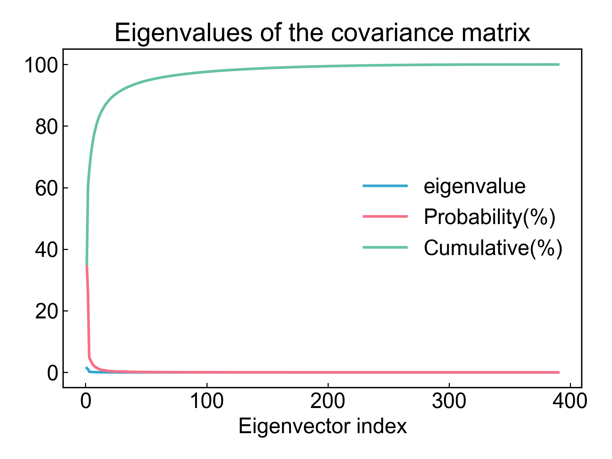

图 7-2　主成分特征值概率分布（DuIvyProcedures gmx_PCA 示例输出，DOI: 10.5281/zenodo.10646113）

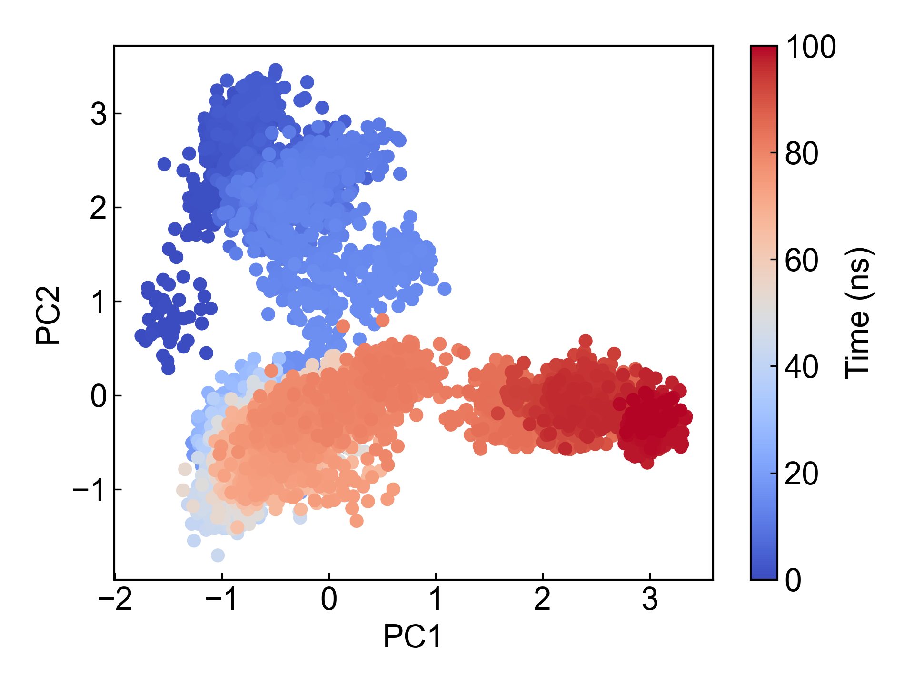

图 7-3　前两个主成分投影散点（DuIvyProcedures gmx_PCA 示例输出；坐标 PCA，Cα 原子组）

**判读要点**：其一，前两三个 PC 的累计方差占比（> 60%–70% 常见）说明体系存在明确的协同运动模式；占比极低且特征值谱平缓，说明波动接近随机噪声、体系无明显的主导构象转变。其二，投影散点图上若出现分离的簇，提示存在可区分的亚态——这是后续自由能面（FEL）与轨迹聚类分析的基础（见 7.4.4 与 7.4.7 节）。其三，**余弦含量（cosine content）**是 PCA 的一项收敛性诊断[18]：把每个 PC 的投影信号与半个余弦周期做相关，若前几个 PC 的余弦含量接近 1，说明该主成分可能是随机扩散的产物而非真实运动，常常意味着轨迹采样不足或体系漂移；GROMACS 的 `gmx anaeig` 不直接输出余弦含量，可把 `proj.xvg` 的列导出后用 Python 计算，或使用 DuIvyProcedures gmx_PCA 模块（其在 log 中输出占比与余弦含量）。其四，主成分的构象含义须通过 `-extr` 极值结构与可视化（VMD/PyMOL，见 7.7 节）确认——PCA 本身不赋予物理意义，只有把 PC 方向映射回原子位移并观察端到端运动，才能判断它对应「开合运动」「铰链弯曲」还是「末端摆动」。

**参数四问（PCA）**：`选择原子组`——是什么：参与协方差矩阵构建的原子集；为何需要：选全蛋白会引入侧链噪声、选 Cα 只捕获骨架层级运动，选择决定「分析的运动尺度」；推荐取值：Cα（蛋白骨架层级）或 Backbone 全原子（含侧链取向）；取值不当的后果：全原子含大量侧链热噪声时前几个 PC 往往被局域运动占据，掩盖整体协同模式。`拟合组`——是什么：对齐用的参考原子组；推荐 Backbone（或 Cα）；拟合到错误组会让整体转动平动混入协方差，PC 失真。`PC 数目`——按累计方差占比与余弦含量联合决定，一般取 2–3 个用于投影与 FEL，取 10–20 用于后续聚类/MSM 的特征空间。

### 二面角主成分分析（dPCA）

坐标 PCA 对整体位移敏感，而局部可动性（如侧链翻转、环区摆动）即使能量上重要，也常被大尺度开合运动淹没。二面角主成分分析（dihedral PCA，dPCA）把特征从坐标换成骨架二面角（φ、ψ），从而把分析聚焦于局部构象变化[19]。由于二面角是周期量（0 与 2π 等价），对角度的直接 PCA 会在周期边界处失效；dPCA 的约定做法是先对每个二面角做三角变换（sin φ, cos φ 或 sin 2φ, cos 2φ，依据文献选择），再对变换后的特征做协方差分析与特征分解[19]。周期性问题同样存在于后续所有基于二面角的分析（tICA、聚类），使用时应核对所采用工具的变换约定。DuIvyProcedures 的 PCA 模块同时支持坐标与二面角两种目标，二面角模式示例输出如图 7-4（前两个主成分投影）。

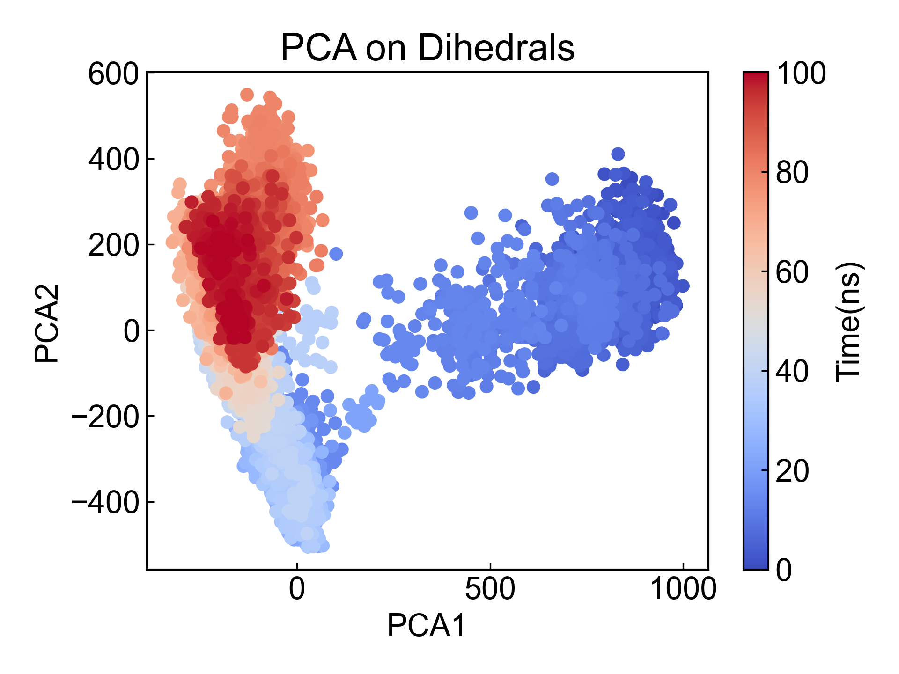

图 7-4　二面角 PCA 前两个主成分投影（DuIvyProcedures PCA 模块示例输出）

**判读要点**：dPCA 的低维投影尤其适合观察环区翻转、α↔β 局部转变等以局部构象为主导的现象；与其坐标 PCA 互补——同一轨迹两者的第一个主成分往往回答不同问题。若研究中大尺度运动与局部构象都重要，建议同时计算并分别报告。

### 动力学互相关矩阵（DCCM）

动力学互相关矩阵（dynamic cross-correlation matrix，DCCM）量化不同残基（或原子）运动的协同程度。对残基 i 与 j，定义位移向量 Δr_i(t) = r_i(t) − ⟨r_i⟩，则归一化互相关

C(i,j) = ⟨Δr_i · Δr_j⟩ / √(⟨Δr_i²⟩ ⟨Δr_j²⟩)，

取值在 [−1, 1]：正值表示同向协同运动，负值表示反向运动，接近 0 表示不相关[20]。DCCM 与 PCA 的关系是：协方差矩阵的对角化给出 PCA，归一化后的 DCCM 则把尺度差异（柔性差异）消掉、突出运动方向的相关性——因此 DCCM 热图常比协方差矩阵更直观地呈现「哪些区域一起动、哪些区域反向动」。经典引用为 Ichiye 与 Karplus 的相关系数定义[20]。

GROMACS 的 `gmx covar` 输出协方差矩阵（可通过 `-o` 与 `-xpm` 同时输出 xpm），把协方差矩阵归一化即得 DCCM；DuIvyProcedures 的 DCCM 模块直接输出协方差矩阵与归一化互相关矩阵并可存为 xpm，典型输出如图 7-5、图 7-6：

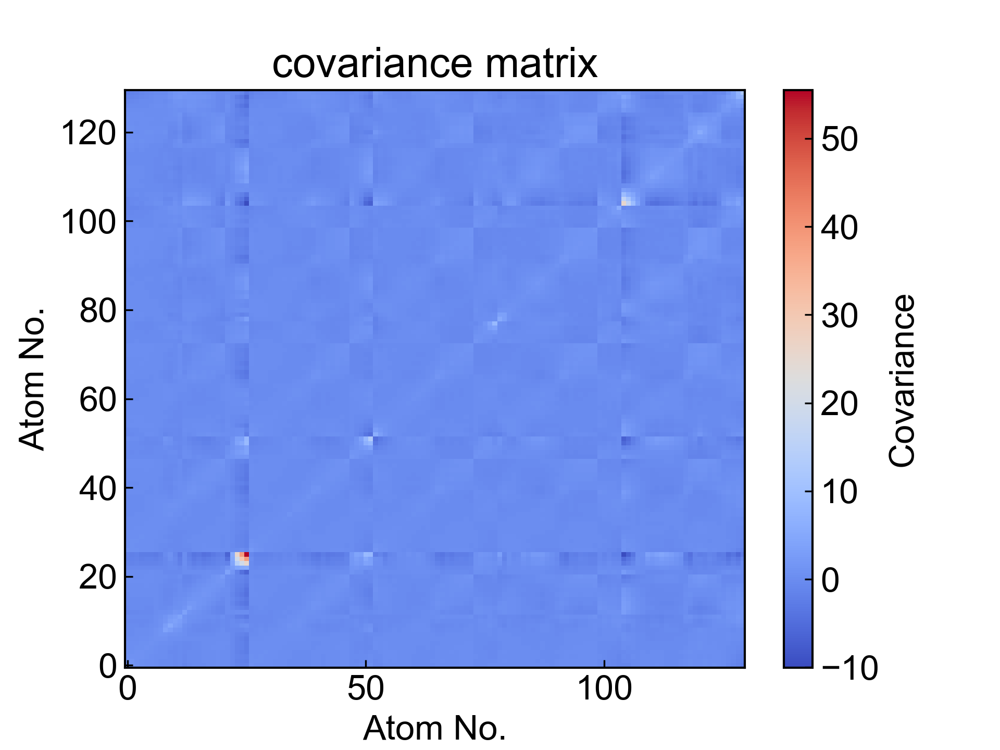

图 7-5　DCCM 协方差矩阵热图（DuIvyProcedures DCCM 模块示例输出）

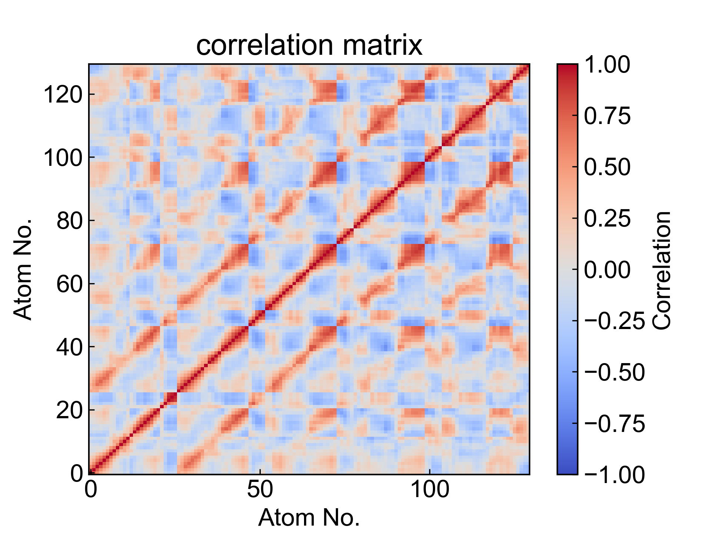

图 7-6　DCCM 归一化互相关矩阵热图（DuIvyProcedures DCCM 模块示例输出；红正蓝负）

**判读要点**：其一，对角线上的强正相关是自身相关的平凡结果；关注的是非对角块——蛋白质结构域内部分残基常呈强的正相关块，跨结构域的负相关区提示铰链式反相运动。其二，DCCM 与距离无关：两个空间上很远的残基也可以高度相关（通过骨架耦合），这正是「长程协同」的直接证据，是别构研究（见 7.4.6 节最短路径图与别构通信）的基础。其三，DCCM 是时间平均量，不携带动力学时间信息；若要区分「静态相关构象偏好」与「真实动力学传播」，需结合后面章节的自相关分析与最短路径分析。其四，归一化消除尺度后，柔性差异不再可见——若同时关心「幅度」与「方向相关」，应分别报告协方差矩阵与 DCCM。


### 自由能面（FEL）

自由能面（free energy landscape，FEL）把轨迹在低维投影空间的访问权重转换为自由能，是观察「体系倾向于哪些构象、亚态间如何分隔」的标准手段。对投影后的两个反应坐标（x, y）（通常取 PCA 前两个主成分的投影，也可取距离对、二面角对等），把坐标平面划分为网格，统计每帧落入各网格的概率 p(x, y)，则

F(x, y) = −k_B T ln p(x, y) + C，

C 为常数（通常取全局最小值处的 F 为 0）[21]。这一转换依赖玻尔兹曼统计（吉布斯分布）：（吉布斯分布）：访问频率高的区域自由能低，访问频率低的区域自由能高，能量差换算为概率比。温度参数必须与模拟温度一致，否则能量尺度错误。

GROMACS 侧可由 `gmx anaeig -2d` 得到的二维投影（时间、PC1、PC2）出发，用 Python（numpy 的直方图与 matplotlib 的 contour/pcolormesh）构造 FEL，或用 DuIvyProcedures 的 FEL 模块直接完成；其输入为三列数据文件（时间、第一坐标、第二坐标），关键参数为温度、网格数（ngrid）、是否寻找局部最小值及其个数。以下为某 FEL 模块的典型输出（Gibbs 能图与最小值标注散点）：

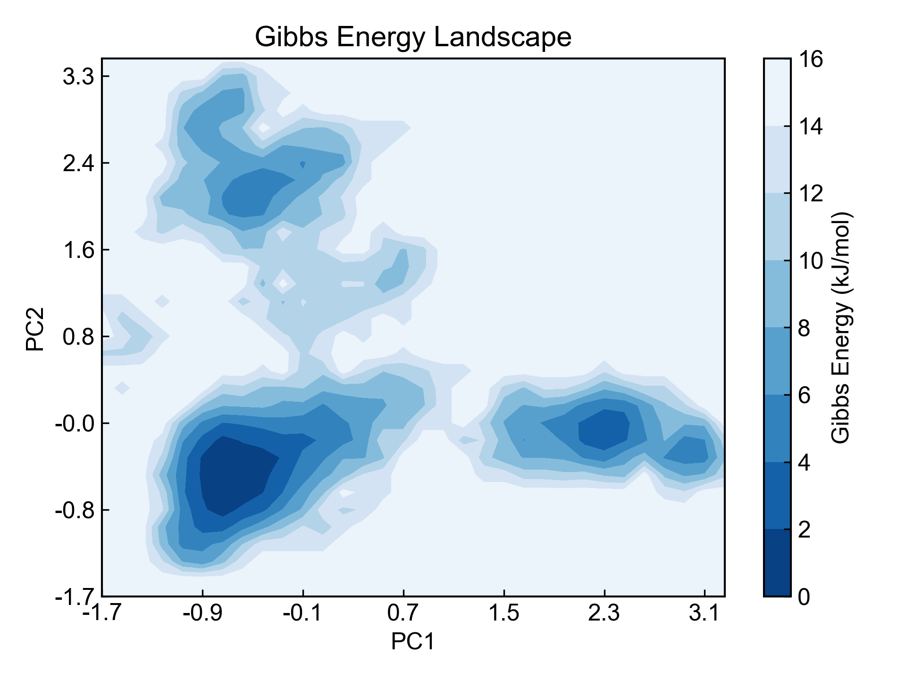

图 7-7　自由能面（Gibbs 能图，DuIvyProcedures FEL 模块示例输出）

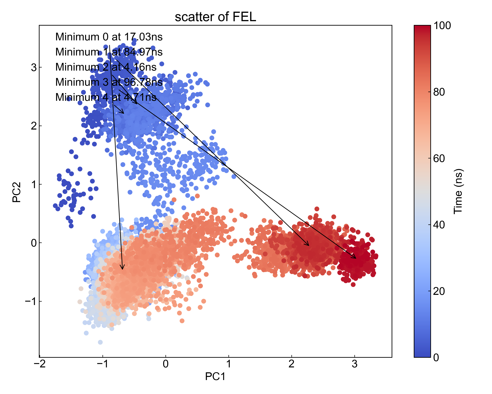

图 7-8　自由能面散点叠加局部最小值标注（DuIvyProcedures FEL 模块示例输出）

**判读要点**：其一，FEL 的绝对数值依赖网格与平滑，重要的是相对极小值的位置与深度、以及极小点之间的能垒高度——能垒（以 k_BT 计）决定亚态间的转换概率。其二，自由能面上若出现明显分隔的多个盆地，每个盆地对应一个亚态，盆地的深浅与宽度对应亚态的相对稳定性与构象涨落；这是聚类与 MSM 的直观先验。其三，FEL 是平衡采样的直接统计：若轨迹采样不足，低访问区域的概率被低估、能垒被高估——这与第 9 章的收敛判据直接相关，FEL 的可靠性应通过分块重复或第 9 章的自相关分析确认。其四，FEL 与伞形采样/元动力学的 PMF（第 8 章）区别：FEL 是基于平衡轨迹的无偏估计（受限于采样覆盖），PMF 是沿指定坐标的偏置采样后重加权的估计（可跨越能垒）——二者概念不同，不能混用「自由能面」一词。

### 残基距离接触矩阵（RDCM）

残基距离接触矩阵（residue distance contact map；简称 RDCM 或 contact map）把每一帧压缩为残基对之间的距离矩阵：矩阵元 d(i,j) 是残基 i 与残基 j 之间的距离（可选残基质心距离、原子最小距离、几何中心等定义），对角线为 0、矩阵对称。整个轨迹对应距离矩阵的时间序列：对每个 (i,j) 可统计平均距离、标准差、接触与否随时间的变化。DuIvyProcedures 的 RDCM 模块在残基距离矩阵基础上还支持衍生分析——基于距离矩阵计算 RMSD（矩阵距离作为构象度量）、RMSF、DCCM、PCA、聚类（帧与残基两个方向的树状图）、contact 与 encounter 的时间占有率——是把接触信息扩展为多维度分析的工具链。`gmx mdmat` 也能计算平均残基最小距离矩阵（`-mean` 输出平均矩阵），但只给出平均画面；完整的轨迹级 RDCM 分析建议用 Python 或上述工具。

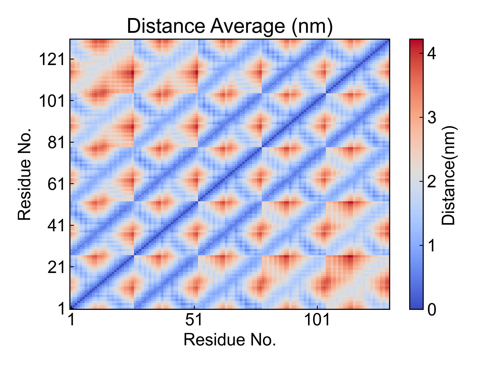

图 7-9　残基距离接触矩阵的平均值（DuIvyProcedures RDCM 示例输出；残基质心距离）

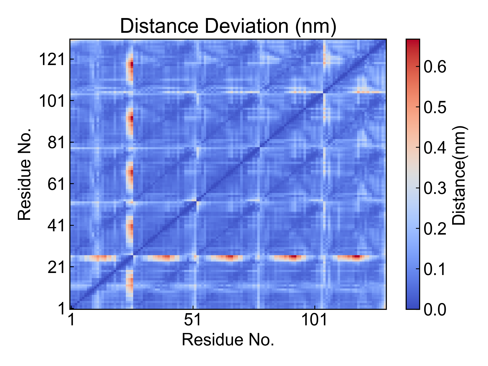

图 7-10　残基距离矩阵的标准差（DuIvyProcedures RDCM 示例输出；大波动残基对的定位）

**contact 与 encounter**：接触分析把距离矩阵离散为「接触/非接触」二值序列——当残基对距离低于 `contact_cutoff`（默认取 1.5 nm）视为接触，统计每个残基对接触的时间占有率（图 7-11、图 7-12）。encounter 是更严格的接触：距离低于 `encounter_low_cutoff` 视为形成 encounter、高于 `encounter_high_cutoff` 视为断裂，从而可统计 encounter 的首次形成时间、平均寿命、形成次数等功能矩阵（图 7-13 为 encounter 的 DCCM）。这类「什么接触稳定、什么接触短暂」的信息对识别功能界面（结合位点接触、别构网络节点）很有价值[22]。

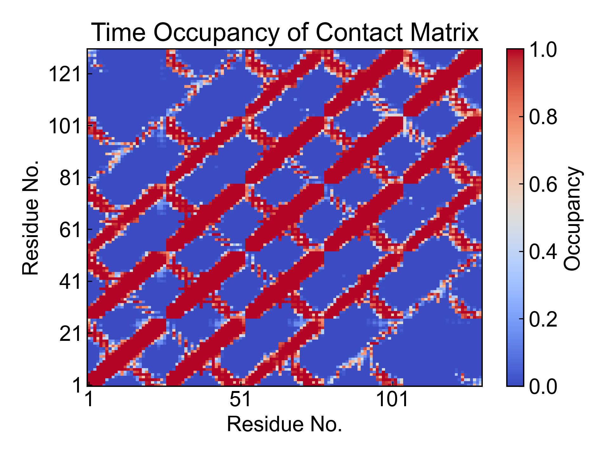

图 7-11　残基接触时间占有率矩阵（DuIvyProcedures RDCM 示例输出）

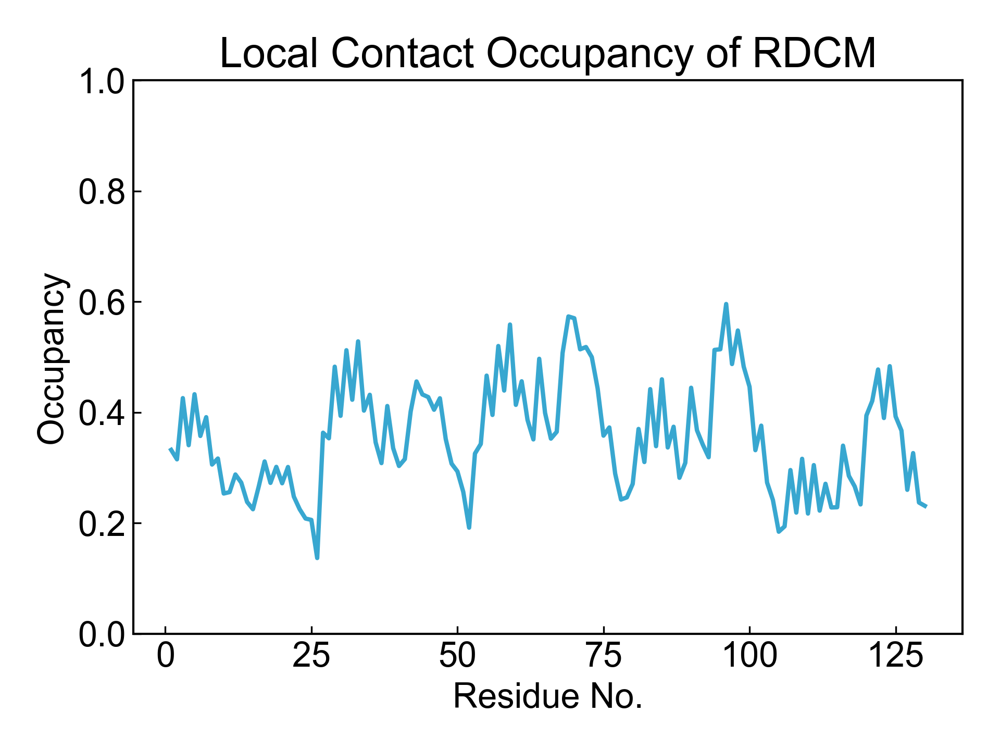

图 7-12　局部接触时间占有率曲线（DuIvyProcedures RDCM 示例输出；反映局部接触稳定性）

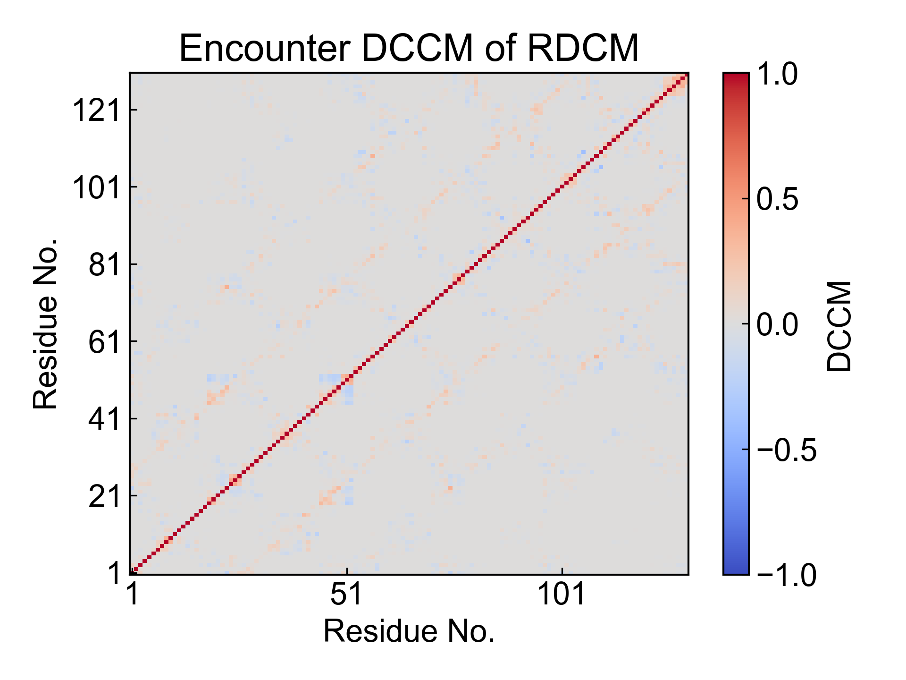

图 7-13　基于 encounter 的 DCCM（DuIvyProcedures RDCM 示例输出）

**判读要点**：其一，平均距离矩阵与标准差矩阵联合看——低平均距离+低标准差是稳定接触（结构性），高标准差暴露「间歇接触」或「摆动残基」，是构象态划分的依据。其二，contact 占有率矩阵的非近邻长程接触高值常对应疏水核心与界面对。其三，基于 RDCM 的 RMSD/RMSF/PCA 与基于坐标的版本互补：距离矩阵特征不依赖对齐与 PBC 处理细节，是「构象差异」的另一种度量（对整体重定向不敏感），常用于与坐标 PCA 交叉验证。

### 最短路径图（SPM）与别构通信

动力学互相关刻画「哪些残基一起动」，而别构问题进一步追问「信号如何从位点 A 传到远端位点 B」。最短路径图（shortest path map，SPM）把残基刻画为图节点、把残基间距离与相关系数结合为边权重，用 Dijkstra 算法求任意两残基之间的最短路径，路径密集经过的残基即可能的别构通信枢纽[23]。典型工作流（参考 Osuna 与同事对酶体系的分析）：第一步计算残基级 DCCM 与平均距离矩阵；第二步以距离阈值（`distance_cutoff`，如 0.6 nm）决定哪些残基对构成图的边，以相关系数的函数（如 1−|C_ij| 或门控权重）作为边权重；第三步对全部残基对求最短路径，统计每条路径经过各残基的频率；第四步把高频率残基（枢纽）映射回结构并与功能性残基（活性位点、结合口袋）对照[23]。DuIvyProcedures 的 SPM 模块输出最短路径图与可导入 PyMOL 的 pml 脚本，典型结果如图 7-14：

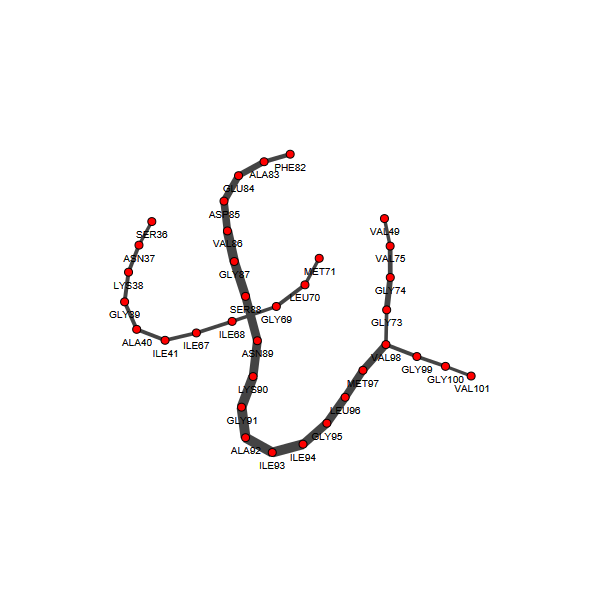

图 7-14　残基间最短路径图（DuIvyProcedures SPM 模块示例输出；线上数值为路径计数）

**判读要点**：其一，SPM 的结论是「相关性 + 拓扑」的联合结果：枢纽残基必须既与两端运动相关、又在结构上处于传播路径，因此它比单纯的高相关残基更有别构意义；其二，边权重与距离阈值的选取直接影响路径，应做敏感性分析（扫描阈值观察枢纽是否稳定）；其三，SPM 属于相关驱动的假设生成工具，识别的枢纽需用定点突变、增强采样（第 8 章）或实验（双突变循环、NMR 化学位移扰动）验证；其四，此方法与 7.5.4 节的配体相互作用分析结合，可把「配体结合位点—远端功能位点」的通信路径连成完整图景。

### 轨迹聚类

轨迹聚类把每一帧分配到有限个构象簇（cluster），得到「轨迹主要由哪些构象态占据、各自占比多少」的离散图像。GROMACS 的 `gmx cluster` 提供多种算法（gromos、linkage、jarvis-patrick、monte-carlo 等），最常用的是 gromos 方法：以 RMSD 矩阵为距离度量，迭代地取邻居最多的帧作为簇中心，把误差半径内（`-cutoff`）的帧并入簇，直至覆盖全部帧。DuIvyProcedures 的 gmx_Cluster 模块封装了 `gmx cluster` 并可视化 RMSD 矩阵、聚类大小分布等输出：

```bash
# 平台：Linux（bash）；版本：GROMACS 2026.x
# 拟合组 Backbone、计算组 Protein、gromos 聚类、cutoff 0.1 nm、RMSD 矩阵
gmx cluster -s md.tpr -f md_fit.xtc -n index.ndx -method gromos -cutoff 0.1 \
            -fit Backbone -dm rmsd_matrix.xpm -o clusters.xpm -sz cluster_size.xvg \
            -cl final.pdb <<< $'Backbone\nProtein'
```

聚类的科学意义在于把连续轨迹离散化为可数的亚态：簇个数、各簇占比与其时间持续性是判断「体系有无稳定亚态」的手段；但聚类结果对算法与 cutoff 敏感，`gmx cluster` 的 `-cutoff` 决定 RMSD 误差半径，不同 cutoff 会得到不同簇数——应扫描 cutoff 观察簇数平台（详见第 8 章聚类参数讨论的对应口径），并结合 FEL 盆地结构互相印证。聚类的每一簇可输出代表结构（`-cl`），供可视化与后续性质计算。

### 降维方法：tICA、UMAP 与 t-SNE

PCA 是线性方法，对「少数大尺度运动主导」的体系有效；当构象分布高度非线性（同一亚态沿弯曲流形分布）时，线性投影会混合亚态。三种常用补充：**tICA（时间滞后独立成分分析）**以时间滞后协方差的最大化为目标，找到「最慢」的混合坐标——它比 PCA 更适合捕捉动力学慢过程，是 MSM 的特征化标准前置（第 9 章有更系统的讨论）；**UMAP 与 t-SNE**是非线性流形方法，擅长把高维点云的可视化结构保真地展开，但它们是「可视化降维」而非动力学坐标——聚类结果可用于观察但不能直接当反应坐标（t-SNE 的结果甚至不对应可解释的连续坐标）。以下为典型输出（均来自 DuIvyProcedures）：

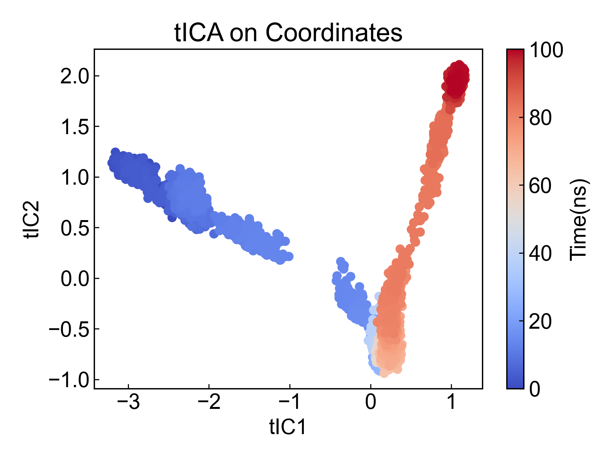

图 7-15　tICA 前两成分投影散点（DuIvyProcedures tICA 示例输出；坐标特征）

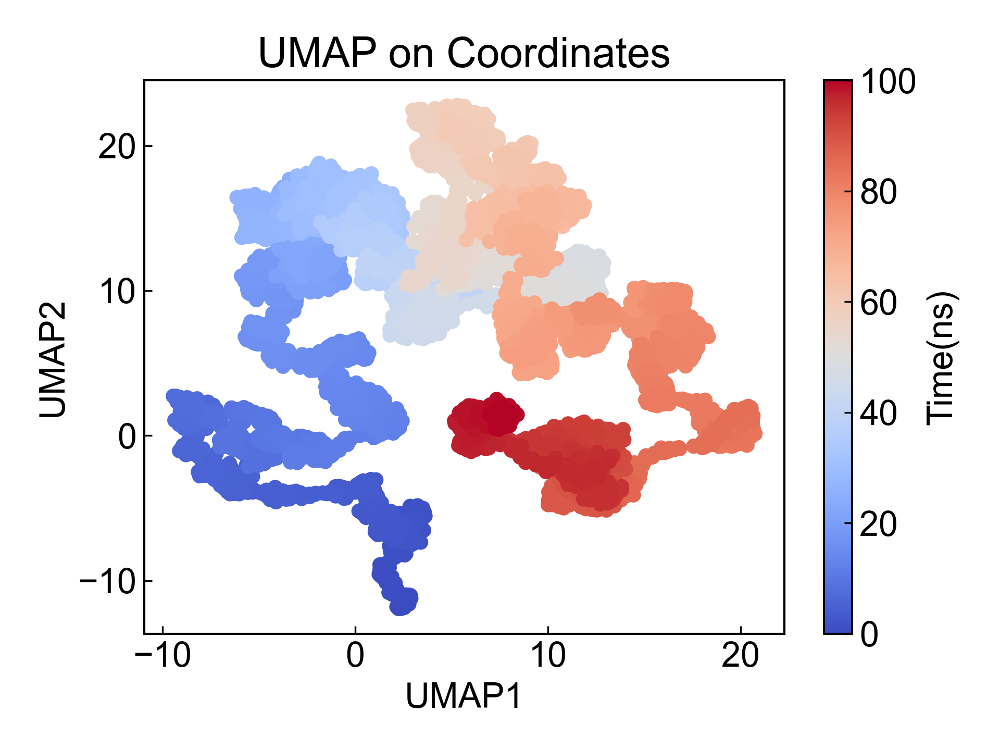

图 7-16　UMAP 二维投影（DuIvyProcedures UMAP 示例输出；n_neighbors=50, min_dist=1）

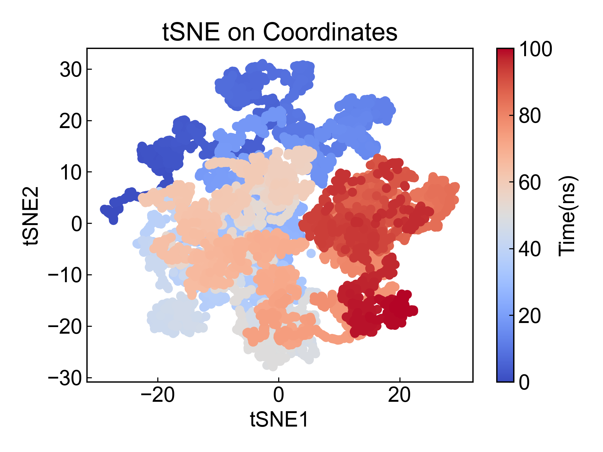

图 7-17　t-SNE 二维投影（DuIvyProcedures t-SNE 示例输出）

**参数与判读**：tICA 的 `lag`（时间滞后）应大于体系特征弛豫时间量级，并对 lag 做扫描观察隐含时间尺度平台（见第 9 章与 MSM 流程）；UMAP 的 `n_neighbors`（近邻数，控制局部 vs 全局结构的取舍）与 `min_dist`（点间最小距离，控制聚集紧密程度）通常需要在合理区间扫描选择，DuIvyProcedures 支持同时给出多个参数组合结果供对比；t-SNE 的 perplexity 类似地控制流形尺度。三者共同的判读纪律：**投影上的「簇」在多大程度上反映真实亚态、多大程度上是降维失真，需要用 FEL 盆地结构、聚类占比与动力学时间尺度交叉验证**——线性方法（PCA/tICA）的结果可赋予连续坐标含义，非线性方法的簇最好仅作为「亚态存在的指示」，不可直接当反应坐标使用。

### 马尔可夫状态模型（MSM）流程

马尔可夫状态模型（Markov state model，MSM）把轨迹在离散态间的转移建模为马尔可夫链，从转移矩阵得到亚态间的平衡分布、寿命与转移速率，是从模拟数据提取动力学信息（不只分布）的标准框架。完整 MSM 流程为：特征化（坐标/二面角/二级结构特征）→ tICA 降维（找到慢坐标）→ 聚类离散化（得到微态）→ 扫描 lag 参数分析隐含时间尺度（ITS）选取合适 lag → 构建转移矩阵并做 Chapman-Kolmogorov 检验 → PCCA 粗粒化到居中态 → 计算 MFPT 与绘制状态转移网络。第 8 章 8.5.4 与第 9 章对该方法有系统论述，本节仅给出操作链条与其典型输出形态（DuIvyProcedures MSM 示例）：tICA 投影、聚类结果、ITS 平台、CK 检验与转移网络。

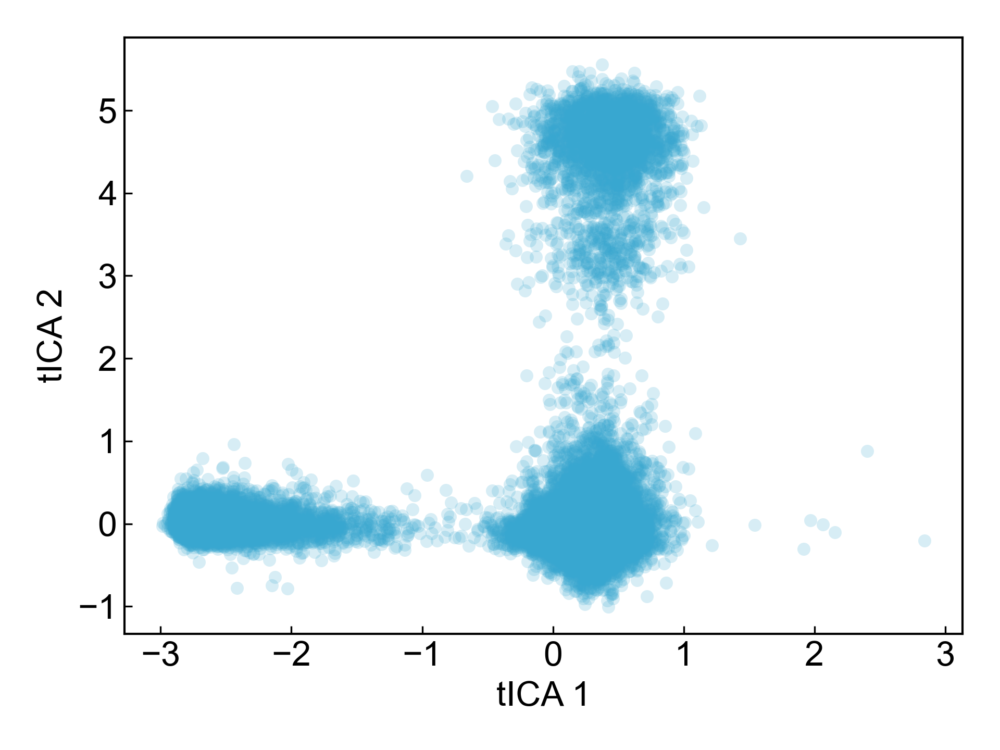

图 7-18　MSM 流程的 tICA 降维投影（DuIvyProcedures MSM 模块示例）

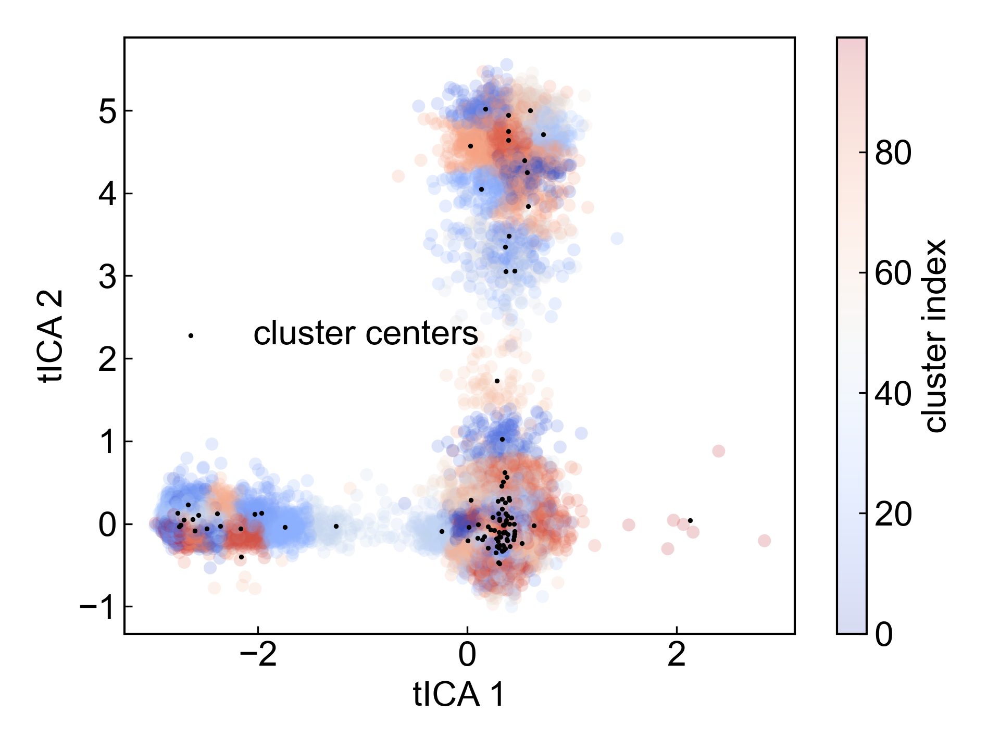

图 7-19　MSM 流程的离散化聚类结果（DuIvyProcedures MSM 模块示例）

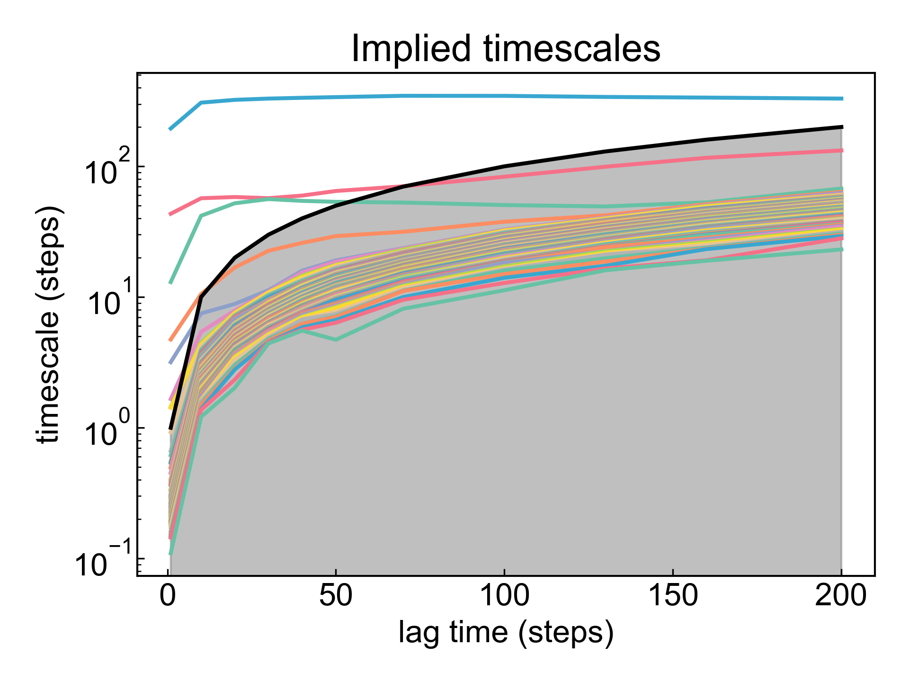

图 7-20　隐含时间尺度（ITS）随 lag 变化（DuIvyProcedures MSM 模块示例；选择曲线进入平台的 lag 构建 MSM）

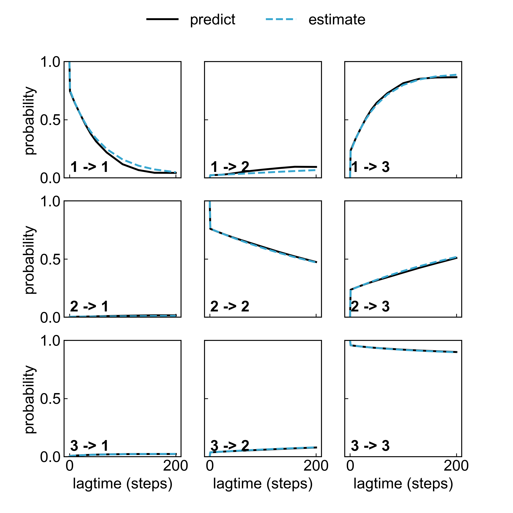

图 7-21　Chapman-Kolmogorov 检验（DuIvyProcedures MSM 模块示例；预测与测量重合说明模型有效）

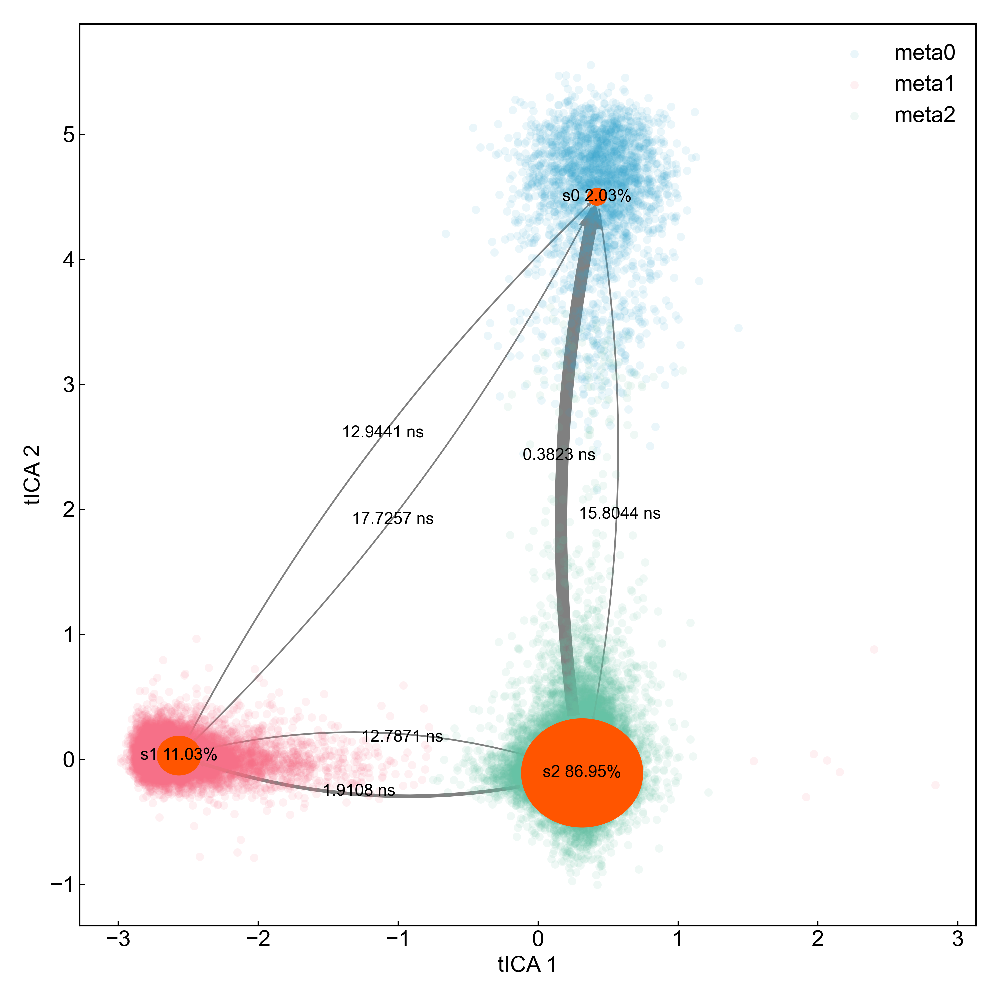

图 7-22　亚态转移网络图（DuIvyProcedures MSM 模块示例）

**判读要点与操作纪律**：ITS 曲线在某个 lag 之后进入平台（曲线不再上升）说明状态划分达到了马尔可夫性要求，应取平台起点稍后的 lag 构建模型；CK 检验中预测与实测显著偏离意味着模型无效，需要回到特征化/聚类环节调整；state_fraction 与 count_fraction 显著小于 1 提示数据覆盖不足。MSM 的结论质量高度依赖采样充分性（第 9 章），本节的定位是让读者「看懂输出、会用工具」，严格的模型诊断需回到第 8、9 章的方法学讨论。


## 二级结构与相互作用

### 二级结构判定：DSSP 算法与 gmx dssp

二级结构判定把每个残基分配到 α 螺旋、β 折叠片等类别。事实标准是 Kabsch 与 Sander 提出的 DSSP（Dictionary of Secondary Structure of Proteins）算法：先按静电相互作用能判定主链氢键，再依氢键模式把残基划入若干约定符号[24]。DSSP 的单字符符号与含义见表 7-4。长期用于 GROMACS 的 `gmx do_dssp` 调用外部 DSSP 程序；自 GROMACS 2023 起，官方以原生实现的 DSSP 算法（version 4）取代该工具并更名为 `gmx dssp`（2023 发行说明明确记载 "gmx do_dssp replaced by native implementation of DSSP algorithm"，调用外部程序时代的 `-ver 4` 选项随之并入新实现），因此 GROMACS 2023 及以后的文档与教程中只出现 `gmx dssp`[25]。旧版仅适用于 2022 及更早版本，正文与脚本不可混用二者参数。

表 7-4　DSSP 单字符二级结构符号（依据 gmx dssp 帮助文本[26]）

| 符号 | 含义 |
| --- | --- |
| H | α 螺旋 |
| B | 孤立 β 桥中的残基 |
| E | 参与 β 折叠梯的延伸链段 |
| G | 3₁₀ 螺旋 |
| I | π 螺旋 |
| P | κ 螺旋（聚脯氨酸 II 型螺旋） |
| S | 弯曲（bend） |
| T | 氢键转角（turn） |
| = | 断裂（break） |
| ~ | 环（无特殊二级结构归属） |

`gmx dssp` 的关键选项包括：`-hmode` 选择氢原子来源（`gromacs` 直接使用结构中的氢，`dssp` 依据前一残基的 C、O 坐标构造氢的赝原子，对缺少氢的结构必须用 `dssp` 模式）；`-hbond` 选择氢键定义（`energy` 用静电相互作用能，`geometry` 用几何判据）；`-nb` 为默认开启的 GROMACS 邻域搜索，配合 `-cutoff` 给出残基与相邻残基的最大距离（最小且推荐值为 0.9）；`-clear` 忽略缺失关键原子（CA、C、N、O、H）的残基；`-num` 输出各类二级结构数量随时间变化；`-pihelix` 与 `-ppstretch` 调整模式搜索偏好[26]。手册给出的一个重要限制是：`gmx dssp` 无法正确处理非 X 射线方法测定（CRYST1 行晶胞信息不正确）的结构，且计算始终以单精度执行，与 GROMACS 的构建精度无关[26]。新实现的 `-o` 输出 DSSP 文本文件（默认文件名 `dssp.dat`），不再产生旧版 `gmx do_dssp`（自 GROMACS 2023 起被取代，仅适用于 2022 及更早）的 `ss.xpm` 时间图；需要逐帧二级结构矩阵图时，可解析 `dssp.dat` 用 Python 绘制（见 7.8 节）[26]。典型调用：

```bash
# 平台：Linux（bash）；版本：GROMACS 2023 及以上（2022 及更早使用 gmx do_dssp，参数与输出不同）
# 生成 dssp.dat 逐帧二级结构赋值与 num.xvg 各类二级结构数目（-sel 以选择语法指定分析组）
gmx dssp -s md.tpr -f md_whole.xtc -sel 'protein' -o dssp.dat -num num.xvg -hmode dssp
```

### 氢键的几何判据

分子动力学中的氢键判定普遍采用几何判据，而非能量判据：当供体-氢-受体的角度与距离同时满足阈值时，认定存在氢键。GROMACS 2023 及更早版本的 `gmx hbond` 帮助文本给出的默认判据为：氢-受体（或供体-受体，取决于 `-da`）距离截断 0.35 nm、氢-供体-受体角度截断 30°，OH 与 NH 基团视为供体，O 恒为受体，N 默认也是受体（可用 `-nitacc` 关闭）[27]。该工具要求两个分析组完全相同或互不重叠，支持 `-num`（数量随时间）、`-dist`（距离分布）、`-ang`（角度分布）、`-hbn`（氢键原子索引）、`-hbm`（存在矩阵）与 `-life`（寿命时间自相关）等输出[27]。自 GROMACS 2024 起，`gmx hbond` 被完全重写：新版以选择语法定义参考组（`-r`）与目标组（`-t`），用 `-hbr` 与 `-hba` 分别设置距离与角度截断（官方推荐 0.35 与 30°），`-cutoff` 为邻域搜索距离（最小且推荐 0.35），`-de`/`-ae` 按元素从拓扑指定供体/受体，`-num`、`-dist`、`-ang`、`-dan` 输出统计量，`-o` 直接写出成键原子索引文件；官方帮助文本明确注明"这是 2024 年新增的 hbond 新实现，需要旧版请用 gmx hbond-legacy"[28]。旧实现的 `-life`、`-ac`、`-hbn`、`-hbm` 等选项在新版中不再提供，须调用 `gmx hbond-legacy`。两个版本的默认判据一致（0.35 nm / 30°），但新版的供体/受体辨识依赖原子元素与拓扑，对非标准命名更敏感，曾有官方 issue 报告新实现漏认某些脂质受体而旧实现正常的案例[29]。以下分别给出两版调用：

```bash
# 平台：Linux（bash）；GROMACS 2024 及以上（新实现，选择语法）
gmx hbond -s md.tpr -f md_whole.xtc -r 'protein' -t 'resname SOL' -num hbnum.xvg -o hbond.ndx

# 平台：Linux（bash）；全部版本（旧实现 gmx hbond-legacy，2024 起需显式用 legacy）
gmx hbond-legacy -s md.tpr -f md_whole.xtc -n index.ndx -num hbnum.xvg <<< $'1\n4'
```

### 氢键网络与寿命分析

氢键寿命是水分子驻留、蛋白-配体相互作用稳定性与溶剂动力学研究的核心量。`gmx hbond-legacy -life` 输出氢键寿命相关的时间自相关函数，`-ac` 依据 Luzar 与 Chandler 的连续/间歇氢键动力学模型输出速率常数[30][31]，`-fitfn` 与 `-fitstart`/`-fitend` 控制自相关函数的指数拟合窗口[27]。氢键寿命的定义分连续寿命（氢键一旦断裂即计入终止）与间歇寿命（允许中途断裂后重新形成），两种定义给出不同的时间尺度，报告时必须注明；前者刻画单次接触的持续时间、对尝试性断裂敏感，后者刻画「束缚-解束缚」的整体交换时间尺度，二者对大分子体系可相差数倍。定量提取寿命的两种做法：一是指数拟合自相关函数 C(t) 得时间常数 τ（`-fitfn exp` 对单指数段、`exp_exp` 对快慢两段）；二是直接对自相关积分 τ=∫₀^∞ C(t)dt——对两段式衰减，慢段决定积分的主要贡献，拟合窗口 `-fitstart/-fitend` 应覆盖衰减至噪声底之前的区间，窗口截得太早会系统性低估寿命。帧间隔对结果有直接影响：寿命估计的时间分辨率受输出频率限制，帧间隔若大于寿命量级，自相关在首帧即衰减大半，得到的是「粗粒化寿命」而非真实动力学——跨运行比较寿命必须用相同输出频率的轨迹。Luzar 与 Chandler 对液体水中氢键动力学的开创性研究建立了「断裂-重形成」的稳态动力学图像，其速率模型是 `-ac` 输出解释的文献基础[30][31]；后续对水重取向动力学的 Laage–Hynes 跳跃模型进一步区分了氢键断裂与分子重取向的耦合机制[32]，可作为把氢键寿命与水动力学联系起来的前沿参考。MDAnalysis 提供等价的氢键寿命计算（见 7.8 节），可对同一轨迹交叉验证。

### 盐桥与接触分析

盐桥（salt bridge）是带相反电荷残基之间由静电主导的相互作用，通常指侧链羧酸根（Asp、Glu）与铵/胍基（Lys、Arg、His）之间的近距接触。Donald 等人对蛋白质结构中盐桥的统计分析表明，这类相互作用具有明确的几何偏好，在序列与空间上均呈特征性分布[33]。盐桥的判定习惯采用距离判据：把带相反电荷原子对的最近距离作为接触度量，0.4 nm（4.0 Å）的常用阈值沿自 Barlow 与 Thornton 对蛋白晶体结构中离子对的经典统计定义[34]，是否附加角度判据取决于研究问题。GROMACS 的专用工具 `gmx saltbr` 以全部带电基团组合为对象输出距离随时间变化，但该工具基于旧的交互式索引框架[35]；现代工作流更推荐用 `gmx distance` 或 `gmx pairdist` 配合选择语法精确限定原子对。`gmx distance` 计算选择中按位置对（1-2、3-4……）给出的距离，`-select` 书写位置对，`-oall` 输出全部距离、`-oav` 输出平均距离、`-oh` 输出直方图[36]；`gmx pairdist` 计算参考选择与若干目标选择之间的最小/最大距离，`-type min|max` 与 `-refgrouping`/`-selgrouping`（`all`、`res`、`mol`）控制聚合粒度，适合"每对残基的最小距离"这类批量输出[37]。盐桥存在概率的定义应明确分子（如"Glu35 的 OE1/OE2 与 Arg52 的 NH1/NH2 最近距离小于 0.4 nm 的帧比例"），并如实记录阈值来源。示例（计算所有 Lys 侧链氮与 Glu/Asp 侧链氧之间的残基级最小距离）：

```bash
# 平台：Linux（bash）；版本：GROMACS 2021 及以上（选择语法时代）
gmx pairdist -s md.tpr -f md_whole.xtc -ref 'name NZ' -sel 'name OE1 OE2 OD1 OD2' \
             -refgrouping res -selgrouping res -type min -o salt_min.xvg
```

### 配体-蛋白相互作用分析（PLIP 与几何判据）

配体-蛋白相互作用的系统分析是现代药物设计研究的标配。两类互补工具各有各的定位：**PLIP（Protein-Ligand Interaction Profiler）** 以单个结构文件（PDB）为输入，自动枚举氢键、疏水接触、π-π 堆积、π-阳离子、盐桥、卤键等相互作用并输出结构化清单，适用于对静态复合物或对轨迹中的每一帧做批处理；**DuIvyProcedures（DIP）** 的 PiStacking、PiCation、Hydrophobic、SaltBridge 等模块直接以轨迹为输入，输出相互作用的存在性、占有率、距离/角度时间序列与寿命，适合做轨迹级统计分析[38]。二者本质一致——都是把相互作用定义为「几何判据满足」——区别在于静态/轨迹、单一相互作用/全套枚举。本小节给出几何判据与轨迹级操作的完整路线。

**氢键**的判据见 7.5.2 节（供体-受体距离与供体-氢-受体角）；**盐桥**的判据见 7.5.4 节。其余四类相互作用的几何判据如下：

- **疏水接触（hydrophobic contact）**：以两组间碳-碳原子距离定义（`dist_max_cutoff` 默认 0.40 nm、`dist_min_cutoff` 0.05 nm），统计满足阈值且互为范德华接触的 C–C 对数量。疏水相互作用本质是熵效应，C–C 接触只是其可操作的代理度量——DIP 在输出接触数时间序列的同时，还按残基对归并（同一残基对的多个接触只计一次）并输出时间占有率。科学意义：疏水接触的数量与稳定性常用于刻画配体结合界面与蛋白-蛋白界面的疏水互补性。
- **π-π 堆积（pi stacking）**：以两个芳香环几何中心距离（`distance_max_cutoff` 默认 0.55 nm、`distance_min_cutoff` 0.05 nm）与环间取向角定义；环中心偏移（`ring_center_offset`，一个环中心在另一环平面上的投影到另一环中心的距离，默认 0.20 nm）区分 P-堆积（近乎平行，两环法向夹角 0–30°）与 T-堆积（近端对，60–90°）。实施要点：环的识别（是否只算芳香环、非芳香环的平面度容差）、寿命与占有率统计的帧间隔（`intermittency`）设置。
- **π-阳离子（pi-cation）**：以芳香环中心与阳离子基团（NH₃⁺、胍基等）电荷中心之间的距离（默认 ≤0.60 nm）与环中心偏移（≤0.20 nm）定义；阳离子基团的原子名随力场而异（AMBER/CHARMM/GROMOS 的 NH₃⁺ 原子命名不同），工具默认值常需按所用力场修改。
- **卤键（halogen bond）**：PLIP 等工具支持；定义为卤原子（Cl、Br、I）与亲核原子之间的 C–X⋯O/N 近线性排列（角度约 180°），以距离与角度截断判定。

**判据口径必须统一**：同一界面上氢键判据（3.0 Å/150° vs GROMACS 0.35 nm/30°）、疏水距离阈值、盐桥距离阈值（0.4 nm vs 0.32 nm）、π 判据的角度定义在不同工具间并不一致，跨工具比较或复现文献前必须先对齐判据——这与 7.7.3 的一致性校验纪律一脉相承。

**轨迹级操作路线**（以配体-蛋白复合物为例）：第一步，把轨迹按配体存在与 PBC 处理准备好（7.1 节）；第二步，选定原子组——蛋白组、配体组（`resname LIG` 或按配体残基名）；第三步，逐帧或按时序统计相互作用——用 PLIP 逐帧导出（PLIP 接受 PDB/结构文件，可对每帧用 `trjconv -dump` 导出后调用，或以 MDAnalysis 逐帧写出再批处理）；用 DIP 则直接对轨迹运行各相互作用模块，得到存在性映射（每帧 0/1）、占有率、距离/角度时间序列与汇总表。DIP 的典型输出：π-π 堆积的距离、角度、偏移时间序列（图 7-23）与存在性/类型占有率图（图 7-24、图 7-25）；π-阳离子的距离与存在性映射（图 7-26、图 7-27）；疏水接触数时间序列（图 7-28）与残基对出口率表；盐桥存在性映射（图 7-29，SaltBridges 汇总矩阵）。

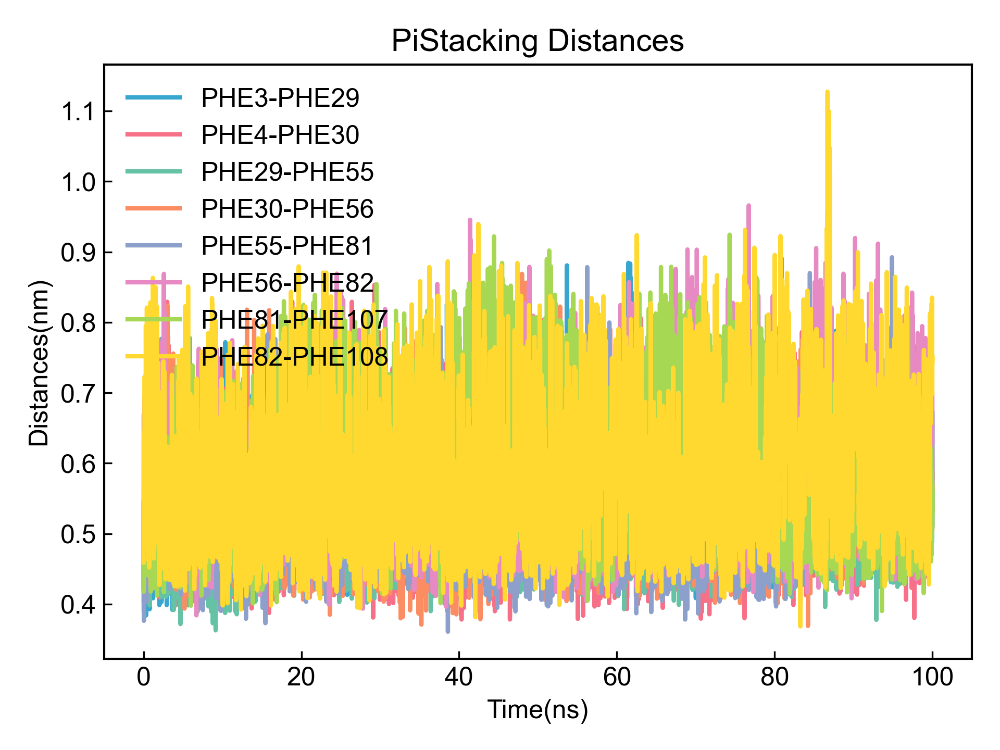

图 7-23　π-π 堆积质心距离时间序列（DuIvyProcedures PiStacking 模块示例输出）

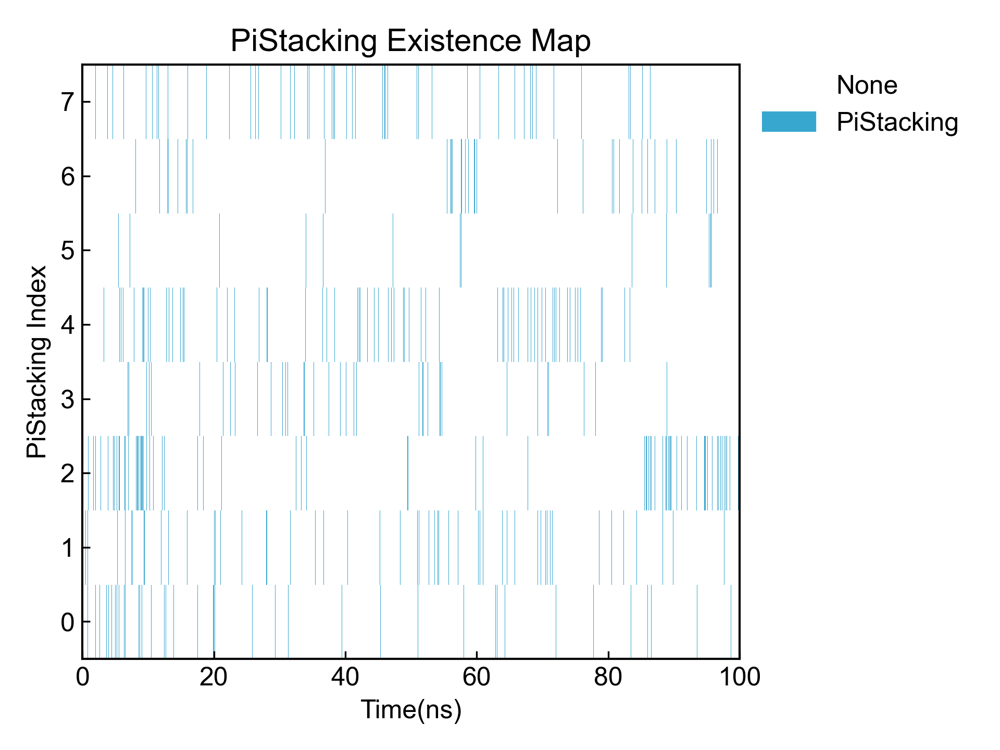

图 7-24　π-π 堆积存在性映射（每帧 0/1，DuIvyProcedures PiStacking 模块示例）

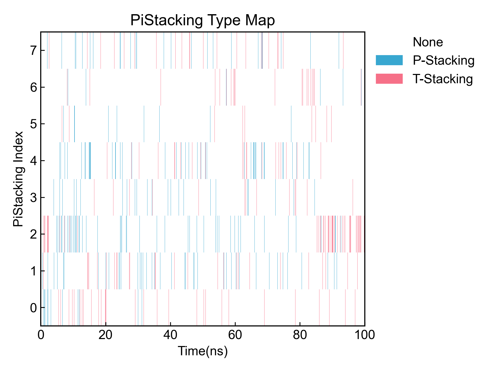

图 7-25　P/T 堆积类型占有率（DuIvyProcedures PiStacking 模块示例）

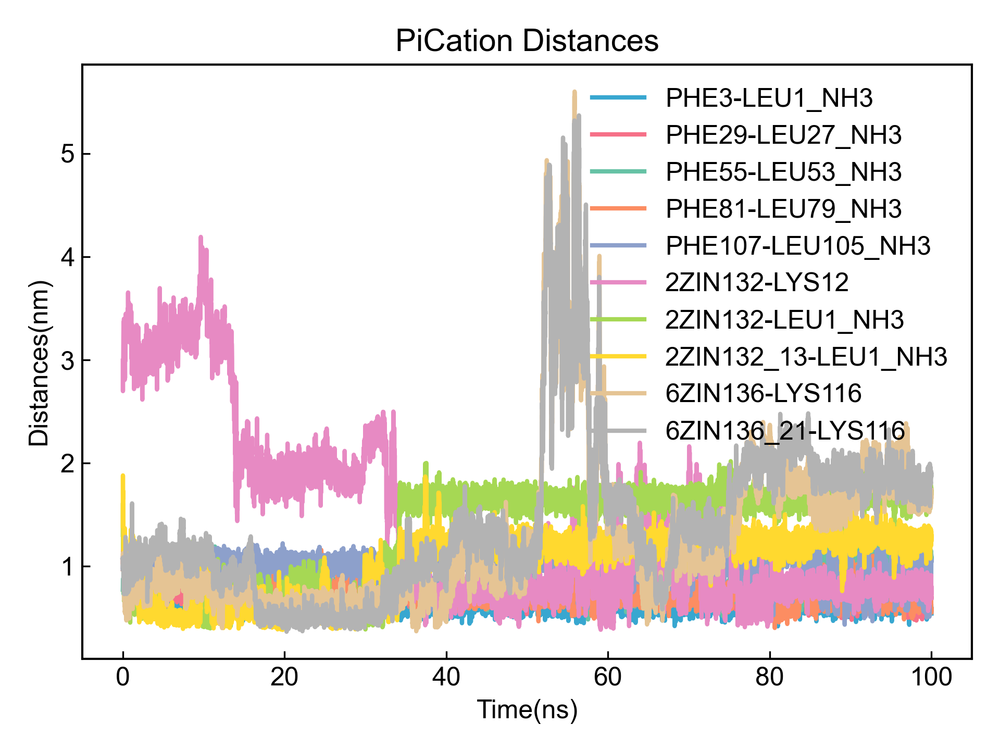

图 7-26　π-阳离子距离时间序列（DuIvyProcedures PiCation 模块示例输出）

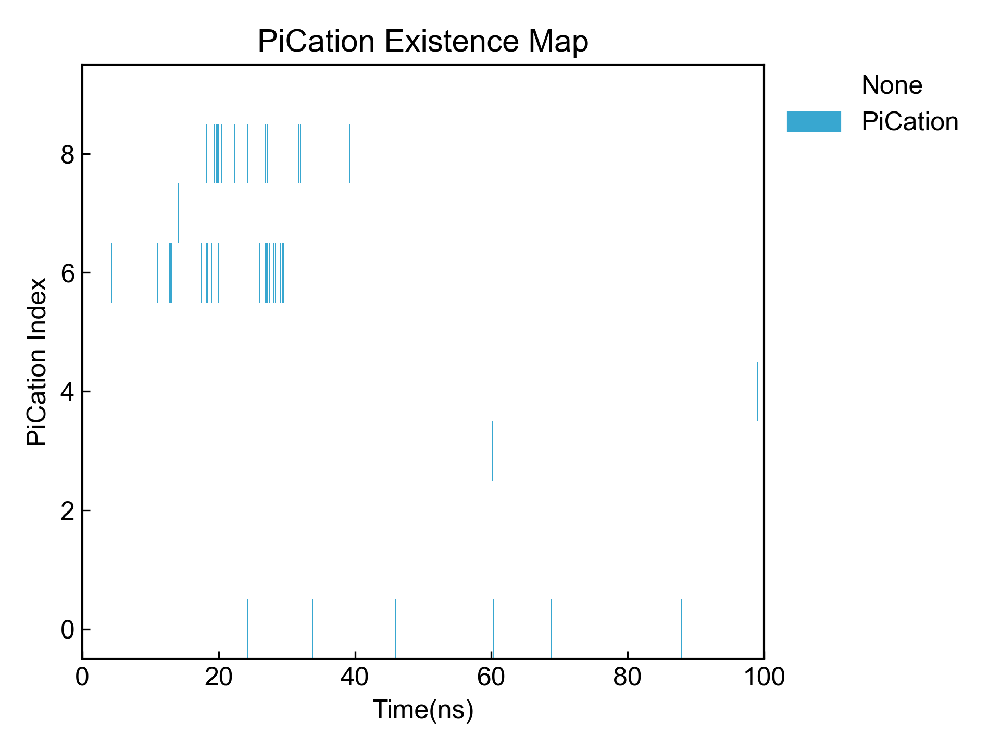

图 7-27　π-阳离子存在性映射（DuIvyProcedures PiCation 模块示例）

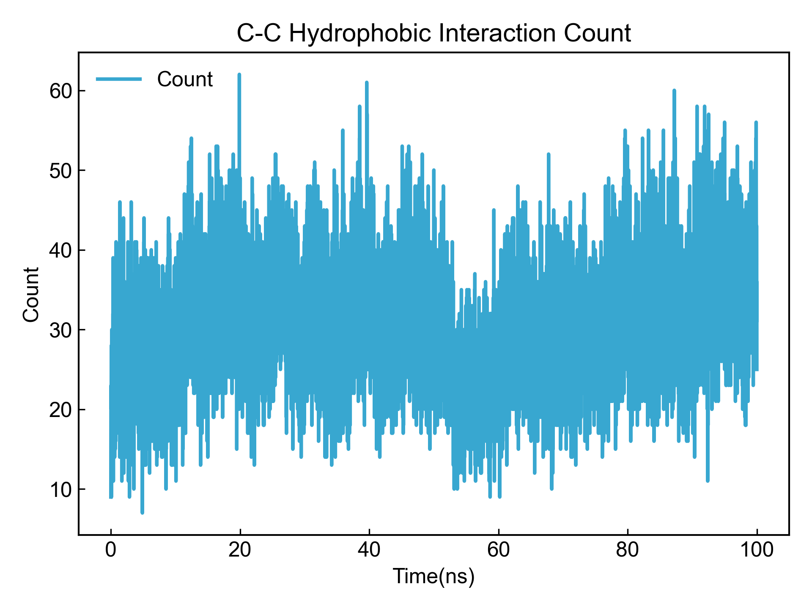

图 7-28　蛋白-配体 C–C 疏水接触数随时间变化（DuIvyProcedures Hydrophobic 模块示例）

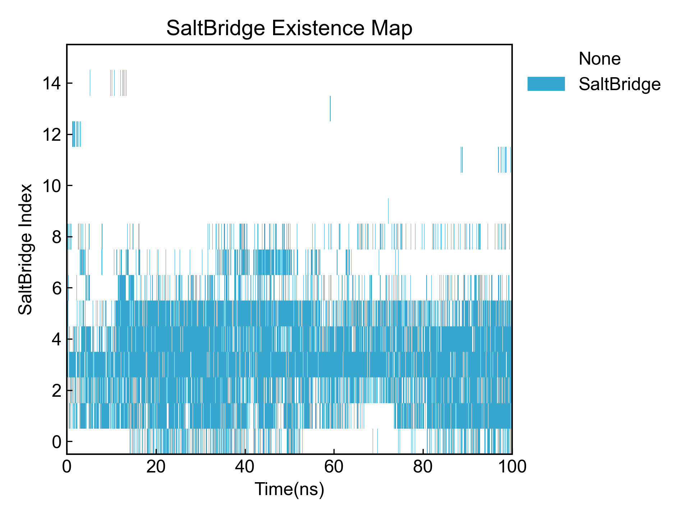

图 7-29　盐桥存在性映射（DuIvyProcedures SaltBridge 模块示例）

**结果解读**：占有率（存在帧数/总帧数）是核心定量——稳定的功能相互作用通常占有率 >80%，偶发接触则是占有率低且存在性映射稀疏；占有率相近的相互作用可进一步用其寿命（连续/间歇，参数 `tau_max`/`intermittency` 定义窗口）区分「虽稳定但偶断」与「真正持久」；把相互作用清单与结合自由能分解（第 8 章 MM-PBSA 章节）结合，可回答「哪些相互作用在热力学上主导结合」。方法记录中应写明判据（距离与角度阈值）、工具与版本、逐帧/统计口径，供第 9 章记录规范追溯。

**结合位点密度分布**：除逐帧相互作用外，把配体（或水、离子）在结合位点附近的占据密度可视化也很有信息量——配体密度图能直观显示其结合构象的热点区域与可能存在的多个亚构象。`gmx density` 或 DuIvyProcedures 的 Density/DensityMap 模块按格点统计目标组分在盒内的时间平均密度，输出三维密度或沿某轴的投影图；密度等高面与蛋白表面的复合图（VMD 等渲染）是展示结合位点的常规发表图件。DIP 的密度图示例（配体在结合位点的分布）如图 7-30：

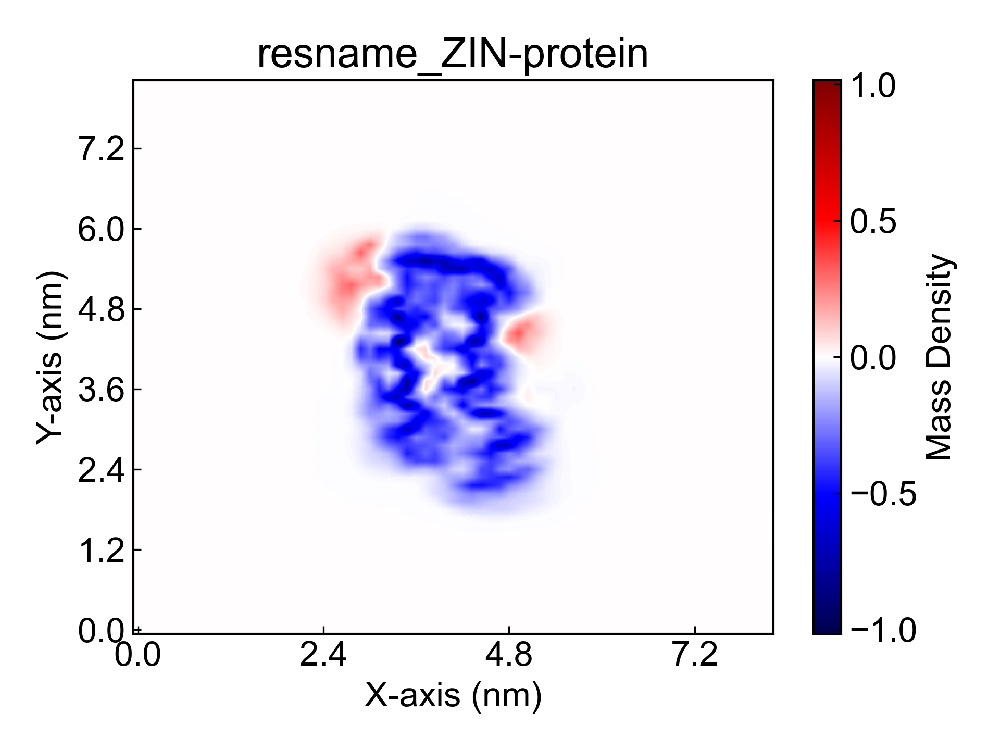

图 7-30　配体 ZIN 在蛋白结合位点的时间平均密度投影（DuIvyProcedures DensityMap 模块示例）


## 分布与溶剂化

### 径向分布函数

径向分布函数（radial distribution function，RDF）$g(r)$ 表示在距参考粒子（或参考原子集合）距离 r 处找到目标粒子的概率密度相对于均匀分布的倍数。在分子模拟中，$g(r)$ 描述溶剂分子（或特定原子类型）围绕溶质的局域分布：第一峰的位置对应第一溶剂化壳层的最概然距离，峰内积分给出配位数，$g(r)$ 在远距离处趋近 1[39]。标准归一化为 $g(r)=\langle\rho(r)\rangle/\rho_0$，其中 $\langle\rho(r)\rangle$ 为距参考 r 处球壳的平均数密度，$\rho_0$ 为体系平均数密度（定义见文献[39]）。`gmx rdf` 以 `-ref` 指定参考选择、`-sel` 指定目标选择，`-bin` 设置直方图宽度（默认 0.002 nm），`-rmax` 设置最大距离（默认在有 PBC 时为盒最短边的一半），`-norm` 选择归一化方式（`rdf` 为完整归一化的标准 RDF，`number_density` 只保留前两项归一化因子，`none` 仅做柱宽归一），`-cn` 输出累积数（r 以内平均粒子数），`-surf` 相对参考选择表面计算 RDF，`-rmpbc` 与 `-pbc` 默认开启保证距离计算考虑周期镜像并整体化分子；其归一化按三步实施：按参考位置数、按柱体积、按目标位置的平均数密度[2]。作为经验参照，水氧围绕蛋白重原子的 RDF 第一峰常在 0.27–0.28 nm（对应第一水化层），峰谷多在 0.34–0.36 nm；具体数值随力场与参考原子类型变化，取层时应以实际曲线的峰谷为准。示例（水氧围绕蛋白质 Cα 的分布，示意）：

```bash
# 平台：Linux（bash）；版本：GROMACS 2026.x；-selrpos/-seltype 控制参考位置口径（atom/res_com 等）
gmx rdf -s md.tpr -f md_whole.xtc -ref "protein and name CA" -sel "name OW" \
        -o rdf_water.xvg -cn rdf_cn.xvg -bin 0.005 -rmax 1.0 -norm rdf
```

RDF 判读遵循固定的三步流程：定位第一峰、以峰谷界定壳层边界、积分得配位数（图 7-31）。配位数即 r 以内平均粒子数，既可由 `-cn` 输出的累积数直接读取，也可对径向分布数值积分得到，两条路径应给出相近结果；报告第一溶剂化壳层时须同时给出峰位、边界半径与配位数三个量，缺一都难以复核。

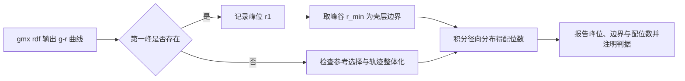

图 7-31　RDF 第一溶剂化壳层判读流程：峰位给出最概然距离，峰谷界定壳层边界，配位数由径向分布积分获得（累积数语义见 gmx rdf 的 `-cn` 选项[2]）

### 密度分布

密度分布（density profile）把盒内某组原子沿一个方向切成若干薄片（slice），统计每片的数密度或质量密度，得到密度随坐标的剖面[3]。`gmx density` 的 `-d` 选择剖面方向（默认 Z），`-sl` 设置切片数（默认 50），`-dens` 选择密度类型（`mass`、`number`、`charge`、`electron`），`-center` 把分箱原点固定在随帧更新的盒中心（而非固定的盒角；官方注明该行为自 GROMACS 5.0 起改为逐帧计算中心并在盒半宽区间内分箱），`-symm` 围绕中心对称化（自动开启 `-center`；官方指出分箱现恒在相对坐标下进行，以应对控压耦合导致的盒尺寸变化，输出沿输出轴按平均盒尺寸缩放）[3]。膜体系是最常见的应用：脂质头基、尾基与水相分别选组后，其 Z 方向密度剖面给出双层厚度、头基间距与界面水层位置；手册特别提醒，面积压缩率高的脂双层在 NPT 下盒形涨落会抹平剖面，应配合 `-center` 并使用较长的统计时间窗[3]。密度剖面输出单位为 kg/m³（质量密度），也可输出数密度与电荷密度[3]。命令示例：

```bash
# 平台：Linux（bash）；版本：GROMACS 2026.x；-ng 指定组数，交互提供各组序号（此处 2 为水组，示意）
gmx density -s md.tpr -f md_whole.xtc -n index.ndx -o dens_Z.xvg -d Z -sl 100 -dens mass \
            -center -ng 1 <<< $'2'
```

### 水分子驻留与交换

水分子驻留（water residence）量化水在蛋白表面或结合位点停留的时间尺度。两类常用手段：其一，`gmx trjorder -nshell` 统计距参考组半径 `-r` 内的分子数随时间变化，`-da` 指定分子内用于距离计算的原子（0 为质心），`-com` 使用参考组质心[40]；该方法给出水壳占有率与层内分子数的粗略时间序列。其二，用氢键寿命刻画驻留：`gmx hbond-legacy -life` 的时间自相关函数与 Luzar–Chandler 速率拟合给出蛋白-水氢键的连续/间歇寿命（见 7.4.3）[27][30][31]。水分子在蛋白表面的驻留时间分布通常不是单一指数：第一壳层内水因氢键网络受限而驻留较长，体相水的取向与平动重排则在皮秒量级；把驻留时间当作单一标量报告前，应检查自相关函数能否用指数族拟合（对应 `-fitfn` 选项的 exp、exp_exp 等），并以 9.3 节的误差估计给出不确定度。MDTraj 与 MDAnalysis 提供等价的壳层计数与氢键寿命实现（7.8 节），适合大规模批量统计。

## 可视化

### VMD 的常用操作

VMD（Visual Molecular Dynamics）以"分子 + 表示 + 渲染"三层模型组织场景，支持 Tcl 脚本批处理，是模拟轨迹检查与出版制图的常用工具[41]。加载轨迹前应使用本章 7.1 节预处理得到的标准化轨迹（数据文件较大，建议在处理节点本地读取）。常用操作包括：`mol new` 加载结构与轨迹；`mol representation`、`mol color`、`mol selection` 设置表示（Licorice 显示配体、NewCartoon 显示蛋白骨架、CPK 显示离子）；`animate next` 与帧循环检查构象；`pbc wrap -all` 在显示层面把分子折回盒子；`measure hbonds` 快速检查氢键；`render` 输出图像。VMD 的原子选择语法（如 `resid 10 and name CA`）与 GROMACS 选择语法不同，混用会出错[41]。对于出版级图像，VMD 提供 Tachyon 离线渲染（`render Tachyon` 输出 `.tachyon` 文件再转换）以获得抗锯齿与高质量光影；渲染参数（分辨率、光照、景深）写入脚本以保证可复现。以下脚本输出一张 300 dpi 规格的蛋白-配体复合物图像（示意，路径与渲染器以安装为准）：

```tcl
# VMD 1.9.4a51 及以上；平台：Linux/macOS（Windows 版本功能相同）
mol new md_whole.pdb
mol addfile md_whole.xtc waitfor all
mol representation NewCartoon; mol color ColorID 0; mol selection "protein"; mol addrep top
mol representation Licorice 0.15; mol color ColorID 4; mol selection "resname LIG"; mol addrep top
mol representation CPK 0.6; mol color Name; mol selection "name NA CL"; mol addrep top
axes location off
render Tachyon snapshot.tachyon
```

### PyMOL 的常用操作

PyMOL 以命令行为核心，`fetch` 下载结构、`load` 加载本地文件、`remove solvent` 与 `hide everything`、`show cartoon/ sticks/spheres` 控制表示，`align` 与 `rms_cur` 计算叠加与 RMSD，`ray` 执行光线追踪，`png` 输出图像。轨迹由 `load_traj` 加载到已加载结构上，`set all_states` 与 `orient` 控制帧呈现；PyMOL 同样不感知 PBC，输入轨迹必须为整体化后的版本。PyMOL 的 `rms_cur` 与 GROMACS `gmx rms` 的数值不可直接类比：前者默认不做质量加权、叠加算法的原子选择与后者不同，历史上曾出现两者对同一配体给出约两倍数值差异的报告[42]（差异源于叠加组与参考帧的口径，而非数值错误）。出版制图通常用 `ray 2400, 1800` 输出高分辨率位图，并用 `set ray_opaque_background` 控制背景。示例（示意，需将 PDB ID 替换为实际结构）：

```python
# PyMOL 2.x；从命令行执行
from pymol import cmd
cmd.load("md_whole.pdb", "complex")
cmd.remove("solvent")
cmd.hide("everything")
cmd.show("cartoon", "chain A")
cmd.show("sticks", "resname LIG")
cmd.bg_color("white")
cmd.ray(2400, 1800)
cmd.png("complex.png", dpi=300)
```

### 出版图像的规范

出版级分子图像应满足可复现性与可读性双重标准。可复现性要求渲染脚本（VMD Tcl 或 PyMOL Python）与方法学一起归档，图像文件注明软件版本、渲染参数与输入文件路径，与 9.6 节的记录规范一致。可读性要求三点：分辨率不低于 300 dpi，矢量格式（PDF/SVG）优先于位图；配色考虑色觉障碍读者，避免红-绿对比组合，配色的方案（如 ColorBrewer 色系）在正文注明；视口与分子朝向在正文与图中一致，图注说明表示类型（骨架/棍棒/球棍）与着色依据（按残基类型/按 B 因子/按链）。科学图形中"胶囊化"的惯例是把 B 因子、RMSF 等连续量映射到连续色带并给出色标；离散量（链、二级结构）用离散色组并给出图例。凡以模拟轨迹为素材的图像，图注应写明数据来自哪一分析阶段（平衡段/生产段、时间窗），与正文方法描述对应。

## Python 批量分析

### MDAnalysis 的基本对象

MDAnalysis 以 `Universe` 封装拓扑与轨迹，`AtomGroup` 封装原子集合，分析类遵循"构造-运行-取结果"模式[43]。`Universe(topology, trajectory)` 读取 tpr/结构文件与 xtc 轨迹；`select_atoms` 使用 CHARMM 风格选择语法（与 GROMACS 选择语法不同，如 `resid 10-20 and name CA`）[6]。轨迹级"即时变换"（transformations）在读取时逐帧应用 `unwrap`（分子整体化）或 `center_in_box`（居中于盒中心），避免在磁盘上复制轨迹[44]。分析模块覆盖本章全部指标：`analysis.rms.RMSD` 与 `analysis.rms.RMSF` 计算均方根偏差与涨落，`analysis.gyration.RadiusOfGyration` 计算回转半径，`analysis.rdf.InterRDF` 计算径向分布，`analysis.hydrogenbonds.HydrogenBondAnalysis`（及 `HydrogenBondAutoCorrel`）实现氢键识别与寿命，`analysis.lineardensity.LinearDensity` 计算沿轴的密度剖面[45][46]；其中氢键寿命自相关等动力学分析随 MDAnalysis 生态由 Gowers 等一并发表[45]。氢键分析的默认几何判据为供体-受体距离 3.0 Å 与供体-氢-受体角 150°，与 GROMACS 的 0.35 nm/30° 口径不同，跨工具比较前必须先统一判据[46]。以下代码用 MDAnalysis 2.x 计算蛋白质 Cα 的 RMSD 与径向分布（示意，版本以安装为准）；MDAnalysis 内部长度单位为 Å，与 GROMACS 的 nm 相差 10 倍：

```python
# Python ≥3.10；依赖 MDAnalysis ≥2.0（RMSF 与按残基 RDF 的可用性以版本为准）
import MDAnalysis as mda
from MDAnalysis.analysis import align
from MDAnalysis.analysis.rms import RMSD, RMSF
from MDAnalysis.analysis.rdf import InterRDF

u = mda.Universe("md.tpr", "md_whole.xtc")
ca = u.select_atoms("name CA")
water_o = u.select_atoms("name OW")

rmsd = RMSD(ca, select="name CA", groupselections=None).run()
print("C-alpha RMSD (Angstrom):", rmsd.results.rmsd[:, 2].mean())

# RMSF 前必须先做轨迹叠合：MDAnalysis 的 RMSF 默认不做任何拟合，
# 未叠合的整体转动/平动会系统性抬高涨落（与正文 7.3.2、常见错误 #2 的成因一致）。
# 先按 Cα 最小二乘对齐到首帧（或参考结构），再计算残基 RMSF。
align.AlignTraj(u, u, select="name CA", in_memory=True).run()
rmsf = RMSF(ca).run()
print("C-alpha RMSF (Angstrom):", rmsf.results.rmsf.mean())

rdf = InterRDF(ca, water_o, nbins=200, range=(0.0, 1.0)).run()
print("first peak at ~", rdf.results.bins[rdf.results.rdf.argmax()], "Angstrom")
```

MDAnalysis 的 `RMSF` 默认不做质量加权（官方文档明示 "No mass weighting is performed"），而 `gmx rmsf` 拟合口径为质量加权；对 Cα 集二者差异可忽略，对含重原子的全集则非零。与 7.7.3 的一致性校验对照时，应把该差异计入预期偏差，或在 Python 侧自行加权后比较[43]。

### MDTraj 的基本对象

MDTraj 以 `Trajectory` 对象同时承载坐标、拓扑（`top`）与盒子（`unitcell_vectors`），`load` 直接读取 xtc/trr/dcd 等格式[47]。其分析模块以批处理向量化为设计目标：`compute_rmsd` 对全部帧一次性计算 RMSD，`compute_rg` 计算回转半径，`compute_rdf` 计算径向分布，`compute_hbonds` 识别氢键，`compute_dssp` 输出二级结构赋值；MDTraj 论文与项目说明强调其 RMSD 计算的吞吐量优势[47][48]。MDTraj 的原子选择用 `top.select("name CA")` 返回掩码数组，与 MDAnalysis 的 `select_atoms` 返回对象不同。MDTraj 对拓扑的依赖较轻（PDB 即可），适合"多轨迹、少拓扑信息"的批量场景。示例：

```python
# Python ≥3.10；依赖 MDTraj 1.9.x（以安装版本为准）
import mdtraj as md

t = md.load("md_whole.xtc", top="md.pdb")
ca = t.top.select("name CA")
print("RMSD (nm):", md.rmsd(t, t, 0, atom_indices=ca).mean())
print("Rg (nm):", md.compute_rg(t).mean())
```

### 与内建工具结果的一致性校验

用 Python 复算 GROMACS 内建工具的指标时，应先做一致性校验（cross-validation）而非直接采信。校验失败通常源于四类口径差异：单位（GROMACS nm 与 MDAnalysis Å）、PBC 处理（是否整体化、是否考虑最小镜像）、拟合组与参考结构（RMSD 的叠加组）、以及几何判据（氢键的 0.35 nm/30° 与 3.0 Å/150° 之别）。推荐流程：先在同一轨迹上运行 `gmx rms`、`gmx rmsf`、`gmx rdf` 等工具获得基准值，再用 Python 复现并比较；对 RMSD 这类尺度敏感量设定相对容差（如 1%），对分布类指标比较峰位与一阶矩。MDAnalysis 与 MDTraj 均提供与 GROMACS 相近但细节不同的实现（如氢键的供体识别、RDF 的归一化），把差异归因于实现口径并写入方法记录是唯一正确的处理方式[6][47]。一致性校验遵循"先统一口径、后比较差异"的流程（图 7-32）。校验脚本以固定轨迹与固定参数作为回归样例保存，后续修改分析代码时重跑同一校验，可防止口径漂移。

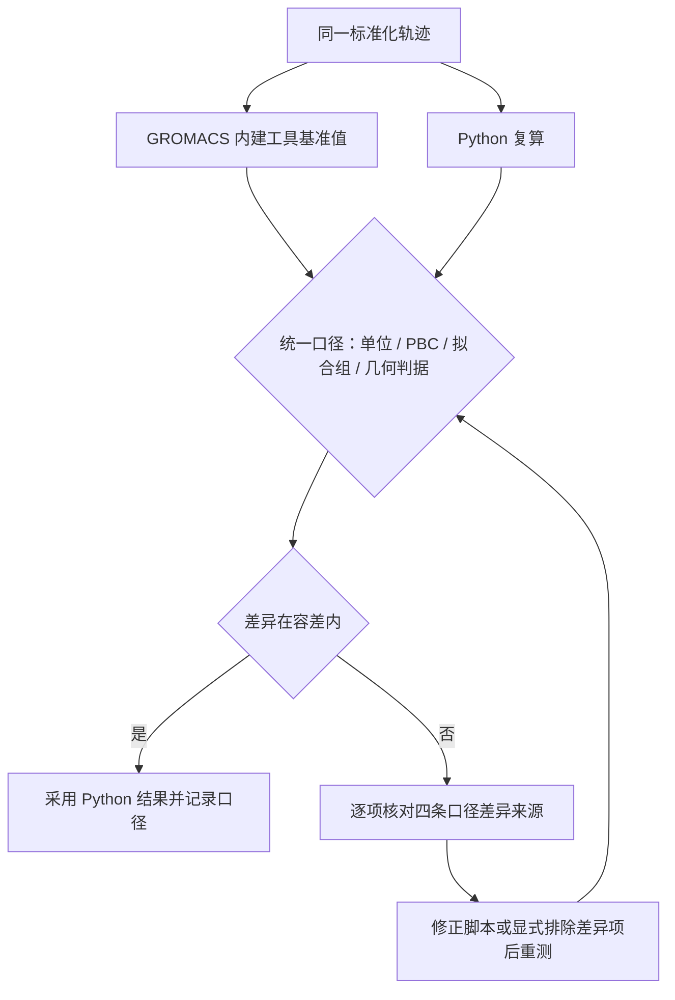

图 7-32　一致性校验流程：先统一口径再比较，差异超出容差时必须定位到口径因素，而不是直接采信任一侧结果一致性校验脚本应纳入版本控制，作为 9.6 节可复现性要求的组成部分。

## 结果的解释

### 常见误读

常规轨迹分析有四类高频误读。其一，把单条轨迹的 RMSD 均值当作"体系稳定性"的充分证据：RMSD 的平台期只说明相对参考结构不再持续漂移，不承诺构象系综已充分采样，后者需要 9.4 节的分块一致性检验与多副本比较。其二，忽视 RMSD 数值的显著性边界：Maiorov 与 Crippen 指出，任意两条无关结构经最优叠加后也存在一个与残基数相关的"本质下限"，小蛋白质尤其容易因偶然得到几何上显著相似的 RMSD[10]；报告 RMSD 时应同时说明参考结构与比较组的规模。其三，把氢键数目的瞬时涨落当成分子的稳定特征：氢键是皮秒尺度的动态对象，应报告时间平均、寿命与其不确定度，而非单帧快照。其四，混淆"接触"与"相互作用"：盐桥、氢键等几何接触判定不包含能量信息，接触频繁不代表相互作用强，需结合寿命与 8.4 节的方法学边界解释。所有数值报告都须附带状态条件（温度、力场、版本、时间窗），这是 1.7 节与 9.5 节的共同约束。

### 结果报告写法

分析结果的报告应同时满足"可复现"与"可解释"。方法学部分必须逐项写明：软件与版本（GROMACS 2026.4、MDAnalysis 2.x）、输入轨迹与其预处理管线（-pbc 模式、时间窗）、每组指标的参考结构、拟合组、几何判据与全部非默认参数；结果部分给出均值、涨落范围与（按 9.3 节方法估计的）不确定度，并注明统计窗与帧间隔。数值表应附带单位与条件列（表 7-3 即此类表格的模板）。图件遵循 7.7.3 节的出版规范。凡引用他人阈值与判据（如盐桥 0.4 nm、氢键 0.35 nm/30°），均给出文献出处，未核实的经验值一律不进入正文。

### 与实验数据的对照

模拟指标与实验观测的对照须先确认两者的可观测量定义一致。晶体学 B 因子与 RMSF 的换算依赖位移模型（各向同性近似），且实验值受晶格接触、分辨率与精修方式影响，直接数值比较前应说明模型差异[11]。SASA 与实验疏水性的对照同样受探针半径与原子半径集规定的影响，跨体系比较时固定同一参数集。第 9 章给出模型误差与统计误差分离的系统方法，本章只强调一点：任何"模拟-实验一致"的结论都必须同时报告两个方向的误差，而不是只报模拟侧的标准差。

## 常见错误

1. **现象**：SASA 计算出的蛋白质表面积明显偏小或偏大，且对截断半径异常敏感。 **成因**：轨迹未整体化，蛋白质分子被盒边界切开，`gmx sasa` 在 `-pbc` 开启时把断裂片段当作多个表面处理；或 `-surface` 组未包含全部非溶剂原子。 **排查步骤**：在 VMD 中加载 `pbc wrap` 后的轨迹检查分子完整性；核对 `-surface` 选择是否为全部溶质原子。 **处置**：先执行 `gmx trjconv -pbc whole`（或 `-pbc mol`）生成整体化轨迹，再重算；确认 `-surface` 组完整。

2. **现象**：RMSF 数值普遍偏大，所有残基的柔性几乎相同。 **成因**：未做拟合，蛋白质的整体转动与平动叠加到原子涨落上。 **排查步骤**：检查命令是否带 `-fit`（默认 yes），或轨迹是否是未经拟合预处理的原生轨迹。 **处置**：使用 `gmx rmsf -fit`，或在 RMSF 前先用 `gmx rms -fit rot+trans` 生成拟合轨迹。

3. **现象**：`gmx dssp` 报告缺少氢原子相关错误，或二级结构赋值全部落在环（~），与晶体结构不符。 **成因**：结构文件缺少氢原子却未使用 `-hmode dssp`；或输入结构为非 X 射线方法测定，CRYST1 晶胞信息不正确。 **排查步骤**：检查 `-hmode` 取值与结构来源；确认输入为 X 射线结构或其模拟衍生物。 **处置**：加 `-hmode dssp`（必要时配 `-clear`）；核对晶胞信息或改用坐标来源正确的结构。

4. **现象**：在 GROMACS 2023 及以后的版本执行 `gmx do_dssp` 报 `command not found`。 **成因**：官方自 2023 起以原生 DSSP（version 4）实现取代 `do_dssp` 并更名为 `gmx dssp`，旧名字不再存在。 **排查步骤**：确认 GROMACS 主版本号（`gmx --version`）。 **处置**：改用 `gmx dssp` 及其新参数接口；旧项目如需复现，在 2022 及更早版本环境中完成并记录版本差异。

5. **现象**：`gmx hbond` 提示选择无供体或无受体（"has no donors AND has no acceptors"），但 VMD 中可见明显氢键。 **成因**：运行的是 2024 年起的新实现，其供体/受体辨识依赖原子元素与拓扑；非标准命名的脂质、配体或含金属体系易漏认；旧实现（hbond-legacy）反而能识别。 **排查步骤**：对比同一输入在 `gmx hbond` 与 `gmx hbond-legacy` 的结果（官方 issue 已记录此类差异）。 **处置**：对新实现显式给出 `-de`/`-ae` 元素列表，或改用 `gmx hbond-legacy`，并在方法记录中注明所用实现。

6. **现象**：`gmx rdf` 在 r 很小时 g(r) 不为零，或峰位出现毛刺。 **成因**：分子内原子对被计入（如计算同一分子的原子间 RDF）；或轨迹分子断裂导致距离计算混乱。 **排查步骤**：检查 `-ref` 与 `-sel` 是否包含同一分子的原子，确认轨迹已整体化。 **处置**：用 `-excl` 启用拓扑排除（要求 `-s` 提供 tpr），或改用 `-cut` 清除小距离区域；先做 `-pbc whole` 预处理。

7. **现象**：`gmx density` 输出的脂质双层剖面被明显抹平，头基间距小于预期。 **成因**：NPT 下双层面积涨落使盒形随时间变化，而分箱原点固定在盒角。 **排查步骤**：检查是否使用了 `-center`；比较带与不带 `-center` 的剖面。 **处置**：加 `-center`（需要对称剖面时可直接改加 `-symm`，后者会自动开启 `-center`），并保证统计窗口显著长于面积涨落的特征时间。

8. **现象**：Python 复算的 RMSD 与 `gmx rms` 数值相差约两倍，或氢键数量相差很大。 **成因**：单位或口径不一致：MDAnalysis 默认长度单位为 Å，氢键判据为 3.0 Å/150° 而非 GROMACS 的 0.35 nm/30°；MDTraj 的 RMSD 未做质量加权或参考选择不同。 **排查步骤**：逐项核对单位、拟合组、参考结构、PBC 与几何判据。 **处置**：统一口径后重算，并把一致性校验纳入脚本（7.8.3 节流程）。

## 本章小结

- 周期性边界修正分三层：整体化修复断裂分子、去跳变恢复坐标连续性、居中改善呈现与部分几何量；工具默认在距离层面感知 PBC，预处理的必要性随分析类型而定。
- `-pbc mol` 依赖 `-s` 提供运行输入以识别分子；`-pbc`、`-center`、`-ur`、`-fit` 的组合必要时拆分多次调用。
- 索引组与选择语法是"统计哪些原子"的唯一权威口：`gmx select -on` 覆盖 `make_ndx` 几乎全部功能，表达式可写进脚本并导出 ndx 复用。
- RMSD 与 RMSF 必须以明确参考结构与拟合组为前提；Rg 与 SASA 不依赖参考结构但依赖分子完整性与参数约定（探针半径）。
- 二级结构判定以 Kabsch–Sander DSSP 为事实标准；`gmx do_dssp` 自 2023 年起由原生实现更名 `gmx dssp`，氢键工具自 2024 年起新旧实现并存（`gmx hbond` 与 `gmx hbond-legacy`）。
- RDF 与密度剖面分别回答"距离分布"与"空间分层"两类问题；第一溶剂化壳层的判定以峰谷截断为常规做法，须记录判据。
- 可视化工具均不感知 PBC，输入轨迹必须整体化；出版图像以渲染脚本归档保证可复现。
- Python 批量分析以 MDAnalysis 与 MDTraj 覆盖本章全部指标，但与内建工具存在单位、判据与拟合口径差异，须先做一致性校验再采信。

## 延伸讨论

轨迹分析的通用纪律可收束为「口径先行」：拟合组与参考结构（RMSD/RMSF）、分子完整性与 PBC 修正（距离类量）、单位（GROMACS nm vs 生态工具 Å）、抽样频率（寿命类量）、选择语法（原子范围）——五项口径中任何一项未统一，跨指标或跨工件的比较都不成立。本章各节的「先统一口径后比较」原则与 7.7.3 的交叉校验正是它的操作化。

寿命类动力学量（氢键寿命、水驻留）的方法学重心在统计而非计算：连续/间歇口径的选择、拟合窗口覆盖噪声底、帧间隔不低于寿命量级——三条都直接影响数值，且都发生在「计算之前的实验设计」。把寿命研究交给他人复核时，这三条加上误差估计（第 9 章）是必查项。

Python 批量分析的价值不在「能算」而在「能复核」：MDAnalysis 的对象模型使分析函数可测试（给定输入帧断言输出），配合第 3 章的幂等纪律与第 9 章的误差估计，构成分析级可复现性。RMSF 无质量加权的口径差异、`gmx` 与生态工件的交叉验证，都是这套纪律的具体体现。

## 参考文献

[1] GROMACS 2026.4 documentation. gmx trjconv[EB/OL]. https://manual.gromacs.org/current/onlinehelp/gmx-trjconv.html（访问日期：2026-10-29）.
[2] GROMACS 2026.4 documentation. gmx rdf[EB/OL]. https://manual.gromacs.org/current/onlinehelp/gmx-rdf.html（访问日期：2026-10-29）.
[3] GROMACS 2026.4 documentation. gmx density[EB/OL]. https://manual.gromacs.org/current/onlinehelp/gmx-density.html（访问日期：2026-10-29）.
[4] GROMACS 2026.4 documentation. gmx make_ndx[EB/OL]. https://manual.gromacs.org/current/onlinehelp/gmx-make_ndx.html（访问日期：2026-10-29）.
[5] GROMACS 2026.4 documentation. gmx select[EB/OL]. https://manual.gromacs.org/current/onlinehelp/gmx-select.html（访问日期：2026-10-29）.
[6] MDAnalysis documentation. Selection commands[EB/OL]. https://docs.mdanalysis.org/2.0.0/documentation_pages/selections.html（访问日期：2026-10-29）.
[7] GROMACS 2026.4 documentation. Reference manual: Root mean square deviations in structure[EB/OL]. https://manual.gromacs.org/current/reference-manual/analysis/rmsd.html（访问日期：2026-10-29）.
[8] Kabsch W. A solution for the best rotation to relate two sets of vectors[J]. Acta Crystallographica Section A, 1976, 32(5): 922-923. DOI: 10.1107/S0567739476001873.
[9] Kabsch W. A discussion of the solution for the best rotation to relate two sets of vectors[J]. Acta Crystallographica Section A, 1978, 34(5): 827-828. DOI: 10.1107/S0567739478001680.
[10] Maiorov V N, Crippen G M. Size-independent comparison of protein three-dimensional structures[J]. Proteins: Structure, Function, and Bioinformatics, 1995, 22(3): 273-283. DOI: 10.1002/prot.340220308.
[11] GROMACS 2026.4 documentation. gmx rmsf[EB/OL]. https://manual.gromacs.org/current/onlinehelp/gmx-rmsf.html（访问日期：2026-10-29）.
[12] GROMACS 2026.4 documentation. gmx gyrate[EB/OL]. https://manual.gromacs.org/current/onlinehelp/gmx-gyrate.html（访问日期：2026-10-29）.
[13] GROMACS 2026.4 documentation. gmx gyrate-legacy[EB/OL]. https://manual.gromacs.org/current/onlinehelp/gmx-gyrate-legacy.html（访问日期：2026-10-29）.
[14] Lee B, Richards F M. The interpretation of protein structures: Estimation of static accessibility[J]. Journal of Molecular Biology, 1971, 55(3): 379-400. DOI: 10.1016/0022-2836(71)90324-X.
[15] Shrake A, Rupley J A. Environment and exposure to solvent of protein atoms. Lysozyme and insulin[J]. Journal of Molecular Biology, 1973, 79(2): 351-371. DOI: 10.1016/0022-2836(73)90011-9.
[16] GROMACS 2026.4 documentation. gmx sasa[EB/OL]. https://manual.gromacs.org/current/onlinehelp/gmx-sasa.html（访问日期：2026-10-29）.
[17] Amadei A, Linssen A B M, Berendsen H J C. Essential dynamics of proteins[J]. Proteins: Structure, Function, and Bioinformatics, 1993, 17(4): 412-425. DOI: 10.1002/prot.340170407.
[18] Hess B. Convergence of sampling in protein simulations[J]. Physical Review E, 2002, 65(3): 031910. DOI: 10.1103/PhysRevE.65.031910.
[19] Altis A, Nguyen P H, Hegger R, et al. Dihedral angle principal component analysis of molecular dynamics simulations[J]. The Journal of Chemical Physics, 2007, 126(24): 244102. DOI: 10.1063/1.2746330.
[20] Ichiye T, Karplus M. Collective motions in proteins: A covariance analysis of atomic fluctuations in molecular dynamics and normal mode simulations[J]. Proteins: Structure, Function, and Bioinformatics, 1991, 11(3): 205-217. DOI: 10.1002/prot.340110305.
[21] Frauenfelder H, Sligar S G, Wolynes P G. The energy landscapes and motions of proteins[J]. Science, 1991, 254(5038): 1598-1603. DOI: 10.1126/science.1749933.
[22] Mercadante D, Gräter F, Daday C. CONAN: A tool to decode dynamical information from molecular interaction maps[J]. Biophysical Journal, 2018, 114(5): 1063-1067. DOI: 10.1016/j.bpj.2018.01.033.
[23] Romero-Rivera A, Garcia-Borràs M, Osuna S. The role of conformational dynamics in the evolution of retro-aldolase activity[J]. ACS Catalysis, 2017, 7(12): 8524-8532. DOI: 10.1021/acscatal.7b02954.
[24] Kabsch W, Sander C. Dictionary of protein secondary structure: Pattern recognition of hydrogen-bonded and geometrical features[J]. Biopolymers, 1983, 22(12): 2577-2637. DOI: 10.1002/bip.360221211.
[25] GROMACS documentation. Release notes: Improvements to GROMACS tools (2023)[EB/OL]. https://manual.gromacs.org/documentation/current/release-notes/2023/major/tools.html（访问日期：2026-10-29）.
[26] GROMACS 2026.4 documentation. gmx dssp[EB/OL]. https://manual.gromacs.org/current/onlinehelp/gmx-dssp.html（访问日期：2026-10-29）.
[27] GROMACS 2023.1 documentation. gmx hbond[EB/OL]. https://manual.gromacs.org/documentation/2023.1/onlinehelp/gmx-hbond.html（访问日期：2026-10-29）.（旧实现，GROMACS 2024 起更名为 gmx hbond-legacy）
[28] GROMACS 2026.4 documentation. gmx hbond[EB/OL]. https://manual.gromacs.org/current/onlinehelp/gmx-hbond.html（访问日期：2026-10-29）.（GROMACS 2024 起的新实现）
[29] GROMACS. Inconsistency of gmx hbond analysis, Issue #5059[EB/OL]. https://gitlab.com/gromacs/gromacs/-/work_items/5059（访问日期：2026-10-29）.
[30] Luzar A, Chandler D. Hydrogen-bond kinetics in liquid water[J]. Nature, 1996, 379(6560): 55-57. DOI: 10.1038/379055a0.
[31] Luzar A, Chandler D. Effect of environment on hydrogen bond dynamics in liquid water[J]. Physical Review Letters, 1996, 76(6): 928-931. DOI: 10.1103/PhysRevLett.76.928.
[32] Laage D, Hynes J T. A molecular jump mechanism of water reorientation[J]. Science, 2006, 311(5762): 832-835. DOI: 10.1126/science.1122154.
[33] Donald J E, Kulp D W, DeGrado W F. Salt bridges: Geometrically specific, designable interactions[J]. Proteins: Structure, Function, and Bioinformatics, 2011, 79(3): 898-915. DOI: 10.1002/prot.22927.
[34] Barlow D J, Thornton J M. Ion-pairs in proteins[J]. Journal of Molecular Biology, 1983, 168(4): 867-885. DOI: 10.1016/S0022-2836(83)80079-5.
[35] GROMACS 2026.4 documentation. gmx saltbr[EB/OL]. https://manual.gromacs.org/current/onlinehelp/gmx-saltbr.html（访问日期：2026-10-29）.
[36] GROMACS 2026.4 documentation. gmx distance[EB/OL]. https://manual.gromacs.org/current/onlinehelp/gmx-distance.html（访问日期：2026-10-29）.
[37] GROMACS 2026.4 documentation. gmx pairdist[EB/OL]. https://manual.gromacs.org/current/onlinehelp/gmx-pairdist.html（访问日期：2026-10-29）.
[38] Salentin S, Schreiber S, Haupt V J, et al. PLIP: Fully automated protein-ligand interaction profiler[J]. Nucleic Acids Research, 2015, 43(W1): W443-W447. DOI: 10.1093/nar/gkv315.
[39] Allen M P, Tildesley D J. Computer Simulation of Liquids[M]. 2nd ed. Oxford: Oxford University Press, 2017. DOI: 10.1093/oso/9780198803195.001.0001.
[40] GROMACS 2026.4 documentation. gmx trjorder[EB/OL]. https://manual.gromacs.org/current/onlinehelp/gmx-trjorder.html（访问日期：2026-10-29）.
[41] Humphrey W, Dalke A, Schulten K. VMD: Visual molecular dynamics[J]. Journal of Molecular Graphics, 1996, 14(1): 33-38. DOI: 10.1016/0263-7855(96)00018-5.
[42] GROMACS forums. RMSD of ligand calculated by gmx rms does not match RMSD from other software[EB/OL]. https://gromacs.bioexcel.eu/t/rmsd-of-ligand-calculated-by-gmx-rms-doesnt-match-rmsd-from-other-software/858（访问日期：2026-10-29）.
[43] Michaud-Agrawal N, Denning E J, Woolf T B, et al. MDAnalysis: A toolkit for the analysis of molecular dynamics simulations[J]. Journal of Computational Chemistry, 2011, 32(10): 2319-2327. DOI: 10.1002/jcc.21787.
[44] MDAnalysis documentation. Trajectory transformations ("on-the-fly" transformations)[EB/OL]. https://docs.mdanalysis.org/2.0.0/documentation_pages/trajectory_transformations.html（访问日期：2026-10-29）.
[45] Gowers R J, Linke M, Barnoud J, et al. MDAnalysis: A Python package for the rapid analysis of molecular dynamics simulations[C]//Proceedings of the 15th Python in Science Conference (SciPy 2016). Austin: SciPy, 2016: 98-105. DOI: 10.25080/Majora-629e541a-00e.
[46] MDAnalysis documentation. Analysis: Hydrogen bond analysis (HydrogenBondAnalysis)[EB/OL]. https://docs.mdanalysis.org/2.8.0/documentation_pages/analysis/hydrogenbonds.html（访问日期：2026-10-29）.
[47] McGibbon R T, Beauchamp K A, Harrigan M P, et al. MDTraj: A modern open library for the analysis of molecular dynamics trajectories[J]. Biophysical Journal, 2015, 109(8): 1528-1532. DOI: 10.1016/j.bpj.2015.08.015.
[48] MDTraj documentation. MDTraj: An open library for the analysis of molecular dynamics trajectories[EB/OL]. https://mdtraj.org/（访问日期：2026-10-29）.
