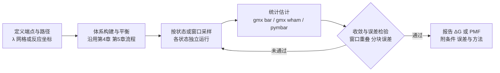
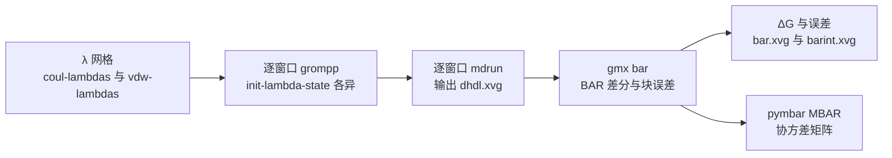

# 第 8 章 自由能、增强采样与高级分析

自由能是连接分子模拟与热力学实验观测的枢纽量：平衡常数、结合亲和力、分配系数与构象布居都直接由自由能差决定。与第 5 至 7 章处理的能量平均值和几何量不同，自由能由配分函数的对数给出，而配分函数是覆盖全部相空间的积分，任何有限轨迹都只能提供其估计，因此“算自由能”在方法学上自成体系。本章先建立自由能计算的总框架（8.1 节），随后展开三类经典技术路线：以耦合参数 λ 连接端点的炼金术自由能（8.2 节）、沿反应坐标加偏置的伞形采样（8.3 节），以及直接对平衡轨迹作系综平均的 MM-PBSA 与 MM-GBSA（8.4 节）；接着处理降维与聚类（8.5 节）、PLUMED 与元动力学、OPES 等增强采样家族（8.6 节）以及驻留时间、氢键寿命与结合路径等动力学指标（8.7 节）。本章所有软件行为与默认值均以 GROMACS 2026.4 官方文档为准[1]；统计误差的估计工具由第 9 章给出，本章在自由能语境下复用其概念，凡属惯例或推断之处均在正文标明依据类型。


## 学习目标

- 能区分自由能计算的统计误差与模型误差，并为给定计算任务选择炼金术路径或物理路径（8.1 节）。
- 能设计并运行多窗口炼金术自由能计算：设置 mdp 的 free-energy 段与 soft-core 参数、解释 dhdl 输出、用 gmx bar 完成 BAR 估计与重叠诊断，并说明 MBAR 的适用条件与外部实现（8.2 节）。
- 能沿反应坐标布置伞形采样窗口，用 gmx wham 进行 WHAM 重加权并检查窗口重叠，判断 PMF 结果的收敛性与边界可靠性（8.3 节）。
- 能说明 MM-PBSA/MM-GBSA 的近似层次与适用边界，正确报告结合自由能的能项分解与不确定度（8.4 节）。
- 能用 gmx covar/anaeig/cluster 完成主成分分析、动态互相关与构象聚类，并评价这些线性方法的适用条件（8.5 节）。
- 能通过 PLUMED 集成运行元动力学与 OPES，理解偏置参数的物理含义与收敛判据，并为给定体系选择伞形采样、元动力学或 OPES（8.6 节）。

## 前置知识

- 第 1 章的版本基线（GROMACS 2026.x）、单位与符号约定。
- 第 4 章的体系构建与第 5 章的平衡流程：本章计算均以平衡好的体系为起点。
- 第 6 章的长时运行与检查点续算机制：多窗口或多副本计算依赖其并行与续算能力。
- 第 7 章的轨迹预处理（去周期性边界、RMS 拟合）与几何分析工具。
- 第 9 章的统计估计概念：自相关、有效样本数、块平均与误差传播，本章多处直接复用。
- 基础统计力学：系综、配分函数、自由能与化学势的关系；基础热力学：焓、熵与 Gibbs 自由能。
## 8.1 自由能计算框架

### 8.1.1 定义与实验可观测量

自由能（free energy）是体系在给定宏观约束下的状态函数。在恒温恒容（NVT）系综中，Helmholtz 自由能定义为 $A=-k_BT\ln Q$，其中 $Q$ 为配分函数；在恒温恒压（NpT）系综中，Gibbs 自由能定义为 $G=-k_BT\ln\Delta$，其中 $\Delta$ 为含压强项的系综配分函数，两者相差 $G=A+pV$[1]。分子动力学只能在有限的相空间轨迹上估计能量平均值 $\langle U\rangle$，而自由能需要对配分函数取对数，不能由“平均能量差”直接得到：$\Delta G=\Delta H-T\Delta S$ 中的熵项 $T\Delta S$ 反映两个状态构象数的差异，必须通过统计采样来体现。两个焓贡献相近的构象集合可能相差很大的自由能，只比较平均势能必然得出错误排序，这是自由能计算区别于普通能量分析的根本原因。

自由能差是实验可观测量的天然桥梁。标准状态下平衡常数满足 $\Delta G^\circ=-RT\ln K$，其中 $K$ 按反应化学计量定义。据此，结合亲和力（以解离常数 $K_d$ 表示）、两相间的分配系数、pKa、溶解度以及构象布居比都可以由自由能差换算。这一关系要求参考态约定一致：计算与实验比较时须采用相同的标准态（如 1 mol·L⁻¹ 的浓度基准与指定温度），否则数值不可比。自由能作为状态函数只依赖端点态的性质，这为下一小节的“换路径”策略提供了合法依据：只要端点的哈密顿量正确，中间过程如何定义都不改变自由能差的数值，而不同的中间过程决定了计算成本与数值稳定性。

### 8.1.2 炼金术路径与物理路径

物理路径（physical pathway）沿真实的反应坐标推进，中间状态是体系实际经历的结构，例如配体与受体的质心距离、跨膜坐标或关键二面角。伞形采样（8.3 节）即属此类：它在反应坐标上布置多个窗口，每个窗口施加偏置势把采样局限在窗口中心附近，再通过重加权拼接出无偏分布[2]。物理路径的困难在于自由能面上高势垒区域的布居极低，直接模拟难以覆盖过渡态附近的结构，所需采样成本随势垒高度指数增长。

炼金术路径（alchemical pathway）不经过任何真实中间态，它把体系哈密顿量写成耦合参数 λ 的连续函数 H(p,q;λ)，λ=0 对应状态 A，λ=1 对应状态 B，中间的 λ 值描述一个“两种分子按比例混成”的非物理体系[3]。由于自由能是状态函数，路径本身不影响自由能差[1]，炼金术路径因此可以绕开自由能面上的高垒。Kirkwood 在热力学积分方法中奠定了这一耦合参数思想[3]，Zwanzig 的自由能微扰与 Bennett 的接受比方法（8.2.2 小节）处在同一框架内。热力学循环常用来组合炼金术结果：计算配体结合自由能时，把“复合物中的结合”与“配体在水中的溶剂化”组织成循环，使需要直接计算的难项互相抵消，手册给出 ΔG₁−ΔG₂=ΔG₃−ΔG₄ 的循环示例[1]。

表 8-1　炼金术路径与物理路径的对照

| 维度 | 炼金术路径 | 物理路径 |
| --- | --- | --- |
| 中间状态 | 非物理的 λ 耦合态 | 真实的构型中间态 |
| 需要定义 | 端点哈密顿量（λ=0 与 λ=1） | 反应坐标及其窗口布置 |
| 代表方法 | 热力学积分、自由能微扰、BAR、MBAR | 伞形采样、恒速拉动、元动力学（见 8.6 节） |
| 典型误差来源 | 端点奇点、软核参数、相邻状态重叠 | 反应坐标不完全、窗口重叠不足、滞后 |

### 8.1.3 采样误差与模型误差

任何自由能数值都同时受两类误差支配。统计误差（statistical error）源于有限采样：窗口或轨迹长度不足、相邻状态分布重叠不够都会放大自由能估计的方差，其特点是随模拟时长与样本量的增加而减小。估计工具属于第 9 章的主题（块平均、自助法、有效样本数），自由能估计器本身也输出统计误差，例如 gmx bar 的分块方差、gmx wham 的自助法区间与 pymbar 的协方差矩阵。模型误差（model error）源于近似本身：力场参数、静电与范德华截断、隐式溶剂、熵项近似等，其特点是延长采样不会改善。判定两类误差的简单实验是更换随机种子与窗口设置，观察估计值是否在统计误差内波动——波动归统计误差；再更换力场重复同一计算，超出统计误差的差异归模型误差。

自由能方法还引入特有的近似层：炼金术路径的离散 λ 网格带来积分误差，soft-core 参数偏离物理端点，伞形采样的反应坐标不完备，MM-PBSA 的连续介质与单轨迹近似（8.4 节）。这些近似与“计算结果是否接近实验”之间的关系必须分开表述：数值与实验在统计误差内符合，只能说明该力场在该近似下与实验一致，不能外推为力场正确；反之，与实验的偏差也须先归因于模型误差层，再考虑延长采样是否值得。第 9 章把这一区分落实到报告规范，本章直接继承。

### 8.1.4 计算流程的基本结构

尽管方法各异，自由能计算的流程共享同一骨架：定义端点状态与路径（或反应坐标）→ 构建体系并平衡（沿用第 4、5 章的流程）→ 按状态或窗口采样 → 统计估计 → 收敛与误差检验 → 报告。差异集中在“采样”与“估计”两步：炼金术方法按 λ 状态并行采样，以 dH/dλ 或状态间能量差为统计量；伞形采样按窗口采样，以偏置后的坐标分布为统计量；MM-PBSA 在单条平衡轨迹上取快照作系综平均。图 8-1 给出通用流程，其中的收敛检验环节与第 9 章的一致性判据联动：未通过检验时回到采样环节调整窗口或延长运行。



图 8-1　自由能计算流程的基本结构：采样与估计之后必须经过收敛检验，未通过时回到采样环节调整

表 8-2　本章四类自由能方法的总览（核心统计量、估计器、工具链与适用场景）

| 方法 | 核心统计量 | 估计器 | GROMACS 工具链 | 适用问题 | 主要成本 |
| --- | --- | --- | --- | --- | --- |
| 热力学积分 | ⟨∂H/∂λ⟩ 序列 | 数值积分 | gmx bar（-oi 输出） | 溶剂化自由能、相对结合 | 窗口数与每窗口时长 |
| FEP/BAR | 状态间能量差分布 | Bennett 接受比 | gmx bar | 相邻状态重叠好的成对变换 | 状态间重叠质量 |
| MBAR | 全部状态的能量矩阵 | 自洽无偏方程 | 外部 pymbar | 多状态联合估计 | 矩阵规模与内存 |
| 伞形采样 | 各窗口坐标分布 | WHAM/MBAR 重加权 | gmx wham | 沿反应坐标的 PMF | 窗口数乘以每窗口时长 |
| MM-PBSA/GBSA | 端点态轨迹平均 | 能项求和 | 轨迹加外部溶剂化工具 | 结合自由能相对排序 | 快照采样与熵项 |

## 8.2 炼金术自由能

### 8.2.1 热力学积分

热力学积分（thermodynamic integration，TI）直接利用配分函数对 λ 的导数。将 Helmholtz 自由能对 λ 求导，导数可写成系综平均：

$$\frac{\mathrm{d}A}{\mathrm{d}\lambda}=\left\langle\frac{\partial H}{\partial\lambda}\right\rangle_{\lambda}$$

进而有 $\Delta A=\int_0^1\langle\partial H/\partial\lambda\rangle_\lambda\,\mathrm{d}\lambda$，恒压条件下对应的 Gibbs 自由能差 $\Delta G$ 具有相同形式[1][3]。这一关系把“无法直接计算的配分函数”转化为“可以采样的能量导数平均”，是 Kirkwood 1935 年给出的基本结果[3]。GROMACS 提供两种采样模式：慢增长（slow-growth）在一段模拟中让 λ 从 0 连续扫到 1，要求演化足够缓慢以保持平衡，手册同时提示正反两个方向的慢增长结果一致并不保证数值正确[1]；离散模式把 λ 固定在若干取值上（mdp 中 delta_lambda=0），每个状态先平衡再采样，最后用数值积分汇总。离散模式的误差包含两部分：每个 λ 点上的采样误差（按第 9 章方法估计）与积分网格的离散化误差——导数曲线光滑的区域可以放宽网格，陡峭或发散的区段必须加密。

mdrun 在每个 λ 状态输出 dH/dλ 序列（dhdl.xvg），后期由 gmx bar 的 -oi 选项输出积分用的导数数据（见 8.2.6 小节）。TI 的实用性取决于 ⟨∂H/∂λ⟩ 曲线的形态：曲线越平滑，等间距网格的积分误差越小；若曲线在端点发散（8.2.4 小节的端点奇点），直接积分会得到不可靠的结果，这是 TI 与 FEP 类方法都需要 soft-core 势的原因。

### 8.2.2 自由能微扰与 BAR

自由能微扰（free-energy perturbation，FEP）由 Zwanzig 给出，它把两个状态的自由能差写成端点态上的单侧指数平均[4]：

$$\Delta F=-k_BT\ln\left\langle\exp\left(-\beta\Delta U\right)\right\rangle_A$$

其中 $\Delta U=U_B-U_A$ 为同一构型下两个状态的势能差，$\beta=1/k_BT$。该式的收敛条件极为苛刻：指数平均主要由 $\Delta U$ 分布的罕见尾贡献，只有状态 A 与状态 B 的构型分布充分重叠时结果才可靠；重叠不足时估计值向某一方向系统偏移且方差巨大，延长采样难以修复。

Bennett 接受比方法（Bennett acceptance ratio，BAR）把两个方向的样本同时用于估计并使方差最小：设 A、B 两态各有 $n_A$、$n_B$ 个样本，先迭代求解常数 C，再取 $\Delta F=C+k_BT\ln(n_A/n_B)$，C 满足前向与后向样本的平衡条件[5]。BAR 对端点分布的形态没有 FEP 那样苛刻的要求，只要相邻状态存在部分重叠就能给出稳健估计，因此在现代工作流中是成对状态估计的事实标准。GROMACS 的 gmx bar 程序实现了 BAR，直接读入各 λ 状态的 dhdl.xvg 文件，逐对输出相邻状态自由能差及其误差[6]；其误差估计把数据分块、假定块间独立后计算方差，手册同时提醒：gmx bar 合并不同采样间隔的数据时假定样本独立，这对相关样本并不严格成立，误差可能被低估[6]。gmx bar 还输出相空间重叠的度量（相对熵 s_A、s_B）与直方图（-oh 选项），用于诊断相邻状态的重叠质量[6]。

### 8.2.3 MBAR

多态 Bennett 接受比（multistate Bennett acceptance ratio，MBAR）把 BAR 推广到任意多个平衡状态：它利用全部状态、全部样本求解一组自洽的无偏估计方程，同时得到所有状态的自由能及其协方差[7]。MBAR 估计量可写作

$$\hat{f}_i=-\beta^{-1}\ln\sum_{j=1}^{K}\sum_{n=1}^{N_j}\frac{\exp[-\beta U_i(\mathbf{x}_{jn})]}{\sum_{k=1}^{K}N_k\exp[\beta\hat{f}_k-\beta U_k(\mathbf{x}_{jn})]}$$

其中 $U_i$ 为第 i 个状态的势能函数，$\mathbf{x}_{jn}$ 为第 j 个状态的第 n 个样本[7]。与两两 BAR 相比，MBAR 显式利用任一状态样本对其他所有状态的贡献，对给定数据达到渐近最小方差，是统计意义上最优的多态估计器；WHAM 可以看作 MBAR 在直方图离散化近似下的特例（8.3.3 小节）。

GROMACS 不内建 MBAR 求解器：官方文档明确指出，dhdl 数据用于 MBAR 分析需要外部 pymbar 包[1]。实际操作中，把各窗口的 dhdl.xvg 按状态组织成能量矩阵，交由 pymbar 的 MBAR 类估计自由能与协方差；协方差矩阵的对角元给出各状态自由能标准误，非对角元反映状态间样本的耦合。MBAR 的样本数要求与第 9 章的有效样本数概念衔接：相关样本会降低等效独立样本数，误差应按有效样本数而非原始帧数报告。

### 8.2.4 soft-core 势与端点奇点

炼金术路径的端点存在固有的数值困难。当粒子“从无到有”或“从有到无”时，在 λ 接近 0 或 1 的区段中范德华相互作用强度趋近于零，粒子可以互相穿透到很小的距离，Lennard-Jones 势在 r→0 处发散，导致 ⟨∂H/∂λ⟩ 的瞬时涨落剧烈放大，采样方差爆炸，积分或 BAR 估计随之失去意义。这一现象称为端点奇点（end-point singularity）。

soft-core 势通过修改势函数的距离依赖消除奇点：把相互作用写成位移形式的软核函数，使势能在小 r 处被截平而不是发散。GROMACS 采用的 Beutler 形式为

$$V_{sc}(r)=(1-\lambda)V^A(r_A)+\lambda V^B(r_B),\qquad r_A=\left(\alpha\sigma_A^6\lambda^p+r^6\right)^{1/6},\qquad r_B=\left(\alpha\sigma_B^6(1-\lambda)^p+r^6\right)^{1/6}$$

其中 α 为软核参数（mdp 的 sc-alpha），p 为 λ 幂次（sc-power），σ 取 $(C_{12}/C_6)^{1/6}$ 或由 sc-sigma 给定[1][8]。软核势仅当 A 或 B 状态相互作用为零时启用，两端都有相互作用时 GROMACS 仍用线性插值。静电项默认线性关闭而非使用软核（sc-coul=no），因为静电 1/r 奇点在软核下的统计噪声通常更大；需要时可用 sc-coul=yes 显式覆盖，sc-alpha 取 0 则完全关闭软核[1]。幂次 p 在原始 GROMOS 工作中取 2，p=1 给出的 ∂H/∂λ 曲线更平滑，是当前实现的常见选择[1]。无范德华参数的氢原子没有 σ，其软核行为由 sc-sigma 控制，p=1 时这类氢会在 λ=0 与 1 端点附近产生 ∂H/∂λ 尖峰，缩小 sc-sigma 可减弱该效应[1]。

### 8.2.5 多态 FEP 与窗口划分

单步 FEP 或两两 BAR 的前提是相邻状态分布重叠，而真实体系的一次完整变换（例如把一个配体“变成”另一个，或把配体在溶剂中“变成”空体积）跨越的能量尺度远大于单个高斯样本的波动范围。因此炼金术计算通常把变换切成多个中间状态，用一条 λ 网格把整个路径离散化，逐段估计再求和，这就是多态 FEP（multi-state FEP）的基本结构。窗口划分有两个自由度：网格的疏密与网格的分布。疏密由相邻状态的重叠决定：gmx bar 输出的相对熵 s_A、s_B 越接近 0 表示分布越接近一致，明显非零说明重叠不足，需要插窗；分布应沿 ∂H/∂λ 曲线的曲率加密，曲线陡峭的区域窗口更密。均匀网格（如 0、0.05、…、1.00 共 21 点，或 0、0.1、…、1.0 共 11 点）是常用起点，实践中以重叠诊断为准再做局部加密（惯例，无通用最优值）。

静电与范德华的关闭顺序构成窗口划分的另一层设计。把两套相互作用耦合到同一 λ 时，λ 接近 1 的区段同时承受电荷消失与 LJ 消失，软核与静电交叉项的导数贡献复杂，误差难以控制。GROMACS 允许 coul-lambdas 与 vdw-lambdas 独立定义，使静电与范德华错开阶段关闭[8]：常见方案是先线性关闭静电（此阶段电荷变化主导、无软核），再在剩余区段用软核关闭 LJ，或按体系先关 LJ 再关静电。不荷电的粒子与水的静电贡献为零，“先静电后 LJ”能显著降低端点噪声，是溶剂化自由能计算的常见安排（惯例）。

### 8.2.6 工作流与参数设置

炼金术计算的运行工作流由逐窗口准备、并行采样、汇总估计三段构成。以 21 个 λ 窗口为例，mdp 中固定 free-energy 与软核参数，逐窗口改写 init-lambda-state 后执行 grompp 与 mdrun；各窗口相互独立，可以同时提交（第 6 章的运行管理、第 10 章的作业数组均可复用）。示例（Linux bash，GROMACS 2026.4）：

```bash
# 平台：Linux（bash）；版本：GROMACS 2026.4。
# 以第 5 章平衡好的 npt.gro 与 topol.top 为基础；fe.mdp 内含完整的 free-energy 段。
for lam in $(seq 0 20); do
  sed "s/^init-lambda-state *=.*/init-lambda-state = ${lam}/" fe.mdp > fe_${lam}.mdp
  gmx grompp -f fe_${lam}.mdp -p topol.top -c npt.gro -o lam_${lam}.tpr
done
```

采样阶段每个窗口运行同等时长的 mdrun，输出 dhdl.xvg（示意的文件名约定，数值随硬件与版本变化）：

```bash
# 平台：Linux（bash）；版本：GROMACS 2026.4。各窗口可并行；此处示意逐窗口执行。
for lam in $(seq 0 20); do
  gmx mdrun -deffnm lam_${lam} -s lam_${lam}.tpr
done
```

汇总阶段把全部窗口的 dhdl.xvg 交给 gmx bar，GROMACS 2026.4 的 gmx bar 一次读入多个文件[6]：

```bash
# 平台：Linux（bash）；版本：GROMACS 2026.4。温度应与模拟一致。
gmx bar -f lam_*/dhdl.xvg -o bar.xvg -oi barint.xvg -oh hist.xvg -temp 300
```

图 8-2 汇总该工作流，表 8-3 给出炼金术关键参数的“四问”。补充两点：每窗口应包含独立的平衡段（第 5 章流程），平衡段长度由能量与 dH/dλ 的稳定性判断；长时间采样利用检查点续算机制（第 6 章），续算时 init-lambda-state 必须与检查点一致。



图 8-2　炼金术工作流：窗口并行采样后，gmx bar 输出 BAR 差分与 TI 积分数据，pymbar 输出 MBAR 估计与协方差

表 8-3　炼金术 mdp 关键参数（参数四问；默认值以 GROMACS 2026.4 文档为准[8]）

| 参数 | 是什么 | 为何需要 | 推荐取值 | 取值不当的后果 |
| --- | --- | --- | --- | --- |
| free-energy | 是否启用炼金术耦合项（布尔） | 启用后哈密顿量才含 λ 依赖 | yes | 未启用时 λ 相关参数全部失效，无 dhdl 输出 |
| init-lambda-state | 本窗口所处的 λ 状态编号（整数，从 0 起） | 指定每个窗口采样的状态 | 逐窗口 0、1、…、N−1；续算与检查点一致 | 状态错置导致窗口重复采样或网格留空 |
| coul-lambdas / vdw-lambdas | 静电与范德华各自的 λ 数组（0–1） | 两套相互作用分阶段关闭 | 均匀网格（如 21 点）或分段方案 | 网格过稀使相邻状态不重叠，BAR 方差激增 |
| calc-lambda-neighbors | 为哪些邻态计算能量差（写入 dhdl） | BAR 需要相邻状态的 ΔU 样本 | 保持默认 1 由程序选择 | 设 0 时只算紧邻状态，限制后续估计 |
| sc-alpha | 软核参数 α（量纲一） | 消除 LJ 端点奇点 | 0.5–1.0；0 表示关闭软核 | 过小失去平滑作用，过大偏离物理路径 |
| sc-coul | 是否对静电使用软核（布尔） | 需要时降低端点静电噪声 | 默认 no；必要时 yes | 对静电用软核通常增大统计噪声 |
| sc-power | 软核 λ 幂次 p | 控制相互作用关闭速度 | 1（导数更平滑）或 2 | p=2 时端点附近 ∂H/∂λ 更陡峭 |
| nstdhdl | dhdl 输出的步数间隔 | 控制 dH/dλ 采样频率 | 默认每 10 步 | 过大丢失信息，过小相关样本冗余 |

## 8.3 伞形采样

### 8.3.1 反应坐标的选择

伞形采样（umbrella sampling）的目标是沿某一声明坐标计算平均力势（potential of mean force，PMF）。PMF 定义为该坐标上的无偏自由能面，数值上等于 $-k_BT\ln p(\xi)$ 加上一个任意常数[9]。反应坐标（reaction coordinate）的选择决定 PMF 的物理含义：它应当能区分初态与末态、沿反应进程单调变化，并与体系的慢自由度耦合。生物分子模拟中的常用选择包括配体与受体质心间的距离（解离路径）、离子通道轴向坐标（跨膜迁移）、关键二面角（构象转变）以及投影到某条主成分上的位移（8.5 节）。距离型坐标由第 7 章的几何分析工具直接派生，是最稳妥的起点。

反应坐标设计不当的后果在结果上表现为三类。其一，坐标未能区分两个状态，PMF 出现虚假的双井，或把不同机制的平均值混在一起；其二，坐标与体系真实慢变量无关，窗口内的构象弛豫极慢，直方图长期不收敛；其三，坐标选择使过渡态区域被压缩到很窄的坐标区间，需要极高的窗口密度才能覆盖。一维坐标是本章的工作基线；二维或多维坐标的窗口数按各维度窗口数相乘，成本随维度指数增长，这正是 8.6 节增强采样家族的动机之一。坐标是否完备没有先验判据，常用做法是以 PMF 在不同窗口布置下的稳定性作为经验检验（惯例）。

### 8.3.2 偏置力与窗口分布

伞形采样的核心思想源于 Torrie 与 Valleau 的非物理采样分布方法[2]：在反应坐标上布置 M 个窗口，每个窗口施加谐振偏置势

$$U_{bias}(\xi)=\frac{k}{2}(\xi-\xi_0)^2$$

把采样约束在窗口中心 ξ₀ 附近，其余自由度不受影响。窗口内的采样分布由偏置势与体系自身自由能面共同决定，偏置力常数越大窗口越窄。分布质量的关键判据是相邻窗口直方图的重叠：重叠充足是 WHAM 与 MBAR 重加权合法的前提，gmx wham 的文档明确要求检查直方图重叠[10]。窗口内 ξ 的标准差约为 $\sqrt{k_BT/k}$，经验上使窗口宽度（约两倍标准差）与窗口间距同量级即可保证相邻窗口重叠（惯例）。

表 8-4　伞形采样关键参数（参数四问；坐标类型与单位以 GROMACS 2026.4 文档为准[8]）

| 参数 | 是什么 | 为何需要 | 推荐取值 | 取值不当的后果 |
| --- | --- | --- | --- | --- |
| pull = yes | 启用伞形偏置；配合 pull-coord1-type = umbrella 指定伞形模式 | 指定采样模式为窗口偏置 | yes + pull-coord1-type = umbrella | 取 no 无偏置；类型取其他值对应拉动或约束模式，非伞形采样 |
| pull-coord1-geometry | 反应坐标的几何定义 | 确定 ξ 的计算方式 | distance（或轴向坐标 direction） | 几何与定义不符时窗口分布错位 |
| pull-coord1-dim | 施加偏置的坐标维 | 定义偏置方向 | 如 Y Y Y（三维距离）或 0 0 1（轴向） | 维数设置错误使偏置方向与意图不符 |
| pull-coord1-k（kJ·mol⁻¹·nm⁻²） | 谐振力常数 | 控制窗口宽度与重叠 | 数百至数千，与坐标刚度匹配 | 过小窗口过宽浪费采样，过大相邻窗口不重叠 |
| pull-coord1-rate | 窗口中心移动速率（nm·ps⁻¹） | 伞形采样须固定窗口中心 | 0.0 | 非零即变成恒速拉动，属非平衡采样 |
| pull-coord1-init | 窗口中心 ξ₀ | 逐窗口指定偏置中心 | 按网格逐步取值 | 中心错置使窗口覆盖不在目标区间 |
| pull-nstxout / pull-nstfout | pullx.xvg 与 pullf.xvg 输出步数间隔 | gmx wham 需要位置与力序列 | 与轨迹输出频率匹配（如每 100 步） | 频率过低时直方图统计不足，误差被低估 |

窗口布置还需考虑三个实践问题。其一，窗口间距：PMF 平坦区域可用较宽的间距，势垒与势阱区域应加密，初稿可用均匀间距（如 0.1–0.2 nm）后按直方图重叠调整（惯例）。其二，每窗口时长：窗口内 ξ 分布达到稳态所需时间由该坐标的弛豫决定，粗判据是前后半段直方图一致性（第 9 章的收敛检验）。其三，边界处理：周期性坐标（如二面角）须保证窗口覆盖整个周期并在分析时使用周期选项（gmx wham 的 -cycl），非周期坐标的两端窗口应有足够的分布衰减，否则重加权在边界处出现虚假抬升。图 8-3 给出窗口布置的示意：相邻窗口的偏置分布沿反应坐标依次排布并互相重叠，重加权步骤把它们去偏置后拼接为一条无偏分布。

```mermaid
flowchart LR
    subgraph S["窗口偏置采样：每个窗口施加 k/2*(xi-xi0)^2"]
        W1["窗口1 中心 xi0<br/>分布近似高斯"] --> H1["直方图 h1(xi)"]
        W2["窗口2 中心 xi0+dx"] --> H2["直方图 h2(xi)"]
        W3["窗口3 中心 xi0+2dx"] --> H3["直方图 h3(xi)"]
    end
    H1 --> G[重加权去偏置<br/>WHAM 或 MBAR]
    H2 --> G
    H3 --> G
    G --> P[无偏分布 p(xi)<br/>PMF = -kBT ln p(xi) + C]
```

图 8-3　伞形采样窗口示意：相邻窗口的直方图沿反应坐标重叠，重加权把偏置分布合并为无偏分布，取对数即得 PMF

### 8.3.3 WHAM 与 MBAR 的重加权

加权直方图分析方法（weighted histogram analysis method，WHAM）由 Kumar 等人提出[11]，是伞形采样重加权的经典解法。设第 w 个窗口有 n_w 个样本，直方图近似下无偏分布满足自洽方程

$$p(\xi)=\frac{\sum_w n_w\,p_w(\xi)}{\sum_w n_w\exp[-\beta(U_{bias,w}(\xi)-f_w)]},\qquad f_w=-k_BT\ln\int p(\xi)\,e^{-\beta U_{bias,w}(\xi)}\,\mathrm{d}\xi$$

其中 f_w 为窗口的重叠因子，由迭代求解。WHAM 把连续坐标离散为直方图柱（bin），柱宽是额外的近似参数：柱过宽抹平 PMF 细节，柱过窄使每个柱内样本过少、误差放大。gmx wham 默认 200 柱，实践中以柱内样本数与 PMF 平滑度为依据调整[10]。gmx wham 直接读取伞形采样的输出，输入文件列表须与对应的 tpr 文件顺序一致[10]：

```bash
# 平台：Linux（bash）；版本：GROMACS 2026.4。
# tpr-files.dat 与 pullx-files.dat 逐行对应各窗口；-b 默认 50 ps，用于去除初始平衡段。
gmx wham -it tpr-files.dat -ix pullx-files.dat -o pmf.xvg -hist hist.xvg \
         -bins 200 -temp 300 -unit kJ
```

gmx wham 的选项对应重加权的质量控制：-b、-e、-dt 控制进入分析的时段，默认 -b 50 ps 用于去除各窗口的弛豫段；-ac 估计积分自相关时间并按 1/(1+2τ/dt) 加权各窗口，缓解相关样本的误差低估；-nBootstrap 与 -bs-method 给出自助法误差区间，默认 b-hist 方法把柱直方图视为独立数据点，文档提醒采样有限时自助法可能低估误差[10]。周期性坐标用 -cycl，对称体系可用 -sym。PMF 的绝对零点没有物理意义，任意常数可由 -zprof0 指定归零位置，报告相对值时必须注明参考点。

MBAR 为伞形采样提供了无需直方图离散化的替代重加权[7]：把每个窗口视为一个平衡状态，各窗口的构型按能量权重互相贡献，直接得到无偏分布与自由能。MBAR 不经过柱近似，对数据的利用率高于 WHAM，在窗口重叠充分时与 WHAM 结果一致，在重叠边缘时更稳健；实现上仍用 pymbar 完成（官方文档对 MBAR 的说明见文献[1]）。重加权结果的质量最终取决于窗口设计本身：无论 WHAM 还是 MBAR，都无法补偿窗口覆盖不到的坐标区段——那一区段的 p(ξ) 只能由偏置势的“尾巴”提供，属于外推而非采样，误差不可估计。伞形采样给出的 PMF 差（如结合态谷底与解离平台之差）可与实验或炼金术结果对照，但三类数值的误差来源不同，比较时须区分统计误差与模型误差。

## 8.4 MM-PBSA 与 MM-GBSA

### 8.4.1 方法假设与能项分解

MM-PBSA（molecular mechanics Poisson–Boltzmann surface area）及其对应形式 MM-GBSA 是另一类自由能近似，方法框架由 Kollman 等人的工作系统化[12]，GBSA 形式可追溯到 Srinivasan 等人对 DNA、RNA 螺旋的连续介质研究[13]。方法把结合自由能分解为显式水的分子力学能与隐式溶剂的溶剂化能之差，再减去溶质熵变：

$$\Delta G_{bind}=\langle\Delta E_{MM}\rangle+\Delta G_{solv}-T\Delta S$$

能量项与溶剂化项取自一条（或少数几条）平衡轨迹的系综平均，这是它与炼金术方法的根本区别：MM-PBSA 不设置中间状态、不改变哈密顿量，只对端点态轨迹做后处理平均，成本低一个量级以上。表 8-5 给出各项的内容与误差敏感性。

表 8-5　MM-PBSA/GBSA 结合自由能的能项分解（方法框架见文献[12]）

| 能项 | 内容 | 计算来源 | 误差敏感性 |
| --- | --- | --- | --- |
| ΔE_MM | 键合项、范德华、静电（分子力学能） | 力场能量求和 | 力场参数、截断设置 |
| ΔG_PB 或 ΔG_GB | 极性溶剂化自由能 | PB 方程或 GB 模型求解 | 隐式溶剂近似、内介电常数 |
| ΔG_SA | 非极性溶剂化（疏水项） | 溶剂可及表面积（SASA）线性模型 | 表面张力系数与探针半径 |
| −TΔS | 溶质熵变（平动、转动、振动） | 正则模分析或忽略 | 简谐近似噪声大，成本高 |

方法假设决定了适用范围。其一，单轨迹近似：复合物轨迹上的构象被同时当作结合态与未结合态构象，忽略了结合诱导的构象变化，因此 MM-PBSA 系统性地偏好“结合前后结构相似”的体系；若配体结合引起显著构象重组，应采用分别模拟复合物与自由配体的多轨迹方案，成本随之上升（惯例）。其二，连续介质近似：水分子被 PB/GB 隐式溶剂替代，丢失显式溶剂化的局域结构（水桥、有序水壳），对深埋电荷、盐桥与强特异性水合体系描述失真；GB 比 PB 计算更快，但对静电的近似更粗[13]。其三，熵项处理：正则模分析在简谐近似下估计振动熵，噪声大且对构象系综敏感，许多使用场景直接省略 −TΔS 只报告能量项，此时得到的量严格说是结合焓近似而非自由能，报告必须写明（惯例）。

### 8.4.2 计算流程

MM-PBSA 的计算流程复用前几章的产物：一条充分采样的平衡复合物轨迹及其拓扑。步骤为：运行常规 NPT 生产模拟（第 5、6 章）→ 从轨迹抽取快照（gmx trjconv）→ 对每个快照计算分子力学能与 PB/GB 溶剂化能 → 平均并估计误差（第 9 章）。快照抽取示例（Linux bash，GROMACS 2026.4）：

```bash
# 平台：Linux（bash）；版本：GROMACS 2026.4。
# 每 1000 ps 抽一帧并逐帧拆分输出，供外部溶剂化工具逐帧读取。
printf 'Protein\n' | gmx trjconv -s topol.tpr -f md.xtc -o snap.pdb -dt 1000 -sep -pbc mol[14]
```

PB 与 GB 的计算不在 GROMACS 内完成：GROMACS 不提供 Poisson–Boltzmann 求解器，需要把快照交给外部工具（如 AmberTools 系的 MMPBSA.py、gmx_MMPBSA 封装，或独立 PB 求解器）[15]；Python 生态中 MDAnalysis、parmed 等库可读取轨迹并组织能项输入（基础见第 3 章）。浮点精度与截断设置应与分子力学能的计算严格一致，否则能项相减时引入虚假残差。快照数的选择以能项平均的收敛为准：绘制累积平均随快照数的曲线（第 9 章的收敛判据），而不是预先固定帧数。轨迹的目视检查（结合位点完整性、配体在快照中的位置）使用 VMD 等可视化工具[16]，属于流程的质量控制环节。

### 8.4.3 结果的解释边界

MM-PBSA 的结果解读必须与其近似层次匹配。方法学上公认的定位是相对比较而非绝对预测[12]：同一受体、同一力场下对一系列配体计算 ΔG_bind，其排序（而非数值本身）可用于先导化合物筛选；数值与实验的符合程度依赖力场、溶剂化模型与熵项处理，不同课题组之间的绝对值通常不可直接比较。误差链条包含三层：快照采样的统计误差（按第 9 章方法估计）、能项分解的模型误差（隐式溶剂、SASA 模型）、以及近似层次本身的偏差（单轨迹、熵项忽略）。报告时应说明这三层各自的处理方式，例如“ΔG_bind 报告为 20 个快照的平均加减块平均标准误，未包含熵项与连续介质近似误差”。

常见的解释误区有三类。其一，把 MM-PBSA 的绝对数值当作可与实验直接对照的结合自由能，而实验结合常数对应的参考态与浓度条件未写入；其二，忽略熵项却把结果称为自由能；其三，在体系存在显著结合诱导构象变化或深埋电荷时仍然使用单轨迹近似，得出与实验排序矛盾的结论。MM-PBSA 与炼金术方法的数值即使对同一体系也不宜混同对待：炼金术方法在力场给定时的系统性偏差主要来自采样，MM-PBSA 额外叠加了端点法与连续介质近似，两者对同一配体系的差异可视为对模型误差边界的估计。对带电配体、强特异性水合与共价型结合体系，可先以 MM-PBSA 做初筛，再以炼金术方法（8.2 节）对少数候选做精算（惯例）。

## 8.5 降维与聚类

一条轨迹中每个构型由 3N 个笛卡尔坐标描述，N 为原子数，直接分析既冗余又难以解释。降维（dimensionality reduction）与聚类（clustering）是两类互补的手段：前者把构型映射到少数几个低维坐标，用于识别主导运动模式、投影自由能面；后者把构型离散化为有限个状态，用于统计布居、挑选代表性构象，并为 8.5.4 节的动力学建模提供状态空间。本节以蛋白质体系为例，依次介绍主成分分析、动态互相关、聚类方法与马尔可夫状态模型（Markov state model，MSM）。分析流程与第 7 章的轨迹预处理（去周期性边界、RMS 拟合）直接衔接；所用工具为 GROMACS 内建分析程序与 Python 数值库。

### 8.5.1 主成分分析

主成分分析（principal component analysis，PCA）对原子坐标涨落的协方差矩阵做特征分解，找到方差最大的正交方向。设某轨迹已去除整体平动与转动，每个构型用选定原子的 3m 维位置矢量 x(t) 表示，定义协方差矩阵

C = ⟨(x − ⟨x⟩)(x − ⟨x⟩)ᵀ⟩，

其中 ⟨·⟩ 为时间平均。对 C 做特征分解 Cv_i = λ_i v_i，特征向量 v_i 称为主成分（principal component，PC），特征值 λ_i 等于轨迹沿该方向的方差。方差最大的前几个 PC 对应体系最显著的构象涨落模式，这一思想在蛋白质动力学中被称为本质动力学（essential dynamics）[17]。对多数球蛋白体系，前几个 PC 即集中了总方差的大部分（占比随体系与力场而异，常见的定性描述是前 5—10 个 PC 超过总方差的八成，数值须按实际轨迹统计，不宜照搬）。投影的自由能面可通过把二维直方图转写为 −k_BT·ln p 得到，其中 p 为投影上的归一化布居。

参数四问以原子选择为例：是什么——PCA 的输入原子组（常用 Cα 或骨架原子）；为何需要——协方差矩阵维度为 3m×3m，m 过大会使对角化的内存与时间以原子数的平方量级增长，手册明确提示全原子规模容易耗尽内存甚至段错误[15]；推荐取值——分析蛋白质整体运动时选 Cα 或骨架组，分析局部界面运动时可扩大至界面残基，先把轨迹用 gmx trjconv 做过 -pbc mol 与 -center 处理；取值不当的后果——原子过多导致内存爆炸，原子过少或拟合组与分析组不一致会引入虚假模式。拟合步骤由 gmx covar 的 -fit 选项默认执行（去整体平动与转动）[15]。

GROMACS 2026.4、Linux x86-64（Windows 经 WSL 执行）下的典型命令为：

```bash
# 先修复周期性边界并居中（参考结构用平衡后构型）
gmx trjconv -s tpr.tpr -f traj.xtc -o traj_whole.xtc -pbc mol -center

# 计算协方差与特征分解；分析组在提示后选择 C-alpha
gmx covar -s tpr.tpr -f traj_whole.xtc -o eigenval.xvg -v eigenvec.trr \
          -av average.pdb -ascii covar.dat

# 投影到前两个主成分（二维投影，用于自由能面）
gmx anaeig -s tpr.tpr -f traj_whole.xtc -v eigenvec.trr -eig eigenval.xvg \
           -first 1 -last 2 -2d proj2d.xvg

# 二维直方图转自由能面
gmx sham -f proj2d.xvg -ls fes.xpm -nlevels 80
```

上述选项与输出文件名对应 GROMACS 2026.4 手册 gmx covar、gmx anaeig、gmx sham 词条[15]。eigenval.xvg 给出按降序排列的 3m 个特征值，第一列即方差占比的原始依据。

Python 一侧可借助 MDTraj 复现同样的计算（Python 3.12、MDTraj 1.9 及以后版本适用；数值与 GROMACS 实现存在舍入差异，属正常）：

```python
import numpy as np
import mdtraj as md

t = md.load("traj_whole.xtc", top="tpr.gro")   # 已去除 PBC 的轨迹
ca = t.topology.select("name CA")
t.superpose(t, atom_indices=ca)                 # RMS 对齐到首帧
x = t.xyz[:, ca, :].reshape(len(t), -1)         # (n_frames, 3*n_ca)
X = x - x.mean(axis=0)
cov = np.cov(X, rowvar=False)                   # 3n x 3n，内存随 n 平方增长
vals, vecs = np.linalg.eigh(cov)
order = np.argsort(vals)[::-1]                  # 降序
proj = X @ vecs[:, order[:2]]                   # 前两个主成分投影
np.savetxt("proj2d_py.dat", proj)
```

PCA 是线性方法，对强非线性运动（环翻转、螺旋伸展等沿单一路径的大幅重排）会把一个物理模式拆散到多个 PC 上，投影图呈现弯曲的轨迹而非分离的盆地。此时宜改用 8.5.4 节的动力学方法或直接以二面角、距离等几何量作描述符。此外，若轨迹实际是自由扩散（无势垒），PC 投影会呈余弦形状，可用 gmx analyze 检查余弦含量作为诊断[15]。

### 8.5.2 动态互相关

动态互相关（dynamic cross-correlation，DCC）以残基对（或原子对）位移涨落的 Pearson 相关系数刻画运动耦合。先对轨迹做 RMS 拟合去除整体平动转动，记残基 i 相对平均位置的位移矢量为 Δr_i，则相关系数

C_ij = ⟨Δr_i·Δr_j⟩ / √(⟨|Δr_i|²⟩⟨|Δr_j|²⟩)，

取值在 −1 与 1 之间，正值为同向运动，负值为反向运动。计算上与 gmx covar 输出的一致，可将 gmx covar -ascii 写出的协方差矩阵按上式归一化，或用 MDAnalysis 直接求得残基质心位移序列后计算。矩阵以热图呈现，即动态互相关图（DCCM）。

解读有三个约束。其一，相关不等于因果，两个残基共享同一刚体运动或经由溶剂间接耦合都会显示高相关。其二，同一结构域内相邻残基的相关是平凡产物，判断「异常相关」应相对于局部接触密度或随机对照比较。其三，线性相关无法描述相位延迟或非线性耦合，DCC 接近零不代表无动力学联系。DCC 的价值在于快速筛查运动耦合格局，为 8.5.1 节的 PC 模式归属或 8.5.4 节的特征选择提供线索。

### 8.5.3 聚类方法

聚类把轨迹构型按相似性分组，相似性度量通常取最小二乘拟合后的骨架 RMSD。得到的是构型布居（各簇包含帧数）、代表性构象（簇质心或最接近质心的构型）以及状态之间的转移信息。GROMACS 的 gmx cluster 提供五种方法，参数与适用场景见表 8-6（信息依据 GROMACS 2026.4 手册 gmx cluster 词条[15]）。

表 8-6　gmx cluster 五种聚类方法对比（GROMACS 2026.4）

| 方法（-method） | 算法要点（依手册） | 簇归属 | 适用场景 |
| --- | --- | --- | --- |
| linkage（默认） | 单链接：与簇内任一成员距离小于 cutoff 即并入 | 链式合并，簇粒度由 cutoff 决定 | 快速概览 |
| gromos | 每次取邻域内结构数最多的结构为质心并剔除其邻域，循环 | 硬划分 | 自由能面离散、代表性构象 |
| jarvis-patrick | 两结构互为最近邻且共享至少 P 个邻居才并入 | 硬划分 | 以共享最近邻判据聚簇（-M、-P 参数） |
| monte-carlo | 重排 RMSD 矩阵使相邻帧差异尽量小 | 非划分 | 生成平滑过渡动画 |
| diagonalization | 对角化 RMSD 矩阵 | 非划分 | 模式分析 |

cutoff 是关键参数（默认 0.1 nm[15]）。四问：是什么——两个构型被视为邻居的 RMSD 阈值（nm）；为何需要——决定簇的粒度，直接决定簇数与簇内结构离散度；推荐取值——先运行 gmx cluster -dist 查看 RMSD 分布，取分布中与局部极小凹陷对应的值，Cα 骨架经验范围 0.1—0.25 nm（惯例，须按体系核定）；取值不当的后果——cutoff 过小使每帧自成簇，过大使全轨迹并为一簇，两者都使布居统计失去意义。gromos 方法中 cutoff 每取一值即得一套簇划分，实务上应扫描多个 cutoff，比较簇数与簇大小分布（-sz 输出）后再定。代表性构象用 -cl 输出，簇归属随时间的演化用 -clid 输出，两者可直接服务于 8.5.4 节的 MSM 与 8.7.3 节的路径分析。

Python 一侧的替代是 scikit-learn 的 k-means 在 PCA 投影（8.5.1）或时间滞后特征上的实现，布居与转移矩阵随后由簇标号序列统计得到。

### 8.5.4 马尔可夫状态模型简介

马尔可夫状态模型把相空间离散为 K 个状态，估计一步转移概率矩阵 T(τ)，其矩阵元 T_ij = P(x_{t+τ} ∈ j | x_t ∈ i)，τ 称为滞后时间（lag time）。马尔可夫假设要求转移概率只依赖当前状态而不依赖历史，即记忆丧失。在此前提下，T(τ) 的谱信息给出体系最慢动力学的近似：隐含时间尺度 t_i = −τ / ln λ_i，其中 λ_i 为 T(τ) 的第 i 大特征值，最大的非平凡尺度对应最慢的构象弛豫；亚稳态通过缓慢衰减特征向量的符号结构识别并粗粒化。综述文献系统介绍了 MSM 的构建、检验与常见陷阱[18]。

构建流程如图 8-4：轨迹经特征化（PCA 或时间滞后独立成分分析，TICA）降维、聚类离散化、以最大似然估计转移矩阵（并施加可逆约束）之后，必须做两步验证——隐含时间尺度随 τ 增大是否进入平台（无平台说明离散化或特征不足），以及 Chapman–Kolmogorov 检验（由单步矩阵预测的多步转移是否与实测一致）。通过验证后方可粗粒化为亚稳态并计算平均首通时间（mean first passage time）、通量等动力学量[18]。

```mermaid
flowchart LR
    A[平衡轨迹] --> B[特征化<br/>PCA / TICA]
    B --> C[离散化<br/>k-means / gmx cluster]
    C --> D[估计转移矩阵 T(τ)<br/>最大似然 + 可逆化]
    D --> E{隐含时间尺度平台?<br/>CK 检验通过?}
    E -- 否 --> B
    E -- 是 --> F[PCCA+ 粗粒化<br/>亚稳态]
    F --> G[平均首通时间<br/>通量与驻留分析]
```

图 8-4　马尔可夫状态模型构建流水线：未通过隐含时间尺度平台或 Chapman–Kolmogorov 检验时回到特征化或离散化环节（流程组织参照综述[18]）

MSM 的统计前提是每个状态边界在观测窗内有足够多的穿越次数，稀少的穿越会把转移矩阵估计变成噪声；增强采样轨迹与 MSM 的结合（重加权到无偏系综）是常见解法，与 8.6 节的方法相互衔接。实现上 PyEMMA 与 deeptime 提供了从特征化到粗粒化的完整 Python 工具链（两库皆为开源软件，接口以各自文档为准）。MSM 只回答了「状态间如何转移」，不回答「转移为何发生」，这一边界在解释结果时需明确。

## 8.6 增强采样

常规分子动力学在自由能势垒远大于 k_BT 时，跨势垒事件（折叠、结合解离、构象转变）的时间尺度远超可达模拟长度，轨迹被囚禁在亚稳盆地，任何观测量都只能反映局部系综。增强采样（enhanced sampling）通过修改哈密顿量或采样权重，压低势垒或抬高低概率区域，使轨迹在有限时间内访问目标区域，再以重加权恢复无偏统计。方法谱系分为沿反应坐标施加偏置（伞形采样见 8.3 节，元动力学与 OPES 见本节）与不依赖反应坐标的副本交换类方法两大类。副本交换（replica exchange）通过在升高温度的副本间交换构型加速跨越势垒[19]，GROMACS 内置其实现[15]；本节集中讲与 GROMACS 集成的 PLUMED 框架及其偏置类方法。

### 8.6.1 PLUMED 与 GROMACS 的集成

PLUMED 是社区开发的增强采样插件库，以统一的输入文件语法提供大量集体变量（collective variable，CV）与增强采样算法，可嵌入 GROMACS 等多个引擎[20]；其社区维护、可复现性约定与输入文件标准见 PLUMED 共识声明[21]。与 GROMACS 的集成采用内核加载方式：运行 `gmx mdrun -plumed plumed.dat` 启用，mdrun 通过环境变量 PLUMED_KERNEL 定位内核动态库，通常为 $plumed_prefix/lib/libPlumedKernel.so；库缺失时程序会提示导出该变量（GROMACS 2026.4 手册「Using PLUMED」一节[15]）。手册同时列出三项限制：PLUMED 不与 GROMACS 的能量计算交互、与 thread-MPI 不兼容（多于一个 thread-MPI rank 即报错退出）、副本交换类变体未实现[15]。用 MPI 构建的 GROMACS 与 PLUMED 2.9 及以上版本组合下运行：

```bash
# Linux x86-64；GROMACS 2026.4（MPI 构建）；PLUMED 2.9
export PLUMED_KERNEL=/opt/plumed/lib/libPlumedKernel.so
plumed --version
gmx grompp -f md.mdp -c npt.gro -p topol.top -o md.tpr
gmx mdrun -deffnm md -plumed plumed.dat -ntmpi 4
```

plumed.dat 用纯文本描述 CV 与偏置，mdrun 在每个积分步调用 PLUMED 内核、按其定义计算并施加偏置；以双二面角体系为例，偏置文件为：

```
# PLUMED 2.9 语法：两个二面角的 well-tempered metadynamics（示意）
phi:  TORSION ATOMS=5,7,9,15
psi:  TORSION ATOMS=7,9,15,17
metad: METAD ARG=phi,psi SIGMA=0.2,0.2 HEIGHT=1.2 PACE=500 \
             BIASFACTOR=10 TEMP=300 \
             GRID_MIN=-pi,-pi GRID_MAX=pi,pi GRID_BIN=200,200
PRINT ARG=phi,psi,metad.bias STRIDE=100 FILE=COLVAR
```

运行产物中，COLVAR 记录 CV 与偏置的时间序列，HILLS 记录元动力学沉积的高斯（二者即 8.6.2 节分析的输入）。PLUMED 附带的 plumed sum_hills 用于由 HILLS 重构自由能面，plumed driver 可离线重算任意轨迹的 CV；这些工具的行为以 PLUMED 官方手册为准[22]。

### 8.6.2 元动力学

元动力学（metadynamics）以历史依赖的偏置势填充自由能盆地：每 PACE 步沿 CV 沉积一个高斯，偏置势形如

V(s,t) = Σ_{kτ<t} W · exp( −Σ_i (s_i − s_i⁰(kτ))² / (2σ_i²) )，

其中 s 为 CV 矢量，W 为高斯高度，σ_i 为第 i 个 CV 方向的高斯宽度，τ 为沉积间隔（PACE）[23]。当偏置填满盆地后，体系被推向未访问区域，最终 V(s) 收敛于 −F(s)（F 为 CV 上的自由能面），因此自由能面可由偏置取反得到（PLUMED 手册 METAD 词条[22]）。原始形式不收敛于有限偏置，实务中普遍使用 well-tempered 变体（WTM）：引入偏置因子 γ，高斯高度随时间按 exp(−V/ΔT) 衰减，其中 ΔT = (γ−1)T，偏置最终收敛到 (1−1/γ)F(s) 的有限幅值，收敛行为更平稳[24]。

参数四问分述如下。CV：是什么——描述反应进程的可逆、连续坐标（距离、二面角、氢键数、RMSD 等）；为何需要——偏置只作用于 CV，未包含的慢自由度仍会拖慢采样；推荐取值——优先选取区分各亚稳态的 1—3 个几何量，能用物理直觉判断过渡态取向的坐标优先；取值不当的后果——CV 退化（多个盆地在 CV 上重叠）时轨迹在盆地间无法区分，分子在 CV 之外的慢坐标上被囚禁，产生滞后（hysteresis），自由能面永不收敛。

PACE：是什么——高斯沉积间隔（步数）；为何需要——决定偏置增长的速率与核评估开销；推荐取值——常见 100—1000 步量级（惯例），配合 HEIGHT 使单位模拟时间的偏置增量维持在小于 k_BT 的若干倍；取值不当的后果——过小使体系被偏置快速推离平衡、自由能面估计噪声大，过大使盆地填充过慢。

HEIGHT：是什么——初始高斯高度（kJ/mol）；为何需要——单次沉积的偏置幅度；推荐取值——0.5—2 kcal/mol（约 2—8 kJ/mol）量级常见（惯例），WTM 下实际沉积高度随 exp(−V/ΔT) 衰减；取值不当的后果——过高在 WTM 中也表现为自由能面早期剧烈抖动，过低使填充效率低下。

SIGMA：是什么——高斯宽度（CV 单位）；为何需要——决定偏置的空间平滑度与 CV 分辨率；推荐取值——取 CV 在附近盆地的典型涨落（惯例，常为 0.1—0.3 对距离类、0.1—0.2 rad 量级对二面角类），PLUMED 在未指定网格间距时默认取 SIGMA 的 1/5 作网格间距[22]；取值不当的后果——过小使采样碎片化、收敛极慢，过大抹平势垒细节、低估自由能差。

BIASFACTOR（γ）：是什么——WTM 的偏置因子（无量纲，须与 ΔT=(γ−1)T 联用）；为何需要——控制偏置收敛幅值与有效温度；推荐取值——5—15 常见（惯例），体系势垒越高取越大；取值不当的后果——γ 过小接近无偏置，过大退回原始元动力学的非收敛行为。GRID 相关参数（GRID_MIN/MAX/BIN）把偏置存于网格，降低核评估开销，网格边界应覆盖 CV 的全部可达范围[22]。

图 8-5 示意 well-tempered metadynamics 的偏置更新循环：高斯仅在 PACE 步沉积，WTM 按 exp(−V/ΔT) 缩放沉积高度，偏置增长随盆地填充而趋缓，最终收敛于有限幅值。

```mermaid
flowchart TD
    A[MD 积分推进 dt 步] --> B[计算 CV 值 s(t)]
    B --> C{当前步为 PACE 的整数倍?}
    C -- 否 --> A
    C -- 是 --> D[在 s(t) 处沉积高斯<br/>高度按 exp(-V/ΔT) 缩放]
    D --> E[更新偏置势 V(s,t)<br/>写 HILLS 与 COLVAR]
    E --> F[体系被偏置推出已填充盆地]
    F --> A
```

图 8-5　well-tempered metadynamics 的偏置更新循环示意图（算法描述依据 PLUMED 手册 METAD 词条[22]）

收敛判据有三：HILLS 中高斯高度随时间衰减到近零；把轨迹分成两半分别重构的自由能面差在 k_BT 量级以内；以及偏置总量（或 rct 组分）趋于平台[22]。自由能面重构为

```bash
plumed sum_hills --hills HILLS --outfile fes.dat --bin 200 --min -3.14 --max 3.14
```

（一维 CV 时的用法；二维时需为每个 CV 分别给出 --bin/--min/--max，详见 PLUMED 手册[22]。）重构并非必需，也可从 COLVAR 出发对偏置做指数重加权。

### 8.6.3 OPES

OPES（on-the-fly probability enhanced sampling）以「先粗后细」的方式估计目标分布而非持续填坑：在每个 PACE 步用核密度估计在线更新 CV 空间的无偏分布 P(s)，并构造偏置

V_n(s) = (1 − 1/γ) · (1/β) · log( P_n(s)/Z_n + ε )，

其中 γ 为偏置因子（well-tempered 目标分布 p^WT(s) ∝ [P(s)]^{1/γ}），Z_n 为归一化因子，ε 为正则化常数（PLUMED 手册 OPES_METAD 词条[22]）。OPES_METAD 是 PLUMED OPES 模块中最常用的 action，与元动力学同属沿 CV 方法，但在偏置形式与收敛行为上有本质区别：偏置快速达到准静态，此后不再显著改变形状，因此可用标准伞形采样式重加权（REWEIGHT_BIAS）而非取偏置反号得到自由能面[25]。方法学上 OPES 把「沉积高斯」替换为「估计分布」，参数更少、对 CV 好坏更敏感，且 CV 退化时偏置不再重塑而是停滞，这一行为反而可用于诊断 CV 质量问题[25][22]。

参数四问以 BARRIER 为核心：是什么——预期要跨越的最高自由能势垒的估计上界（kJ/mol），OPES 用它自动设置 γ、ε 与核截断的合理值；为何需要——OPES 的目标分布由势垒高度决定采样范围；推荐取值——对体系势垒给出偏保守的上估（蛋白质构象转变常在 20—100 kJ/mol 量级，具体依体系与力场而定），若明显低于真实势垒则无法跨越；取值不当的后果——过低导致采样限于出发盆地，过高虽不损坏正确性但拖慢收敛[22]。PACE 为核更新周期（步），意义与元动力学的沉积间隔相当。TEMP 为温度，缺省时尝试从引擎读取（并非所有引擎都提供）。SIGMA 默认自适应（由 ADAPTIVE_SIGMA_STRIDE 窗口内的涨落估计），可显式给出初始宽度并设 SIGMA_MIN 下限。BIASFACTOR 显式置 inf 即目标平坦均匀分布，仅用于特定场景。输出组件中 rct 与 zed 仅供监测（应随收敛趋于平台），neff 反映有效样本量[22]。

```bash
# OPES 需在编译 PLUMED 时启用模块：./configure --enable-modules=opes
# plumed.dat（示意，双二面角）
phi:  TORSION ATOMS=5,7,9,15
psi:  TORSION ATOMS=7,9,15,17
opes: OPES_METAD ARG=phi,psi PACE=500 BARRIER=40 TEMP=300 SIGMA=0.15,0.15
PRINT ARG=phi,psi,opes.bias STRIDE=100 FILE=COLVAR
```

```bash
gmx mdrun -deffnm md -plumed plumed.dat
```

收敛判断参考元动力学一类的外部判据（前后半程自由能面差、neff 增长、rct 平台[22]）。精确续算需使用 STATE_RFILE/STATE_WFILE 记录的内核与状态文件（KERNELS 文件的续算精度有限），偏置收敛后可用 UPDATE_UNTIL=0 冻结偏置做静态采样[22]。

### 8.6.4 自适应偏置与伞形采样变体

伞形采样（umbrella sampling）的原始思想是以多个窗口的简谐偏置强制体系遍历反应坐标，再由 WHAM 或 MBAR 合并各窗口分布得到 PMF[2][9]，其窗口配置与重加权细节见 8.3 节。本节补充三类变体。

其一是自适应偏置类方法。核心思想是不预设窗口，而是沿 CV 在线估计平均力并施加与之相反的自适应偏置力（adaptive biasing force，ABF），使 CV 上的边际分布趋于均匀，闭合回路的势能差即为该处自由能梯度，积分即得 PMF。ABF 免去了窗口划分，代价是需要稳定估计平均力。GROMACS 内置的 AWH（accelerated weight histogram）以权重直方图形式实现在线自由能估计并输出收敛的自由能面（GROMACS 手册「Adaptive biasing with AWH」一节，mdp 中以 awh- 前缀参数组启用[17,26]）；PLUMED 亦提供 ABF 类方法（详见 PLUMED 手册[22]）。

其二是窗口配置的自适应化。伞形采样最常见的失败是相邻窗口直方图不重叠，使 WHAM/MBAR 的统计连接失效。判据是检查各窗口沿反应坐标的直方图（GROMACS 各窗口直方图输出或自写统计）是否首尾相接，窗口间距由偏置弹簧刚度协调：刚度大则每窗分布窄，需加密窗口；刚度小则窗口间有缝隙。实务上先粗跑一批窗口看直方图，再决定加密或调刚度（惯例，具体数值随体系而异）。

其三是与元动力学、OPES 的选型。伞形采样在反应坐标已知且近似准静态的场景下统计效率高，适合已锁定单一反应坐标的结合自由能计算；元动力学与 OPES 适合反应坐标存疑、需要先探索的策略。表 8-7 汇总四种方法的偏置形式与参数化特征。

表 8-7　沿反应坐标增强采样方法对比（实现与参数依据 GROMACS 2026.4、PLUMED 2.9 手册）

| 方法 | 偏置形式 | 收敛行为 | 关键参数 | 实现 |
| --- | --- | --- | --- | --- |
| 伞形采样 | 静态简谐偏置（多窗口） | 窗口分布合并（WHAM/MBAR） | 窗口间距、弹簧刚度 | GROMACS pull；PLUMED RESTRAINT/UMBRELLA |
| 元动力学 | 时变高斯沉积 | WTM 收敛于 (1−1/γ)F(s) | CV、PACE、HEIGHT、SIGMA、BIASFACTOR | PLUMED METAD |
| OPES | 在线估计目标分布 | 偏置准静态，重加权得 FES | CV、PACE、BARRIER、TEMP | PLUMED OPES_METAD |
| AWH | 权重直方图自适应 | 在线 PMF 估计 | mdp 中 awh- 参数组 | GROMACS 内置 |

表中「收敛行为」一列表述了方法学结论，原始出处分别见文献[2][9][23][24][25]与 GROMACS 手册[15]。选型时还需考虑：沿多个 CV 同时增强时维度灾难以指数形式放大，两三个 CV 以上应降低 CV 冗余度或改用不依赖 CV 的副本交换类方法（GROMACS 手册「Replica exchange」一节[15]）作为补充选项。

## 8.7 动力学指标

8.5 与 8.6 节关注系综与自由能面，本节转向时间关联信息：特定事件的平均等待时间、寿命与路径。动力学指标回答「分子在某处停留多久」「氢键维持多久」「配体通过什么路径结合」三类问题，三者都以平衡或增强采样轨迹中的时间序列为输入，与第 9 章的自相关与误差框架直接衔接。

### 8.7.1 驻留时间

驻留时间（residence time）指分子（水分子、离子或配体片段）在特定位点——水合位、结合口袋或蛋白表面区域——的平均停留时长。以水分子为例，先按几何判据定义占据函数 h(t)：该水分子与其位点参考原子的距离小于截断 r_c（并满足氢键几何，见 8.7.2 节）时 h=1，否则 h=0。驻留统计有两种口径：连续口径只统计单次连续占据段（断开即终止），其段长分布反映单个水分子在该位点的结合寿命；间歇口径允许中途断开后重建，其相关函数反映位点占据的网络性重排。平均寿命由生存函数 S(t) = ⟨h(0)h(t)⟩/⟨h⟩ 的指数拟合给出，τ 即时间常数；若出现多指数衰减，说明位点存在多个结合亚态（如两种取向或两层水壳）。

参数四问以截断与时间分辨为例。r_c：是什么——判定「占据」的距离阈值（nm）；为何需要——定义位点边界，直接决定占据序列与寿命数值；推荐取值——水合位取 0.30—0.35 nm 量级并与氢键判据联用（参照氢键距离截断惯例），离子位取第一配位壳层对应的径向分布函数谷底；取值不当的后果——偏大把第二壳层计入、偏小把瞬时热运动判为解离，两者都使寿命偏离物理含义。时间分辨：是什么——帧间隔 dt（ps）；为何需要——采样率须分辨目标寿命的短时间尺度的十分之一乃至更细；推荐取值——待测寿命的 1/10 以内（惯例），水合位通常要求亚皮秒到几皮秒级输出频率；取值不当的后果——帧间隔过粗会把亚皮秒级断裂掩盖，系统性高估连续寿命。此外，平衡段必须剔除，驻留统计只应基于已收敛的稳态段，否则初始弛豫的低占据会压低平均寿命。

Python 计算连续段长的最小实现为（Python 3.12，numpy 1.26）：

```python
import numpy as np

def residence_events(h, dt_ps):
    """h: 0/1 占据序列；返回各连续占据段时长（皮秒）。"""
    segs, start = [], None
    for t, occ in enumerate(h):
        if occ and start is None:
            start = t
        elif not occ and start is not None:
            segs.append((t - start) * dt_ps)
            start = None
    if start is not None:
        segs.append((len(h) - start) * dt_ps)
    return segs

segs = residence_events(h, dt_ps=10.0)   # 帧间隔示例为 10 ps
tau_rough = np.mean(segs)                # 粗估计；稳健做法见正文指数拟合
```

驻留时间的解释边界在于其强烈依赖水模型与力场：不同水模型给出定量不同的水驻留，与核磁共振弛豫等实验比较时须把模型误差与统计误差一并报告（误差框架见第 9 章）。占据判据的 GROMACS 实现可用 gmx select 按时变选择输出位点邻域内的水分子索引（GROMACS 2026.4 手册 gmx select 词条[15]），再交给 Python 统计。

### 8.7.2 水桥与氢键寿命

水桥（water bridge）指两个基团通过单个水分子介导的间接氢键相互作用（A···H–O–H···B），在蛋白-配体界面、酶活性位点与蛋白-蛋白界面的稳定贡献中常见。氢键寿命（hydrogen bond lifetime）刻画单个氢键的动态持续性。先定义氢键存在函数 h(t)：对每一对供体-受体，按几何判据（供体-受体距离不超过截断，且供体-氢-受体角不小于角度阈值）判定该帧是否存在氢键，h 取 0 或 1；GROMACS 的几何判据默认值为距离 0.35 nm、角度 30°（gmx hbond 词条[15]）；氢键寿命的物理模型与分子水中的氢键动力学见文献[27]。

寿命有两类定义。连续寿命（continuous lifetime）取单次连续存在段的段长，反映单个氢键断裂的动力学；间歇寿命（intermittent lifetime）允许中途断裂后重建，由存在函数的自相关 C(t)=⟨h(0)h(t)⟩/⟨h⟩ 的衰减时间常数表征，反映氢键网络整体的重排。两者数值不同且含义不同，报告中必须注明口径。GROMACS 的 gmx hbond-legacy 提供 -life（寿命输出）与 -ac（存在函数自相关）两个选项，并可用 -nthreads 并行；新实现的 gmx hbond（GROMACS 2024 及以后）不包含这两项，需调用 hbond-legacy（2026.4 手册 gmx hbond-legacy 词条[28]）：

```bash
# Linux x86-64；GROMACS 2026.4
gmx hbond-legacy -f traj_whole.xtc -s tpr.tpr -n index.ndx \
                 -life hblife.xvg -ac hbac.xvg -fitfn exp
```

其中 -life 输出寿命相关曲线，-ac 输出平均自相关，-fitfn exp 做单指数拟合（拟合区间由 -fitstart/-fitend 控制，默认 1—60 ps[15]）；也可对 hbac.xvg 自行做双指数拟合以分辨快速振动组分与慢速交换组分。水桥的统计需先用水分子判据筛选出同时向两个基团供/受氢键的水分子（gmx select 的动态选择或 Python 逐帧几何判定），再沿用同一套寿命框架统计水桥的存在与寿命。二者共同的注意事项：平衡段剔除、帧间隔足够细、以及把「氢键寿命」与 8.7.1 的「分子驻留」区分开——前者是键的持续性，后者是分子的位置占据。

### 8.7.3 结合路径分析

结合路径分析的目标是刻画分子（配体、离子或底物）从本体溶液到达结合位点的路径、中间态与相应的自由能代价，回答「如何结合」而非仅「结合与否」。方法谱系包括三支。

其一，沿反应坐标的增强采样（8.6 节方法）给出结合-解离的平均力势（PMF）剖面与势垒高度[9]；PMF 只保留反应坐标方向的自由能，正交方向的代价需以二维增强或路径系综补充。其二，从长轨迹或增强采样轨迹中提取结合与解离事件，按几何通路（如配体质心相对蛋白的入口角度、经过的水桥网络）把事件分组，得到各路径族的相对通量与驻留，这与 8.5.4 节 MSM 的转移矩阵结合后可计算平均首通时间与路径通量[18]。其三，非平衡拉拽（steered MD）以恒速或恒力拉拽分子越过势垒，可作通路快速筛选与趋势判断，其定量重构需要非平衡功的重加权处理（Jarzynski 等式[29]），实现细节超出本节范围；增强采样与稀有事件方法的概念框架可参见综述[30]。

实践流程为：定义结合态与解离态（以距离与接触数为判据）→ 从轨迹提取事件序列 → 参数化路径几何量（入口角度、水桥数、配体取向）→ 聚类为路径族（8.5.3 节工具）→ 统计各路径频率、驻留与势垒 → 以 VMD 叠加轨迹与关键水分子快照做可视化（VMD 为分子可视化软件[16]）。路径分析的解释边界有二：其一，路径族划分依赖几何判据，换判据可能改变路径分类，结果须随判据一起报告；其二，短轨迹中稀缺的结合事件不足以支撑通量统计，此时应回到 8.6 节做增强采样，并把统计前提写入报告。

## 8.8 常见错误

本节汇总 8.5—8.7 节内容对应的典型错误，每条按「现象 → 成因 → 排查步骤 → 处置」展开。

**错误一：PCA 前两个主成分的投影呈无结构的弥散云，或沿坐标系方向出现「裂开」的构象。** 成因：轨迹未经周期性边界修复，分子在盒边界跳跃；或整体平动转动未去除，协方差矩阵被整体运动主导。排查：检查轨迹是否已用 gmx trjconv -pbc mol -center 处理；查看 average.pdb 是否居中连续；核对 gmx covar 的 -fit 是否在提示中确认开启。处置：先做轨迹预处理再重新协方差分析，分析组与拟合组保持一致。

**错误二：gmx covar 报段错误或内存耗尽。** 成因：协方差矩阵维度与原子数的关系近似平方增长，全原子规模超内存（手册明示此风险[15]）。排查：统计分析组原子数（3m×3m 矩阵的元素数量）；检查是否误把全原子选为分析组。处置：改用 Cα 或骨架组，减少原子数；必要时用 gmx anaeig -first/-last 限制分析的 PC 数量，或改用增量式 Python 计算（8.5.1）。

**错误三：gmx cluster 的聚类结果对 cutoff 极敏感，出现全部帧并为一簇或每帧自成簇。** 成因：cutoff 与体系 RMSD 涨落尺度不匹配。排查：运行 gmx cluster -dist 看 RMSD 分布；用 -sz 查看簇大小分布；绘制簇数—cutoff 扫描曲线。处置：按 RMSD 分布选取与局部极小凹陷对应的 cutoff（Cα 经验范围 0.1—0.25 nm，按体系核定），并在报告中同时给出 cutoff 与簇数。

**错误四：mdrun -plumed 启动即报错，提示找不到 PLUMED 内核或要求导出 PLUMED_KERNEL。** 成因：环境变量未设置或指向的内核路径不存在。排查：确认 PLUMED 安装前缀（plumed --version 可验证可用性）；核对 $plumed_prefix/lib/libPlumedKernel.so 是否存在。处置：export PLUMED_KERNEL=<绝对路径>/libPlumedKernel.so 后重试（GROMACS 2026.4 手册[15]）。

**错误五：线程版本 GROMACS 下 -plumed 多 rank 直接退出。** 成因：PLUMED 与 thread-MPI 不兼容（多于一个 thread-MPI rank 会报错退出，手册明示[15]）。排查：检查 mdrun 是否以 thread-MPI 多 rank（-ntmpi>1）运行，确认构建类型。处置：改用 MPI 构建的 GROMACS，或使 thread-MPI rank 数为 1，或用 -ntomp 而非 -ntmpi 扩展并行。

**错误六：well-tempered metadynamics 中 HILLS 高度不衰减，自由能面持续抬升。** 成因：HEIGHT 相对 PACE 过大、BIASFACTOR 过小，或 CV 未覆盖全部慢自由度（退化 CV 引入滞后）。排查：绘制 HILLS 高斯高度随时间的变化；把轨迹两半分别重构自由能面并比较；检查 CV 是否区分所有亚稳态。处置：调低 HEIGHT、提高 BIASFACTOR 或更换/增补 CV；给偏置加网格（GRID）降低开销；必要时改用 OPES 观察偏置是否停滞以诊断 CV（8.6.3）。

**错误七：伞形采样或 OPES 重加权得到的自由能面在边界剧烈振荡。** 成因：边界区域样本稀少，直方图或核估计在边界不可靠；窗口重叠不足。排查：检查各窗口直方图沿反应坐标的重叠；检查边界处的占据数。处置：加密窗口与调整弹簧刚度（8.6.4）；扩大 CV 范围或延长采样；对 OPES 核验 neff 与 rct 平台。

**错误八：氢键寿命数值与直觉不符（过大或过小）。** 成因：把连续寿命与间歇寿命口径混淆；帧间隔过粗掩盖快速断裂；平衡段计入统计。排查：核对报告所用口径与 hbond-legacy 的 -life/-ac 语义（8.7.2）；检查轨迹输出频率与帧间隔。处置：统一口径并注明；加密输出频率（帧间隔取待测寿命的 1/10 以内）；剔除平衡段后重新统计。

## 8.9 本章小结

- 降维与聚类是轨迹分析的两层预处理：PCA 以协方差矩阵特征分解提取方差最大的线性运动模式，本质动力学思想适用于准谐涨落，对强非线性运动需改用几何描述符或动力学方法。
- 主成分分析的结果依赖轨迹预处理（去 PBC、RMS 拟合）与分析原子选择，协方差矩阵的内存代价随原子数近似平方增长，全原子计算需谨慎。
- 动态互相关由位移涨落的 Pearson 相关定义，解读时须区分相关与因果、对照结构域背景，且无法捕捉非线性耦合。
- 聚类方法以 RMSD 为度量，gmx cluster 提供 gromos、linkage 等五种方法，cutoff 决定簇粒度，应先扫描再选定并随结果报告。
- 马尔可夫状态模型把构象离散化并估计转移矩阵，隐含时间尺度平台与 Chapman–Kolmogorov 检验是通过性前提，未通过时回到特征化或离散化环节。
- PLUMED 经 PLUMED_KERNEL 与 `gmx mdrun -plumed` 集成，存在不与 GROMACS 能量交互、与 thread-MPI 不兼容、副本交换未实现三项限制。
- 元动力学以沉积高斯填充盆地，well-tempered 变体通过偏置因子 γ 控制收敛幅值，收敛判据为高斯高度衰减、前后半程自由能面一致与偏置平台。
- OPES 在线估计目标分布而非持续填坑，偏置快速准静态、参数更少，BARRIER 需覆盖真实势垒，精确续算依赖状态文件。
- 驻留时间、氢键寿命与结合路径是三类动力学指标，其数值全部依赖几何判据、时间分辨与平衡段剔除，报告时必须给出判据与口径。
- 本节常见错误集中在参数与统计前提的失配：轨迹未预处理、cutoff 失当、PLUMED 环境与并行限制、偏置参数失配、寿命口径混淆。

## 参考文献

[1] GROMACS 2026.4 documentation. Reference manual: Free energy calculations[EB/OL]. https://manual.gromacs.org/current/reference-manual/algorithms/free-energy-calculations.html（访问日期：2026-10-29）.
[2] Torrie G M, Valleau J P. Nonphysical sampling distributions in Monte Carlo free-energy estimation[J]. J Comput Phys, 1977, 23(2): 187-199. DOI: 10.1016/0021-9991(77)90121-8.
[3] Kirkwood J G. Statistical mechanics of fluid mixtures[J]. J Chem Phys, 1935, 3(5): 300-313. DOI: 10.1063/1.1749657.
[4] Zwanzig R W. High-temperature equation of state by a perturbation method[J]. J Chem Phys, 1954, 22(8): 1420-1426. DOI: 10.1063/1.1740409.
[5] Bennett C H. Efficient estimation of free energy differences from Monte Carlo data[J]. J Comput Phys, 1976, 22(2): 245-268. DOI: 10.1016/0021-9991(76)90078-4.
[6] GROMACS 2026.4 documentation. gmx bar[EB/OL]. https://manual.gromacs.org/current/onlinehelp/gmx-bar.html（访问日期：2026-10-29）.
[7] Shirts M R, Chodera J D. Statistically optimal analysis of samples from multiple equilibrium states[J]. J Chem Phys, 2008, 129(12): 124105. DOI: 10.1063/1.2978177.
[8] GROMACS 2026.4 documentation. Molecular dynamics parameters (.mdp options)[EB/OL]. https://manual.gromacs.org/current/user-guide/mdp-options.html（访问日期：2026-10-29）.
[9] Roux B. The calculation of the potential of mean force using computer simulations[J]. Comput Phys Commun, 1995, 91(1-3): 275-282. DOI: 10.1016/0010-4655(95)00053-I.
[10] GROMACS 2026.4 documentation. gmx wham[EB/OL]. https://manual.gromacs.org/current/onlinehelp/gmx-wham.html（访问日期：2026-10-29）.
[11] Kumar S, Rosenberg J M, Bouzida D, et al. The weighted histogram analysis method for free-energy calculations on biomolecules[J]. J Comput Chem, 1992, 13(8): 1011-1021. DOI: 10.1002/jcc.540130812.
[12] Kollman P A, Massova I, Reyes C, et al. Calculating structures and free energies of complex molecules[J]. Acc Chem Res, 2000, 33(12): 889-897. DOI: 10.1021/ar000033j.
[13] Srinivasan J, Cheatham T E, Cieplak P, et al. Continuum solvent studies of the stability of DNA, RNA and phosphoramidate-DNA helices[J]. J Am Chem Soc, 1998, 120(37): 9401-9409. DOI: 10.1021/ja981844.
[14] GROMACS 2026.4 documentation. gmx trjconv[EB/OL]. https://manual.gromacs.org/current/onlinehelp/gmx-trjconv.html（访问日期：2026-10-29）.
[15] GROMACS development team. GROMACS 2026.4 user manual[EB/OL]. https://manual.gromacs.org/2026.4/.（访问日期：2026-10-29）
[16] Humphrey W, Dalke A, Schulten K. VMD: Visual molecular dynamics[J]. J Mol Graph, 1996, 14(1): 33-38. DOI: 10.1016/0263-7855(96)00018-5.
[17] Amadei A, Linssen A B M, Berendsen H J C. Essential dynamics of proteins[J]. Proteins, 1993, 17(4): 412-425. DOI: 10.1002/prot.340170408.
[18] Pande V S, Beauchamp K, Bowman G R. Everything you wanted to know about Markov State Models but were afraid to ask[J]. Methods, 2010, 52(1): 99-105. DOI: 10.1016/j.ymeth.2010.06.002.
[19] Sugita Y, Okamoto Y. Replica-exchange molecular dynamics method for protein folding[J]. Chemical Physics Letters, 1999, 314(1-2): 141-151. DOI: 10.1016/S0009-2614(99)01123-9.
[20] Tribello G A, Bonomi M, Branduardi D, et al. PLUMED 2: New feathers for an old bird[J]. Comput Phys Commun, 2014, 185(2): 604-613. DOI: 10.1016/j.cpc.2013.09.018.
[21] Bonomi M, Bussi G, Camilloni C, et al. Promoting transparency and reproducibility in enhanced molecular simulations[J]. Nature Methods, 2019, 16(8): 670-673. DOI: 10.1038/s41592-019-0506-8.
[22] PLUMED consortium. PLUMED documentation, version 2.9[EB/OL]. https://www.plumed.org/doc-v2.9/user-doc/html/.（访问日期：2026-10-29）
[23] Laio A, Parrinello M. Escaping free-energy minima[J]. Proc Natl Acad Sci USA, 2002, 99(20): 12562-12566. DOI: 10.1073/pnas.202427399.
[24] Bussi G, Laio A. Using metadynamics to explore complex free-energy landscapes[J]. Nat Rev Phys, 2020, 2(4): 200-212. DOI: 10.1038/s42254-020-0153-0.
[25] Invernizzi M, Parrinello M. Rethinking metadynamics: From bias potentials to probability distributions[J]. J Phys Chem Lett, 2020, 11(7): 2731-2736. DOI: 10.1021/acs.jpclett.0c00497.
[26] GROMACS 2026.4 documentation. Reference manual: Adaptively biased methods (AWH)[EB/OL]. https://manual.gromacs.org/current/reference-manual/special/awh.html（访问日期：2026-10-29）.
[27] Luzar A, Chandler D. Hydrogen-bond kinetics in liquid water[J]. Nature, 1996, 379(6560): 55-57. DOI: 10.1038/379055a0.
[28] GROMACS 2026.4 documentation. gmx hbond-legacy[EB/OL]. https://manual.gromacs.org/current/onlinehelp/gmx-hbond-legacy.html（访问日期：2026-10-29）.
[29] Jarzynski C. Nonequilibrium equality for free energy differences[J]. Physical Review Letters, 1997, 78(14): 2690-2693. DOI: 10.1103/PhysRevLett.78.2690.
[30] Valsson O, Tiwary P, Parrinello M. Enhancing important fluctuations: Rare events and metadynamics from a conceptual viewpoint[J]. Annual Review of Physical Chemistry, 2016, 67: 159-184. DOI: 10.1146/annurev-physchem-040215-112229.
