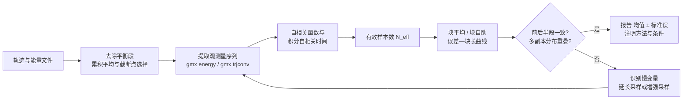
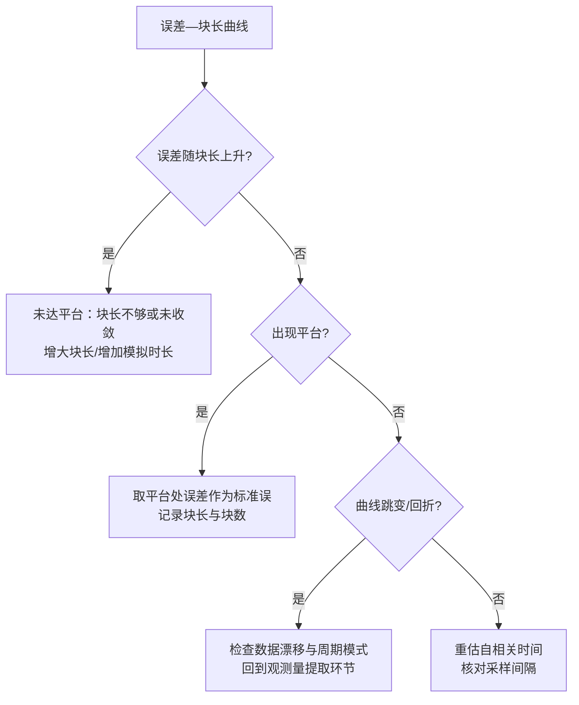

# 第 9 章 采样统计、误差与可复现性

第 5、6 章把体系带到稳定的生产运行并解决了运行期诊断，第 7 章给出轨迹量的常规计算，第 8 章进入自由能与增强采样。GROMACS 引擎的并行实现背景见软件论文[1]。本章回答另一类问题：从一段长度有限的轨迹中得到的平均值，其不确定性有多大；怎样判断延长轨迹能否带来实质性精度增益；以及一套结果能否被他人复查与重现。三者分别对应统计误差的估计、采样收敛性的判断与可复现性的落实，最终都落在方法学的报告规范上。有限采样意味着任意可观测量的样本均值都是随机变量：其分布宽度由轨迹的自相关结构决定，与能量文件或轨迹的输出频率无关。若把相邻帧当作独立样本，误差将被系统性低估，其严重程度取决于自相关时间与采样间隔之比。本章先建立遍历性与有限采样、自相关与有效样本数的概念，再给出块平均、自助法与误差传播三类误差估计工具，随后讨论分块一致性、多副本与慢变量三类收敛判据，接着把模型误差与统计误差分开处理，最后给出可复现性的落实清单与报告规范。本章所有软件行为与默认值均以 GROMACS 2026.4 官方文档为准[2]；误差估计与采样质量的方法学框架参照最佳实践文献[3]与综述[4]，方法要点引原始文献与经典教材[5][6]；凡属推断或惯例之处均在正文标明依据类型。第 3 章的 numpy 处理基础与第 7 章的分析流程是本章代码与例子的基础，第 10 章将进一步把本章的记录规范工程化。

## 学习目标

- 能解释遍历性假设在分子动力学中的含义，并列举采样不足在观测量分布、平均值与方差上的可检验表现。
- 能为给定观测量的时间序列计算自相关函数、积分自相关时间与有效样本数，并说明积分截断对结果的影响。
- 能独立实现块平均与适合相关数据的自助法（含块自助），绘制误差—块长曲线并判断是否达到平台。
- 能运用前后半段一致性、累积平均与多副本比较判断观测量是否收敛，并识别拖慢收敛的慢变量。
- 能区分统计误差与模型误差，判断延长采样能否改善计算结果与实验数据的符合程度。
- 能为一次模拟完成满足可复现要求的记录（输入文件、版本、种子、误差表述），并撰写符合本章报告规范的方法学描述。

## 前置知识

- 第 1 章的版本基线、单位与符号约定。
- 第 3 章的 numpy/pandas/matplotlib 数据处理基础。
- 第 6 章的稳态运行、日志与轨迹产出。
- 第 7 章的常规轨迹分析（RMSD、Rg 等）作为分析对象。
- 基础统计学：均值、方差、协方差、正态分布、置信区间。

## 遍历性与有限采样

### 遍历性的含义

分子动力学把牛顿方程离散化为一系列构型，其统计含义依赖于遍历性假设（ergodicity hypothesis）：在足够长的时间内，一条动力学轨迹对相空间的访问应当与系综平均等价。对平衡态系综，可观测量的系综平均定义为 ⟨A⟩_ens = ∫A(Γ)ρ(Γ)dΓ，其中 ρ(Γ) 为平衡分布；时间平均定义为 Ā = (1/T)∫₀ᵀ A(t)dt。遍历性假设断言两者在 T→∞ 时相等，分子动力学正是以此为前提，用有限长时间平均估计系综平均[5][6]。严格证明遍历性对真实高维体系并不现实，模拟实践接受的是准遍历性（quasi-ergodicity）的工程假设：只要轨迹在观测窗口内充分访问了可达相空间，时间平均即可作为系综平均的近似，其残差进入统计误差；若轨迹被势垒囚禁在某一亚稳盆地，时间平均将系统性偏向该盆地，残差不再是随机误差而是系统偏差。因此遍历性讨论的真正对象不是数学命题，而是「轨迹是否访问了应当访问的区域」，这一判断决定后续所有误差估计的解释方式。生物分子体系的统计物理与采样背景见教材[7]。控温控压等耦合算法只改变采样权重与动力学细节，不改变「时间平均估计系综平均」这一框架；温度由动能定义、压强含维里项等约定已在第 5、6 章给出，本章直接继承。

### 采样不足的表现形式

采样不足（undersampling）在可观测数据上有三类可检验表现。其一，平均值不收敛：把轨迹按时间分窗，窗口平均随窗口起点漂移，或累积平均持续朝一个方向移动，说明观测窗口内存在未完成弛豫的慢模式[8]。其二，分布特征异常：直方图出现意料之外的双峰或多峰；自由能面本身可以多峰，因此「双峰」不构成采样不足的证据，须结合模式间是否发生足够次数的转换来判断（教材共识）。其三，结果对初始条件敏感：从同一平衡态出发、仅更换随机种子的多条轨迹给出互不重叠的观测量分布，这是采样不足最直接的表现[3]。此外，势能与温度等快变量在困于亚稳盆地时仍呈现「正常」的统计涨落，快变量的平稳不能反推慢变量已收敛，这一区分贯穿整个「收敛判据」一节。Hess 对小型蛋白体系的早期研究表明，采样收敛的瓶颈在于慢自由度，轨迹长度需求远超快变量弛豫所需的时间（数值随体系与力场、版本变化）[8]。

### 有限轨迹下的统计推断

把轨迹上的 N 个时间点视为样本，样本均值 ⟨A⟩_N = (1/N)ΣᵢA(tᵢ) 是一个随机变量：重复模拟会给出围绕真实系综平均的分布。当样本近似独立时，中心极限定理给出其标准差（标准误）σ_⟨A⟩ = σ_A/√N，其中 σ_A 为瞬时涨落的标准差。这一公式有两个前提：样本独立、分布具有有限二阶矩。分子动力学产生的相邻样本高度相关，直接套用会低估标准误；若分布重尾，中心极限定理的收敛速度变慢，小样本下的误差估计本身带有噪声[5]。合理的统计推断流程因而是：先去除平衡段，再估计自相关时间与有效样本数，用块平均或适合相关数据的重抽样方法估计标准误，最后以「均值 ± 标准误」连同估计方法一并报告[3]。图 9-1 给出本章建议的完整流程，后续各节依次展开其中每个环节。



图 9-1　采样统计推断的工作流：误差估计与收敛判断交替进行，未通过一致性检验时回到采样环节（流程组织参照最佳实践文献[3]，收敛检验见本章「收敛判据」一节）

### 快慢模式的分离

体系的涨落由时间尺度不同的动力学模式叠加而成：键长与键角的振动、水分子的重排在皮秒量级；二面角扭转、侧链翻转在几十皮秒到纳秒量级；结构域相对运动、整体折叠或结合与解离过程可达微秒乃至更慢[4]。观测量的自相关时间是其各涨落模式自相关时间的加权平均，慢模式即使只贡献少量涨落幅度，也会显著拉长自相关函数的尾巴。以回转半径为例，其瞬时涨落包含水分子重排的快速分量，而长期漂移由整体形状弛豫这一慢分量主导，因此 Rg 的自相关时间可比键长振动长两到三个数量级（数值依体系与力场而定，教材共识）。分离快慢模式的意义是双重的：或者与分析阶段把观测量的慢分量显式识别出来（见「隐含慢变量的识别」一节），或者在采样阶段针对慢模式设计增强手段（见第 8 章）。当最慢相关模式的时间尺度与模拟时长接近时，基于单条轨迹的统计推断应被视为不可靠：误差估计只能给出「已观测部分」的精度，无法外推到未采样的区域[4]。

## 自相关

### 自相关函数的定义

对稳态（stationary）观测序列 A(t)，定义涨落 δA(t) = A(t) − ⟨A⟩，其中 ⟨A⟩ 为时间平均，则归一化自相关函数（autocorrelation function，ACF）为

$$c_A(\tau)=\frac{\langle\delta A(t)\,\delta A(t+\tau)\rangle}{\langle(\delta A)^2\rangle}$$

分子上的角括号表示按时间起点 t 的平均。c_A(τ) 满足 c_A(0)=1、c_A(−τ)=c_A(τ)、|c_A(τ)|≤1 三条性质，并在 τ→∞ 时趋于零；许多体系的自相关函数接近指数衰减 c_A(τ)≈exp(−τ/τ_A)，τ_A 称为相关时间（correlation time）[5][9]。自相关函数刻画的是「一个观测值在多大程度上携带了 τ 之前的信息」，它直接决定样本均值估计量的方差：若相邻样本完全独立，c_A(τ)≈0（τ≠0）；若强相关，则 |c_A(τ)| 在较长滞后上仍接近 1，有效独立样本数远小于帧数。第 7 章以工具形式用过 gmx analyze 计算的自相关输出，本节给出其统计语义，为误差估计提供依据。

从离散轨迹估计自相关函数时，用样本均值代替系综平均、按滞后 τ=kΔt 统计，其中 Δt 为采样间隔。自相关函数的估计质量依赖两个外部选择：数据点间隔必须远小于自相关的时间尺度，否则抽样混叠会扭曲峰值形状（官方文档对 gmx analyze 的明确提示[2]）；轨迹总长必须远大于自相关时间，否则长滞后处的自相关估计被噪声主导。

### 积分自相关时间

积分自相关时间（integrated autocorrelation time）定义为 τ_int = ∫₀^∞ c_A(τ)dτ。对指数衰减的自相关函数，τ_int = τ_A。积分自相关时间直接给出样本均值估计量的方差：对连续采样，Var(⟨A⟩) = (2τ_int/T)·Var(A)；对以间隔 Δt 离散采样、滞后按帧数计的情形，引入统计低效因子（statistical inefficiency）s = 1 + 2τ_int，其中 τ_int 以帧为单位，则方差为 Var(⟨A⟩) ≈ (s/N)·Var(A)[9][5]。τ_int 与 s 的引入把「样本均值不确定性」与「帧间相关性」定量联系起来，是本章所有误差估计方法共同的出发点。

参数四问——积分截断 τ_cut：τ_int 的数值积分需要截断上限。定义上 τ_cut 是时间（或帧数）量纲的滞后上限；为何需要：c_A(τ) 在长滞后处被噪声主导，直接积分到无穷会把噪声算进 τ_int；推荐取值：取 c_A(τ) 首次穿过零、或首次落入明显噪声平台的滞后（教材共识，实践中常取 2–10 倍估计的 τ_int 并检验结果对截断的稳健性）；取值不当的后果：截断过早会低估 τ_int，进而高估有效样本数、低估误差；截断过晚会把长尾噪声积分进去，使 τ_int 随窗口长度漂移。稳妥做法是改变截断重复计算，若 τ_int 变化超过其自身估计的数十个百分点，说明轨迹长度不足以可靠估计 τ_int。

仅当自相关函数以单一指数衰减时，截断才是唯一确定的；对一般序列，τ_int 的数值依赖截断方式与截断位置，因此应把 τ_int 当作估计量——其自身相对不确定度的数量级为 δτ_int/τ_int ≈ √(2τ_int/T)（T 为轨迹总长；对近指数相关尾的经典估计见文献[10]）。这一关系式的直接推论是：当 T 只是 τ_int 的几十倍时，τ_int 的相对误差已在 10%–20% 上下，误差棒的「误差」本身不再稳定；此时若改变截断，τ_int 的漂移通常会超过自身不确定度，一条轨迹不足以可靠估计积分自相关时间[10]。与截断选择配套的可复核做法是窗口化积分（windowed integration）：把积分上限视为窗口宽度 W，画出 τ_int(W) 随 W 的曲线，取使 τ_int(W) 进入平台的最小 W 作为截断[10]，这比任意选定「2–10 倍 τ_int」更可复核。除截断位置外，两类系统偏置同样影响 τ_int 的估计：其一，用样本均值代替系综平均计算 ACF，会在长滞后处引入约 O(τ_int/N) 量级的系统负偏，使 ACF 在真实过零之前就贴向零，表现为「伪过零」（pseudo-zero-crossing），导致「首次过零」截断系统性提前、τ_int 偏低[10]；其二，对压力、应力、速度自相关等过零后带明显负长尾或振荡的观测量，首次过零截断会严重低估 τ_int，此时应以尾部拟合后的解析积分（gmx analyze 的 -fitfn exp_exp，见「自相关时间的数值估计」一节）或窗口化积分代替首次过零截断（判据为教材共识，出处见文献[2][10]）。

### 有效样本数

有效样本数（effective number of samples）定义为 N_eff = N/s = N/(1+2τ_int)，其中 N 为原始帧数、s 为统计低效因子[9]。N_eff 的意义是：这段轨迹在统计意义上等价于 N_eff 个独立样本。标准误据此修正为 σ_⟨A⟩ = σ_A/√N_eff。当 τ_int 远大于采样间隔（例如输出间隔 1–2 ps 而 τ_int 达纳秒）时，N_eff 可以比 N 小两到三个数量级，这是「相邻帧不独立」在数值上的后果；最佳实践文献把报告 N_eff（或等效地报告 τ_int 与采样间隔）列为误差报告的必要项[3]。

数值案例——用一组示意数字感受量级：设输出 1.0×10⁶ 帧势能序列、采样间隔 2 ps，由自相关分析估计 τ_int = 1.2 ns（即 600 帧），则 s = 1+2×600 = 1201，N_eff ≈ 10⁶/1201 ≈ 8.3×10²——看似 10⁶ 个样本实为约 830 个有效独立样本，独立样本公式给出的标准误被低估 √1201 ≈ 35 倍（近一个半数量级；数值为示意，τ_int 依体系与采样间隔而定，估计框架见文献[9][3]）。

与有效样本数相关的实用操作是子采样（subsampling）：以间隔 ≥2τ_int（有文献建议更大倍数）抽取帧，所得子序列近似独立，可安全套用独立样本公式。子采样只用于简化统计，不增加信息量。实践中可以借助 gmx trjconv -dt 按时间间隔抽取帧[11]，间隔参数按 τ_int 换算；更稳妥的做法是不丢帧、直接用块平均（见「块平均」一节）处理相关序列，因为块平均等价于在块尺度上做子采样且无需选择抽帧间隔。

### 自相关时间的数值估计

GROMACS 的 gmx analyze 提供自相关函数的直接计算：-ac 输出归一化自相关函数（默认先减均值，-subav；ACF 长度默认取总帧数一半，-acflen）[2]。官方文档同时提醒，数据点间隔必须远小于自相关的时间尺度，否则估计失真[2]。对长尾自相关函数，数值估计 τ_int 的常见做法是将 c_A(τ) 拟合为单指数或双指数之和再解析积分（gmx analyze 的 -fitfn 选项提供 exp、exp_exp 等拟合函数），或按「首次过零」截断后用梯形积分[2]。下面是等价的 Python 参考实现，直接对 xvg 格式的序列计算归一化自相关与积分自相关时间：

```python
# 平台：任意（Python 3.12 + numpy 2.x）；输入为 gmx 导出的两列 xvg（时间、观测值）
import numpy as np

def read_xvg(path):
    rows = []
    with open(path, encoding="utf-8") as f:
        for line in f:
            s = line.strip()
            if s and not s.startswith(("#", "@")):
                rows.append([float(x) for x in s.split()])
    a = np.array(rows)
    return a[:, 0], a[:, 1]

def autocorr(x):
    x = x - x.mean()
    n = len(x)
    # 直接算法，n 较小时可用；大序列宜用 FFT 加速
    c = np.array([np.dot(x[: n - k], x[k:]) for k in range(n)]) 
    return c / c[0]

def tau_int(c, dt=1.0):
    # 积分到首次过零；离散梯形积分
    c = c[1:]                      # 去掉 τ=0 点，避免把 c(0)=1 计入积分
    idx = np.where(c <= 0)[0]
    cut = idx[0] if len(idx) else len(c)
    return np.trapezoid(c[:cut], dx=dt)

t, a = read_xvg("potential.xvg")
c = autocorr(a)
print("tau_int (帧) =", tau_int(c))          # 按帧计，乘采样间隔得物理时间
print("N_eff        =", len(a) / (1 + 2 * tau_int(c)))
```

输出数值为示意，随体系、力场与采样间隔变化。需要说明的是，信号越长、滞后越远处自相关估计的方差越大，τ_int 的估计应视为带有不确定性的量而非精确常数，其量级见「积分自相关时间」一节的估计式[10]。

上述手写实现与 pymbar.timeseries 模块直接对应——pymbar 是 MBAR 估计器的参考实现库（「误差传播」一节的估计器与之同源），其 timeseries 子模块专为相关数据处理而写，官方文档明示：MBAR 方法仅适用于不相关样本，故提供若干工具对模拟数据解相关[12]。其中 statistical_inefficiency 按 g = 1+2τ 估计统计低效因子（可选 FFT 加速），integrated_autocorrelation_time 估计积分自相关时间，detect_equilibration 实现自动化平衡段检测（返回平衡起点 t0、低效因子 g 与最大有效样本数 Neff_max），subsample_correlated_data 按 g 抽取近似独立的子样本[12]。这三件套（去平衡、低效因子、子采样）与「分块一致性检验」一节的 Chodera 方法对应；同行实践建议以 pymbar.timeseries 取代自写代码，并以手写实现作交叉核对：同一序列上两者给出的 s 与 N_eff 应一致，不一致时优先排查截断与去均值口径（官方文档见文献[12]）。

## 误差估计

### 块平均

块平均（block averaging）是估计相关数据标准误的标准方法：把长度为 N 的序列切成 M 个连续块，每块长 L=N/M，计算块均值 B_i，当 L 远大于积分自相关时间时，各块均值近似独立，于是样本均值的方差可估计为

$$\sigma^2_{\langle A\rangle}\approx\frac{1}{M(M-1)}\sum_i (B_i-\langle B\rangle)^2$$

即块间方差除以 M。该方法由 Flyvbjerg 与 Petersen 在考虑自相关的重正化群意义上给出系统论证[13]，是分子模拟误差估计的原始文献之一。若块长不足（L 与 τ_int 同量级），块均值间仍相关，上式低估误差；块长过大则 M 太小，估计本身噪声大。标准用法是画「误差—块长」曲线：块长从 1 开始成倍增加，误差先随块长上升（未达独立），再进入平台（此时视为真实误差），块长继续增大后退化的估计噪声使曲线波动。把平台值对应的误差作为报告值是块平均的默认口径[13][14]。

低估程度可以定量化：设块长 L 下的统计低效因子为 s_L = 1+2Σ_{k=1}^{L−1}(1−k/L)c(k)，则块平均估计的方差与真实方差之比为 γ² = s_L/s，其中 s = 1+2τ_int 为全序列低效因子[13]；对近指数相关的序列，块长不足时的误差低估因子约为 √(L/(1+2τ_int))（L≪τ_int 的极限），例如 L = τ_int/2 时误差约低估 40%–50%[10]。这一量级关系把「块长必须 ≫τ_int」从定性要求变成可核验的数量级，也使未经平台判定的块平均误差有了可估计的下限（推导为教材级标准结果，出处见文献[13][10]）。

参数四问——块长 L：定义上 L 是每块包含的连续帧数或对应时间长度；为何需要：L≫τ_int 是块间独立性的前提，也是块平均正确的唯一关键假设；推荐取值：取误差—块长曲线平台出现后能够稳定复现的最小块长（教材共识，实践中常取 L ≈ 5–10 倍 τ_int 起步并按倍倍增扫描）；取值不当的后果：L 过小系统性低估误差，L 过大则块数太少、误差估计自身的波动显著。GROMACS 的两个工具内置块平均：gmx analyze -ee 输出误差—块长曲线并叠加双指数解析拟合，其解析形式出自 Hess 对块平均方差的推导[14]；gmx energy 在交互式统计输出中直接给出基于 5 块的块平均误差（可用 -nbmin/-nbmax 改变块数范围）[15]。两者都要求输入点等间距，且 gmx energy 的统计基于能量文件中按 MD 步累积的全精度平均，直接对输出的 xvg 序列重算统计会损失这部分精度[15]。

以下为等价的 Python 块平均实现（对无量纲化或任意单位的序列均可）：

```python
# 平台：任意（Python 3.12 + numpy）；x = 一维观测序列（已去除平衡段）
import numpy as np

def block_average(x, L):
    n = len(x) - len(x) % L
    b = x[:n].reshape(-1, L).mean(axis=1)   # 块均值
    return b.mean(), b.std(ddof=1) / np.sqrt(len(b))

def error_vs_block(x, Lmax=None):
    L = 1
    out = []
    while L <= (Lmax or len(x) // 4):
        m, se = block_average(x, L)
        out.append((L, se))
        L *= 2
    return np.array(out)

# 用法：err = error_vs_block(series); 画 log2 块长 vs 误差，取平台
```

方法学评注——合成数据自校验是检验上述实现的标准动作：构造一阶自回归（AR(1)）序列 x_t = ρx_{t−1} + ε_t（设自相关系数 ρ = 0.9），其积分自相关时间有解析解 τ_int = ρ/(1−ρ) = 9 帧、统计低效因子 s = 1+2τ_int = 19。在该序列上运行块平均代码，平台处标准误应满足 SE_plateau²·N/σ_x² ≈ 19（σ_x 为序列标准差）；反向使用该式即得 τ_int 与块平均平台的交叉核对处方——把平台误差、样本数 N 与观测方差 σ_A² 代入 SE_plateau²·N/σ_A² ≈ 1+2τ_int，若左侧显著偏离自相关口径的 s，说明两套估计互相矛盾，应回头检查截断、去均值或块长扫描的细节（判据为教材共识，块长以 τ_int 为依据见文献[3]）。

误差—块长曲线的解读按图 9-2 的判定树进行：曲线持续上升（误差随块长亚线性增长、尚未达到独立块长）表示样本未收敛或块长不足；出现平台则取平台值，并把平台误差代入 SE_plateau²·N/σ_A² ≈ 1+2τ_int 与自相关口径互相印证（见上一段的自校验评注）；平台判定可设经验阈值——相邻两块长（倍增一档）的误差相对变化小于约 5%，且再倍增一档仍保持稳定，即视为进入平台（阈值属教材共识，具体数值随数据而定）；曲线出现非单调跳变通常是数据含漂移或块长与周期模式共振，需回到数据检查[13]。



图 9-2　误差—块长曲线的解读流程：平台的出现是块平均成立的经验判据（判读过程参照文献[13]与官方工具说明[2]，具体阈值随数据而定）

案例解剖——gmx energy 内建误差与自行重算不一致时信任哪个。同一批能量数据，gmx energy 交互式统计输出的块平均误差与对导出的 xvg 序列自行块平均得到的误差可能不同，差异来源有三：其一，平均口径——能量文件按 MD 步累积全精度平均，向统计输出提供更密的等效样本，xvg 每输出帧仅一次采样；其二，块数与误差公式——gmx energy 内建块平均默认 5 块并按全精度平均计算误差（可用 -nbmin/-nbmax 改变块数范围），自行扫描块长则是另一套口径；其三，等间距与导出精度——xvg 导出经插值或舍入后可能破坏等间距假设与帧级精度，而两种块平均都要求输入点等间距[15]。结论按观测量类型取舍：能量类量（势能、温度、压力）以 gmx energy 内建口径为准；非能量导出的观测量（如回转半径）无法用内建统计，须自行块平均并在报告中写明块长与块数[15][3]。表 9-2 汇总了相关工具的统计口径。

### 自助法与刀切法

自助法（bootstrap）与刀切法（jackknife）是两类不依赖分布假设的重抽样方法。刀切法由 Quenouille 提出：每次从样本中剔除一个观测，用剔除后的统计量与原统计量的差来估计偏差与方差[16]；自助法由 Efron 提出：从原始样本中有放回地抽取与原样本等长的重样本，重复 B 次，用重样本统计量的分布直接给出置信区间[17]。两者对独立同分布样本的性质已有完整理论，分子模拟中更常用自助法，因为它能直接输出非对称置信区间与整条分布。

自助法应用于相关数据时必须改造：对轨迹帧直接重抽样会破坏时间结构，重样本之间的相关性被误当作样本间独立性，置信区间会系统性偏窄。正确做法是块自助（block bootstrap）：以块（长度取 ≳ τ_int）为单位有放回抽样，再拼接成重样本。参数四问——重抽样次数 B：定义上是自助重样本个数（无量纲整数）；为何需要：B 决定置信区间估计的稳定性与百分位分辨；推荐取值：日常分析取 B=1000 足以给出稳定区间，正式发表建议 B=10⁴（教材共识，随所需百分位精度调整）；取值不当的后果：B 过小时区间端点抖动明显、不可复现，B 过大仅增加计算时间而不改变区间（不产生额外偏差）。块自助中块长的选取与「块平均」一节相同，均以 τ_int 为依据[3]。块自助的形式化始于 Künsch 对一般平稳序列的推广[18]；时间序列统计中对最优块长有随序列长度 N 增长的标度理论（方差估计口径下最优块长约按 N^{1/3} 增长），分子模拟界则以 τ_int 的倍数作为工程惯例——两者目标一致：使块内完整覆盖相关结构，块长不足都会令置信区间偏窄（标度关系为时间序列文献结果，教材共识）[18]。还需说明，自助法估计的是「抽样波动」，不能纠正系统偏差（例如未去除平衡段带来的偏差），因此重抽样之前的数据清洗（去平衡、去漂移）不可省略[17][3]。

### 误差传播

当目标量是多个观测量的函数 f(A,B,…) 时，其方差由误差传播（error propagation）给出。对独立的 A、B，近似有

$$\sigma^2_f\approx\left(\frac{\partial f}{\partial A}\right)^2\sigma^2_A+\left(\frac{\partial f}{\partial B}\right)^2\sigma^2_B$$

当观测量之间存在相关性（分子模拟中很常见），须加入协方差项：σ²_f = gᵀΣg，其中 g 为梯度、Σ 为观测量的协方差矩阵，Σ 的估计同样要考虑自相关（教材共识，见文献[3]对协方差项的处理建议）；实用处方是把 A、B 两序列按同一块长分块，用各块均值序列的样本协方差作为 Σ 的估计——块长与「块平均」一节同平台时，该估计即考虑了自相关的协方差矩阵（教材共识）。实践中两个典型场景：其一，自由能差的估计，热力学积分（TI）把 ΔA 写成 ∫⟨∂H/∂λ⟩dλ 的积分[19]，误差来自每个 λ 点被积函数的统计误差沿 λ 方向传播，各点样本又相互独立，可直接用分点误差积分；其二，指数平均（FEP）形式 ΔA = −k_BT·ln⟨exp(−ΔU/k_BT)⟩₀[20]，其误差由指数被积函数的重尾决定，小样本下对数与指数运算都会放大偏差。Bennett 接受比（BAR）与多态 Bennett 接受比（MBAR）估计器直接给出自由能差及其统计不确定性的估计[21][22]，无需手工误差传播；MBAR 还提供任意热力学期望值的不确定性[22]，但该不确定性以各态样本先去相关（子采样或块化）为前提——pymbar 官方文档明确 MBAR 方法仅适用于不相关样本，直接喂入相关轨迹会低估自由能误差[12]。还需注意一阶误差传播的失效边界：目标量为 exp、log、倒数等强非线性函数时，一阶展开不捕获 Jensen 偏差（FEP 指数平均即典型），应改用重抽样方法直接估计目标量的分布（教材共识，重抽样见「自助法与刀切法」一节）。对这类专用估计器，手工误差传播只适合作为数量级核对，正式结果应以估计器内置误差为准（文档推定，依据估计器理论性质）。

### 误差估计方法的选择准则

不同方法对相关数据的假设与适用条件不同（表 9-1）。选择顺序建议：先计算自相关时间与 N_eff；若 τ_int 小于总时长的百分之一，块平均即可；若需要置信区间或目标量是观测量的非线性函数，用块自助；若需估计偏差（如小样本下的非线性量），用刀切或自助。任何方法都不得越过「去除平衡段」与「确认序列近稳态」两个前置步骤[3][13]。

表 9-1　误差估计方法对照

| 方法 | 对相关数据的假设 | 输出 | 适用情形 | 主要局限 |
| --- | --- | --- | --- | --- |
| 块平均 | 块长 ≫ τ_int 后块均值独立 | 标准误（点值） | 均值类量的常规误差估计 | 无分布信息；需手动判定平台 |
| 刀切法 | 剔除一个样本影响可忽略 | 偏差与方差估计 | 小样本偏差校正 | 对相关数据需块化，理论弱于自助 |
| 自助法（独立样本） | 样本独立同分布 | 置信区间、整条分布 | 独立数据上的任意统计量 | 直接用于轨迹帧会低估误差 |
| 块自助 | 块长 ≫ τ_int 后块独立 | 置信区间 | 相关数据上的任意统计量 | 块长选择影响结果，需与 τ_int 匹配 |

表 9-2　GROMACS 中与采样统计相关的常用工具（版本：2026.x，以 2026.4 文档为准）

| 工具（选项） | 功能 | 统计口径 | 注意事项 |
| --- | --- | --- | --- |
| gmx energy 统计输出 | 平均值与误差估计 | 基于能量文件内全精度平均的块平均，默认 5 块，-nbmin/-nbmax 改变块数 | 比直接对导出序列重算更准；误差基于块平均[15] |
| gmx analyze -ac | 归一化自相关函数 | -subav 先减均值；-acflen 默认 ACF 长度取半帧数 | 输入点须等间距；点间隔须远小于自相关尺度[2] |
| gmx analyze -ee | 块平均误差—块长曲线 | 块间方差公式 + 双指数解析拟合 | 解析式出处为 Hess 2002[14]；同样要求等间距输入[2] |
| gmx trjconv -dt | 按时间间隔子采样 | — | 用于抽近似独立帧，间隔按 τ_int 换算[11] |

## 收敛判据

### 分块一致性检验

分块一致性检验（split-half consistency check）把轨迹按时间切成前后两半（或多个连续窗口），比较两个半段上可观测量的估计是否在统计误差内一致。操作上：对每一半分别计算均值与标准误（用「块平均」一节的平台误差），若两均值之差小于两倍合并标准误（2×√(SE₁²+SE₂²)，两半近似独立时的合并标准误），判为前后一致；该判据是正态近似下的启发式，等价于 z 检验，对相关数据与重尾分布只是近似[3]。再进一步比较两半的分布（直方图重叠程度），因为均值一致并不保证分布一致（例如前后半段各占一个亚稳态、平均值恰好相同）。Lyman 与 Zuckerman 提出以子空间重叠度量前后半段采样的一致性，其思想是把两半轨迹分别做主成分分析，比较前 m 个主成分张成的子空间的重叠度[23]；GROMACS 参考手册在协方差分析一节建议用前后两半的采样重叠检验主模是否定义良好，且两半须用同一参考结构拟合[24]。需要区分两个度量：文献[23]的子空间重叠按两半主成分特征向量张成空间计算，GROMACS 手册的采样重叠则是按协方差矩阵平方根定义的标量（手册式 469），两者含义与取值不同，报告中须注明采用哪一个[23][24]。累积平均（cumulative average）是分块一致性的连续版：随时间推进把均值重算一次，画出累积平均值随轨迹长度的变化；若曲线在误差带内趋于平稳，表明窗口平均已稳定。Chodera 给出一种自动化的平衡段截断方法：在给定时长内选择截断点，使保留段的有效样本数（由其自相关时间决定）最大化，从而客观地决定丢弃多少初始段[25]；该方法的 Python 落地即「自相关时间的数值估计」一节所述的 pymbar.timeseries.detect_equilibration[12]。

以下用 MDAnalysis 载入轨迹，计算蛋白回转半径序列并做前后半段均值比较（作为参考实现；MDAnalysis 用法见其引用文献[26]）：

```python
# 平台：Linux（bash）/ Windows（PowerShell）；Python 3.12；依赖 numpy、MDAnalysis 2.x
# 安装示例：pip install numpy MDAnalysis
import numpy as np
import MDAnalysis as mda

u = mda.Universe("topol.tpr", "traj_comp.xtc")     # 拓扑与压缩轨迹
prot = u.select_atoms("protein")
rg = np.array([prot.radius_of_gyration() for ts in u.trajectory])
n2 = len(rg) // 2
def block_se(x, L):
    n = len(x) - len(x) % L
    b = x[:n].reshape(-1, L).mean(axis=1)
    return b.std(ddof=1) / np.sqrt(len(b))
se = max(block_se(rg, L) for L in (100, 200, 400))  # 取多块长中的保守估计（示意）
m1, m2 = rg[:n2].mean(), rg[n2:].mean()
print(f"前半 {m1:.3f} ± {se:.3f}  后半 {m2:.3f} ± {se:.3f}  差值/SE = {(m1-m2)/se:.2f}")
```

输出为示意。差值显著（大于 2–3 倍 SE）时判定不一致，应回到「快慢模式的分离」一节定位慢变量的来源。

### 累积平均与收敛曲线

累积平均（cumulative average）是分块一致性的逐点版：定义 Ā(t) = (1/t)∫₀ᵗ A(t′)dt′。当采样收敛时，Ā(t) 在统计误差内趋于水平；当体系未平衡或被困慢模式时，Ā(t) 持续漂移。收敛曲线（convergence plot）把 Ā(t) 及其误差带（例如 ±2σ_⟨A⟩(t)）随时间画出，是判断「平均值的稳定性」的直观工具[25]。Chodera 的截断点选择方法直接利用这一图像：在给定时长内搜索截断点 τ*，使 (T−τ*) 段上的有效样本数最大，从而同时完成平衡段去除与生产段长度选择[25]。累积平均平稳只是必要条件而非充分条件：慢模式若在窗口中只完成一次转换，平均值也可能看似平稳——这正是「分块一致性检验」与「多副本比较」要继续检查的原因。累积平均曲线本身不提供收敛的证明，只排除明显未收敛的情形（教材共识，见文献[3]对收敛判据的讨论）。

### 多副本比较

多副本（replicas）指从同一平衡态出发、仅初始条件或随机种子不同的多条独立轨迹。多副本比较（replica comparison）的基本判据：各副本的可观测量分布应当一致，副本间均值的散布应当在合并统计误差之内。若某副本的分布明显偏离其余副本，说明该副本被囚禁在未充分关联的亚稳区域，或者初始条件并未真正随机化。参数四问——副本数 n：定义上 n 是独立轨迹条数（无量纲）；为何需要：单条轨迹只有一个实现，无法区分「随机涨落」与「系统差异」，n 条轨迹给出 n 个实现的散布，是分布级收敛检验的数据基础；推荐取值：常规分子性质至少 3 条，涉及慢构象过程的体系建议 5 条或更多（教材共识，数值依体系与测试性质而定）；取值不当的后果：n 过小则个别副本的异常无法识别，n 过大则浪费机时——副本数的收益随 n 增大而递减（误差按 1/√n 下降）。运行多副本的工程做法：每条副本一套目录（或用 mdrun -multidir 一次启动多条，见官方 mdrun 功能说明[27]），初始速度用不同 gen_seed 生成（见「随机种子与并行不确定性」一节），平衡协议保持一致。比较对象既可以是均值，也可以是完整分布：对分布做重叠度或适合的假设检验，比仅比较均值更严格（教材共识）。副本一致后，最终报告值按逆方差加权合并：⟨A⟩_pool = ΣᵢwᵢAᵢ/Σᵢwᵢ，权重 wᵢ = 1/SEᵢ²，合并标准误 SE_pool = 1/√(Σᵢ1/SEᵢ²)，其中 SEᵢ 为第 i 条副本的块平均标准误；副本间均值的散布若显著大于 SE_pool，说明副本未收敛或一致性假设不成立（逆方差合并为教材级标准结果）。功效上还需明确：常规 3 条、慢过程 5 条的经验值给出的是异常检测的覆盖度，多副本一致不足以证明分布级收敛——收敛结论仍以分块与慢变量判据为准[3]；现代研究还系统演示过，以单次模拟考察盒尺寸等系统参数的影响容易把采样涨落误读为真实趋势，重复次数足够时才可区分样本间差异与系统效应[28]。

### 隐含慢变量的识别

隐含慢变量（hidden slow variables）指在观测量之外、支配体系弛豫时间尺度的坐标，例如蛋白质的主链二面角、结构域间距离、配体结合口袋的开合度。识别慢变量的标准工具是主成分分析/本质动力学：以质量加权坐标协方差矩阵的前若干主成分作为集体坐标，第 i 个主成分的涨落幅度由其本征值给出[29][24]。协方差分析输出的本征值谱若呈双指数/幂律衰减，前几个主成分可能对应体系的主要慢模式；一个常用的诊断量是余弦含量（cosine content）：把主成分时间序列投影到余弦基，若前几个主成分的余弦含量接近 1，说明这些模式的行为与自由扩散无异——体系并未在势能主导的盆地之间采样，而是做无结构的随机游走，这强烈提示采样不足[24][8]。另一个诊断是「第一与第二主成分是否近似半个与一个余弦周期」——GROMACS 官方手册据此判断所谓主模可能是噪声而非真实运动，并建议用前后半段子空间重叠来核实主模的稳定性[24]。识别出的慢变量应当被记录、并在报告中说明其是否已收敛；若未收敛，常规 MD 的其余结论都应附加这一保留条件。

上述本质动力学与余弦含量把「方差最大」当作慢方向，但高方差方向未必是慢方向。现代标准做法是时间滞后独立成分分析（time-lagged independent component analysis，tICA）：它把「最大化慢度」化作广义本征值问题——在给定序参量集合上求取使时间滞后协方差与瞬时协方差之比最大的线性组合，由构象动力学的变分原理可证该组合给出最优慢子空间，输出成分按隐含时间尺度（implied timescale）排序[30]。与 PCA 的关键差异在于 tICA 显式引入时间滞后，直接优化慢度而非方差，因此能识别 PCA 错过的慢模式；其输出可作为马尔可夫状态模型（MSM）的输入特征，与第 8 章的 MSM 工作流衔接，实现由 PyEMMA 或 msmbuilder 提供（PyEMMA 用法见第 11 章）。对识别出的慢坐标，宜以隐含时间尺度曲线判断收敛：把 tICA 特征值换算为隐含时间尺度并随滞后时间作图，曲线趋于平台说明相应慢过程已收敛，持续上升则说明采样仍不足——这与「累积平均平稳仅是必要条件」的告诫一致[30]。余弦含量应视为启发式指标：它对预处理（去平动/转动、以参考结构拟合）敏感，低维投影下存在假阳性，宜与慢坐标隐含时间尺度的平台化及前后半段子空间重叠交叉验证，而非单独充当绝对判据[24][30]。

### 自由能估计的收敛

涉及自由能差与势能面的统计结论有专门的一致性要求。伞形采样结合 WHAM 重构势能面时，相邻窗口直方图必须有充分重叠，重叠不足表示相邻窗口的真实分布不相接、重构失真[31]；WHAM 的收敛速度与误差还与窗口位置、窗口数及每窗口时长相关，Zhu 与 Hummer 系统考察了 WHAM 的收敛性与误差估计，提出以自一致迭代中的残差评价收敛程度[32]。对一类直方图估计器，报告误差时应同时给出统计误差（来自块平均或自助）与迭代收敛残差（来自估计方程的自洽程度）[32]。热力学积分与 BAR/MBAR 的收敛判据（λ 点间充分重叠、误差随样本数按 1/√N 下降等）与第 8 章的自由能计算内容衔接，本章只强调其统计口径：任何自由能差都必须带误差报告，且误差必须来自与数据相关性相容的估计器[21][22]；TI/FEP 至少应检验误差随样本数按 1/√N 下降（把生产段翻倍看误差是否约减半），这是收敛的最低证据（教材共识，最佳实践建议见文献[3]）。

## 与实验的比较

### 可观测量的对应

模拟结果与实验对照的前提是两者定义同一个可观测量的同一种平均方式。模拟给出系综平均（或时间平均）⟨A⟩，实验往往给出另一权重下的平均值：例如 NOE 观测的是 ⟨r⁻⁶⟩ 的某种统计形式，而不是 r 或 r² 的简单平均；转动相关时间来自时间相关函数在实验频率窗口的积分；20 种残基的化学位移是构象系综的玻尔兹曼加权平均。反算观测量（back-calculation）应在系综层按实验算符加权平均——NOE 距离按 ⟨r⁻⁶⟩⁻¹/⁶、化学位移按玻尔兹曼权重——再连同实验误差一起纳入 χ² 判据（教材共识；平均方式讨论见文献[33]）。因此「结构量（如 RMSD 或 Rg 与实验半径比较）」看起来直观，实际却受平均方式与实验定义的双重限制，van Gunsteren 与 Mark 针对这一主题总结了模拟与实验对照的系统性注意事项[33]。在分子模拟语境中，可与之比较的观测量典型包括：热力学量（密度、膨胀率、热容，来自涨落关系）、动力学量（扩散系数、旋转相关时间、氢键寿命）、结构量（Rg 与 SAXS 对照、距离分布与 FRET 对照）与结合自由能（与量热或抑制常数换算的 ΔG 对照）。结合自由能是模型误差最敏感的一类观测量，MM-PBSA 一类以连续介质近似水溶剂的方案在统计误差之外还叠加了模型近似，其与实验的偏差主要来自模型而非采样[34]。

### 实验条件的匹配

对照前必须核对实验条件与模拟条件的对应：温度与压力（实验的 T、p 与模拟的 ref-t、ref-p）、盐浓度与离子强度（模拟盒中离子的数密度换算）、pH 与质子化态（实验 pH 下的质子化构型是否与模拟拓扑一致）、共溶物浓度（模拟盒尺寸有限，浓度误差随盒变小而增大）。动力学量还需注意有限尺寸效应：扩散系数在小周期性盒中被高估，须用大盒或尺寸修正。对自扩散系数，Yeh 与 Hummer 给出解析修正：D_∞ ≈ D_PBC + k_BT·ξ/(6πηL)，其中 D_PBC 为周期盒模拟的扩散系数、η 为溶剂剪切黏度、L 为盒边长，立方盒取 ξ ≈ 2.837（非立方盒需按水动力学张量推广）[35]；对水等简单体系，该修正可定量消除扩散系数的有限尺寸依赖（数值依体系与黏度取值而定，见文献[35]），而对含大溶质的体系（如蛋白水溶液），表观盒依赖还来自自由水体积的变化，须另行评估（讨论见文献[28]）。旋转相关时间受盒尺寸与溶剂黏度耦合影响。van Gunsteren 与 Mark 强调，只有当模拟的可观测定义、热力学状态与实验严格对应时，对照才有意义[33]。若模拟只有单条轨迹而实验是长时间平均，需在报告中标明这一不对称性（教材共识，讨论见文献[33]）。

### 模型误差与统计误差的分离

总偏差（模拟均值 − 实验值）可分解为模型误差（力场、水模型、截断、近似算法引入的系统偏差）、统计误差（有限采样引入）与实验误差（测量与数据处理引入）。定量判据是比较 |⟨A⟩_sim − A_exp| 与 σ_tot = √(σ_stat² + σ_model² + σ_exp²)：偏差超出约两倍 σ_tot 说明模型或实验口径至少一项未匹配；σ_model 通常只能给出量级估计，因此 σ_tot 本身是近似量（教材共识，框架见文献[33][3]）。分离二者的可操作判据：若延长采样后统计误差缩小而偏差不变，偏差即模型误差；若统计误差已小于模型误差，进一步延长采样无助于改善与实验的符合。实践中有三个步骤：其一，把统计误差减到实验误差以下，观察剩余偏差是否稳定；其二，换用力场（或水模型）重复，看偏差是否随力场变化——模型误差对力场选择敏感；其三，用多副本确认偏差不随种子变化。若偏差远大于统计误差且含系统结构，应回到力场选择与建模决策（第 4 章）而非继续累积采样（教材共识，方法框架见文献[33][3]）。

## 可复现性

### 影响结果的因素清单

可复现性（reproducibility）要求在一份完整记录下，另一个人（或另一台机器）能重建同一套结果。影响分子模拟结果的因素分为四层：输入层（力场及其确切版本、水模型、坐标来源、质子化态、离子浓度）、计算层（截断与长程方法、约束、时间步、控温控压方案与参数、邻域搜索与 PME 网格）、执行层（GROMACS 版本与编译选项、SIMD 指令集、GPU 型号、并行划分、随机种子）与分析层（分析工具版本、拟合与误差估计参数）。表 9-3 给出记录清单。GROMACS 官方文档「管理长模拟」一节说明：检查点续算在相同代码、编译器、架构、进程数与不使用 GPU 的前提下是二进制精确的；否则结果会逐位不同但仍为合法采样[36]。

表 9-3　影响结果的因素与记录要求（记录规范参照十项规则[37]整理）

| 因素 | 影响途径 | 记录要求 |
| --- | --- | --- |
| 力场与版本 | 势函数形式与参数 | 力场全名与版本、参数文件哈希 |
| 水模型与离子 | 溶剂性质与相互作用 | 水模型名称、离子种类与浓度 |
| 输入坐标与拓扑 | 起始结构与建模 | 坐标文件、pdb2gmx 日志、拓扑文件 |
| 截断/长程/约束/步长 | 数值结果细节 | 对应 mdp 参数（或 mdout.mdp） |
| 控温控压方案 | 系综与涨落统计 | tcoupl/pcoupl、tau-t/tau-p、ref-t/ref-p |
| 随机种子 | 初速度与随机数流 | gen_seed 取值 |
| GROMACS 版本与编译 | 算法实现与精度 | 版本号、编译选项、md.log 头部 |
| 硬件（CPU/GPU/SIMD） | 舍入与非确定性 | 处理器型号、GPU 型号、并行配置 |
| 分析工具与版本 | 分析结果 | 工具名与版本、分析脚本 |
| 误差估计参数 | 误差数值 | 块长、重抽样次数、截断点方法 |

### 记录规范

记录的目标是让一次模拟可被重新执行并被核查。最小记录集包括：输入文件（topol.top、坐标、mdp、索引）、生成 tpr 的命令与 grompp/mdrun 输出日志、环境信息（GROMACS 版本、编译选项、依赖库版本）、随机种子、以及物理条件（温度、压力、时长、副本数）。GROMACS 的 grompp 会把实际解析后的参数写入 mdout.mdp，md.log 头部记录版本与构建信息，这两份文件的归档即可覆盖计算层的多数信息（文档推定，依据 grompp 与 mdrun 输出行为，见第 6 章）。作业脚本、module 列表与机器档案（CPU、GPU、BIOS 差异）也应记录，因为并行划分与硬件直接决定逐位结果。十项规则（Ten simple rules for reproducible computational research）给出通用方法论：所有程序与脚本纳入版本控制、记录所有运行的准确执行环境、归档原始数据与结果、把分析做成脚本而非交互操作、避免手工编辑中间文件[37]。记录应随模拟同步进行而非事后补写；第 10 章将把这里的记录规范固化为任务目录约定与自动化流程。

### 数据与代码归档

归档分三档：原始数据（轨迹、能量文件、检查点）、衍生数据（xvg、直方图、拟合结果）与可执行分析（脚本及其版本）。归档策略要点：轨迹量大，XTC 压缩轨迹与往返校验和（md5/sha256）应保留，全精度 TRR 视需要取舍；所有归档文件附带生成命令与工具版本；分析脚本与依赖锁定版本（requirements.txt 或 conda 环境导出）；必要时用容器固化执行环境。公开归档平台（Zenodo、OSF 等）为论文配套材料提供稳定标识，数据与代码分开授权并写明许可证（教材共识；原则参照十项规则[37]）。归档完成的标准是：另一个人在身份明确的环境中，仅凭归档内容即可重建 mdrun 输出与主要分析图表。

归档元数据宜对齐 FAIR 原则——可发现（Findable）、可访问（Accessible）、可互操作（Interoperable）、可复用（Reusable）——以稳定标识（如 DOI）、机器可读元数据与明确许可发布，使他人可在无人干预下定位并复用数据与脚本[38]。

### 随机种子与并行不确定性

GROMACS 的初速度生成由 mdp 选项控制：gen_vel（默认 no）决定是否按目标温度生成麦克斯韦—玻尔兹曼初速度；gen_seed（默认 −1）指定随机数种子，取 −1 时由 grompp 生成随机种子，固定为整数时可在相同输入下复现同一套初速度[39]。但初速度的可复现不等于轨迹的可复现：mdrun 默认的运行模式会根据负载与硬件动态调整计算安排（对话、负载平衡、GPU 卸载），官方文档明确说明高效并行 MD 全流程逐位可复现是困难的，只有当使用 -reprod 时，同输入同硬件上的重复调用才逐位一致；该模式以牺牲性能为代价，仅用于排查问题，且换硬件、编译器后仍不保证一致[27]。因此对可复现性应当区分两个层面：统计可复现（同分布的合法采样，多副本之间应有涨落）与逐位可复现（仅 -reprod 或同构环境下的确定性复跑）。多副本之间存在的逐位差异是合法涨落而非错误；相反，若两次「独立」副本完全一致，反而说明随机性源头未真正独立。安排副本时，为每条副本显式设置不同的 gen_seed（或让 gen_seed = −1 由系统随机化），是「副本独立」的工程保障[39]。图 9-3 汇总可复现性管理的关键环节：


图 9-3　可复现性管理闭环：输入、版本、运行与输出四类留痕相互衔接，任一环节缺失都会使复核链断裂（框架参照十项规则[37]整理）

## 报告规范

### 方法学描述

方法学描述的目标是让读者能在不猜测的前提下重建计算流程。分子模拟报告应当写明：体系构建细节、力场与其版本、水模型、盒型与尺寸、截断与长程静电方案、积分时间步、约束设置、平衡协议（各阶段时长与耦合参数）、生产运行时长与副本数、采样与输出频率、分析工具与版本、误差估计方法及其参数。表 9-4 给出最低报告清单。自由能计算另有专门的最低报告要求：应当写明估计器（TI/FEP/BAR/MBAR/WHAM 等）、λ 点分布与窗口重叠、误差来源与数值，以及所用的重加权或去偏差处理（Pohorille 等的自由能良好实践文献整理了完整清单[40]，第 8 章的方法学细节与此衔接）。正确性文献还建议报告能量漂移与守恒情况，作为数值可行的旁证（实践建议，依据性能与错误诊断章节的判读惯例，见第 6 章）。

表 9-4　分子模拟方法学报告清单（依据最佳实践[3]、自由能良好实践[40]与可复现规则[37]整理）

| 报告要素 | 建议内容 | 依据 |
| --- | --- | --- |
| 软件与环境 | 引擎、版本、编译选项、并行配置 | [3][37] |
| 力场与模型 | 力场名与版本、水模型、离子浓度 | [3] |
| 体系构建 | 初始坐标来源、质子化态、盒尺寸 | 惯例（教材共识） |
| 运行参数 | mdp 关键项：dt、NPT/NVT 方案、截断、时长 | [3] |
| 采样与副本 | 副本数、种子策略、平衡段丢弃 | [3] |
| 分析 | 工具与版本、拟合/误差方法、块长或重抽样次数 | [3] |
| 误差报告 | 均值 ± 误差、误差定义（SE/CI）、N_eff | [3] |
| 自由能专项 | 估计器、λ 网格、重叠、误差估计器 | [40] |

### 不确定性的表达

不确定性表达的首要规则是区分标准误（standard error，均值估计的离散度）与标准差（standard deviation，分布宽度）：误差棒若未注明定义，读者无法判断其含义；同一图中应统一使用同一种误差（最佳实践建议报告标准误或多副本间的区间，并注明样本数[3]）。报告推荐格式为「均值 ± 标准误（N_eff = …；方法 = 块平均/块自助，块长/重抽样次数 = …）」，数值保留到误差支持的位数。对自由能差，误差应同时给出统计误差与（若适用）模型误差的估计文字说明；不给出误差的自由能数值在方法学上是不完整的[40]。

标准误换算置信区间需注明适用边界：95% 置信区间 ≈ 均值 ± 1.96·SE 仅在正态近似下成立，直接报告时应写明换算方式；多副本给出的区间应区分是「副本间经验区间（最小—最大或分位数）」还是由合并标准误换算而来（教材共识，合并公式见「多副本比较」一节）。以下给出一段方法学描述的示例（数值为示意，非实测结果）：「蛋白—配体结合自由能由双拓扑热力学积分计算，体系为蛋白—配体复合物溶于 TIP3P 水（约 1.2×10⁴ 水分子，立方盒边长约 7.2 nm）；力场为 Amber ff19SB/GAFF2，共 21 个 λ 窗口，每个窗口在 NpT（298.15 K、1 bar）下平衡 1 ns 后生产 10 ns（时间步 2 fs，PME 静电，LINCS 约束氢原子）；统计上先以 pymbar.timeseries 估计各窗口 dH/dλ 序列的 τ_int 并子采样解相关，ΔG 由 MBAR 给出：ΔG_bind = −32.4 ± 0.6 kJ·mol⁻¹（N_eff ≈ 1.2×10³，方法 = 块平均，块长 10 ns；估计器 = MBAR，pymbar 4.2）。」该示例覆盖表 9-4 的全部要素，并把误差与 N_eff、估计方法与估计器一并交代，可直接改写为投稿方法学段落（示例数字须以实际计算替代，报告口径见文献[3][12][40]）。

### 数值精度与有效数字

结果数值的精度受两部分限制：输入的数值精度（构型坐标、势参数）与统计样本量。有效数字的规范是：报告位数应不大于误差所支持的分辨率，例如平均值为 1.234 nm 而标准误 0.05 nm 时，应写 1.23 ± 0.05 nm 而非 1.234567 nm。通用约定是保留误差的 1–2 位有效数字，均值与误差同量级对齐（教材共识）。轨迹坐标的默认压缩精度（XTC 3 位小数，约 0.001 nm）对多数结构量足够，但涉及高阶量或差量（如短距离、能量差）时应检查压缩损失；gmx 官方文件格式说明给出各精度的位表示（文档推定，结论来自第 6 章对轨迹格式的讨论），必要时用全精度 TRR 复核关键结果。

## 常见错误

1. **用独立样本公式估计相关数据的标准误**
   现象：误差棒明显小于块平均或自助估计，置信区间窄得不真实；同一条轨迹换输出频率后误差随输出帧数下降。成因：把相邻帧（或其子集）当作独立样本，忽略了自相关；输出频率越高、低估越严重。排查：对比 σ/√N 与块平均、σ/√N_eff 三者；检查自相关函数是否在几个滞后后仍显著。处置：以 N_eff 或块平均口径重新估计，并在报告中注明方法[9][3]。

2. **未去除平衡段就把全轨迹纳入平均**
   现象：累积平均持续漂移；前半段均值与后半段明显不同；误差—块长曲线不出现平台。成因：初始瞬态（体系尚未弛豫）被当作稳态样本。排查：画累积平均图；用分块一致性检验比较前后半段。处置：按 Chodera 截断方法（最大化尾段有效样本数）选择平衡段终点，丢弃后再做统计[25]。

3. **块平均未到平台就取误差，或只报一个默认块长**
   现象：报告的误差随「默认块数」改变而变化，不同工具给出不同误差。成因：没有检查误差—块长曲线，块长小于 τ_int，块均值仍相关。排查：按 2 的幂扫描块长并画曲线；核对曲线是否进入平台。处置：以平台处误差为准；若曲线持续上升，接受「未收敛」结论而不是凑一个误差数字[13]。

4. **对轨迹帧直接自助**
   现象：自助置信区间与块平均明显不一致且系统性偏窄；区间不随块长变化。成因：把相关帧当作独立样本重抽样，相关性被当成独立性。排查：把自助改为块自助（块长取数倍 τ_int）重算比较。处置：对相关数据统一用块自助，报告块长与重抽样次数[17][3]。

5. **以单条轨迹的稳态断言收敛**
   现象：单条轨迹的观测量看似平稳，但另一条同条件轨迹给出明显不同的均值。成因：体系被困亚稳盆地，单轨迹无法探测盆地间转换。排查：跑 3 条以上独立副本比较分布；检查慢变量（主成分、二面角）自相关时间。处置：把结论限定为「该副本内的统计」；必要时延长采样或改用第 8 章的增强采样[3][4]。

6. **用「观测量平稳」代替分布与慢变量收敛检验**
   现象：RMSD 或势能趋于平台，但二面角分布或主成分投影未收敛。成因：平稳的快变量掩盖了慢变量未弛豫的事实。排查：对慢坐标单独计算自相关时间与前后半段重叠。处置：报告慢变量收敛状态；未收敛时在结论中说明局限[24][8]。

7. **报告缺少版本、种子与硬件条件**
   现象：论文或报告只写「GROMACS 模拟 1 µs」，无法重现；读者换机器后数值不同而无法核对。成因：未按记录规范留档，或认为默认值无需报告。排查：对照表 9-3 逐项核对记录是否齐全。处置：补齐 mdout.mdp、版本、种子、硬件与命令记录；归档校验和[37]。

8. **有效数字超出误差分辨率**
   现象：报告 1.234567 nm 的平均值，而标准误为 0.05 nm；或自由能报 4 位小数而误差 0.5 kJ/mol。成因：直接输出分析工具的默认打印精度，未按误差取舍。排查：核对均值与实际误差同量级对齐。处置：按「误差 1–2 位有效数字、均值与其对齐」的规则改写[3]。

## 本章小结

- 遍历性是工程假设而非可证明命题：时间平均估计系综平均的前提是轨迹覆盖了可达相空间；采样不足表现为均值漂移、分布异常与结果对初始条件敏感三类可检验症状。
- 自相关结构决定统计精度：积分自相关时间 τ_int 与统计低效因子 s=1+2τ_int 把原始帧数换算为有效样本数 N_eff，是连接「轨迹长度」与「误差大小」的桥梁。
- 块平均是相关数据误差估计的默认方法，其误差—块长曲线同时兼具收敛诊断功能；平台未出现即不应报告误差数值。
- 自助法适用于任意统计量的区间估计，但相关数据必须改为块自助；重抽样次数与块长都应写入报告。
- 收敛判据分三层递进：分块一致性（前后半段与累积平均）、多副本比较（分布级交叉验证）、慢变量识别（PCA 余弦含量、tICA 与隐含时间尺度、子空间重叠）；任一层的失败都否定「已收敛」的结论。
- 与实验比较前先匹配可观测量的定义与实验条件；偏差应分解为统计误差与模型误差，统计误差已小于模型误差时延长采样无益。
- 可复现性的合理目标是统计可复现：默认 mdrun 逐位不确定是设计使然，逐位复现仅在 -reprod 或同构环境下成立；多副本间的差异是合法涨落。
- 报告规范三位一体：方法学清单逐项给出、误差定义明确标注（SE/CI 及其估计方法）、数值精度受误差分辨率约束。

## 延伸讨论

统计章的三条核心判据值得以「公式+陷阱」的形式复述：其一，τ_int 的估计误差 δτ/τ ≈ √(2τ/T)，均值减除导致长滞后负偏、压力类负尾振荡使首次过零截断系统性偏早——这是「为什么必须用 pymbar.timeseries 或手写窗化积分」的理由；其二，块平均的平台化判定（相邻块长方差变化 <5%）与低估因子（√(L/(1+2τ_int))）一起回答「块长够了吗」；其三，多副本合并用逆方差加权，且「副本间一致」绝不等于「已收敛」——后者需要块间与副本间一致性的联合检验。

与实验比较的方法学重心在「误差同口径」：σ_tot = √(σ_stat² + σ_model² + σ_exp²) 把三类误差放到同一标尺上，任何一项被省略，比较结论就失去量化意义。Yeh-Hummer 修正提醒我们：有限尺寸效应对输运类量的贡献可以与统计误差同量级，「与实验一致」必须建立在同样的热力学极限口径上。

可复现性的六要素（版本、力场、水模型、种子对、硬件、口径）不是记录表格而是「重建实验的充分条件」检查表：给定六要素，任何人应能在合理时间内重建统计性质（而非逐位轨迹）。本章把「统计诚实」作为模拟工作的底线——这也是全书三条主线的归宿。

## 参考文献

[1] Abraham M J, Murtola T, Schulz R, et al. GROMACS: High performance molecular simulations through multi-level parallelism from laptops to supercomputers[J]. SoftwareX, 2015, 1-2: 19-25. DOI: 10.1016/j.softx.2015.06.001.

[2] GROMACS 2026.4 documentation. gmx analyze[EB/OL]. https://manual.gromacs.org/current/onlinehelp/gmx-analyze.html（访问日期：2026-10-29）.

[3] Grossfield A, Patrone P N, Roe D R, et al. Best practices for quantification of uncertainty and sampling quality in molecular simulations [Article v1.0][J]. Living Journal of Computational Molecular Science, 2018, 1(1): 5067. DOI: 10.33011/livecoms.1.1.5067.

[4] Zuckerman D M. Equilibrium sampling in biomolecular simulations[J]. Annual Review of Biophysics, 2011, 40: 41-62. DOI: 10.1146/annurev-biophys-042910-155255.（综述，方法结论另引原始文献）

[5] Frenkel D, Smit B. Understanding molecular simulation: From algorithms to applications[M]. 2nd ed. San Diego: Academic Press, 2002.

[6] Berendsen H J C. Simulating the physical world: Hierarchical modeling from quantum mechanics to fluid dynamics[M]. Cambridge: Cambridge University Press, 2007.

[7] Zuckerman D M. Statistical physics of biomolecules: An introduction[M]. Boca Raton: CRC Press, 2010.

[8] Hess B. Convergence of sampling in protein simulations: The magnitude of the problem[J]. Physical Review E, 2002, 65(3): 031910. DOI: 10.1103/PhysRevE.65.031910.

[9] Straatsma T P, Berendsen H J C, Stam A J. Estimation of statistical errors in molecular simulation calculations[J]. Molecular Physics, 1986, 57(1): 89-95. DOI: 10.1080/00268978600100071.

[10] Sokal A D. Monte Carlo methods in statistical mechanics: Foundations and new algorithms[M]//DeWitt-Morette C, Cartier P, Folacci A. Functional integration: Basics and applications. NATO ASI Series B: Physics, vol. 361. New York: Springer, 1997: 131-192. DOI: 10.1007/978-1-4899-0319-8_6.（C 级权威讲义，积分自相关时间估计不确定度与窗口化积分）

[11] GROMACS 2026.4 documentation. gmx trjconv[EB/OL]. https://manual.gromacs.org/current/onlinehelp/gmx-trjconv.html（访问日期：2026-10-29）.

[12] pymbar documentation. The timeseries module pymbar.timeseries[EB/OL]. https://pymbar.readthedocs.io/en/latest/timeseries.html（访问日期：2026-11-04）.

[13] Flyvbjerg H, Petersen H G. Error estimates on averages of correlated data[J]. The Journal of Chemical Physics, 1989, 91(1): 461-466. DOI: 10.1063/1.457480.

[14] Hess B. Determining the shear viscosity of model liquids from molecular dynamics simulations[J]. The Journal of Chemical Physics, 2002, 116(1): 209-217. DOI: 10.1063/1.1421362.

[15] GROMACS 2026.4 documentation. gmx energy[EB/OL]. https://manual.gromacs.org/current/onlinehelp/gmx-energy.html（访问日期：2026-10-29）.

[16] Quenouille M H. Notes on bias in estimation[J]. Biometrika, 1956, 43(3/4): 353-360. DOI: 10.1093/biomet/43.3-4.353.

[17] Efron B. Bootstrap methods: Another look at the jackknife[J]. The Annals of Statistics, 1979, 7(1): 1-26. DOI: 10.1214/aos/1176344552.

[18] Künsch H R. The jackknife and the bootstrap for general stationary observations[J]. The Annals of Statistics, 1989, 17(3): 1217-1241. DOI: 10.1214/aos/1176347265.

[19] Kirkwood J G. Statistical mechanics of fluid mixtures[J]. The Journal of Chemical Physics, 1935, 3(5): 300-313. DOI: 10.1063/1.1749657.

[20] Zwanzig R W. High-temperature equation of state by a perturbation method. I. Nonpolar gases[J]. The Journal of Chemical Physics, 1954, 22(8): 1420-1426. DOI: 10.1063/1.1740409.

[21] Bennett C H. Efficient estimation of free energy differences from Monte Carlo data[J]. Journal of Computational Physics, 1976, 22(2): 245-268. DOI: 10.1016/0021-9991(76)90078-4.

[22] Shirts M R, Chodera J D. Statistically optimal analysis of samples from multiple equilibrium states[J]. The Journal of Chemical Physics, 2008, 129(12): 124105. DOI: 10.1063/1.2978177.

[23] Lyman E, Zuckerman D M. Ensemble-based convergence analysis of biomolecular trajectories[J]. Biophysical Journal, 2006, 91(1): 164-172. DOI: 10.1529/biophysj.106.082941.

[24] GROMACS 2026.4 documentation. Reference manual: Covariance analysis[EB/OL]. https://manual.gromacs.org/current/reference-manual/analysis/covariance-analysis.html（访问日期：2026-10-29）.

[25] Chodera J D. A simple method for automated equilibration detection in molecular simulations[J]. Journal of Chemical Theory and Computation, 2016, 12(4): 1799-1805. DOI: 10.1021/acs.jctc.5b00784.

[26] Michaud-Agrawal N, Denning E J, Woolf T B, et al. MDAnalysis: A toolkit for the analysis of molecular dynamics simulations[J]. Journal of Computational Chemistry, 2011, 32(10): 2319-2327. DOI: 10.1002/jcc.21787.

[27] GROMACS 2026.4 documentation. User guide: Useful mdrun features[EB/OL]. https://manual.gromacs.org/current/user-guide/mdrun-features.html（访问日期：2026-10-29）.

[28] Gapsys V, de Groot B L. On the importance of statistics in molecular simulations for thermodynamics, kinetics and simulation box size[J]. eLife, 2020, 9: e57589. DOI: 10.7554/eLife.57589.

[29] Amadei A, Linssen A B M, Berendsen H J C. Essential dynamics of proteins[J]. Proteins: Structure, Function, and Bioinformatics, 1993, 17(4): 412-425. DOI: 10.1002/prot.340170408.

[30] Pérez-Hernández G, Paul F, Giorgino T, et al. Identification of slow molecular order parameters for Markov model construction[J]. The Journal of Chemical Physics, 2013, 139(1): 015102. DOI: 10.1063/1.4811489.

[31] Kumar S, Rosenberg J M, Bouzida D, et al. THE weighted histogram analysis method for free-energy calculations on biomolecules. I. The method[J]. Journal of Computational Chemistry, 1992, 13(8): 1011-1021. DOI: 10.1002/jcc.540130812.

[32] Zhu F, Hummer G. Convergence and error estimation in free energy calculations using the weighted histogram analysis method[J]. Journal of Computational Chemistry, 2012, 33(4): 453-465. DOI: 10.1002/jcc.21989.

[33] van Gunsteren W F, Mark A E. Validation of molecular dynamics simulation[J]. The Journal of Chemical Physics, 1998, 108(15): 6109-6116. DOI: 10.1063/1.476021.

[34] Kollman P A, Massova I, Reyes C, et al. Calculating structures and free energies of complex molecules: Combining molecular mechanics and continuum models[J]. Accounts of Chemical Research, 2000, 33(12): 889-897. DOI: 10.1021/ar000033j.

[35] Yeh I-C, Hummer G. System-size dependence of diffusion coefficients and viscosities from molecular dynamics simulations with periodic boundary conditions[J]. The Journal of Physical Chemistry B, 2004, 108: 15873-15879. DOI: 10.1021/jp0477147.

[36] GROMACS 2026.4 documentation. User guide: Managing long simulations[EB/OL]. https://manual.gromacs.org/current/user-guide/managing-simulations.html（访问日期：2026-10-29）.

[37] Sandve G K, Nekrutenko A, Taylor J, et al. Ten simple rules for reproducible computational research[J]. PLoS Computational Biology, 2013, 9(10): e1003285. DOI: 10.1371/journal.pcbi.1003285.

[38] Wilkinson M D, Dumontier M, Aalbersberg I J J, et al. The FAIR guiding principles for scientific data management and stewardship[J]. Scientific Data, 2016, 3: 160018. DOI: 10.1038/sdata.2016.18.

[39] GROMACS 2026.4 documentation. Molecular dynamics parameters (.mdp options)[EB/OL]. https://manual.gromacs.org/current/user-guide/mdp-options.html（访问日期：2026-10-29）.

[40] Pohorille A, Jarzynski C, Chipot C. Good practices in free-energy calculations[J]. The Journal of Physical Chemistry B, 2010, 114(32): 10235-10253. DOI: 10.1021/jp102971x.