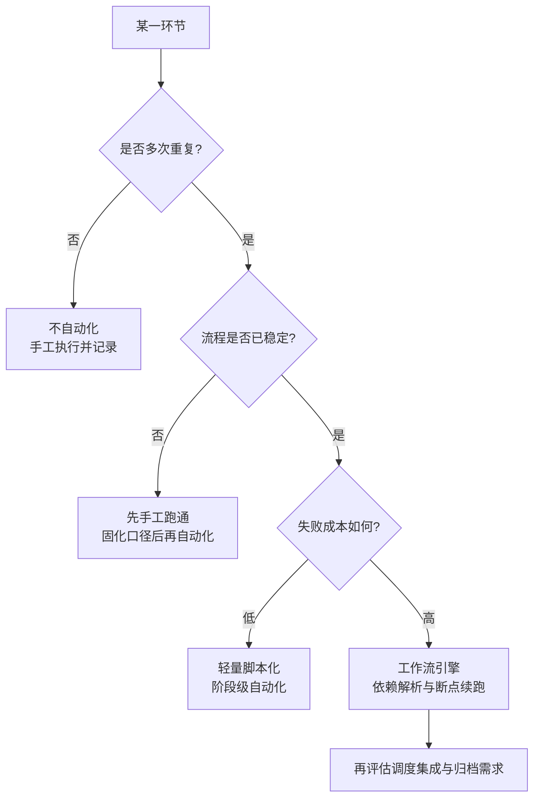
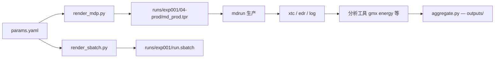
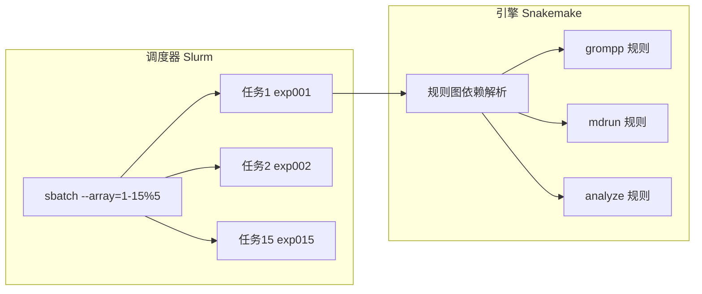
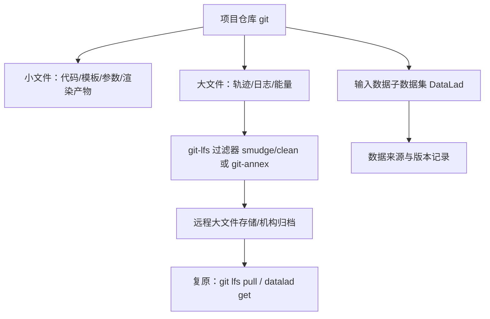

# 第 10 章 自动化与工程化

前三章建立的运行与分析方法把「一次模拟」从输入文件推进到结论，但一次完整的分子动力学研究很少止于单个模拟：多副本采样、伞形采样窗口、体系变体与参数扫描会把「运行一次」扩展为「运行几十上百次」，而每次运行又由构建、最小化、平衡、生产与分析多个阶段串联。人工逐条敲打命令的流程在此规模下会暴露出三类系统性问题：参数在复制粘贴中漂移、某个阶段失败后无法增量重跑、产物与产生它的输入失去对应关系。本章把前章建立的以文件为单位的工作流提升为工程化流程，使其可重复执行、可增量重跑、可批量调度、可追溯、可归档。内容安排如下：10.1 节界定自动化的边界与常见反模式，回答「什么值得自动化」；10.2 节讨论 mdp 等输入文件的模板化与参数替换机制；10.3 节约定任务目录与元数据文件；10.4 节引入 Makefile 与 Snakemake 两类工作流引擎，并处理依赖解析、断点续跑与失败重试；10.5 节解决与 Slurm 调度器的集成，包括提交脚本生成、作业数组与运行监控；10.6 节汇总结果并生成自动报告；10.7 节讨论版本控制与数据归档。工具行为以官方文档为准：GROMACS 行为按 2026.4 版手册表述（检查点与续算机制在多版本间有变动，正文标注适用区间）[1][2][3]，Slurm 行为按 SchedMD 26.05 版本文档[4]，Snakemake 按 9.x 文档（其执行器接口自 8.0 起改为插件机制）[5]；方法与最佳实践参考 BioExcel GROMACS 最佳实践指南[6]与 GROMACS 官方「管理长时间模拟」指南[3]。涉及 GROMACS 版本差异的参数语义，以官方手册当前版的表述为准，凡属推断或经验性内容均在正文标明依据类型。

## 学习目标

- 能依据任务重复频率、一次失败的成本与再执行成本判断一个环节是否值得自动化，并识别至少五类自动化反模式及其成因。
- 能使用 Jinja2 等模板引擎从参数文件渲染 mdp 与提交脚本，并用 grompp 回显（mdout.mdp）、tpr 校验等官方机制核验生成结果。
- 能为模拟项目设计任务目录结构与元数据文件，并沿「产物—元数据—参数—模板版本」链条追溯任意结果的输入与参数。
- 能写出按依赖增量执行的 Makefile 与 Snakemake 工作流，解释两者断点续跑的语义差异，并为失败规则配置重试与续跑策略。
- 能生成使用作业数组的 Slurm 提交脚本，并用 squeue、sstat 与 sacct 完成运行监控、进度估计与失败判定。
- 能区分应纳入版本控制与应归档的数据对象，并用 git、git-lfs 与 DataLad 实现代码、参数与大数据文件的联合版本管理。

## 前置知识

- 第 2 章：Slurm 资源模型、提交脚本结构要素与监控命令最小集（2.5 节）；目录结构与命名约定（2.8 节）。
- 第 3 章：subprocess 调用外部程序与返回码处理（3.7 节）、表格数据的解析与聚合（3.4–3.5 节），本章结果汇总部分直接复用这些工具。
- 第 5 章：mdp 参数体系与最小化/平衡模板（5.8 节），本章 10.2 节以其为模板化对象。
- 第 6 章：mdrun 检查点机制与续算（6.2 节）、日志解读与性能报告（6.3 节），本章 10.4 与 10.5 节以官方长期模拟管理指南[3]为依据展开工作流视角。
- 第 9 章：可复现性的影响因素与记录规范（9.6 节），本章 10.7 节把记录规范落为版本控制与归档操作。
- 外部材料：GNU make 手册与 Snakemake 官方文档的概念（规则、依赖、通配符）随用随引，不要求预先通读。

## 自动化的边界与收益

### 值得自动化的情形

判定一个环节是否值得自动化，先看它是否同时满足三个条件：重复出现、规则明确、失败成本高。Wilson 等人在《计算科学中的良好实践》中把脚本化与自动化列为科学计算的最低工程要求——不应逐条手工输入命令，而应让机器执行已记录的指令，其理由正是重复劳动的错误率与不可追溯性[7]；Mölder 等人对 Snakemake 工作流的系统论述进一步把「可复现、可适应、可透明」作为数据分析流程的工程目标，其中可适应指能够低成本修改分析以回答新问题[8]。GROMACS 的多级并行能力从工作站延伸到超算，改变的是单次运行的成本结构[9]；而研究级产出的质量还取决于批量任务的组织方式，后者正是本章的讨论对象。

按重复粒度，值得自动化的环节可分为四类。其一为阶段级自动化：把一个阶段内固定次序的命令序列（如第 4、5 章的构建与平衡序列）固化为脚本，消除逐条输入时的抄写错误。其二为流程级自动化：把跨阶段的数据依赖（最小化产物作为平衡输入、平衡产物作为生产输入）交由引擎解析，使修改任意输入后只重跑受影响的分支。其三为批处理自动化：对多副本、多窗口、多参数组合这类同构任务做批量生成与调度，这也是 10.5 节作业数组的适用对象。其四为报告自动化：把聚合、制图与文字生成接入同一流程，见 10.6 节。反例同样明确：一次性探索性分析——数值口径未定、文件结构频繁变动、尚未跑通的阶段——此时自动化的维护成本高于手工操作的收益，正确顺序是先手工跑通、稳定口径，再把流程固化。

### 常见反模式

反模式是「看似自动化、实则引入新问题」的常见做法。表 10-1 列出七类高频反模式及其正确形态；其中前四类源于对自动化工具的误用，后三类源于自动化边界的失守。Sandve 等人的十条可复现规则把「自动化所有步骤」「记录所有参数」「版本化所有脚本」作为正面要求[10]，反模式的实质正是这些要求的反面。

表 10-1　自动化反模式对照（依据文献[7][10][11]归纳）

| 反模式 | 表象 | 本质问题 | 正确形态 |
| --- | --- | --- | --- |
| 复制粘贴命令历史 | 每阶段手工粘贴上一步的命令 | 参数漂移、无记录、难追溯 | 阶段脚本化，参数入文件 |
| 一条龙脚本 | 单个 shell 脚本按序执行全部阶段 | 无依赖解析，失败即从头重跑 | 目标驱动的增量执行（10.4 节） |
| 手改产物 | 直接编辑生成的 mdp、topol 后重跑 | 产物与生成管线失步 | 模板 + 渲染管线，产物只读 |
| 目录堆叠 | results_final、results_final_v2 层层复制 | 追溯失效、结果混乱 | YODA 式任务目录与元数据（10.3 节）[11] |
| 压制警告 | 用 -maxwarn 放行 grompp 警告 | 隐蔽的参数与拓扑问题进入运行 | 逐条解释警告，修复而非压制[1] |
| 过度自动化 | 把未稳定的探索流程强行固化 | 排错成本超过收益 | 先稳定口径，再固化流程 |
| 无纪律命名 | 作业名全为 test、输出文件互相覆盖 | 监控与归档失去锚点 | 语义化命名与独立输出文件 |

「手改产物」与「压制警告」两类在 GROMACS 工作流中尤其常见：grompp 官方文档在 `-maxwarn` 选项的说明中写明该选项「并非常规用途，且可能生成不稳定体系」[1]，其本意是让用户逐条判读警告；目录堆叠则直接对应 YODA 项目所批评的 `results_August19/`、`main_script_DONTUSE.py` 式组织[11]，其目录结构规范化方案见 10.3 节。

### 自动化的成本与收益核算

自动化把「执行层面的错误」转变为「定义层面的错误」：手工流程的失败多发生在敲错命令或漏掉步骤，自动化流程的失败发生在工作流定义本身。因此核算自动化收益时，两个方向都必须计入。Peng 指出可复现性可作为计算科学主张的最低检验标准[12]；Grüning 等人对生命科学计算可复现性的综述则强调，达到这一标准需要把工作流、容器与版本控制组合使用，存在真实的工程投入[13]。收益侧的量是「单次人工耗时 × 重复次数 + 失败重放成本 × 失败率」；成本侧的量是「定义与排错工时 + 维护工时 + 环境迁移成本」。Deelman 等人在对科学工作流现状的系统梳理中指出，工作流管理系统的价值恰恰体现在大规模、多任务、跨执行环境的场景，小型一次性任务并不适用[14]。图 10-1 给出按频率与失败成本两维的决策流程。



图 10-1　自动化边界决策流程：按重复频率、流程稳定性与失败成本三级判定选择合适的自动化深度（依据文献[7][12]归纳）

一个可操作的经验法则是：同一阶段在同一参数口径下需要执行三次以上，或任何一次失败后的人工重放时间超过开发自动化所耗时间的一半，就值得至少做阶段级脚本化；一旦任务数达到几十量级且彼此存在依赖，直接进入 10.4 节的工作流引擎。需要强调，自动化只消除程序性错误，不消除建模错误——工作流跑通不等于结果正确，后者仍需第 9 章的统计判据把关。

## 输入模板化

### mdp 模板

GROMACS 的运行输入由四类文件构成：mdp（运行参数）、拓扑 top 及其 include 的 itp（成键与非键参数）、坐标文件（gro 或 pdb）与可选的索引文件 ndx。grompp 读取这些输入并生成 tpr，官方文档明确 tpr 是「可作为 MD 程序唯一输入文件」的二进制产物[1]。模板化的对象主要是 mdp 与提交脚本，因为这两者随阶段、副本与体系变体高频变化；拓扑与坐标则按 10.2.3 节的方式处理。

mdp 模板化的第一前提是理解默认值机制：官方参数页开头即说明「默认值写在括号中，或列在取值列表的首项；列表中第一项恒为默认选项」[15]，凡未在 mdp 中写出的选项由 grompp 按默认值填入。这意味着「少写参数」不等于「没有参数」——不写 `coulombtype` 会得到默认的 Cut-off 截断而非 PME[15]，这正是第 5 章反复强调显式写出关键参数的原因。模板的任务因此不是罗列所有选项，而是把「随任务变化的参数」提升为变量、把「随阶段固定的参数」写成常量注释。表 10-2 给出常规显式水蛋白体系的模板变量矩阵，取值依据官方参数页[15]与教程惯例[16]，参数语义见第 5 章 5.8 节，此处不重复展开。

表 10-2　mdp 模板变量矩阵（常规显式水蛋白体系，GROMACS 2026.x）

| 变量 | 最小化 | NVT | NPT | 生产 | 出处 |
| --- | --- | --- | --- | --- | --- |
| integrator | steep | md | md | md | [15] |
| dt / ps | — | 0.002 | 0.002 | 0.002 | [15] |
| nsteps | 50000 | 50000 | 250000 | 按目标时长 | [15][16] |
| gen_vel | — | yes | no | no | [15] |
| tcoupl | — | v-rescale | v-rescale | v-rescale | [15] |
| pcoupl | — | no | C-rescale | C-rescale | [15] |
| constraints | — | h-bonds | h-bonds | h-bonds | [15] |
| coulombtype | PME | PME | PME | PME | [15] |
| nstxout-compressed | 0 | 500 | 500 | 5000 | [15] |

上表中「—」表示该阶段不适用或默认 no。以输出频率参数 `nstxout-compressed` 的四问为例：该参数定义每多少步向压缩轨迹写入一帧坐标，量纲为「步」；需要它的原因是压缩轨迹（xtc）是后续分析的唯一结构数据来源，输出过稀则时间分辨不足，过密则磁盘与写入负担过大；常规显式水蛋白体系在平衡阶段可取 500、生产阶段取 5000（对应 2 fs 步长下每 10 ps 一帧）[15][16]；取值不当的后果是分析侧时间分辨不足（如氢键寿命、水驻留等快过程需要远高于此的帧率）或轨迹文件体积失控，前者需要在设计阶段就确定，缩样后再抽稀无法恢复被丢弃的信息。模板文件存放于项目 `templates/mdps/` 目录，具体任务的 mdp 一律由渲染器生成，生成物只读——这是 10.1 节「手改产物」反模式的直接对策。

### 参数替换机制

参数替换有三级实现方式，投入与能力递增。第一级是 shell 的 `sed` 与 `awk`：对少量、无结构的替换足够，但替换串与转义易错，且无法表达条件与循环，不适合参数矩阵。第二级是 Python 标准库的 `string.Template`：以 `$name` 占位，安全（不执行任意表达式），适合十余个参数的轻量渲染。第三级是模板引擎 Jinja2：官方文档将其定义为「快速、富有表现力、可扩展的模板引擎；模板中的特殊占位符允许书写类似 Python 的语法，渲染时传入数据生成最终文档」[17]，支持条件、循环、过滤器与模板继承，适合阶段模板与批量任务。选择依据是参数规模：参数超过数十个或存在阶段矩阵时直接使用 Jinja2，避免先例化再迁移的成本。

Jinja2 渲染 mdp 的最小示例（平台：Linux；Python 3.12+；渲染脚本 `render_mdp.py`）：

```python
#!/usr/bin/env python3
# 平台：Linux；Python ≥3.12；依赖：PyYAML、Jinja2（pip install pyyaml jinja2）
import yaml, jinja2, pathlib

params = yaml.safe_load(pathlib.Path("params.yaml").read_text(encoding="utf-8"))
env = jinja2.Environment(loader=jinja2.FileSystemLoader("templates/mdps"))
for stage in ["em", "nvt", "npt", "prod"]:
    out = pathlib.Path("runs") / f"md_{stage}.mdp"
    out.parent.mkdir(parents=True, exist_ok=True)
    out.write_text(env.get_template(f"{stage}.mdp.j2").render(**params), encoding="utf-8")
```

对应模板 `templates/mdps/prod.mdp.j2`（示意片段）：

```jinja
integrator = md
dt = {{ dt }}
nsteps = {{ prod_nsteps }}

gen_vel = yes ; gen_temp = {{ gen_temp }} ; gen_seed = {{ gen_seed }}

gen_vel = no

tcoupl = v-rescale ; tc-grps = Protein Water_and_ions
tau_t = 0.1 0.1 ; ref_t = {{ ref_t }} {{ ref_t }}
pcoupl = C-rescale ; pcoupltype = isotropic
tau_p = 5.0 ; compressibility = 4.5e-5 ; ref_p = 1.0
constraints = h-bonds
cutoff-scheme = Verlet ; coulombtype = PME
rvdw = 1.0 ; rcoulomb = 1.0
nstxout-compressed = {{ nstxout_compressed }}
```

参数文件 `params.yaml` 同时作为提交脚本渲染（10.5.1 节）与元数据快照（10.3.2 节）的数据源，形成「单一事实源」：同一份文件驱动 mdp、调度与记录，从源头消除三处不一致。命名纪律上，YAML 键名与 mdp 选项名保持一致（如 `gen_vel` 而非 `generateVelocities`），减少模板内语法噪音。另一处官方支持的替换机制是 mdp 的 `define` 与 `include`：grompp 内置预处理器解析 `#ifdef`、`#include` 等指令，`define = -DPOSRES` 会在预处理阶段启用拓扑中的位置约束段[1][15]，这是「同一拓扑按阶段切换约束」的标准通道，应优先于对拓扑文本的字符串替换。

### 结构、拓扑与索引的模板化

拓扑与结构文件不宜作为文本替换对象：top 的原子类型、成键参数与力场绑定，原子表由 pdb2gmx、solvate 与 genion 按输入结构生成，直接改文本极易破坏一致性。模板化的正确粒度是「选择型参数」，即力场名、水模型、离子浓度、质子化态等流程级选择，由构建命令参数承载；例如：

```bash
# 平台：Linux；版本：GROMACS 2026.x；参数以 $FF、$WATER、$CONC 形式从 params.yaml 注入
gmx pdb2gmx -f $STRUCT -o system.gro -p topol.top -ff "$FF" -water "$WATER"
gmx solvate -cp system.gro -cs spc216.gro -o box.gro -p topol.top
echo "$ION_CMD" | gmx genion -s ions.tpr -p topol.top -o system_ions.gro -conc "$CONC"
```

位置约束是拓扑模板化的典型场景：posre.itp 由 genrestr 生成并按残基分组，何时启用由 mdp 的 `define = -DPOSRES` 控制[1]，因此流程脚本只需按阶段切换 define 取值，无需改动拓扑。索引文件的交互式生成难以自动化，替代方案有两种：一是 `gmx select` 以选择语法直接输出 ndx[18]；二是把 `make_ndx` 的交互输入固化为文本再经管道喂入（`gmx make_ndx` 接受标准输入），本质也是「选择参数模板化」。校验层面，grompp 的 `-pp` 选项输出预处理后的完整拓扑，用于核对 `-D` 定义确实生效[1]。

### 生成结果的校验

模板化引入了「渲染器正确性」这一新的错误来源，校验分三层。第一层在渲染后、grompp 前：对比渲染出的 mdp 与参数文件，例如用 `grep` 抽出关键键并断言其值；更稳妥的做法是把渲染产物纳入版本控制，用 `git diff` 直观查看参数变化。第二层在 grompp 后：官方文档说明 mdout.mdp「包含注释行以及 grompp 读入的输入」[1]，应以回显文件而非自述为准核对每个关键参数；grompp 的全部警告须逐条解释，`-maxwarn` 仅在确认警告无害时使用，且该选项说明书明确提示可能生成不稳定体系[1]。第三层在 tpr 层面：官方文档指出可用 gmx dump 查看 tpr 内容[19]、用 gmx check 比较两个运行输入文件[20]，续算场景下以此确证前后两个 tpr 的相互作用设置一致。一套可落地的校验脚本如下：

```bash
# 平台：Linux；shell：bash；用途：渲染后校验（第 2、3 层）
set -euo pipefail
gmx grompp -f runs/md_prod.mdp -c runs/conf_npt.gro -p topol.top -o runs/md_prod.tpr
grep -E '^(dt|nsteps|tcoupl|pcoupl|coulombtype|rvdw) ' runs/mdout.mdp \
  | tee runs/checked_params.txt     # 与 params.yaml 期望值人工/自动比对
gmx check -s1 runs/md_npt.tpr -s2 runs/md_prod.tpr   # 交互返回，或由管道喂入 'q'
```

校验脚本本身属于工作流的一部分（10.4 节），应在每次渲染后自动执行，而不是交给人工抽查。

## 目录与元数据约定

### 任务目录结构

目录结构的价值在于让「产物在哪里、由什么产生、属于哪个实验」三个问题不依赖记忆即可回答。Wilson 等人的「良好实践」把项目组织列为科学计算的基本技能，其要点是把数据、代码与输出分离，并让文件名承载语义[21]；YODA 项目把这套原则形式化为三条：一件事一个数据集、记录数据从哪来与现在在哪、记录对数据做了什么以及用什么做的[11][22]。表 10-3 给出适配多副本模拟项目的目录模板，它是 YODA 原则在 GROMACS 上下文中的具体化。

表 10-3　模拟项目任务目录模板（依据文献[11][21][22]归纳）

| 目录 | 内容 | 产生者 | 变更策略 |
| --- | --- | --- | --- |
| `code/` | 渲染脚本、聚合脚本、工作流定义 | 研究者 | 纳入 git，每次改动留提交 |
| `templates/` | mdp 与提交脚本模板（.j2） | 研究者 | 纳入 git，与参数解耦 |
| `inputs/` | 初始结构、力场补丁等只读输入 | 研究者/外部 | 只读，校验和记录 |
| `runs/exp001/` | 单个任务的完整运行目录（含 01-em、02-nvt、03-npt、04-prod、05-analysis 各阶段产物） | 流程引擎 | 渲染产物只读，原始轨迹归档 |
| `outputs/` | 跨副本汇总表、图与报告 | 聚合脚本 | 由聚合流程生成 |
| `logs/` | 调度器输出与提交记录 | 调度器 | 按作业号命名，不覆盖 |
| `envs/` | 计算环境说明或容器定义 | 研究者 | 纳入 git |

目录命名遵循三条纪律：小写、以连字符或下划线分词、可排序（序号用零填充，如 `exp001`）。单个任务目录 `runs/exp001/` 内部按阶段固定命名：`01-em/`、`02-nvt/`、`03-npt/`、`04-prod/`、`05-analysis/`，每个阶段目录内统一用 `md_<阶段>.tpr`、`conf_<阶段>.gro` 等固定文件名。固定命名使工作流引擎的规则只需写一次即可作用于全部任务，这是 10.4 节通配符机制能够成立的文件系统前提。

### 命名与元数据文件

命名承担两类信息：人类可读的语义与机器可解析的结构。作业名与任务名采用 `体系-变体-副本` 三段式，例如 `abr-salt150m-rep03`；时间信息写入元数据而非文件名，避免同一任务因时间戳不同被复制成多个目录。每个任务目录内固定放置三类元数据文件。其一为 `params.yaml`：渲染该任务所用参数文件的按值快照，内容与 10.2 节的单一事实源一致，任务完成后不再修改。其二为 `manifest.txt`：关键产物的文件名、字节数与 SHA-256 校验和，由聚合流程或归档流程生成，用于事后完整性校验。其三为 `run.log`：提交时刻、作业号、命令回显与退出码，由提交脚本追加写入。YODA 原则 P2 要求「记录数据从哪来」，对应到本模板即 `inputs/` 的获取来源、版本标识与校验和记录[11][22]。

### 元数据驱动的任务追溯

追溯（provenance）链条的完整形态是：任意结果文件 → 产生它的命令与参数 → 渲染它的 params.yaml 与模板版本 → 模板与脚本的 git 提交号 → 输入数据的版本与来源。Sandve 十条规则的第一条「为每个结果记录其产生方式」与第六条「记录随机种子」在此落地：`gen_seed`、`ld-seed` 等随机种子写入 params.yaml，复核实验可因此精确复现初速度与热浴噪声序列[10]。追溯操作的两个抓手：一是 `git log` 定位模板与脚本的提交，二是 `manifest.txt` 与任务目录内的 `mdout.mdp` 回显交叉验证某次运行实际生效的参数。当结果与输入失配时（例如两篇报告引用了同一编号却来自不同参数的任务），沿该链条可在分钟级定位断裂点；若链条某处缺失（如 `runs/exp007` 没有 params.yaml），该结果的科学有效性应降级处理——这与第 9 章「无法追溯的结果不具可复现性」的立场一致。

## 工作流引擎

### Makefile 的基本规则

Makefile 以「目标—依赖—命令」三元组描述构建：目标（target）是要生成的文件，依赖（prerequisite）是目标成立所需的文件，命令（recipe）是当目标缺失或任一依赖比目标新时执行的 shell 命令；`make` 通过比较文件修改时间决定是否重建[23]。其核心价值是增量执行：修改一个 mdp 后，只有依赖该 mdp 的目标及其下游被重建，已完成且未受影响的阶段原样保留。最小示例（GNU make 4.x，平台 Linux）：

```makefile
# GNU make 4.x；平台：Linux（bash）；在项目根目录下运行 make
.PHONY: all clean

SHELL := /bin/bash

all: runs/nvt/nvt.gro

# 阶段一：能量最小化
runs/em/em.tpr: mdp/em.mdp topol.top runs/conf.gro
	mkdir -p runs/em
	gmx grompp -f mdp/em.mdp -c runs/conf.gro -p topol.top -o runs/em/em.tpr

runs/em/em.gro: runs/em/em.tpr
	gmx mdrun -deffnm runs/em/em -v

# 阶段二：NVT 平衡（依赖最小化输出的坐标）
runs/nvt/nvt.tpr: mdp/nvt.mdp topol.top runs/em/em.gro
	mkdir -p runs/nvt
	gmx grompp -f mdp/nvt.mdp -c runs/em/em.gro -r runs/em/em.gro -p topol.top -o runs/nvt/nvt.tpr

runs/nvt/nvt.gro: runs/nvt/nvt.tpr
	gmx mdrun -deffnm runs/nvt/nvt -v

clean:
	rm -rf runs/em runs/nvt
```

上例中 `all` 以最终目标 `runs/nvt/nvt.gro` 为依赖，`make` 沿依赖图反向解析：先检查 `nvt.gro` 是否存在、是否比 `nvt.tpr` 新，逐级向上直至输入文件。`.PHONY` 声明 `all` 与 `clean` 为伪目标——它们不对应真实文件，无论文件是否存在都应执行命令[23]。任何一步失败（如 grompp 报错、mdrun 中途退出）都会使 `make` 以非零状态停止，已成功的阶段保留，修复后再次 `make` 只重跑失败分支。

### Makefile 在模拟流程中的应用

把第 5、6 章的序列映射为图 10-2 的依赖图后，Makefile 的增量语义与「修改 mdp 只重跑受影响阶段」的目标完全对齐。生产阶段的续跑需要特别处理：mdrun 从检查点续算时并不重写 tpr，而是向既有输出文件追加内容[3]，因此「tpr 比 gro 旧」并不是目标过期的可靠信号；若以续算代替重跑，应让目标依赖「续算完成标记」（例如跑完后写入的空文件 `done.marker`），把判断权交还工作流而非文件时间戳。表 10-4 汇总模拟项目常用目标。



图 10-2　模板化模拟流程的依赖图：渲染、运行、分析与聚合各层之间的数据依赖关系（依据文献[23]的依赖语义绘制）

表 10-4　模拟项目 Makefile 常用目标（GNU make 4.x）

| 目标 | 依赖 | 动作 | 说明 |
| --- | --- | --- | --- |
| `all` | 各阶段最终产物 | 解析全图 | 默认目标，等价于完整流程 |
| `em` / `nvt` / `npt` / `prod` | 上一阶段产物 | 单阶段 grompp + mdrun | 便于单独重跑某一阶段 |
| `analyze` | 生产轨迹 | 各项 gmx 分析 | 与生产阶段解耦 |
| `report` | 分析产物 | 聚合与渲染报告 | 见 10.6 节 |
| `clean` | — | 删除可再生的产物 | 保留 inputs/ 与代码 |

一个需要提前确认的边界是：make 只比较时间戳，不感知文件内容与命令语义，也不区分「上次运行成功」与「上次运行失败但留下了残缺产物」。缓解方法是让目标文件只在命令成功时生成（mdrun 正常结束时才写出完整输出），并把校验步骤（10.2.4 节）作为依赖挂入图，使任何污染产物都能触发重建。

### 模式规则与自动变量

多副本任务的结构使每个任务的文件名呈现同一模式：`runs/exp001/04-prod/md_prod.tpr`、`runs/exp002/04-prod/md_prod.tpr`……为每个副本复制粘贴规则不可维护，应使用模式规则：目标中的 `%` 匹配任意字符串，`$*` 可取回该字符串。自动变量把路径成分绑定到命令：`$@` 为目标名，`$<` 为第一个依赖，`$^` 为全部依赖[23]。副本模式规则示例：

```makefile
# 对所有副本统一的生产阶段规则；% 匹配 exp001 等副本目录名
runs/%/04-prod/md_prod.tpr: runs/%/03-npt/conf_npt.gro topol.top params.yaml templates/mdps/prod.mdp.j2
	./render_mdp.py prod $*
	gmx grompp -f runs/$*/04-prod/md_prod.mdp -c runs/$*/03-npt/conf_npt.gro -p topol.top -o $@
```

模式规则使规则数量与副本数量解耦：新增副本只需复制任务目录并让其在 `all` 的依赖列表中出现。`make` 对「同一目标有多条普通规则」按书写顺序取最后一条并打印错误信息，对「同一输出可由多个模式规则匹配」则按最短 stem 优先、书写顺序仅在同长度时作决胜——规则顺序本身不构成优先级[23]，这与 Snakemake 的歧义处理方式不同（见 10.4.4 节）。

### Snakemake

Snakemake 是 Python 语法的声明式工作流引擎：每条规则声明输入、输出与执行的 shell 命令，输出中的 `{wildcard}` 通配符把一条规则展开为任意数量的任务[24][25]。与 make 相比，它的依赖判定默认采用修改时间戳比较，且要求输出文件已存在；用 `--rerun-triggers mtime,input,params,code` 等可把输入内容哈希与规则代码变化纳入触发条件，配合 `--rerun-incomplete` 标记未完成输出以便断点续跑[25]。多副本生产的最小 Snakefile（Snakemake 9.x）如下：

#### 配置文件的单一事实源

同一项目里同时出现 `config/config.yaml`（Snakemake 的 `configfile` 声明）与 `params.yaml`（10.3.2 节元数据快照、10.5.1 节提交脚本渲染的输入）时，两者必须**分工明确而非双轨冗余**。推荐的分工：`config.yaml` 只承载「工作流结构」配置（副本数、参数扫描矩阵、路径布局），`params.yaml` 承载「每个运行实例的物理参数」（力场名、水模型、浓度、种子），且 `params.yaml` 由 `config.yaml` 派生或反之——用一条规则（如 `snakemake params.yaml`）从配置矩阵渲染出参数文件，保证两处永不分叉。易错点：若两个文件都写「种子号」而取值不同，规则层用哪个取决于规则内 `params:` 的读取顺序，排查时先在 `--printshellcmds` 输出中核对实际注入的命令而非文件内容；把「单事实源」做成显式派生规则后，这类歧义从源头消失。提交脚本渲染与元数据快照复用同一份 `params.yaml`（10.5.1 与 10.3.2 节的约定即为此设计），不应再开第三份。

```python
# Snakemake 9.x；Python ≥3.12；运行：snakemake -c4 --printshellcmds
configfile: "config/config.yaml"

rule grompp_prod:
    input:
        "runs/{replica}/03-npt/conf_npt.gro",
        "topol.top",
        "templates/mdps/prod.mdp.j2",
        "params.yaml",
    output:
        "runs/{replica}/04-prod/md_prod.tpr"
    shell:
        "./render_mdp.py prod {wildcards.replica} && "
        "gmx grompp -f runs/{wildcards.replica}/04-prod/md_prod.mdp "
        "-c runs/{wildcards.replica}/03-npt/conf_npt.gro "
        "-p topol.top -o runs/{wildcards.replica}/04-prod/md_prod.tpr"

rule mdrun_prod:
    input:
        "runs/{replica}/04-prod/md_prod.tpr"
    output:
        "runs/{replica}/04-prod/md_prod.xtc",
        "runs/{replica}/04-prod/md_prod.gro"
    shell:
        "gmx mdrun -deffnm runs/{wildcards.replica}/04-prod/md_prod"

rule all:
    input:
        expand("runs/exp{rep:03d}/04-prod/md_prod.xtc", rep=range(1, 16))
```

上例中 `{replica}` 是通配符，`expand()` 显式声明 15 个副本为最终目标；Snakemake 依据通配符把两条规则展开并自动构建依赖图，`-c4` 指定最多并行 4 个任务（示意，具体值与硬件相关）。工作流定义文件本身就是 Python 程序，可在规则外书写任意参数化逻辑，这是 make 难以表达的[25]。表 10-5 对照两类引擎的能力边界。

表 10-5　GNU make 与 Snakemake 能力对照（依据文献[23][24][25]归纳）

| 维度 | GNU make | Snakemake |
| --- | --- | --- |
| 规则语言 | 专有 Makefile 语法 | Python 语法 + 声明式规则 |
| 依赖判定 | 文件时间戳 | 输出存在性 + 可选内容校验 |
| 通配符 | `%`（每规则一个） | `{wildcard}`（正则约束可用） |
| 断点续跑 | 按时间戳增量 | 缺失/不完整输出重跑 |
| 失败重试 | 无内建 | `--retries`、`--rerun-incomplete` |
| 集群集成 | 需自行封装提交 | 执行器插件（含 Slurm）[5] |
| 报告 | 无内建 | `snakemake --report` 生成 HTML 报告[25] |

### 依赖解析与断点续跑

两类引擎的「断点续跑」语义存在实质差异。make 的续跑基于时间戳：只要目标存在且不比依赖旧，即视为完成——上次失败留下的残缺产物若时间戳较新，会被误判为完成。Snakemake 默认把「输出文件缺失」视为未完成，`--rerun-incomplete` 进一步把「上次运行中断产生的部分输出」也纳入重跑范围[25]；因此同一场景下 Snakemake 的重跑判定通常比 make 更保守也更接近真实状态。GROMACS 侧的续跑工具链与引擎语义正交：单纯延长运行用 `gmx convert-tpr -extend` 生成延续 tpr，再由 `gmx mdrun -s next.tpr -cpi state.cpt` 从检查点继续[3][26]；需要改变输出频率或系综等非时长参数时，用 `gmx grompp -t state.cpt` 把检查点的高精度坐标与速度带入新 tpr，再以 `-cpi` 续跑[3]。检查点按 `-cpt` 周期写入，`state.cpt` 的 `_prev` 副本机制保证写入中断时最多损失一个周期[3]。续跑写入既有输出文件受检查点内校验和保护：任何输出文件被外部修改或删除后，mdrun 将拒绝直接追加，此时需恢复原文件或改用 `-noappend` 生成带 `.partXXXX` 后缀的分段输出[3]；该行为在本书基线（GROMACS 2026.x）及近几个主要版本（2021 起）的官方长期模拟指南中一致记录[3]。

### 失败处理与工作流验证

失败处理的第一原则是让退出码与输出分离：grompp 与 mdrun 以非零状态退出即视为失败，脚本用 `set -euo pipefail` 防止错误被流水线吞掉；日志文件的存在不等于成功，`grep 'Finished mdrun'` 之类的成功标记可作为工作流层的判据。Snakemake 提供 `--retries` 为偶发失败（如瞬态文件系统错误）设置重试，`--printshellcmds` 与 `-n`（预演）用于检查将执行的命令与实际渲染内容[25]。工作流验证分两级：流程级验证确认「每个规则都按预期输入产出预期输出」，其手段是把 10.2.4 节的三层校验作为规则挂入图；科学级验证确认「结果与第 9 章的统计判据、第 6 章的稳定性判据一致」，例如比对相邻副本的能量分布、检查温度是否落在目标值附近。BioExcel 最佳实践指南把质量控制列为工作流的常态环节而非事后补救[6]。工作流跑通与结果正确是两回事，自动化放大了错误传播的速度而非消除错误本身。

## 调度集成

### 提交脚本的生成

提交脚本与 mdp 一样属于高频模板化对象：分区、时长、核数、GPU 数随任务与集群变化。与 10.2 节同一套 Jinja2 渲染器生成，`params.yaml` 提供取值，脚本模板存于 `templates/sbatch/`。每次提交前脚本被重新渲染，保证提交内容与当前参数一致；生成物写入任务目录并保留，作为该次提交的审计记录。模板示例（Jinja2，示意字段）：

```bash
#!/usr/bin/env bash
#SBATCH --job-name={{ job_name }}
#SBATCH --partition={{ partition }}
#SBATCH --time={{ walltime }}
#SBATCH --ntasks={{ ntasks }}
#SBATCH --cpus-per-task={{ cpus_per_task }}
#SBATCH --gres=gpu:{{ n_gpu }}
#SBATCH --output=logs/{{ job_name }}-%j.out
#SBATCH --error=logs/{{ job_name }}-%j.err

set -euo pipefail
source {{ gmxrc }}                     # 按集群事实改写
cd "{{ workdir }}/runs/exp{{ replica }}"
gmx mdrun -deffnm 04-prod/md_prod -maxh {{ maxh }} -cpt {{ cpt }}
```

渲染后需做最少的静态检查再提交：核对 `--time` 与 `-maxh` 的数量关系（见 10.5.4 节）、确认模板变量 gmxrc 与 workdir 指向的路径在计算节点可访问。提交脚本是「程序」而非「记录」，每次渲染后应提交由渲染产物而不是手工修改的副本——这同属 10.1 节「手改产物」反模式的适用范围。

### 作业数组

同构批量任务（n 副本 × m 参数组合）在 Slurm 上的标准形态是作业数组：`sbatch --array=0-14` 一次提交 15 个任务，脚本内经环境变量 `SLURM_ARRAY_TASK_ID` 区分任务编号[27]。小于等于任务数的并发上限用百分号后缀控制，如 `--array=0-14%5` 表示最多 5 个任务同时运行，适用于共享许可证或控制落盘压力[27]。表 10-6 列出作业数组的内建环境变量与用途。

表 10-6　Slurm 作业数组内建环境变量（依据 SchedMD 26.05 sbatch 与作业数组文档[4][27]）

| 环境变量 | 含义 | 典型用途 |
| --- | --- | --- |
| SLURM_ARRAY_JOB_ID | 整个数组的首个作业号 | 输出文件名前缀、整体取消 scancel |
| SLURM_ARRAY_TASK_ID | 当前任务的数组下标 | 映射副本/参数序号，选输入与目录 |
| SLURM_ARRAY_TASK_COUNT | 数组任务总数 | 进度统计、参数文件行数校验 |
| SLURM_ARRAY_TASK_MIN / MAX | 下标下界/上界 | 聚合范围、断言 |

输出文件名中的 `%A` 与 `%a` 分别替换为数组作业号与任务下标，`--output=logs/prod-%A_%a.out` 保证每个任务独占日志文件[4][27]，这是 10.1 节「无纪律命名」反模式的调度器侧对策。作业数组的典型脚本：

```bash
#!/usr/bin/env bash
# 平台：Linux；调度器：Slurm 26.05；提交：sbatch run_array.sbatch
#SBATCH --job-name=prod-sweep
#SBATCH --partition=gpu
#SBATCH --time=48:00:00
#SBATCH --ntasks=1
#SBATCH --cpus-per-task=8
#SBATCH --gres=gpu:1
#SBATCH --output=logs/prod-%A_%a.out
#SBATCH --error=logs/prod-%A_%a.err
#SBATCH --array=1-15%5

set -euo pipefail
source /opt/gromacs-2026.4/bin/GMXRC.bash        # 路径按集群事实改写
cd "$SLURM_SUBMIT_DIR"
REPLICA=$(printf "%03d" "$SLURM_ARRAY_TASK_ID")
cd "runs/exp${REPLICA}"
gmx mdrun -deffnm 04-prod/md_prod -maxh 47.5 -cpt 15
```

图 10-3 给出作业数组与工作流引擎两条并行路线的分工：作业数组解决「一批同构任务如何被调度器排队」的问题，工作流引擎解决「任务内部各阶段如何按依赖编排」的问题，二者可嵌套——数组任务内部再运行 Snakemake 或 make 处理该副本的阶段链。

**规则级提交（rule-level submission）** 是第三种形态，也是集群上成熟工作流的常见做法：工作流引擎并非在计算节点上就地跑完每条规则，而是为每条规则生成一个 Slurm 作业并提交，让调度器按资源排队——「批处理」的对象从一批同构任务扩展到「整条依赖图上的每个步骤」。Snakemake 的 `--cluster` / `--executor slurm`（9.x 起）把规则的 `threads`、`resources`（如 `mem_mb`、`gpu`）映射到 `sbatch` 参数，例如一条声明 `threads: 16` 与 `resources: mem_mb=32000` 的 mdrun 规则会被提交为 `sbatch --cpus-per-task=16 --mem=32G`；`--cluster-cancel` 关联 `scancel` 以便在发生错误时撤销整条作业链。与作业数组的区别在于：数组的所有任务共享同一脚本骨架（同构），规则级提交的每个作业可携带不同的资源与命令（异构的任务依赖图），且自动维护作业间的依赖（`--dependency=afterok`）而不需要手工指定。对多窗口伞形采样这类「同构任务+外部依赖」，两者可组合：数组负责同构副本的并行，Snakemake 的规则级提交负责编排窗口间的一致性检查与聚合。

规则级提交需要配套**作业自续循环**约束：集群队列等待时间可能超过单个作业时限，长生产段（如 500 ns 生产被拆成若干 24 h 作业）若在时限内未完成，应让脚本在结束前写检查点并在规则内等待续算——Snakemake 的 `--rerun-incomplete` 配合 `gmx mdrun -cpi` 检查点续算，使「超时的规则」重跑时从检查点继续而不是从头再来；判断「是否真正完成」的断言见 10.2 节（校验输出文件与 md.log 的完整收尾），切忌用「作业退出码 0」作为完成判据。



图 10-3　作业数组（任务级并行）与工作流引擎（阶段级编排）的分工（依据文献[5][27]绘制）

### 运行监控

运行监控分三档。第一档是排队与运行状态：`squeue -u $USER` 查看队列，任务状态码 PD（排队）、R（运行）、S（挂起）等说明见 squeue 手册[28]；数组任务在 `squeue` 中聚合显示为区间（如 `12345_[4-15]`），运行中的任务单独列出[27]。第二档是运行中资源与进度：`sstat -j <jobid>` 按作业/步读取实时 CPU、内存与能耗统计[29]；mdrun 的进度以日志 `Step ... Performance` 为准，`-maxh` 之外可配合 `-cpt` 的周期检查点文件名判断推进。第三档是事后审计：`sacct -j <jobid> --format=JobID,JobName,State,ExitCode` 返回任务终态与退出码[30]，数组任务按 `<数组号>_<下标>` 逐条列出；退出码非零或状态为 FAILED 的任务应在聚合阶段被显式排除或标记。三档工具的语义均以 SchedMD 26.05 文档为准[28][29][30]，字段名与输出列在不同版本间基本稳定。

### 集群感知的资源声明

提交脚本的资源声明必须与 mdrun 的并行模型对齐，这是调度集成中最易出错的一环。Slurm 侧声明 `--ntasks`（进程数/MPI 秩数）与 `--cpus-per-task`（每进程核数）[4]；GROMACS 侧由 `-ntmpi`（thread-MPI 线程数，等价于 MPI 秩）与 `-ntomp`（每秩 OpenMP 线程数）控制[2]。两者应满足：`--ntasks × --cpus-per-task ≈ -ntmpi × -ntomp`，且不超出节点物理核数。GPU 资源经 `--gres=gpu:1` 声明[4]，mdrun 默认自动探测可用 GPU，`-gpu_id` 可在多卡节点显式指定映射[2]。`OMP_NUM_THREADS` 等环境变量在 Slurm 任务内由 `--cpus-per-task` 决定，不应在登录环境遗留的配置中定义。`-maxh` 与 `-cpt` 两个参数直接服务于此场景，按参数四问说明如下。`-maxh`：是什么——mdrun 运行时长上限（小时），到达后以正常方式停止并写检查点，帮助文本注明按请求时长的 0.99 倍触发[2]；为何需要——使模拟在调度器强杀前自行收尾，连续模拟的多个作业借此无缝衔接[3]；推荐取值——略小于队列 walltime，例如 `--time=48:00:00` 时取 47.5（经验做法，留出检查点写入与调度器预留时间，属工程惯例而非硬性规定，正文按文档推定标注）；取值不当的后果——超过 walltime 被调度器强杀，最后一段进度仅有周期检查点可恢复，极端情况下丢失近一个 `-cpt` 周期的计算。`-cpt`：是什么——检查点写入周期（分钟），默认 15[2]；为何需要——提供强杀或故障时的恢复粒度，同时配合 `_prev` 副本抵御写入中的中断[3]；推荐取值——短任务保持默认，长任务按「可接受的最大损失时长」设定，例如 60 分钟级的强杀恢复粒度可取 30；取值不当的后果——周期过短增加 I/O 与文件系统压力，周期过长（超出 walltime 余量）会在强杀时损失大段进度。

## 结果汇总

### 数据聚合

多副本运行结束后，聚合层把分散在各任务目录的分析输出收集为统一表格。聚合使用第 3 章的 pandas 工具链[31]：以副本号为键读取同名输出（例如每个任务 05-analysis 下的 `temperature.xvg`），按时间对齐后计算均值、标准误与有效样本数。表 10-7 给出常用聚合指标及其口径。

表 10-7　多副本聚合指标与口径（聚合实现依据 pandas[31]）

| 指标 | 单位 | 每副本口径 | 跨副本聚合 |
| --- | --- | --- | --- |
| 温度 | K | 平衡段时间均值 | 均值 ± 副本间标准误 |
| 势能与总能量 | kJ/mol | 平衡段时间均值 | 均值 ± 标准误，检查漂移 |
| 体系密度 | kg/m³ | 平衡段时间均值 | 均值 ± 标准误 |
| RMSD 平台值 | nm | 后 50% 轨迹时间均值 | 均值 ± 标准误 |
| 结束时间戳 | ps | 各副本实际末帧 | 最小/最大，用于完整性核对 |

聚合脚本应显式处理三类边界：其一为任务未完成（轨迹短于预期或缺失），按任务排除并把排除记录写入 `outputs/excluded.txt`，不得静默跳过；其二为时间轴不一致（各副本输出频率相同则天然对齐，否则先按公共时间网格重采样）；其三为输出文件格式异常（xvg 注释行以 `#` 或 `@` 开头，解析时应剔除，见第 3 章 3.4 节）。示意代码：

```python
# 平台：Linux；Python ≥3.12；pandas 2.x；用法：python aggregate.py
import glob, pathlib, pandas as pd

def read_xvg(path):
    t, val = [], []
    for line in open(path):
        if line.startswith(("#", "@")):
            continue
        p = line.split()
        t.append(float(p[0])); val.append(float(p[1]))
    return pd.Series(val, name="value")

rows = []
for f in sorted(glob.glob("runs/exp*/05-analysis/temperature.xvg")):
    rep = pathlib.Path(f).parts[1]
    s = read_xvg(f)
    rows.append({"replica": rep, "mean": s.mean(), "sem": s.sem(), "n": s.size})
df = pd.DataFrame(rows)
df.to_csv("outputs/summary.csv", index=False)
print(df)
```

### 自动报告生成

自动报告把聚合表格、关键图与固定文本模板合成为面向人的文档：图由 matplotlib 生成[32]，文本由 Jinja2 模板渲染[17]，两者共用 `params.yaml` 与聚合结果作为数据源，消除「结果变了、报告没改」的常见失步。模板 `templates/report/report.md.j2` 以 Markdown 为输出格式，插入聚合表格（可由 pandas 的 `to_markdown` 生成）与图文件引用；渲染脚本读取 `outputs/summary.csv`，生成 `outputs/report.md`。报告内固定声明版本信息（GROMACS、Snakemake、参数文件 hash、生成时间），使报告本身成为可追溯对象。对合作者或审稿人而言，报告的可读性取决于图表的坐标轴标注与单位是否完整，这复用第 3 章 3.6 节的出版级作图规范[32]。

### 结果一致性检查

聚合层应内建一组跨副本一致性检查，把「异常数据流入结论」的概率压到最低。检查项包括：各副本的结束时间戳不小于目标时长（排除被 `-maxh` 或强杀截断的任务）；温度与密度的副本间离散度不超过经验阈值（超出时要回到任务日志确认是否平衡不足或参数漂移）；能量时间序列无台阶式跳变（台阶往往对应续算边界或检查点问题）；grompp 警告数记录为 0 或已逐条解释。两个文件层面的核对手段可复用：`gmx check -s1 -s2` 比较两个 tpr 的相互作用设置[20]，用于确认「声称相同参数的副本确实使用相同 tpr」；`git diff` 查看渲染产物与参数文件的差异，防止模板变量未生效。BioExcel 指南把这类检查纳入工作流常态[6]，其原则是：报告中的每一个数字都应能指到一条检查记录。

### 冒烟测试与持续集成

工作流仓库（Makefile/Snakefile/提交脚本）本身也应被测试——不测试的自动化工具会在最需要时（生产提交前）暴露错误。最低成本的测试是**冒烟测试（smoke test）**：在不消耗计算资源的前提下验证工作流的结构正确性。对 Snakemake 用 `snakemake -n`（dry-run）检查整条依赖图可解析、无缺失输入与未定义通配符；对 Makefile 用 `make -n` 或 `--dry-run` 同样只展开命令而不执行；对 Slurm 提交脚本，用 `sbatch --test-only` 验证语法与资源声明可被调度器解析（不实际排队）。冒烟测试之上是**最小端到端冒烟**：把体系缩到最小（如单个配体或短轨迹）、帧数降到几十，跑通「构建→平衡→分析」全链，确认产物结构正确后再放大规模——这避免了「大批量提交后才发现规则错误」的浪费。持续集成（CI）把冒烟测试固化为自动门槛：在 GitHub Actions / GitLab CI 上对仓库每次变更运行 `make -n`、`snakemake -n` 与依赖安装测试（`--use-conda` 环境锁定见 10.6 节），任何语法或结构回归在合并前即被拦截。CI 中运行真实 mdrun 不现实（需要 GPU 与长时间），所以 CI 层只做结构校验，真实验证留在发布前的实体冒烟。对同行读者，把「工作流仓库自带冒烟测试 + CI 状态徽章」写进方法节，与第 9 章 9.6 的记录规范形成呼应，是可复现性声明中很有说服力的一环。

## 版本控制与归档

### 纳入版本控制的内容

版本控制解决「代码与参数随时间怎么变、谁在何时改了什么」的问题，是计算可复现性的基础设施[33]。模拟项目中的对象按变更频率、体积与再生能力分三类处理，见表 10-8。图 10-4 给出 git、git-lfs 与 DataLad 的分工：小而高频的对象（代码、模板、参数、渲染产物）进 git 普通跟踪并享受 diff 能力；大而低频的对象（轨迹、日志、能量文件）用 git-lfs[34] 或 DataLad 的 annex 机制跟踪指针，内容存远程；输入数据作为只读子数据集由 DataLad 管理来源与版本[22][35]。

表 10-8　版本控制与归档对象划分（依据文献[22][33][34][35]归纳）

| 对象类别 | 示例 | 工具 | 策略 |
| --- | --- | --- | --- |
| 代码与工作流 | code/、templates/、Snakefile | git | 每次修改提交，信息完备的提交说明 |
| 参数与渲染产物 | params.yaml、mdx 渲染的 mdp、提交脚本 | git | 渲染产物入 git，便于 diff 与复现 |
| 小输入 | 初始 PDB、topol.top、itp | git | 与代码同库，源头可溯 |
| 大输出 | xtc、trr、edr、log | git-lfs 或 DataLad annex | 指针入 git，内容存远程/归档[34][35] |
| 输入数据集合 | inputs/ 各组件 | DataLad 子数据集 | 记录来源、版本与校验和[22][35] |
| 可再生中间产物 | 各阶段 gro、tpr | 不纳入提交 | .gitignore 排除，可随时重建 |



图 10-4　git、git-lfs 与 DataLad 的联合版本管理分工（依据文献[22][34][35]绘制）

### 数据归档策略

存档的目标是「若干年后仍能拿到与论文数字对应的一组文件并验证其一致」。git-lfs 把大文件替换为指针提交，内容经 smudge/clean 过滤器在检出与提交时自动往返[34]，适合团队内部共享与版本化轨迹；托管平台对单文件大小设有上限，预案应写入项目说明。DataLad 以 git 加 git-annex 实现同样的指针机制，并追加两层能力：`datalad run` 记录命令、输入输出与执行环境之间的关联并把这些信息写入历史，`datalad save` 仅记录当前文件状态变化，两者职责不同[22][35]，配合 `datalad create -c yoda` 自动套用 YODA 目录约定[22]。归档落地三件事：其一，对每个实验任务提交 `params.yaml`、模板版本与渲染产物，保证「输入可重建」；其二，对轨迹等大对象生成并把校验和写入 `manifest.txt`；其三，把归档副本写入与工作盘物理隔离的存储（远程 git-lfs 服务器、机构归档或冷存储），仅留指针于活跃仓库。官方长期模拟指南同样建议对检查点文件冗余备份，并提示使用 rsync 等工具在不中断运行的情况下同步输出[3]。

### 归档的复原与校验

复原练习应定期进行，而不是在投稿或撤稿审查时才第一次尝试。复原路径与产生路径相反：克隆仓库取回代码与参数（普通 git），`git lfs pull` 或 `datalad get` 取回大文件内容[34][22]，随后就近重建：用归档的 params.yaml 与模板重新渲染 mdp，`gmx grompp` 重新生成 tpr，与归档 tpr 用 `gmx check -s1 -s2` 比对确认一致[20]，再把归档轨迹接入分析链验证聚合数值可复现。校验层面，`manifest.txt` 的 SHA-256 与 `git fsck`、`git lfs fsck` 一起构成可自动执行的一致性检查，任何一处失配即代表归档破损或人为改动。复原失败的常见原因不是存储故障而是约定失效：模板或参数在归档后又被改动、校验和未在归档时生成、目录结构在迁移中被重命名——这再次指向 10.3 节的元数据纪律：追溯链条的每一环都要在写入时留下证据，而不是依赖事后回忆。

## 常见错误

1. **现象**：grompp 因警告停止，加入 `-maxwarn 1` 后放行，生产模拟照常完成，但后续分析发现温度/压力异常或结构发散。
   **成因**：警告被当作「可以压掉的噪音」批量放行，而 grompp 的帮助文本明确提示 `-maxwarn` 可能生成不稳定体系[1]。
   **排查步骤**：删除 `-maxwarn` 重跑 grompp，逐条阅读警告输出；对照 `mdout.mdp` 与 `params.yaml` 检查实际生效参数。
   **处置**：按警告语义修复 mdp 或拓扑；确属无害的警告（如仅涉及不参与相互作用的组）在提交说明中记录理由，而不是永久挂在 `-maxwarn` 上。

2. **现象**：`make` 报告「无需重跑」，但目标文件实际残缺或来自一次失败的运行；或续跑后 make 反复重跑整个链条。
   **成因**：make 只比较时间戳；续算不重写 tpr、失败运行也可能留下时间戳较新的部分输出，导致过期判断失真[23]。
   **排查步骤**：`make -n` 预演观察将被执行的命令；检查目标文件的 mtime 与内容完整性（`grep 'Finished mdrun'` 于日志）。
   **处置**：用「成功标记」文件作为目标（命令成功后才 `touch done.marker`）；把校验规则挂入依赖图；需要内容语义时改用 Snakemake 的 `--rerun-incomplete`[25]。

3. **现象**：Snakemake 报 `MissingInputException` 或 `AmbiguousRuleException`，提示找不到某规则输出或规则歧义。
   **成因**：通配符约束缺失（如 `{replica}` 同时匹配目录与文件层次）、输出文件名不含通配符、多条规则的输出可被同一请求匹配[25]。
   **排查步骤**：用 `snakemake -n` 列出将执行的规则与具体文件；检查通配符在输入、输出与 shell 命令三处的书写一致性。
   **处置**：为通配符加正则约束（`wildcard_constraints: {"replica": r"\d+"}`）；保证每条规则的输出都含通配符；消除输出模式重叠。

4. **现象**：作业数组运行后，多个任务的日志互相覆盖，`slurm-*.out` 缺失或只保留最后写入者。
   **成因**：`--output` 未使用 `%A`（数组作业号）与 `%a`（任务下标），所有任务写入同一文件，后写者截断前者[4]。
   **排查步骤**：检查 `--output`/`--error` 的格式串与 `ls logs/` 实际生成的文件名；对照 `SLURM_ARRAY_TASK_ID` 验证映射。
   **处置**：统一为 `--output=logs/prod-%A_%a.out` 形式；脚本内所有临时文件路径带 `${SLURM_ARRAY_TASK_ID}`[27]。

5. **现象**：`make clean`（或 `all`）不执行任何命令，或照常返回成功但行为与预期不符。
   **成因**：目录中存在与目标同名的文件时，make 把伪目标当作真实文件处理，因「目标不过期」而跳过命令[23]。
   **排查步骤**：`ls -la` 检查同名文件；查看 Makefile 是否在 `.PHONY` 中声明了该目标。
   **处置**：在 `.PHONY` 中显式声明所有不对应文件的目标[23]；给产物目录加统一后缀（如 `out/`）避免与目标名冲突。

6. **现象**：提交脚本在登录节点 `bash script.sh` 正常，经 `sbatch` 提交后在计算节点报「命令未找到」或路径不存在。
   **成因**：脚本依赖登录环境遗留的 module 加载、conda 激活或硬编码绝对路径；计算节点是独立环境，不继承登录交互配置[4]。
   **排查步骤**：`sbatch --test-only` 或直接查看任务 stderr 首行；在脚本内 `type gmx` 检查解析到的可执行文件。
   **处置**：脚本内显式 `source` GROMACS 环境（或 `module load`）与 `cd` 到提交目录；环境依赖写入 `envs/` 说明并由渲染器注入；避免在脚本中使用登录节点专有路径。

7. **现象**：首次续算正常，第二次续算后能量出现台阶或报「tpr 与检查点不匹配」类错误。
   **成因**：续算参数在多次 `grompp -t` 与 `mdrun -cpi` 之间不一致（如重新生成了速度、改了 `constraints` 或 `dt`）；官方指南明确续算时一般不应重新生成速度，应设置 `continuation`[3]。
   **排查步骤**：比对各次续算的 tpr（`gmx check -s1 -s2`）；检查新 mdp 中 `gen_vel`、`init-step` 与 `continuation` 的取值[3][15]。
   **处置**：延续时长用 `gmx convert-tpr -extend`[26]；必须改参数时，把检查点传给 `grompp -t` 并保持 `gen_vel = no`、`continuation = yes`[3]。

8. **现象**：聚合脚本崩溃（键缺失、空值）或报告出现明显偏小的样本数，个别副本被静默忽略。
   **成因**：聚合读取了未完成任务的部分输出，或按 glob 匹配的文件名与任务目录不一致；异常被 `try/except` 吞掉。
   **排查步骤**：列出聚合读入的文件清单与 `squeue`/`sacct` 任务终态对照；开启聚合脚本的详细日志逐任务核对。
   **处置**：聚合前先按 `sacct` 退出码过滤任务[30]；缺失任务显式写入 `outputs/excluded.txt`；用表 10-7 的完整性字段（结束时间戳、样本数）断言后再进入均值计算。

## 本章小结

- 自动化的判定以「重复出现、规则明确、失败成本高」为准；一次性探索优先手工跑通，流程稳定后再固化，避免把未定型的口径固化进难以修改的流程。
- 反模式的共同根源是丢失「产物—参数—命令」的对应关系；模板化、只读产物、语义化命名与逐条处理警告是四类最直接的纠正手段。
- mdp 模板化的前提是默认值机制：未书写的选项由 grompp 按默认填入，模板应显式写出随任务变化的参数；渲染产物的校验以 mdout.mdp 回显与 tpr 层校验为准，`-maxwarn` 不承担解释警告的职能。
- 任务目录按「一件事一个目录、输入只读、产物可重建、元数据伴随」组织；params.yaml、manifest.txt 与 run.log 三者构成追溯链条的落点。
- 工作流引擎的选择以依赖语义为分界：时间戳语义的 make 适合阶段链，输出存在性加内容校验的 Snakemake 适合多通配符批量任务；两者的续跑语义差异必须在设计时显式考虑。
- 续算语义以官方长期模拟指南为准：检查点是唯一受支持的续算通道，单纯延长用 convert-tpr，改参数用 grompp -t 配合 -cpi，输出追加受检查点校验和保护。
- 调度集成把资源声明、作业数组与监控三件事对齐：`--ntasks × --cpus-per-task` 与 `-ntmpi × -ntomp` 一致，`-maxh` 小于 walltime，`%A_%a` 保证输出隔离，sacct 返回码进入聚合判定。
- 版本控制与归档按对象分类：代码与参数进 git，大文件经 git-lfs 或 DataLad 管理指针，输入数据以子数据集记录来源；归档的价值由复原演练检验。

## 延伸讨论

自动化的价值判据是「重复频率 × 流程稳定性 × 失败成本」三者的乘积，而不是「能自动就自动」：高重复、稳定、失败代价大的环节最值得自动化（如多副本生产的续算闭环），低重复或高流动性的环节手工更省。本章的批处理、工作流与调度集成三件套，正是沿这一判据分配深度的。

「完成判定」是自动化的软肋：作业退出码 0 不等于模拟完成，xtc 帧数、md.log 统计块、检查点校验三者才是「真完成」的证据。把校验断言做成工作流的显式步骤（而非口头纪律），是从「脚本自动化」升级到「工程自动化」的分水岭——它同时服务第 9 章 9.6 的可复核要求。

CI 与实体冒烟的双层结构回答了另一个高频问题：「工作流改了，怎么知道没弄坏？」CI 层以结构校验（dry-run、环境锁定）拦截语法与结构回归，实体层以最小端到端冒烟拦截行为回归；两层合用，使「重构工作流」不再是高风险操作。这一思路与 git 的提交纪律共同构成研究代码的工程底线。

## 参考文献

[1] GROMACS 2026.4 documentation. gmx grompp[EB/OL]. https://manual.gromacs.org/current/onlinehelp/gmx-grompp.html（访问日期：2026-10-29）.
[2] GROMACS 2026.4 documentation. gmx mdrun[EB/OL]. https://manual.gromacs.org/current/onlinehelp/gmx-mdrun.html（访问日期：2026-10-29）.
[3] GROMACS 2026.4 documentation. Managing long simulations[EB/OL]. https://manual.gromacs.org/current/user-guide/managing-simulations.html（访问日期：2026-10-29）.
[4] SchedMD. Slurm Workload Manager: sbatch (26.05)[EB/OL]. https://slurm.schedmd.com/sbatch.html（访问日期：2026-10-29）.
[5] Snakemake documentation. Executor plugins[EB/OL]. https://snakemake.readthedocs.io/en/stable/executing/executors.html（访问日期：2026-10-29）.
[6] BioExcel. GROMACS Best Practices[EB/OL]. https://docs.bioexcel.eu/gromacs_bpg/（访问日期：2026-10-29）.
[7] Wilson G, Aruliah D A, Brown C T, et al. Best practices for scientific computing[J]. PLoS Biology, 2014, 12(1): e1001745. DOI: 10.1371/journal.pbio.1001745.
[8] Mölder F, Jablonski K P, Letcher B, et al. Sustainable data analysis with Snakemake[J]. F1000Research, 2021, 10: 33. DOI: 10.12688/f1000research.29032.2.
[9] Abraham M J, Murtola T, Schulz R, et al. GROMACS: High performance molecular simulations through multi-level parallelism from laptops to supercomputers[J]. SoftwareX, 2015, 1-2: 19-25. DOI: 10.1016/j.softx.2015.06.001.
[10] Sandve G K, Nekrutenko A, Taylor J, et al. Ten simple rules for reproducible computational research[J]. PLoS Computational Biology, 2013, 9(10): e1003285. DOI: 10.1371/journal.pcbi.1003285.
[11] Hanke M, Meyer K A, Visconti di Oleggio Castello M, et al. YODA: YODA's Organigram on Data Analysis[EB/OL]. F1000Research, 2018, 7: 1965 (poster). DOI: 10.7490/f1000research.1116363.1.
[12] Peng R D. Reproducible research in computational science[J]. Science, 2011, 334(6060): 1226-1227. DOI: 10.1126/science.1213847.
[13] Grüning B, Chilton J, Köster J, et al. Practical computational reproducibility in the life sciences[J]. Cell Systems, 2018, 6(6): 631-635. DOI: 10.1016/j.cels.2018.03.014.
[14] Deelman E, Peterka T, Altintas I, et al. The future of scientific workflows[J]. The International Journal of High Performance Computing Applications, 2018, 32(1): 159-175. DOI: 10.1177/1094342017704893.
[15] GROMACS 2026.4 documentation. Molecular dynamics parameters (.mdp options)[EB/OL]. https://manual.gromacs.org/current/user-guide/mdp-options.html（访问日期：2026-10-29）.
[16] Lemkul J A. From proteins to perturbed Hamiltonians: A suite of tutorials for the GROMACS-2018 molecular simulation package[J]. Living Journal of Computational Molecular Science, 2019, 1(1): 5068. DOI: 10.33011/livecoms.1.1.5068.（发表年份存在 2018/2019 两种标注，正文按 LiveCoMS 期刊正式发行年取 2019）
[17] Pallets Projects. Jinja documentation (3.1.x)[EB/OL]. https://jinja.palletsprojects.com/（访问日期：2026-10-29）.
[18] GROMACS 2026.4 documentation. gmx select[EB/OL]. https://manual.gromacs.org/current/onlinehelp/gmx-select.html（访问日期：2026-10-29）.
[19] GROMACS 2026.4 documentation. gmx dump[EB/OL]. https://manual.gromacs.org/current/onlinehelp/gmx-dump.html（访问日期：2026-10-29）.
[20] GROMACS 2026.4 documentation. gmx check[EB/OL]. https://manual.gromacs.org/current/onlinehelp/gmx-check.html（访问日期：2026-10-29）.
[21] Wilson G, Bryan J, Cranston K, et al. Good enough practices in scientific computing[J]. PLoS Computational Biology, 2017, 13(6): e1005510. DOI: 10.1371/journal.pcbi.1005510.
[22] The DataLad Handbook[EB/OL]. https://handbook.datalad.org/（访问日期：2026-10-29）.（6.2 节 YODA: Best practices for data analyses in a dataset）
[23] Free Software Foundation. GNU Make Manual[EB/OL]. https://www.gnu.org/software/make/manual/（访问日期：2026-10-29）.
[24] Snakemake documentation[EB/OL]. https://snakemake.readthedocs.io/（访问日期：2026-10-29）.
[25] Köster J, Rahmann S. Snakemake—a scalable bioinformatics workflow engine[J]. Bioinformatics, 2012, 28(19): 2520-2522. DOI: 10.1093/bioinformatics/bts480.
[26] GROMACS 2026.4 documentation. gmx convert-tpr[EB/OL]. https://manual.gromacs.org/current/onlinehelp/gmx-convert-tpr.html（访问日期：2026-10-29）.
[27] SchedMD. Slurm Workload Manager: Job Array Support (26.05)[EB/OL]. https://slurm.schedmd.com/job_array.html（访问日期：2026-10-29）.
[28] SchedMD. Slurm Workload Manager: squeue (26.05)[EB/OL]. https://slurm.schedmd.com/squeue.html（访问日期：2026-10-29）.
[29] SchedMD. Slurm Workload Manager: sstat (26.05)[EB/OL]. https://slurm.schedmd.com/sstat.html（访问日期：2026-10-29）.
[30] SchedMD. Slurm Workload Manager: sacct (26.05)[EB/OL]. https://slurm.schedmd.com/sacct.html（访问日期：2026-10-29）.
[31] McKinney W. Data structures for statistical computing in Python[C]//Proceedings of the 9th Python in Science Conference. Austin: SciPy, 2010: 56-61. DOI: 10.25080/Majora-92bf1922-00a.
[32] Hunter J D. Matplotlib: A 2D graphics environment[J]. Computing in Science & Engineering, 2007, 9(3): 90-95. DOI: 10.1109/MCSE.2007.55.
[33] Ram K. Git can facilitate greater reproducibility and increased transparency in science[J]. Source Code for Biology and Medicine, 2013, 8(1): 7. DOI: 10.1186/1751-0473-8-7.
[34] git-lfs. Git Large File Storage[EB/OL]. https://git-lfs.com/（访问日期：2026-10-29）.
[35] Halchenko Y O, Meyer K, Poldrack B, et al. DataLad: Distributed system for joint management of code, data, and their relationship[J]. Journal of Open Source Software, 2021, 6(63): 3262. DOI: 10.21105/joss.03262.