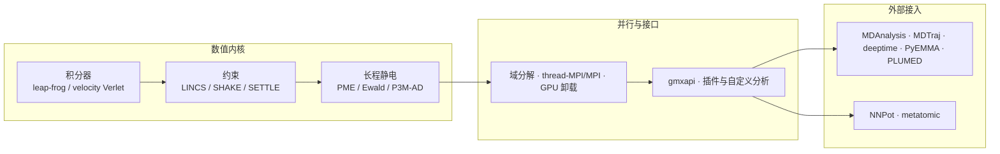
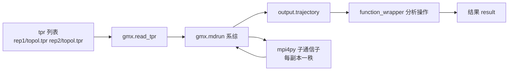
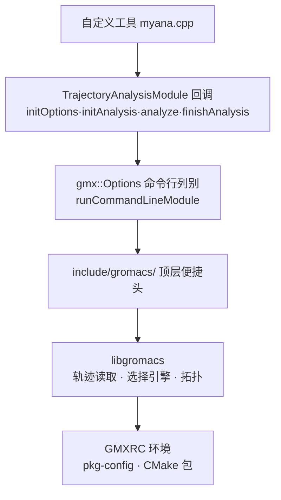

# 第 11 章 Python 生态与扩展开发

　　前 10 章建立了一条从体系构建、运行管理到结果分析的完整命令行工作流，Python 在其中承担数据处理与流程驱动。当研究方法进入自定义算法、批量副本调度与机器学习势阶段时，仅仅包装命令行已经不够：需要理解模拟引擎内部的数值与并行结构，使用官方 Python 接口 gmxapi 直接驱动 mdrun，编写与 libgromacs 链接的自定义分析工具，并选择 MDAnalysis、deeptime 与 PLUMED 等生态组件接入自有流程。本章按「数值内核—并行架构—官方接口—扩展开发—生态工具—机器学习势—工程化」的次序展开：11.1 回顾积分器、约束算法与 PME 的算法选择及其对参数的约束；11.2 说明域分解、thread-MPI 与 MPI 以及 GPU 卸载模型，它们决定了扩展代码的运行环境；11.3 介绍 GROMACS 官方 Python 接口 gmxapi 的设计目标、基本用法与限制；11.4 讲解基于分析工具模板与 libgromacs 的自定义分析工具开发；11.5 对照 MDAnalysis、MDTraj、deeptime、PyEMMA 与 PLUMED 的使用边界；11.6 讨论 NNPot 模块与 metatomic 后端接入机器学习势的现状；11.7 给出测试与性能剖析方法，把脚本推进为可维护的软件。GROMACS 是一个通过多级并行从笔记本扩展到超级计算机的分子模拟引擎[1]，本章涉及版本相关行为均以 GROMACS 2026.4 官方文档为准[2]，凡属方法学结论与工程惯例之处均在正文标明依据类型。

## 学习目标

- 能解释 leap-frog 与 velocity Verlet 的辛性质、LINCS/SHAKE 的收敛条件以及 PME 网格参数对精度与成本的影响，并据此判断给定 mdp 参数组合是否自洽；
- 能根据体系规模、节点数与 GPU 型号判断 thread-MPI、MPI 与 GPU 卸载的适用组合，并解释动态负载平衡与 MPMD PME 的作用；
- 能用 gmxapi 编写单副本与系综（ensemble）模拟脚本，指出其与命令行流程在并行启动、错误处理上的差异；
- 能基于分析工具模板与 find_package(GROMACS) 编译一个自定义 gmx 分析工具，并用已知参考数据核验输出；
- 能为轨迹读取、动力学建模与增强采样任务选择 MDAnalysis、MDTraj、deeptime、PyEMMA 或 PLUMED 并写出最小可用调用；
- 能为自研分析代码编写单元测试与交叉验证用例，并用 cProfile 定位性能瓶颈。

## 前置知识

- 第 2 章：Linux 命令行、环境管理与 GROMACS 源码编译（CMake 选项、GMX_MPI 与 GPU 后端）；第 2 章 2.6 节的并行取舍是本章 11.2 的直接基础。
- 第 3 章：Python 语言最小集、数组与表格数据处理、subprocess 调用外部程序。
- 第 5 章与第 6 章：运动方程、控温控压、mdrun 运行与性能报告；第 6 章 6.3 至 6.5 节的日志解读与并行配置。
- 第 7 章与第 8 章：轨迹分析工具链、索引组与选择语法；8.5.4 小节马尔可夫状态模型简介为 11.5.3 提供概念基础。
- 第 10 章：工作流自动化与版本控制，11.3 节将 gmxapi 与通用工作流引擎加以对照。
- 程序设计基础：C++ 与 CMake 的基本使用（用于 11.4 节）。

## 11.1 数值方法回顾

　　扩展开发建立在对引擎内部机制的准确理解之上：gmxapi 的插件力、自定义分析工具读取的轨迹语义、机器学习势替换的能量项，都以积分器、约束算法与静电处理为底层约定。本节回顾这三组机制，重点给出它们对运行参数与扩展代码的约束。



图 11-1　本章主题分层：数值内核决定参数约束，并行架构决定运行环境，gmxapi 与扩展开发位于引擎与外部生态之间

### 11.1.1 积分器与辛结构

分子动力学把 Newton 方程 $m_i\frac{\mathrm{d}^2\mathbf{r}_i}{\mathrm{d}t^2}=\mathbf{F}_i$ 离散为递推格式，积分器（integrator）即这一离散化的具体方案。Verlet 于 1967 年提出以位置为中心差分的无速度积分格式，奠定了现代分子动力学积分器的基础[3]。该格式属于辛积分器（symplectic integrator）：其映射保持相空间体积元，离散哈密顿量只引入有界的涨落而不是随时间线性增长的漂移，这是长时间能量稳定的根本原因。

GROMACS 的默认积分器为 leap-frog（md），它是 Verlet 格式的等价变体：速度在半整数时刻更新，位置用半整数时刻的速度推进。velocity Verlet（md-vv 与 md-vv-avek）同时给出整数时刻的位置与速度，在需要精确同步坐标和速度的算法（部分压力控制与热统计方案）中更合适。手册的 Molecular Dynamics 一章列出了这些积分器及其适用条件[4]。选择积分器时只改变步进的数值方案，不改变势能函数，因此积分器对分析代码没有直接接口影响；真正影响扩展开发的是时间步长（time step，mdp 参数 dt，单位 ps）。

时间步长是积分器的核心参数，四问如下。它定义相邻两次坐标更新的时间间隔；它必须短于体系中最快运动周期的一半，通常受限于键伸缩与氢原子振动（周期约 10 fs），同时步长上限又决定了单位计算时间的采样长度。经验取值（文档推定，随体系与力场变化）：全原子蛋白-水体系在约束氢键后常用 2 fs，无氢键约束或含氢原子柔性键时降至 1 fs，粗粒化体系可到 10-20 fs。取值过大会使能量发散或触发 LINCS 警告，取值过小则浪费算力而不改变平衡态结果。对自定义力而言，若插件实现的是随坐标快速变化的势（如机器学习势），其高频成分同样受步长限制，此点将在 11.6 节回到。

### 11.1.2 约束算法

约束（constraint）把键长、角度等几何量固定为常数，从而消除相应的高频运动并允许更大的时间步长。SHAKE 是最早的通用约束算法：它以拉格朗日乘子形式改写约束力，对一组耦合方程作逐约束迭代直至满足相对容差[5]。LINCS 是 GROMACS 默认使用的约束算法，它把约束耦合矩阵的求逆写成幂级数展开，用两个步骤完成约束修正，比 SHAKE 更快、更稳定，而且不依赖迭代收敛条件[6]。手册说明 SHAKE 与 LINCS 均可在 GROMACS 中使用，默认算法为 LINCS[7]。

LINCS 的使用存在明确边界：其矩阵展开以特征值小于 1 为前提，若用距离约束把多个角耦合起来形成高连通环结构，特征值会接近或超过 1，导致展开不收敛，官方算法章节明确建议不要对耦合角约束使用 LINCS[6,7]。水的刚体约束则由 SETTLE 解析求解，避免迭代开销[7]。在并行域分解下，分子可能横跨多个单元，此时约束计算采用 P-LINCS，它把同一条分子链上（lincs_order+1）个键范围内的原子坐标通信到所在单元，再执行本地 LINCS，P-LINCS 的细节由其原始文献给出[8]，其与域分解的配合在 11.2.1 节展开。

LINCS 的关键参数有两个。lincs-order 是矩阵展开阶数，MD 计算用四阶即可达到每约束相对偏差小于 0.0001，Brownian 动力学大步长时可能需要八阶[7]。lincs-warnangle 是单步内键旋转角的警告阈值，超过该角度 LINCS 会发出警告；它实际上是一个诊断参数而非控制参数——频繁警告说明步长过大或体系存在过度应力。约束算法与积分器共同决定了 dt 的上限：约束氢键后 dt 可取 2 fs，这一组合是第 5、6 章所有运行示例的默认前提。

### 11.1.3 长程静电的 PME

周期性边界下库仑相互作用的严格处理需要 Ewald 求和：把条件收敛的晶格和拆为收敛很快的直接空间项、倒易空间项与自能修正项。直接求 Ewald 和的代价约为 $N^{3/2}$ 量级，不适合大体系。粒子网格 Ewald（particle mesh Ewald，PME）把倒易空间求和映射到均匀网格：电荷经 B 样条插值分配到网格点，用三维 FFT 在倒易空间完成求和，再反变换得到势场与力，复杂度降至 $N\log N$[9]。手册的 Long Range Electrostatics 一章给出 GROMACS 中 Ewald、PME 与 P3M-AD 三种方案的公式与适用说明[10]。

PME 在 GROMACS 中通过 mdp 选项启用，核心参数包括 coulombtype、rcoulomb、fourierspacing、pme-order 与 ewald-rtol。fourierspacing 定义 FFT 网格的最大间距（单位 nm），它决定网格点数与倒易空间精度；pme-order 是插值阶数，四阶（三次样条）为默认。手册给出的经验配置为 coulombtype=PME、rcoulomb=0.9、fourierspacing=0.12、pme-order=4、ewald-rtol=1e-5，此时静电能量相对精度约为 $5\times10^{-3}$[10]。两个缩放关系值得记住：静电精度在 rcoulomb 与 fourierspacing 同比例缩放时近似不变，因此增大截断的同时可放大网格间距而不损失精度；反之单独缩小 fourierspacing 只增加 FFT 成本。直接空间势在截断处被平移使势能为零，这一 shift 处理在 Verlet 截断方案下与力严格一致，维持能量守恒[10]。对扩展开发的意义在于：PME 要求电荷分布信息完整，自定义非键势或机器学习势若自行计算静电，必须明确其与 PME 的交互（见 11.6.4 节）。

表 11-1　数值方法对照：积分器、约束算法与长程静电方案

| 类别 | 方案 | 核心特征 | 主要参数 | 适用条件 |
| --- | --- | --- | --- | --- |
| 积分器 | leap-frog（md） | 辛、半整数步速度，默认方案 | dt | 绝大多数 MD 运行 |
| 积分器 | velocity Verlet（md-vv / md-vv-avek） | 坐标与速度同步 | dt | 需要同步数据的算法 |
| 约束 | LINCS（默认） | 幂级数展开、非迭代、稳定 | lincs-order、lincs-warnangle | 键约束与孤立角约束，不适用于耦合角约束 |
| 约束 | SHAKE | 拉格朗日乘子逐约束迭代 | shake-tol | 不使用 LINCS 的替换方案 |
| 约束 | SETTLE | 水的刚体解析求解 | 无 | 刚性水分子，自动启用 |
| 静电 | PME（默认推荐） | B 样条网格 + 3D-FFT，$N\log N$ | fourierspacing、pme-order | 周期性体系、大体系 |
| 静电 | Ewald | 双空间显式求和 | fourierspacing、ewald-rtol | 极小体系、避免网格开销 |
| 静电 | P3M-AD | 格点影响函数误差最优 | 同 PME | 需要格点误差最小化的场合 |

## 11.2 并行架构

　　GROMACS 的性能来自多级并行：域分解负责进程间的空间划分，thread-MPI 与 MPI 提供进程与线程两种并行粒度，GPU 卸载把最耗时的非键与 PME 计算交给加速器。第 6 章已经给出配置层面的操作，本节回到机制层面，说明这些机制为何决定扩展代码的运行环境——特别是自定义力必须满足的通信与邻居规则。

### 11.2.1 域分解

域分解（domain decomposition，DD）把模拟盒划分为空间单元，每个 MPI 秩（rank）负责一个单元内的粒子积分。由于分子间相互作用的局域性，单元只需与其近邻交换坐标与力，因此 DD 天然适合并行。手册的并行化章节指出，GROMACS 采用"第八壳"（eighth shell）法把每个单元的相互作用开销分摊给相邻单元，并按坐标通信的负方向脉冲、力通信的逆序完成数据交换[11]。系统在每次邻居搜索步中被重新划分，最小划分单元可以是原子，也可以是更新组（update group）——约束与虚位相关的一组原子构成一个更新组，组内更新不再需要通信，这使 GROMACS 在只约束含氢键时无须并行约束算法[11]。

DD 对扩展开发有两条硬约束。其一，任何相互作用范围不能越过单元分配的范围：两体键合相互作用的范围 -rdd 默认取初始构型中键合更新组距离加 10% 余量，约束范围 -rcon 由键长估计，单元最小尺寸 $L_C\geq\max(r_{\mathrm{mb}},r_{\mathrm{con}})$[11]。其二，当分子跨单元边界时，约束计算由 P-LINCS 完成：把分子上距边界至多（lincs_order+1）个键的原子坐标通信到目标单元，再执行本地 LINCS，因此跨边界分子不破坏约束一致性[8,11]。插件实现的自定义力若需要访问邻居粒子，必须遵守 PBC 与上述通信约定，这是 gmxapi 插件能在并行下正确运行的前提（11.3.1 节）。

### 11.2.2 thread-MPI 与 MPI

GROMACS 提供两种进程级并行模型。thread-MPI 是内建的线程并行实现，单节点多核即可使用，无需安装外部 MPI 库，安装指南明确说明该模式无需任何用户配置[12]。MPI 用于跨节点并行，要求支持 MPI 3.0 的库（如 OpenMPI 或 MPICH），编译时以 -DGMX_MPI=on 启用，生成的二进制与库以 _mpi 后缀命名（gmx_mpi）[12]。MPI 版的线程数由 mdrun 的 -ntmpi 与 -ntomp 控制，进程内再叠加 OpenMP 线程，构成进程-线程两级的混合并行；第 6 章的运行与性能报告给出了如何根据核数选择配比。

MPI 与 thread-MPI 的选择不只是一个性能问题，它直接决定第三方代码的形态。gmxapi 的系综模拟依赖 mpi4py 与相同 MPI 实现，因此 gmxapi 环境必须与 GROMACS 的 MPI 构建保持一致[13]。PLUMED 与 thread-MPI 不兼容，使用 PLUMED 的模拟必须使用 MPI 构建（11.5.4 节）。自定义分析工具若以库形式链接 libgromacs，需要与 GROMACS 相同的编译器与标准库（11.4.2 节）。由此得到的配置建议是：只做单节点模拟时 thread-MPI 足够；只要涉及 gmxapi 系综、PLUMED 或多节点运行，就应当使用 MPI 构建。表 11-2 汇总各并行层次的对比。

表 11-2　并行层次对照：thread-MPI、MPI 与 GPU 卸载

| 并行层次 | 实现形式 | 适用规模 | 启用方式 | 对扩展代码的主要限制 |
| --- | --- | --- | --- | --- |
| thread-MPI | 进程内线程 | 单节点多核 | 内建，无需配置 | PLUMED 不兼容；gmxapi 每个成员一个进程 |
| MPI | 多进程，跨节点 | 集群、超算 | -DGMX_MPI=on，MPI 3.0 | 需要同一 MPI 实现（gmxapi 要求 mpi4py） |
| OpenMP | 进程内线程 | 单节点 | 编译器检测 | 与 -ntomp 配比相关 |
| GPU 卸载 | 短程非键与 PME 网格上 GPU | 节点内有 GPU | -DGMX_GPU=CUDA/OpenCL/SYCL（单一后端） | 自定义非键核需要针对后端实现 |

### 11.2.3 GPU 卸载模型

自 2016 版起 GROMACS 引入异构并行：短程非键相互作用与 PME 网格计算被卸载到 GPU，CPU 与 GPU 之间通过异步任务流重叠——CPU 计算键合项与约束时 GPU 并行计算非键项，PME 的 FFT 亦可在 GPU 上执行[14]。Páll 等人在 2020 年系统描述了这一卸载模型的性能特征：卸载不仅降低绝对时间，还通过任务重叠提高资源利用率，对中等规模蛋白-水体系尤为显著[14]。安装指南给出了各硬件平台的推荐后端：NVIDIA 用 CUDA（要求 CUDA 工具包 12.1 及以上、计算能力 5.0 及以上），Intel 与 AMD GPU 用 SYCL，Apple M 系列用 OpenCL（该后端已标记为弃用但仍为 M 系列唯一支持），AMD 另可选用自 2025 版引入的 HIP 后端，每个构建只能配置一个 GPU 后端[12]。多 GPU 直连通信可借助 CUDA-aware MPI（推荐 OpenMPI 4.1.0 以上与 UCX 1.10 以上），GROMACS 编译时自动检测并在必要时以环境变量 GMX_FORCE_GPU_AWARE_MPI=1 强制启用；NVSHMEM 提供 GPU 内核发起的直连通信，目前标记为实验特性，适合约 30 万粒子以下的小体系[12]。

GPU 卸载对扩展开发的含义：gmxapi 插件力在 CPU 上执行并与 GPU 任务重叠，因此插件不宜做阻塞式大规模数值运算，否则会破坏任务流重叠（快速演进中）；NNPot 的模型推理默认在 GPU 上进行，与短程非键共享设备，设备选择由 mdrun 继承（11.6.1 节）。

### 11.2.4 负载平衡与通信成本

并行效率的损失主要来自负载不平衡与通信。手册列出负载不平衡的四类来源：粒子分布不均匀、相互作用成本不均（带电/不带电、水/非水）、小粒子数下的统计涨落、以及通信时间受网络拓扑与其他作业干扰[11]。GROMACS 默认启用动态负载平衡（dynamic load balancing，DLB）：当力计算不平衡导致的性能损失达到 2% 或以上时，mdrun 自动调整各单元的体积以均衡负载，单元每维最小可缩小到默认值 0.8（mdrun 选项 -dds），自 2016.1 版起若测量表明 DLB 反而恶化性能则自动停用[11]。DLB 的测量在坐标通信与力通信之间进行，避开 MPI 调用本身，因此它对插件长时间计算导致的失衡同样有效。

静电的全局通信是另一项扩展性约束。PME 的倒易空间求和需要全局通信，通常成为大规模并行下扩展性的瓶颈。GROMACS 采用多程序多数据（MPMD）方案：部分秩专职 PME 网格计算（粒子-粒子秩与 PME 秩分离，mdrun 选项 -npme），矩形盒的最优 PP 与 PME 秩比约为 3:1，菱形十二面体盒约为 2:1[11]。手册建议把 PME 负载调到总计算负载的 25% 至 33%，grompp 在预处理结束时打印该负载的估计值，gmx tune_pme 工具可自动扫描最优 PME 秩数。PME 秩数减少四倍时通信调用次数约减少十六倍，这是大规模并行能扩展四倍格点的来源[11]。对扩展开发而言，任何在每步执行的自定义代码都应避免引入全局归约或阻塞式同步，否则会抵消 DD 与 PME 的通信优化。

## 11.3 gmxapi

### 11.3.1 设计目标

gmxapi 是 GROMACS 官方维护的 Python 接口，自 GROMACS 2019 版起正式支持，在当前版本中默认启用[15]。Irrgang 等人给出的设计动机是：以包装命令行（第 3 章的 subprocess 方式）驱动 GROMACS 在复杂协议面前显得脆弱——文件系统管理、多个模拟副本的协同、运行时控制（循环与条件分支）都需要程序化的任务图；外部工作流引擎通过命令行接口接入模拟则难以获得引擎内部信息。gmxapi 因而选择让 Python 直接调用 libgmxapi C++ 接口，把模拟与分析的执行组织成计算图，由底层自行调度[15]。其设计目标可归纳为四点：其一，完整复现 GROMACS 命令行功能，通过 gmxapi.mdrun() 与 commandline_operation() 包装实现；其二，把系综（ensemble）作为一等对象，传入输入列表即可并行运行一组模拟；其三，可组合性，一个操作的输出直接作为另一个操作的输入，形成数据流图；其四，运行时插件，允许在不修改 GROMACS 源码的前提下向 mdrun 注入自定义力，且插件运行在原生并行分解之下，可享受线程与 GPU 加速[15]。Python 绑定由 pybind11 生成，C++ 层面的接口库同时随 GROMACS 分发[15]。

### 11.3.2 基本用法

gmxapi 的 Python 包随 GROMACS 安装，需要与 GROMACS 同版本对应，并建议在独立虚拟环境中安装；若 GROMACS 以 -DGMX_MPI=on 构建，则 gmxapi 也必须用同一 MPI 编译器工具链构建，并安装 mpi4py[13]。安装完成并 source GMXRC 后即可导入：

```python
# Python ≥3.12；gmxapi 0.5.x（GROMACS 2026.4 手册对应版本）
import gmxapi as gmx

sim = gmx.read_tpr("topol.tpr")   # 从 tpr 建立模拟输入，不立即执行
md = gmx.mdrun(sim)               # 构建模拟任务
md.run()                          # 显式触发执行
traj = md.output.trajectory.result()  # 惰性求值：首次取结果时自动运行
```

这段代码建立的是任务而非立即执行的计算：read_tpr 声明输入，mdrun 声明操作，result() 才在实际需要时触发运行，这种惰性求值是数据流接口的特征[13]。gmxapi 的 Python 异常统一继承自 gmxapi.exceptions.Error，可据此捕获全部 gmxapi 级错误。系综模拟只需把输入换成列表，mdrun 会把列表上的每个元素作为一个副本，并在 MPI 环境下把根通信子划分给各副本：

```python
# 两个副本的系综；需以 MPI 启动，且秩数不少于副本数（见正文）
ens = gmx.read_tpr(["rep1/topol.tpr", "rep2/topol.tpr"])
gmx.mdrun(ens).run()
```

系综的运行依赖 MPI 环境：脚本应以 `mpiexec -n 2 \`which python\` -m mpi4py ensemble.py` 方式启动，-m mpi4py 保证 mpi4py 在主进程中可用并正确清理资源[13]。可用 gmxapi.version.has_feature("mpi_bindings") 检测当前安装是否带 MPI 绑定。未以 MPI 包装的 gmx 命令行工具可以通过 commandline_operation() 包装为数据流中的操作，输入输出文件用命令行旗标作为键声明：

```python
solvate = gmx.commandline_operation(
    "gmx", "solvate", arguments=["-box", "5", "5", "5"],
    input_files={"-cs": structurefile}, output_files={"-p": topfile, "-o": struct_out})
```

commandline_operation 的输出包含 returncode 与 stderr 等成员，可用于错误处理[13]。此外，@gmx.function_wrapper 装饰器可把任意 Python 函数转换为数据流操作，供循环与子图（subgraph）使用，这使高层次的采样算法（如系综重加权）可以完全在 Python 层编写。表 11-3 汇总 gmxapi 的常用操作与其对应的命令行语义。图 11-2 给出以 gmxapi 构建「系综模拟—轨迹—分析」链的典型数据流。

表 11-3　gmxapi 常用操作与对应命令行语义（GROMACS 2026.4 / gmxapi 0.5.x）

| gmxapi 调用 | 对应命令行 | 说明 |
| --- | --- | --- |
| gmx.read_tpr(tpr) | 无（读取运行输入） | 声明模拟输入，不执行 |
| gmx.mdrun(input) | gmx mdrun | 声明模拟任务 |
| md.output.trajectory.result() | 轨迹文件读取 | 惰性求值，自动触发运行 |
| gmx.commandline_operation("gmx","solvate",…) | gmx solvate | 包装任意 gmx 命令行工具 |
| gmx.function_wrapper | 无 | 把 Python 函数转为数据流操作 |
| gmxapi.version.has_feature("mpi_bindings") | 无 | 检测 MPI 绑定 |



图 11-2　gmxapi 的系综数据流：输入列表生成系综操作，输出作为下一操作的输入，MPI 把根通信子划给各副本

### 11.3.3 适用范围与限制

gmxapi 适合三类任务：需要在引擎内嵌入自定义力的算法（约束系综、BRER 等，其插件范式以 sample_restraint 为参考实现[15]）、需要以循环与条件组织多个模拟副本的高层采样算法、以及希望把模拟与分析写进同一个可复现 Python 脚本的研究流程。它不适合替代第 10 章的工作流引擎：gmxapi 面向「引擎内控制」，Snakemake 面向「任务编排与文件依赖」，两者关注的抽象层次不同，实践中可组合使用。

gmxapi 的限制来自其架构与成熟度，官方文档给出若干明确条目[13,16]。GROMACS 库内部的一部分错误目前无法在 Python 层恢复，且大部分标准终端输出还不能通过 Python 访问，因此错误诊断仍需要参考 md.log。装在同一 GROMACS 前缀下的 gmxapi CMake 包在同一时刻只能导入一个版本（官方 Issue 4334 所述状态），多 GROMACS 安装应使用不同虚拟环境。资源管理 API 尚在开发中（官方 Issue 3718），系综成员在 thread-MPI 构建下每个模拟只分配一个进程，因而对跨副本的核间共享尚无精细控制。commandline_operation 包装的 MPI 程序在 gmxapi 自身处于 MPI 上下文时可能误判 mpiexec 所有权，需要以 runtime.filtered_mpi_environ() 过滤 MPI 环境变量后传入[13]。这些限制都处在演进之中，采用 gmxapi 的项目应在发布说明中跟踪其版本变化；本章写作时手册对应的 gmxapi 版本为 0.5.0a1[16]。

## 11.4 插件与自定义分析

　　GROMACS 的分析工具与 mdrun 插件都建立在库接口之上：轨迹分析工具链接 libgromacs，插件化 MD 扩展使用 gmxapi 的 C++ 接口。官方文档把这条路径称为 Public C++ API，并随安装提供模板作为起点[17]。本节以分析工具为主体，说明模板结构、编译链接方法与调试手段，mdrun 插件（gmxapi 插件力）的 C++ 侧参见 gmxapi 文档[16]。

### 11.4.1 分析工具模板

分析工具是一类读取轨迹、逐帧或逐块计算并写出结果的命令行程序。官方文档建议新工具基于轨迹分析框架（Trajectory Analysis Framework）编写，该框架以 gmx::TrajectoryAnalysisModule 为核心接口，工具实现 initOptions、initAnalysis、analyzeFrame 与 finishAnalysis 四个回调，分别负责声明选项、初始化、逐帧分析与收尾汇总（旧版模板中逐帧回调名为 analyze）[18]。框架的分层结构如图 11-3：上层便捷头提供稳定接口，命令行列别由 gmx::Options 与 runCommandLineModule 管理，底层链接 libgromacs[18]。



图 11-3　分析工具的分层结构：工具实现框架回调，经 gmx 命令行机制与 libgromacs 交互，编译信息由 GMXRC 提供

安装 GROMACS 之后，源码树中的 share/template/ 与安装前缀下的 share/gromacs/template/ 各提供一份分析工具模板，包含 CMakeLists.txt、Makefile.pkg、cmake/FindGROMACS.cmake 以及一个可编译的示例工具源码（模板中的示例实现了一个最小分析工具，安装后可直接构建作为起点）[17,18]。模板的主要价值在于固定了与 GROMACS 版本配套的编译设置：编译器匹配检查、库后缀选择与头文件包含路径都在模板中处理，开发者只需替换核心计算逻辑。从 4.5/4.6 时代选择引擎编写的旧模板工具需要转换才能迁移到新框架，官方文档对此有专门说明[18]。

需要明确的是 API 稳定性条款：官方文档提醒，除了 include/gromacs/ 下的顶层便捷头，子目录头文件与各算法接口都可能随版本调整，除补丁版本外每次升级都可能有破坏性变化[18]。因此分析工具的构建配置应固化在 CMake 或打包脚本中，并在每次升级 GROMACS 后重新构建与回归（11.7.1 节）。

### 11.4.2 编译与链接

链接 libgromacs 有两种官方支持的方式。其一是 pkg-config：安装会生成 libgromacs.pc（带后缀的构建为 libgromacs_mpi.pc 等），source GMXRC 会把 pkg-config 搜索路径指向这些文件，模板中的 Makefile.pkg 展示了最小用法[18]。其二是 CMake：find_package(GROMACS) 由 FindGROMACS.cmake 与包配置文件 gromacs-config.cmake 组成，前者可在项目内本地复制使用，后者提供编译与链接细节；成功找到后通过导入目标链接即可[17,18]：

```cmake
# 平台：Linux；CMake ≥3.28；GROMACS 2026.4（外部 FFTW 构建，见已知问题）
find_package(GROMACS REQUIRED)
add_executable(myana myana.cpp)
target_include_directories(myana PRIVATE ${GROMACS_INCLUDE_DIRS})
target_link_libraries(myana PRIVATE Gromacs::libgromacs)
```

关键约束有三项。编译器必须与构建 GROMACS 的编译器兼容（同一编译器或使用同一标准库的变体），gromacs_check_compiler(CXX) 宏会做检查，环境模块（module load）在不同工具链的集群上是常见出错点[17,18]。精度与并行后缀必须匹配：GMX_DOUBLE 与 GMX_MPI 改变库名与 CMake 包名，例如 find_package(gromacs_mpi_d)，GROMACS_SUFFIX 变量可在 FindGROMACS.cmake 中指定[17]。若 GROMACS 以 GMX_BUILD_OWN_FFTW=ON 构建，其 CMake 导入定义引用只在构建树中存在的 gmxfftw 目标，find_package(GROMACS) 将链接失败；官方文档将该情形列为已知问题，解决方式是改用外部 FFTW 构建[18]。pkg-config 文件不可重定位（绝对前缀），换前缀安装后需重新安装或手工修复[18]。

### 11.4.3 调试方法

自定义分析工具的调试按输入、数值、构建、运行四个层次进行（下列方法属工程惯例，文档推定）。输入层：先用 gmx select 验证选择语法与选出的原子数，用 gmx dump 与 gmx check 检查 tpr 内容的原子顺序与参数，确保工具读到的拓扑与轨迹帧一致[18]。数值层：把工具输出与 GROMACS 内置工具交叉验证——第 7 章 7.7.3 小节建立的一致性校验原则直接适用，例如回转半径与 gmx gyrate、RMSD 与 gmx rms 对比，偏差应限于浮点舍入范围；若偏差不可接受，再检查单位换算（nm/Å、kJ/mol/kcal/mol 是高频错误来源）。构建层：以 -DCMAKE_BUILD_TYPE=Debug 构建并保留符号，用 gdb 对段错误与断言断点，怀疑内存问题时用 AddressSanitizer 或 valgrind 检查。运行层：grompp 的 -debug 选项会写出 grompp.log 调试文件（官方在线帮助文本所述，文档推定），mdrun 的 -v 选项输出负载与性能报告，可据此判断工具耗时是否集中在预期部分。若怀疑是 GROMACS 库行为而非自身代码，可在最小复现上以官方模板工具运行同一输入，逐层排除。性能回归使用 gmx nonbonded-benchmark 建立基线，再对照开启自定义工具后的耗时差异。

## 11.5 生态工具

　　轨迹分析与动力学建模的通用化工具与 GROMACS 互补：MDAnalysis 与 MDTraj 提供统一的对象模型读取多种轨迹格式，deeptime 与 PyEMMA 把轨迹转化为马尔可夫状态模型，PLUMED 在引擎内施加偏置势。本节给出各工具的对象模型、最小用法与适用边界，选择判据在 11.5.6 汇总。

### 11.5.1 MDAnalysis

MDAnalysis 以 Universe 对象承载拓扑与轨迹：Universe(拓扑, 轨迹) 读入由 AtomGroup、ResidueGroup 与 SegmentGroup 构成的层级结构，选择语法 select_atoms("protein and name CA") 返回原子组，分析模块 analysis.rms、analysis.rdf、analysis.gyration 等封装常见量[19,20,21]。原始论文定义了其对象模型与设计目标，2016 年的 SciPy 论文补充了用以支撑大规模并行分析的架构改进[19,20]。最小用例如下（示意，未经本机实测，输出数值随体系与版本变化）：

```python
# Python ≥3.12；MDAnalysis 2.x（示意）
import MDAnalysis as mda

u = mda.Universe("topol.tpr", "traj.xtc")   # 拓扑与轨迹
protein = u.select_atoms("protein")
rg = protein.radius_of_gyration()           # 当前帧回转半径，MDAnalysis 单位 Å
```

MDAnalysis 的分析结果单位与 GROMACS 约定可能不同（长度常为 Å，能量与力亦然），与第 7 章内置工具对比时必须显式换算。它支持通过统一 Reader 接口流式读取 xtc、trr、dcd 等多种格式，适合长轨迹的在线分析[19]。

### 11.5.2 MDTraj

MDTraj 把轨迹整体载入内存成为一个 (n_frames, n_atoms, 3) 的数组对象，拓扑独立于坐标保存[22]。其设计强调与 NumPy 生态的直接对接：compute_rmsd、compute_rdf、compute_contacts 等函数返回数组，可直接进入向量化计算与机器学习管线[22,23]。格式方面 load/save 覆盖 xtc、trr、dcd、pdb、h5、xyz 等，自带拓扑推断与格式转换[23]。最小用例如下（示意）：

```python
# Python ≥3.12；MDTraj 1.9.x（示意）
import mdtraj as md

t = md.load("traj.xtc", top="topol.pdb")    # 整体载入内存
rg = md.compute_rg(t)                        # 每帧回转半径，MDTraj 单位 nm
```

MDTraj 与 MDAnalysis 的选择标准是任务形态：需要逐帧数组计算与 sklearn 式管线时 MDTraj 更直接；需要原子组语义、残基片段级操作与结构分析时 MDAnalysis 更完整。两者都支持 xtc 等 GROMACS 常用格式，都可与内置工具交叉验证。

### 11.5.3 deeptime 与 PyEMMA

马尔可夫状态模型（MSM）把轨迹动力学离散为态间转移估计，其工作流固定为四步：特征化（featureization，如二面角、接触图）→ 降维（时间滞后独立成分分析 tICA）→ 离散化（聚类为微态）→ 转移矩阵估计与验证（隐含时间尺度、Chapman-Kolmogorov 检验）[24]。PyEMMA 2 以 pyemma.coordinates、pyemma.msm、pyemma.plots 三个模块组织这条管线，估计、验证与绘图一站完成[24,25]（示意）：

```python
# Python ≥3.12；PyEMMA 2.5.x（示意）
import pyemma
cl = pyemma.coordinates.cluster_kmeans(features, k=50)   # 聚类
msm = pyemma.msm.estimate_markov_model(cl.dtrajs, lag=10)
its = pyemma.msm.its(cl.dtrajs, lags=[1, 2, 5, 10])      # 隐含时间尺度
```

deeptime 以 scikit-learn 风格的 Estimator/Model 分层重新实现同类算法，覆盖 MSM、隐马尔可夫模型、Koopman 模型与 VAMPnets、深度 MSM 等深度学习方法，统一 API 便于嵌入现有分析与深度学习管线[26,27]（示意）：

```python
# Python ≥3.12；deeptime 0.4.x（示意）
from deeptime.clustering import KMeans
from deeptime.markov.msm import MarkovStateModel

k = KMeans(n_clusters=50).fit_fetch(features)   # features: (n_frames, n_feat)
dtraj = k.transform(features)
msm = MarkovStateModel(lagtime=10).fit_fetch(dtraj)
print(msm.timescales())
```

两类工具估计的转移矩阵、自由能面与慢过程都依赖轨迹的遍历性与统计质量，样本不足时模型外推结论不可靠，判据沿用第 9 章的分块一致性与误差估计；模型验证（implied timescale 平台期与 CK 检验）属于必做步骤而非可选项[24]。

### 11.5.4 PLUMED

PLUMED 是偏置采样与自由能计算的插件库，通过补丁或动态加载接入 GROMACS，支持元动力学、伞形采样、OPES 等增强采样方法[28]。其 GROMACS 接口由手册的 Using PLUMED 章节定义：以 `gmx mdrun -plumed plumed.dat` 启用，运行时通过环境变量 PLUMED_KERNEL 指定包含 PLUMED 内核的共享库（通常为 $plumed_prefix/lib/libPlumedKernel.so）；输入为纯文本的 plumed.dat，完整语法见 PLUMED 官方文档[29,30]：

```bash
# 平台：Linux；GROMACS 2026.4（MPI 构建）+ PLUMED ≥2.9（示意）
export PLUMED_KERNEL=/path/to/plumed/lib/libPlumedKernel.so
gmx_mpi mdrun -plumed plumed.dat -deffnm npt
```

PLUMED 接口存在三条官方明示的限制：不能与 GROMACS 的能量输出交互；与 thread-MPI 不兼容（多于 1 个线程 MPI 秩即报错），因此必须使用 MPI 构建；各类副本交换（replica exchange）变体尚未实现[30]。第 8 章的元动力学与 OPES 全部沿用这些约束。

### 11.5.5 可视化与流程工具

官方 How-To 指南的可视化章节集中给出三件事：可视化软件（VMD 等）、轨迹信息提取与外部轨迹分析工具清单、绘图方法[31]。VMD 提供官方文档支撑的轨迹回放、渲染与测量工具[32]；第 7 章已使用 VMD 与 PyMOL 完成出版图像。Python 侧的可视化通常用 NGLView 在 notebook 中交互查看结构，或把 MDAnalysis/MDTraj 的输出交给 matplotlib 出图（第 3 章规范）。流程层面，第 10 章的 Snakemake 负责文件级任务编排，11.3 节的 gmxapi 负责引擎内控制的系综与插件，两者在官方文档中都被列为轨迹分析与模拟脚本化的推荐路径[31]。

### 11.5.6 选型判据与数据格式

生态工具的选型可以归结为三个问题：轨迹格式支持是否覆盖数据来源；内存模型与轨迹长度是否匹配；分析类型需要对象语义还是数组计算。表 11-4 汇总常用工具的定位。数据格式自身的约定仍以第 7 章为准：xtc 保存压缩坐标、trr 保存全精度、edr 保存能量数据，分析链的第一环用 trjconv 完成 PBC 修正与居中，分析工具读到的是「物理上连续」的轨迹，而不是原始盒坐标——这一约定对 MDAnalysis 与 MDTraj 同样生效。

表 11-4　常用生态工具对照

| 工具 | 核心对象 | 典型任务 | 内存模型 | 与 GROMACS 的衔接 |
| --- | --- | --- | --- | --- |
| MDAnalysis | Universe、AtomGroup | 结构分析、选择语法、批量几何量 | 流式 Reader | 直读 xtc/trr 等，需注意 Å 单位 |
| MDTraj | Trajectory 数组 | 数组化计算、格式转换、ML 输入 | 整体载入内存 | 直读 xtc/trr 等，nm 单位 |
| PyEMMA 2 | featurizer/trajectory | MSM 估计与验证、tICA | 特征矩阵 | 连接第 8 章 MSM 概念 |
| deeptime | Estimator/Model | MSM、HMM、VAMP 与深度方法 | 特征矩阵 | 与 sklearn 生态统一 |
| PLUMED | 偏置势与集体变量 | 元动力学、伞形采样、OPES | 引擎内 | 需 MPI 构建与 PLUMED_KERNEL |

## 11.6 机器学习势

　　机器学习势（machine learning potential）以神经网络拟合电子结构数据得到的能量-坐标映射，在保持经典分子动力学吞吐的同时逼近从头算精度。GROMACS 2026.4 提供内置的 NNPot 模块，另有 metatomic 项目以插件形式接入。本节内容对应官方手册版本，且该领域接口变化频繁，相关描述均标注（快速演进中），使用前须核对对应版本的官方文档。

### 11.6.1 NNPot 模块

NNPot 模块允许在 mdrun 中使用基于神经网络或一般机器学习的势函数。模型以原子描述符为输入，最常见的描述符是原子位置与原子序数，输出给定构象的势能值；力由损失函数对输入坐标的反向传播梯度得到，例如借助 PyTorch 的自动微分引擎[33]。模型基于 DFT 或 CCSD(T) 等电子结构数据训练，目标是让能量与力达到从头算级别的精度[33]。手册明确：当前只有用 PyTorch 训练并经 TorchScript 导出的模型得到支持，且运行机器的 LibTorch 版本应与训练导出时一致[33]。

NNPot 通过 mdp 选项启用，表 11-5 汇总官方列出的关键选项。模型输入按在 mdp 中出现的顺序传给模型，所有模型输入都没有默认值，漏写会直接报错[33]。模型须返回一个包含体系能量的张量，也可同时返回力张量（当模型能以比反向传播更高效的方式给出力时）；若模型不返回力，接口按第一个输入张量求梯度[33]。

表 11-5　NNPot 关键 mdp 选项（GROMACS 2026.4 官方文档，快速演进中）

| 选项 | 取值示例 | 含义 |
| --- | --- | --- |
| nnpot-active | true | 启用 NNPot 模块 |
| nnpot-modelfile | ani2x.pt | TorchScript 模型文件路径 |
| nnpot-input-group | System | 施加模型力的原子组 |
| nnpot-model-input1 … | atom-positions 等 | 模型输入，按声明顺序传递，无默认值 |
| 环境变量 GMX_NN_DEVICE | cpu / gpu | 推理设备；cuda 已弃用并按 gpu 处理 |

默认情形下 GROMACS 在有可用 GPU 时于 GPU 上执行推理，多 GPU 时活动设备继承自 mdrun；GPU 推理要求 CUDA/HIP 感知的 LibTorch 安装[33]。手册给出了把 TorchANI 的 ANI-2x 模型封装并导出的示例：包装模块处理单位换算（nm 到 Å、Hartree 到 kJ/mol），再以 torch.jit.script 导出为 ani2x.pt[33]。

### 11.6.2 LibTorch 与 metatomic 后端

GROMACS 内置 NNPot 的运行时后端是 LibTorch（PyTorch 的 C++ 库）：模型以 TorchScript 格式保存，由 libgromacs 加载并在 CPU 或 GPU 上推理，全部输入输出为张量，设备选择由 GMX_NN_DEVICE 与 mdrun 的状态决定[33]。这一后端把「用什么框架训练」与「在哪个引擎里跑」解耦，训练侧只需导出 TorchScript。

metatomic 是独立于官方 NNPot 的另一条接入路线：它是 metatensor 生态中负责模型存储与引擎对接的库，把原子机器学习模型及其元数据打包为可移植格式；其 GROMACS 引擎以单独的 GROMACS fork 形式发布，支持以 metatomic 格式的势运行全体系或子体系（ML/MM）分子动力学，可输出能量、非保守力与应力[34]。安装可通过 conda（gromacs-metatomic，-c metatensor -c conda-forge，含 nompi/openmpi/mpich、单/双精度、CPU/CUDA 变体）或源码构建（依赖 metatensor、metatensor-torch、metatomic-torch 与 LibTorch，CMake 选项 GMX_METATOMIC=AUTO）[34]。其 mdp 侧使用 metatomic-active、metatomic-input-group、metatomic-model、metatomic-device 等选项，官方文档的选项清单与示例文件在键名上存在不一致，这本身说明接口仍在演进（快速演进中），实践中应以所用版本的实际文档为准[34]。两条路线当前并存：官方 NNPot 作为内置模块随 GROMACS 分发，metatomic 面向模型分发与跨引擎移植；本节的接口细节均为文档推定，未在本机实测（快速演进中）。

### 11.6.3 精度与计算成本

机器学习势的价值主张是「以可控成本获得从头算级精度」，对这一主张需要分两项核验。精度侧：模型能量与力来自对训练集的拟合，其误差由训练数据覆盖范围、描述符表达能力与网络容量共同决定；手册把训练数据来源（DFT 或 CCSD(T)）作为前提给出，未对具体模型作精度承诺[33]。使用前应以未参与训练的量子化学构型与气相/凝聚相实验量交叉验证，任何「精度高于经典力场」的结论都必须有对照数值支撑（参见 STYLE 的数值条件要求）。成本侧：每步 MD 的模型开销是前向推理加力反向传播，通常显著高于同体系的经典力场；GPU 推理与（节约成本的）ML/MM 混合嵌入（11.6.4 节）是两条主要削减手段[33,34]。训练数据本身的成本不容忽略：每个构型的电子结构计算（DFT 天量级）意味着多数课题使用 ANI 等预训练模型或小体系自训练数据，而不是从头训练大体系势（工程惯例，文档推定）。

### 11.6.4 与经典力场的接口边界（快速演进中）

NNPot 支持混合 NNP/MM 模拟：只有小子体系由神经网络势建模，其余体系用常规力场。嵌入方式与 QM/MM 的机械嵌入类似，总能量写为 $E_{\mathrm{tot}}=E_{\mathrm{NNP}}+E_{\mathrm{MM}}+E_{\mathrm{NNP\text{-}MM}}$，其中耦合项包含 NNP 区与 MM 区之间的非键静电与 Lennard-Jones 相互作用，仍按 GROMACS 常规方式计算；例外是当 NNP 模型自身计算静电时，耦合项只保留 LJ 项[33]。键合相互作用留在 MM 层，同时删除包含 2 个 NNP 原子的键项、包含 2 或 3 个 NNP 原子的角与 SETTLE 项、包含 3 或 4 个 NNP 原子的二面角项；NNP 与 MM 原子间断裂的化学键以 link atom 封端，link atom 位于从 NNP 原子指向 MM 原子的固定距离处，其受力按 2FD 型虚位方式分配回两侧原子；以上全部拓扑修改由 grompp 预处理自动完成[33]。在 electrostatic-model 嵌入下，模型须同时返回 NNP 与 MM 原子的力[33]。NNP 区的范围通过 nnpot-input-group 指定，经典相互作用（PME 等）对 MM 区照常生效，因此对静电、截断选用的规则仍遵循 11.1.3 节。接口边界快速变化，表 11-5 的选项与嵌入类型可能随版本增删，迁移版本时需回归验证（快速演进中）。

## 11.7 从脚本到软件

　　第 3 章与第 10 章把分析代码组织为脚本与模块；当一段分析代码被反复使用、多人协作或被论文引用时，就进入了软件形态：需要测试、剖析与打包。本节给出这三项工作的最小可行做法，测试框架以 pytest 为准[35]，性能剖析以 Python 标准库 profile 模块为准[36]，具体命令均为示意，数值随环境变化。

### 11.7.1 测试策略

测试分三层组织。单元测试覆盖纯函数——解析 xvg、单位换算、几何量计算这类输入输出确定的代码；集成测试验证脚本各步骤衔接（第 3 章的解析—筛选—统计管线）；回归测试在修改后重跑全部用例，防止已修复问题复发。数值代码的断言不用相等比较，而用相对容差：np.allclose(actual, expected, rtol=1e-6) 类写法，容差取值与双精度舍入匹配而非随意放宽。

测试的参照物至关重要。解析与几何量计算以 GROMACS 内置工具的输出为参照（第 7 章 7.7.3 的一致性校验原则）——例如自定义 rmsd 函数与 gmx rms 的输出在容差内一致；统计量的参照来自第 9 章的误差估计口径。pytest 的 fixture 管理临时目录与小轨迹文件，parametrize 批量覆盖边界条件（空轨迹、单帧、原子数不匹配）；关键用例接入第 10 章的版本控制与 CI，任何依赖顶级的改动都必须通过矩阵测试。环境固定同样属于测试：Python 与依赖版本锁定（第 3 章 3.9 节），GROMACS 版本与 MPI 变体写入测试环境元数据，因为 11.4.2 节的 ABI 约束意味着换 GROMACS 构建后必须重跑回归。

### 11.7.2 性能剖析

剖析遵循「先测量再优化」：用 cProfile 收集调用级耗时，pstats 排序输出热点，再决定优化方向。示意命令如下。

```powershell
# Windows（PowerShell 示意；Linux/macOS 用 python3 -m cProfile ...）
python -m cProfile -o ana.prof analysis.py
python -m pstats ana.prof   # 交互式 pstats；或 python -c "import pstats,sys;pstats.Stats('ana.prof').sort_stats('cumulative').print_stats(20)"
```

剖析结果按热点分类处置：轨迹读取 I/O 占优时，减少读取帧数或改用压缩轨迹（第 7 章输出频率约定）；数值热点是未向量化的 Python 循环时，改写为 NumPy 向量化（第 3 章 3.4 节）；重复解析同一文件时，把解析结果缓存成数组或中间文件。逐行级剖析（line_profiler 类工具）与内存剖析（长轨迹整体载入是 MDTraj 模式的常见隐患，改用分块读取）属于工程惯例（文档推定）。这里只剖析 Python 分析管线本身；整体模拟吞吐仍以 mdrun 的性能报告（ns/day）为准（第 6 章），Python 侧优化不得以牺牲结果正确性为代价。

### 11.7.3 打包与分发

打包是脚本固化为软件的收尾动作：用 pyproject.toml 声明项目元数据、依赖与入口点，src 布局避免包名与工作目录混淆；通过 pip install -e . 在本地开发环境安装（工程惯例）。分发时的版本语义要同时覆盖两件事：自身代码的语义化版本号，以及所依赖的 GROMACS 构建信息（版本、编译器、MPI 变体、双精度）——因为 11.4.2 节的 ABI 约束与 11.6 节的快速演进接口都要求运行环境被精确记录。依赖锁定采用第 3 章 3.9 节的做法（venv/conda、uv 或 pip freeze 输出），并在 README 中写明最低版本区间。对外发布的开源工具应注意与 GROMACS 生态的许可兼容（GROMACS 与 gmxapi 采用 LGPL 类许可，发布前核对自身依赖列表）。至此，一个从单条命令行到可测试、可剖析、可发布的分析软件包的完整路径即告闭合。

## 常见错误

**错误 1：gmxapi 系综脚本未并行，或报 mpi_bindings 缺失。**
现象：传入列表的系综运行缓慢、串行执行，或脚本启动即抛出与 mpi4py/mpi_bindings 相关的错误。
成因：gmxapi 的系综并行依赖 mpi4py 与带 MPI 绑定的构建；直接用 python script.py 启动时根本没有 MPI 上下文。
排查：执行 `python -c 'import gmxapi; assert gmxapi.version.has_feature("mpi_bindings")'` 检测绑定；确认 GROMACS 以 -DGMX_MPI=on 构建且 gmxapi 用同一 MPI 编译。
处置：以 `mpiexec -n <副本数> python -m mpi4py script.py` 启动，保证秩数不少于系综成员数。

**错误 2：自定义分析工具链接失败，找不到 libgromacs 或版本不匹配。**
现象：CMake 配置时报找不到 GROMACS 包，或链接期报未定义符号、标准库版本冲突。
成因：GMXRC 未 source（GROMACS_DIR 未设置）；客户端编译器与 GROMACS 构建编译器不兼容；GMX_BUILD_OWN_FFTW=ON 构建使 CMake 包失效。
排查：确认 pkg-config --modversion libgromacs 有输出；检查 gromacs_check_compiler 提示；查看 gromacs-config 报错指向的 gmxfftw。
处置：source GMXRC 后重建；统一编译器与标准库；改用外部 FFTW 构建 GROMACS。

**错误 3：MDAnalysis/MDTraj 计算结果与 gmx 内置工具不一致。**
现象：回转半径、RMSD 等数值系统性偏离官方工具结果。
成因：单位约定不同（MDAnalysis 常用 Å，MDTraj 与 gmx 常用 nm）；选择语义不同（是否包含氢、是否按残基）；PBC 未处理。
排查：先在单帧上以 trjconv 居中后的结构对比原子坐标；核对两边的单位与选择字符串。
处置：统一单位换算；按第 7 章 7.7.3 流程交叉校验后固定实现。

**错误 4：PLUMED 启动报找不到内核，或多线程运行直接报错。**
现象：mdrun 提示无法加载 libPlumedKernel.so，或 thread-MPI 下 PLUMED 退出。
成因：PLUMED_KERNEL 环境变量未设置；GROMACS 为 thread-MPI 构建（官方文档明示 PLUMED 不兼容多于 1 个线程 MPI 秩）。
排查：检查 PLUMED_KERNEL 是否指向存在的共享库；gmx --version 查看构建类型。
处置：export PLUMED_KERNEL=/路径/libPlumedKernel.so；改用 MPI 构建的 gmx_mpi。

**错误 5：NNPot 运行报模型输入缺失或张量维度错误。**
现象：grompp/mdrun 提示模型输入未指定，或推理时报输入顺序与模型签名不符。
成因：nnpot-model-inputN 没有默认值、必须全部列出，且按模型 forward 签名顺序排列；LibTorch 版本与导出时不匹配。
排查：对照表 11-5 与手册逐项核对 mdp；检查模型 forward 的输入顺序（位置、原子序数、盒子、PBC）。
处置：按模型签名补齐输入并保持顺序一致；重装匹配版本的 LibTorch。

**错误 6：节点内扩大并行后性能反而下降。**
现象：增加 -ntomp 或 -ntmpi 后 ns/day 下降，日志中负载不平衡或 PME 通信占比升高。
成因：线程数超过物理核数；PME 秩数设置不当使全局通信成为瓶颈；DLB 未生效或单元过小。
排查：查看 md.log 性能报告中的负载不平衡与 PME 占比；对比核数。
处置：按第 6 章配比调整 -ntmpi/-ntomp；用 -npme 或 gmx tune_pme 调 PME 秩数；小体系时减少并行度。

**错误 7：自研分析代码结果不可复现或 CI 偶发抖动。**
现象：同一输入多次运行输出在小数位漂移，或凑巧通过/不通过测试。
成因：依赖未锁定的库版本；聚合顺序依赖字典或集合；浮点断言容差过严或过松。
排查：在固定环境（第 3 章依赖锁定）重跑；检查代码中遍历集合/字典的位置。
处置：固定依赖与随机种子，排序聚合输入；用相对容差断言；把环境信息写入测试元数据。

## 本章小结

- 数值内核决定参数上限：积分器步长受最快自由度限制，LINCS 的幂级数展开与 SHAKE 的迭代各有适用边界，PME 的 fourierspacing 与截断同比例缩放可保持精度。
- 域分解以空间单元划分任务，坐标与力沿邻居方向通信；跨单元约束由 P-LINCS 处理，任何自定义力必须遵守 PBC 与单元范围约定。
- thread-MPI 适合单节点、MPI 用于跨节点，选择同时受 gmxapi（需 mpi4py）与 PLUMED（不兼容 thread-MPI）等第三方代码约束。
- GPU 卸载把短程非键与 PME 网格交给加速器，后端一经构建固定；动态负载平衡自动补偿粒子分布不均，MPMD PME 以 3:1/2:1 的 PP/PME 秩比缓解全局通信瓶颈。
- gmxapi 以计算图组织模拟，系综、可组合性与运行时插件是其三大设计支柱；其错误恢复、资源管理仍在演进，与通用工作流引擎分工互补。
- 自定义分析工具以模板与 libgromacs 为起点，编译链接受编译器匹配、后缀与 FFTW 来源三项约束，调试按输入、数值、构建、运行四层展开。
- 生态工具按任务选型：结构分析与对象语义选 MDAnalysis，数组化计算选 MDTraj，动力学建模选 deeptime/PyEMMA，偏置采样选 PLUMED；选择前先核对单位与 PBC 约定。
- 机器学习势经 NNPot 模块（LibTorch/TorchScript）或 metatomic 后端接入，接口快速演进；精度与成本须以未参与训练的量子化学数据验证，ML/MM 混合嵌入的接口边界以手册为准。
- 脚本固化为软件需要三层测试、交叉验证参照、cProfile 剖析与依赖/GROMACS 环境锁定，打包时记录 ABI 相关的构建信息。

## 习题

1. 解释为何在约束氢键后蛋白质-水体系可以采用 2 fs 的时间步长，并指出 LINCS 不能用于耦合角约束的数学原因（提示：矩阵展开的收敛条件）。
2. 某体系约 10 万原子、单个 64 核节点、无 GPU，计划运行 1 μs 蛋白-水模拟。据此选择并行配置（thread-MPI 或 MPI、-ntmpi/-ntomp 配比），说明判断依据，并指出其扩展性瓶颈。
3. 用 gmxapi 编写脚本：读取两个 tpr 副本的输入，运行系综模拟并取回两条轨迹文件的路径；说明该脚本必须满足的 MPI 启动条件与检测方式。
4. 基于分析工具模板编写自定义工具的步骤是什么？从模板复制、修改核心计算、编译链接到与内置工具交叉验证各给出关键动作；指出至少两个最容易出错的链接配置。
5. 分别用 MDAnalysis 与 MDTraj 写出读取轨迹并计算每帧 RMSD 的代码，说明两者单位与内存模型差异，并给出与 gmx rms 交叉验证的方案。
6. （开放题）gmxapi 与第 10 章的 Snakemake 在模拟工作流中的边界在哪里？给出一个应选 gmxapi、一个应选 Snakemake、一个应两者组合的场景，并说明理由。
7. （开放题）评估在蛋白-配体复合物上使用 NNPot 的可行性：给出成本（训练数据与推理）、精度验证（与从头算与实验对比）与接口边界（ML/MM 划分、静电处理）三方面的论证框架，并指出该方案中风险最不可控的环节。

## 参考文献

[1] Abraham M J, Murtola T, Schulz R, et al. GROMACS: High performance molecular simulations through multi-level parallelism from laptops to supercomputers[J]. SoftwareX, 2015, 1-2: 19-25. DOI: 10.1016/j.softx.2015.06.001.
[2] GROMACS 2026.4 documentation[EB/OL]. https://manual.gromacs.org/2026.4/（访问日期：2026-10-29）.
[3] Verlet L. Computer "experiments" on classical fluids. I. Thermodynamical properties of Lennard-Jones molecules[J]. Phys Rev, 1967, 159(1): 98-103. DOI: 10.1103/PhysRev.159.98.
[4] GROMACS 2026.4 documentation. Reference manual: Molecular Dynamics（积分器与速度 Verlet）[EB/OL]. https://manual.gromacs.org/2026.4/reference-manual/algorithms/molecular-dynamics.html（访问日期：2026-10-29）.
[5] Ryckaert J-P, Ciccotti G, Berendsen H J C. Numerical integration of the Cartesian equations of motion of a system with constraints: Molecular dynamics of n-alkanes[J]. J Comput Phys, 1977, 23(3): 327-341. DOI: 10.1016/0021-9991(77)90098-5.
[6] Hess B, Bekker H, Berendsen H J C, et al. LINCS: A linear constraint solver for molecular simulations[J]. J Comput Chem, 1997, 18(12): 1463-1472. DOI: 10.1002/(SICI)1096-987X(199712)18:12<1463::AID-JCC4>3.0.CO;2-H.
[7] GROMACS 2026.4 documentation. Reference manual: Constraint algorithms（SHAKE、SETTLE、LINCS）[EB/OL]. https://manual.gromacs.org/2026.4/reference-manual/algorithms/constraint-algorithms.html（访问日期：2026-10-29）.
[8] Hess B. P-LINCS: A parallel linear constraint solver for molecular simulation[J]. J Chem Theory Comput, 2008, 4(1): 116-122. DOI: 10.1021/ct700200b.
[9] Essmann U, Perera L, Berkowitz M L, et al. A smooth particle mesh Ewald method[J]. J Chem Phys, 1995, 103(19): 8577-8593. DOI: 10.1063/1.470117.
[10] GROMACS 2026.4 documentation. Reference manual: Long Range Electrostatics（Ewald、PME 与 P3M-AD）[EB/OL]. https://manual.gromacs.org/2026.4/reference-manual/functions/long-range-electrostatics.html（访问日期：2026-10-29）.
[11] GROMACS 2026.4 documentation. Reference manual: Parallelization（域分解、MPMD PME、动态负载平衡）[EB/OL]. https://manual.gromacs.org/2026.4/reference-manual/algorithms/parallelization-domain-decomp.html（访问日期：2026-10-29）.
[12] GROMACS 2026.4 documentation. Installation guide（线程/MPI 配置、GPU 后端、NNPot 支持安装）[EB/OL]. https://manual.gromacs.org/2026.4/install-guide/index.html（访问日期：2026-10-29）.
[13] GROMACS 2026.4 documentation. gmxapi: Using the Python package（系综、MPI、commandline_operation）[EB/OL]. https://manual.gromacs.org/2026.4/gmxapi/userguide/usage.html（访问日期：2026-10-29）.
[14] Páll S, Zhmurov A, Bauer P, et al. Heterogeneous parallelization and acceleration of molecular dynamics simulations in GROMACS[J]. J Chem Phys, 2020, 153(13): 134110. DOI: 10.1063/5.0018516.
[15] Irrgang M E, Davis C, Kasson P M. gmxapi: A GROMACS-native Python interface for molecular dynamics with ensemble and plugin support[J]. PLoS Comput Biol, 2022, 18(2): e1009835. DOI: 10.1371/journal.pcbi.1009835.（卷期以 PLOS 官方页面标注为准：18(2)）
[16] GROMACS 2026.4 documentation. gmxapi Python module reference[EB/OL]. https://manual.gromacs.org/2026.4/gmxapi/userguide/pythonreference.html（访问日期：2026-10-29）.
[17] GROMACS 2026.4 documentation. C++ API: Public C++ API（libgromacs、CMake 包与模板）[EB/OL]. https://manual.gromacs.org/2026.4/api/gmxlibs.html（访问日期：2026-10-29）.
[18] GROMACS 2026.4 documentation. Doxygen: Using GROMACS as a library（轨迹分析框架、模板与链接机制）[EB/OL]. https://manual.gromacs.org/2026.4/doxygen/html-user/page_usinglibrary.xhtml（访问日期：2026-10-29）.
[19] Michaud-Agrawal N, Denning E J, Woolf T B, et al. MDAnalysis: A toolkit for the analysis of molecular dynamics simulations[J]. J Comput Chem, 2011, 32(10): 2319-2327. DOI: 10.1002/jcc.21787.
[20] Gowers R J, Linke M, Barnoud J, et al. MDAnalysis: A Python package for the rapid analysis of molecular dynamics simulations[C]//Proceedings of the 15th Python in Science Conference. Austin: SciPy, 2016: 98-105. DOI: 10.25080/Majora-629e541a-00e.
[21] MDAnalysis User Guide[EB/OL]. https://userguide.mdanalysis.org/（访问日期：2026-10-29）.
[22] McGibbon R T, Beauchamp K A, Harrigan M P, et al. MDTraj: A modern open library for the analysis of molecular dynamics trajectories[J]. Biophys J, 2015, 109(8): 1528-1532. DOI: 10.1016/j.bpj.2015.08.015.
[23] MDTraj documentation[EB/OL]. https://mdtraj.org/（访问日期：2026-10-29）.
[24] Scherer M K, Trendelkamp-Schroer B, Paul F, et al. PyEMMA 2: A software package for estimation, validation, and analysis of Markov models[J]. J Chem Theory Comput, 2015, 11(11): 5525-5542. DOI: 10.1021/acs.jctc.5b00743.
[25] PyEMMA documentation[EB/OL]. https://pyemma.org/（访问日期：2026-10-29）.
[26] deeptime documentation[EB/OL]. https://deeptime-ml.github.io/（访问日期：2026-10-29）.
[27] Hoffmann M, Scherer M, Hempel T, et al. Deeptime: A Python library for machine learning dynamical models from time series data[J]. Machine Learning: Science and Technology, 2022, 3(1): 015009. DOI: 10.1088/2632-2153/ac3de0.（期刊、卷期页与 DOI 按 IOP/Crossref 记录修正，文献清单原标注的 J Chem Phys 157(12):127101 与 DOI 10.1063/5.0111044 经核验不成立）
[28] Tribello G A, Bonomi M, Branduardi D, et al. PLUMED 2: New feathers for an old bird[J]. Comput Phys Commun, 2014, 185(2): 604-613. DOI: 10.1016/j.cpc.2013.09.018.
[29] PLUMED documentation[EB/OL]. https://www.plumed.org/doc（访问日期：2026-10-29）.
[30] GROMACS 2026.4 documentation. Reference manual: Using PLUMED（PLUMED_KERNEL 与限制）[EB/OL]. https://manual.gromacs.org/2026.4/reference-manual/special/plumed.html（访问日期：2026-10-29）.
[31] GROMACS 2026.4 documentation. How-To: Visualization Software（可视化、外部轨迹分析工具与绘图）[EB/OL]. https://manual.gromacs.org/2026.4/how-to/visualize.html（访问日期：2026-10-29）.
[32] VMD documentation[EB/OL]. https://www.ks.uiuc.edu/Research/vmd/（访问日期：2026-10-29）.
[33] GROMACS 2026.4 documentation. Reference manual: Neural Network Potentials（NNPot 模块与混合 NNP/MM）[EB/OL]. https://manual.gromacs.org/2026.4/reference-manual/special/nnpot.html（访问日期：2026-10-29）.
[34] metatomic documentation: GROMACS engine（metatomic 引擎、mdp 选项与安装）[EB/OL]. https://docs.metatensor.org/metatomic/latest/engines/gromacs.html（访问日期：2026-10-29）.
[35] pytest documentation[EB/OL]. https://docs.pytest.org/（访问日期：2026-10-29）.
[36] Python documentation: The Python Profilers[EB/OL]. https://docs.python.org/3/library/profile.html（访问日期：2026-10-29）.
